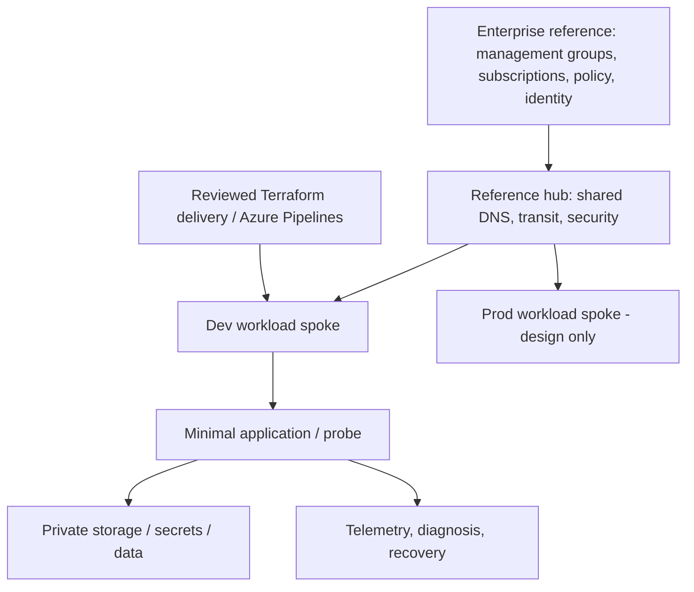

# Azure CloudOps & Enterprise Infrastructure

> **Roadmap V3.0 — 2026-11-26** · Revised from V2 (2026-11-05)  
> **Current status:** `PLANNED` — documentation only; no implementation or live Azure validation recorded.  
> **Repository:** [miku-wwl/azure-cloudops](https://github.com/miku-wwl/azure-cloudops)  
> **Target roles:** Azure Cloud Engineer · Senior Cloud / Infrastructure Engineer · Platform Engineer · SRE / DevOps Engineer

## 1. Mission

Build an evidence-driven, enterprise-oriented Azure operations training repository, using a fictional banking infrastructure as a consistent technical scenario. The objective is to convert existing Azure architecture, administration, Terraform and Kubernetes knowledge into repeatable engineering competence: design, deploy, diagnose, secure, recover and explain infrastructure under realistic constraints.

This is **a specialist practice repository and technical handbook**, not a banking application, a cloud management product, or a claim of production banking experience. It complements KPCP (platform control plane), AWS CloudOps (AWS-specific operations), DevOps Delivery & Observability (general delivery and reliability), and application engineering projects. Implement only enough workload code to exercise infrastructure behavior.

The target is a coherent technical portfolio with reproducible labs, meaningful tests, incident investigations and a mechanism-oriented handbook, not a collection of disconnected tutorials or screenshots.

## 2. Reference scenario

A fictional bank needs isolated workload environments, private application-to-service connectivity, least-privilege access, controlled infrastructure changes, telemetry and recoverability. The enterprise reference design and the executable lab are intentionally different in scale.



The diagram is a **proposed logical architecture**, not a deployed topology. The first executable slice is one small lab environment. Two real subscriptions, a production workload, managed firewall, ExpressRoute, Virtual WAN, Application Gateway or AKS clusters are not prerequisites for the local release.

## 3. Engineering tracks

| Track | Core competency | Target deliverable |
|---|---|---|
| Architecture & governance | Azure Landing Zones, trust boundaries, subscription and network design, policy, cost ownership | Reference topology, responsibility matrix, ADRs, lab-to-enterprise mapping |
| Network & private access | VNet, NSG, UDR, peering, Private Link, DNS, Network Watcher | Baseline and repeatable DNS/connectivity incidents |
| Identity & security | Entra ID, RBAC control/data plane, managed identities, Key Vault, Policy, security posture | Positive/negative access tests; least-privilege design |
| Infrastructure & workload | Terraform AzureRM/AzAPI, compute, Storage, ACR/AKS, App Service, Azure SQL | Minimal shared lab; explicit service-specific validation boundaries |
| Delivery engineering | GitHub Actions, Azure Pipelines, workload identity federation, state, reviewed changes, drift and rollback | Offline CI and gated live delivery design; live pipeline only if authorized |
| Observability & operations | Azure Monitor, Activity Log, Log Analytics/KQL, Application Insights, Resource Graph, PowerShell | Query pack, alerts, read-only inventory, diagnostic procedures |
| Reliability & recovery | Incident response, rollback, backup/restore, integrity, RPO/RTO | Twelve incident specifications; eight mandatory executable local drills; bounded live subset |
| Knowledge transfer | Mechanism diagrams, practical code walkthroughs, evidence interpretation | Modular engineering handbook and role-based interview map |

## 4. Execution model: never confuse evidence levels

| Mode | What is actually exercised | What must not be claimed |
|---|---|---|
| `DESIGN` | Architecture, ADRs, configurations, threat and cost models | Deployment, runtime behavior or tested recovery |
| `STATIC` | Formatting, validation, lint, policy fixtures, configuration tests | Azure API acceptance or cloud enforcement |
| `LOCAL` | Containers, DNS, routing analogues, Azurite, local Kubernetes, synthetic telemetry, executable test fixtures | Real Entra ID, ARM, Azure Policy, NSG, Private Link, AKS or Azure Monitor semantics unless actually tested in Azure |
| `DEMO` | Explicitly identified external sample datasets, e.g. Log Analytics Demo | Telemetry from this repository's own infrastructure |
| `LIVE` | Authorized Azure/Azure DevOps resources and observed results | Production experience, enterprise-scale capacity or untested services |

Default execution is **zero incremental paid cloud spend**. Local workloads should be runnable on one developer workstation. WSL2/Linux and Podman-compatible tooling are the preferred baseline; tool compatibility must be verified before making it a dependency. Any cloud provisioning, billable resource, Azure DevOps paid capacity, tenant-level change or credential setup needs explicit owner authorization and a scoped cost/cleanup plan. Budget alerts are not hard spending caps.

Azurite is a limited Azure Storage emulator, not an Azure control-plane emulator. DNS proxies, network namespaces, local policy checks and Kubernetes can teach mechanisms; they do not establish Azure-specific service behavior. Record a fidelity/limitations table per lab. No dependency on an unverified general-purpose Azure emulator is assumed.

## 5. Roadmap and release gates

The complete execution contract is [AZURE_SPECIALTY_ROADMAP.md](AZURE_SPECIALTY_ROADMAP.md). Stage gates are sequential; optional live work must not block local training.

| Stage | Objective | Status |
|---|---|---|
| P0 | Architecture, scope, prerequisites, lab/evidence contracts | PLANNED |
| P1 | Local substrate, probes, Terraform baseline and CI | PLANNED |
| P2 | Networking and private connectivity | PLANNED |
| P3 | Identity, security and governance | PLANNED |
| P4 | Compute, data and container workload operations | PLANNED |
| P5 | Controlled delivery, Terraform state and Azure DevOps | PLANNED |
| P6 | Observability, KQL and operational automation | PLANNED |
| P7 | Incident response, recovery and independent replay | PLANNED |
| P8 | Handbook, integrated acceptance, local release | PLANNED |
| L1–L3 | Optional authorized live Azure validation, pipeline/recovery | NOT_RUN |

- **`LOCAL_RELEASE_READY`**: all mandatory P0–P8 gates pass with documented evidence; live-only checks remain `NOT_RUN` or `BLOCKED`.
- **`LIVE_VALIDATED_SUBSET`**: individually named Azure/Azure DevOps scenarios passed in an authorized live environment; other scenarios retain their actual status.
- **`PORTFOLIO_READY_LIVE`**: local release plus every mandatory live acceptance gate in the roadmap, including actual deployment, network and identity incident recovery, alert verification, approved delivery and data restoration. This is a lab qualification, not production readiness.

An unexecuted test, a skipped assertion, a plan file, an architecture diagram, a mock, and a successful cloud deployment are distinct evidence. Do not promote a release status by editing documentation alone.

## 6. Intended repository layout

Only `README.md`, `AZURE_SPECIALTY_ROADMAP.md` and `LICENSE` exist at this roadmap revision. The following is a proposed implementation layout, not current contents. Create directories only when the corresponding stage implements meaningful artifacts.

```text
azure-cloudops/
├── architecture/             # Reference architecture, ADRs, trust boundaries
├── infrastructure/           # Terraform modules, environment roots, state bootstrap
├── labs/                     # Reusable local substrate, probes, cloud lab definitions
├── incidents/                # Fault contracts, diagnosis and RCA
├── pipelines/azure-devops/    # Azure Pipelines examples and setup requirements
├── scripts/                  # Scoped lifecycle, read-only inventory and safety checks
├── tests/                    # Unit, contract, integration and scenario tests
├── evidence/                 # Redacted summaries, manifests and replay instructions
├── manual/                   # Handbook sources and release PDFs
├── .github/workflows/        # Offline validation; gated cloud workflows if authorized
├── README.md
├── AZURE_SPECIALTY_ROADMAP.md
└── LICENSE
```

## 7. Non-negotiable engineering rules

- One coherent scenario and reusable environment; no second platform control plane, no full banking product, no unnecessary services, and no always-on expensive infrastructure.
- Use version-pinned dependencies, bounded runtime, explicit target scope, deterministic fixture data and reproducible commands. Prefer tested scripts over manual steps where appropriate.
- Never perform fault injection against employer, customer, shared, production or unknown resources. Cloud mutations must fail closed when authorization, scope or budget prerequisites are missing.
- Keep credentials, access tokens, raw state, binary plans, sensitive logs and actual tenant/subscription identifiers out of Git and public artifacts. Use short-lived federation when available. Restrict approval and deployment permissions; PRs must not receive live write credentials.
- Separate expected failures from harness failures. Negative tests must fail for the intended reason, not because of broken setup, timeout or missing dependency.
- Preserve baseline, fault, diagnosis, recovery, cleanup and evidence provenance. Report `NOT_RUN`, `BLOCKED`, `FAIL` or `PARTIAL` honestly.
- Treat every paid experiment as disposable: preflight estimate, approved time window, teardown, residual inventory, and cost recheck. Never delete shared resources or pre-existing state by wildcard.
- The handbook must explain mechanisms and trade-offs, not repackage logs or third-party tutorials. Label all diagrams, screenshots and output by their actual origin.

## 8. Getting started

At the current planning-only revision there are no executable commands beyond inspecting the documents. Start with P0. Later stages introduce tested setup, check, incident replay and teardown entrypoints. Do not interpret example commands in the roadmap as implemented commands.

For Microsoft and HashiCorp reference links, implementation priorities and exact gates, see the [V3 roadmap](AZURE_SPECIALTY_ROADMAP.md).

## License

[Apache License 2.0](LICENSE). This documentation revision preserves the original repository license unchanged.
