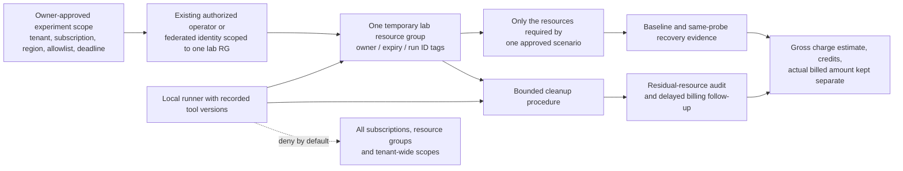

# Conditional minimal live-lab architecture

- Status: DESIGNED / NOT_RUN, 2026-11-27 (Pacific/Auckland).
- Stage: Stage 3 only. This architecture authorizes no login, query, deployment, role assignment or cleanup operation.
- Cost boundary: one USD 1.00 cumulative project ceiling; USD 0.70 planning line; USD 0.30 reserve. No experiment proceeds when its total gross cost cannot be estimated reliably.

## Scope and trust boundary

## Conditional design rules

- First prefer a documented read-only observation of an owner-authorized, already existing target. Read-only does not mean zero-cost: queries, DNS requests, logs and data transfer still need a current cost review.
- If a live mutation is necessary, use exactly one named temporary resource group in one verified subscription/region, with a per-experiment resource allowlist, maximum runtime, operator identity, expiry, cleanup owner and rollback. Never use a guessed `default` subscription or a broad tenant scope.
- Do not create a shared enterprise hub, Firewall, Bastion, VPN/ExpressRoute gateway, Virtual WAN, Private Resolver, Sentinel workspace, AKS cluster, VM, NAT Gateway, or long-lived Log Analytics workspace for the minimum lab. These add cost, dependencies or persistent cleanup obligations.
- A candidate substantive low-footprint mechanism is a resource-group-scoped Azure Policy deny probe: create a temporary, narrowly scoped policy assignment, submit one request that should be denied before the target resource exists, observe the `RequestDisallowedByPolicy` evidence, then remove the assignment and temporary group. This candidate is not presumed free; before execution, verify the current policy feature and exact API/role behavior, account for any deployment/control-plane charges, and obtain explicit authorization. If that cannot be shown reliably below the cumulative planning line, defer it.
- Private DNS, Private Link, routing, RBAC, data restore and deployment rollback require scenario-specific resources/permissions. Their resource graphs and unit prices must be separately evaluated; none is authorized by this generic architecture.
- Reuse an existing approved identity if one is available. Do not create application registrations, service connections, role assignments, managed identities or secrets merely to make a lab run. Use workload identity federation where the operator has separately approved its setup; verify issuer, subject and audience exactly.
- Send evidence to local redacted files by default. If Azure Monitor or a billing query is required, record its scope, retention, cost and data sensitivity before the request.

## Stage 3 gates before a resource operation

1. Complete L0 with the owner-authorized tenant, subscription, billing scope and exact caller permissions. A CLI login or cached context is not sufficient proof of the intended target.
2. Recheck current official region/SKU pricing and service availability for every resource, including minimum billing periods, dependencies, data processing, retention, teardown and delayed charges.
3. Record the maximum runtime and a bounded cleanup watchdog that is not solely dependent on the experiment process.
4. Verify total estimated gross cost stays at or below USD 0.70 cumulatively, retaining USD 0.30 contingency. If any required cost is unknown, do not deploy.
5. Review the exact resource/scope allowlist and least-privilege identity; obtain separate authorization for that specific mutation batch. The master project authorization does not imply authorization for every resource type, scope or cost.
6. Run the preflight with mutations disabled, capture the resolved target scope, and verify no unrelated resources can be targeted.
7. Execute baseline → fault → diagnosis → minimum repair → same-probe recovery → negative control → teardown → residual audit. Stop at the deadline or budget threshold.
8. Preserve redacted command output and update `COST_LEDGER.md` with estimated gross, credits/discounts, actual billed evidence, cleanup result and billing delay status.

## Stop conditions

Mark the scenario `PERMISSION_DEFERRED` if the exact scope or required narrowly scoped role is unavailable; `BUDGET_DEFERRED` if reliable cost exceeds USD 0.70 or cannot be established; `LIVE_NOT_RUN` if no request occurred; `BILLING_PENDING` where charges may not yet be visible. Never report actual Azure spend as USD 0.00 before billing evidence supports it.
