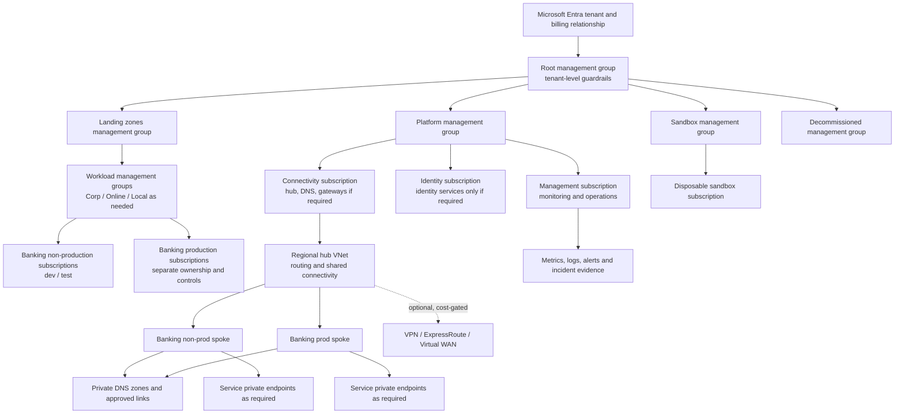

# Enterprise Azure reference architecture

- Status: DESIGNED, 2026-11-27 (Pacific/Auckland).
- Purpose: reference boundary for the fictional banking workload used in the textbook.
- Not a deployment record, a landing-zone accelerator, or a production-readiness claim.

## Logical view

This is a pattern, not a mandate to create every management group or platform subscription. The platform landing zone provides shared governance and capabilities; workload landing zones hold workload resources and their environments. The number and shape of subscriptions depend on ownership, isolation, quota and policy needs. A dev/prod separation should be expressed through enforceable subscription, identity, network and state boundaries, not naming alone.

## Boundaries and responsibility

| Boundary | Main responsibility | Owner |
|---|---|---|
| Entra tenant | Human/workload identities, authentication and tenant-wide controls | Identity/security platform |
| Management group | Inherited governance and policy organization | Cloud platform governance |
| Subscription | Quota, billing scope, resource ownership and workload isolation | Platform / workload owner |
| Resource group | Lifecycle and operational grouping within a subscription | Workload team |
| VNet / subnet | IP and network segmentation; routing and filtering attachment points | Network platform and workload owner by contract |
| Data plane | Service-specific access to data, keys or state | Data/service owner |
| Terraform state key | Single independently locked desired-state boundary | Infrastructure delivery owner |

No one boundary replaces another. Azure RBAC grants actions at scopes; Azure Policy evaluates resource configuration and can deny or audit; neither makes a private route, DNS answer or service data permission appear automatically.

## Network and private-service pattern

- Use a customer-managed hub and spoke as the reference starting point for a small number of regions and controlled routing. Peerings do not become transitive merely because a hub exists; explicit routing and inspection paths must be designed and verified in both directions.
- Evaluate Azure Virtual WAN when branch, multi-region, global-transit or operational-scale requirements justify its managed routing model. Its hub hours, gateway/connection units and data processing are cost inputs; the design does not select it by default.
- Put only shared network functions in a connectivity boundary. Avoid an assumed “everything through one hub” rule until the traffic matrix, failure domains and inspection owners are explicit.
- For Private Link, map the private endpoint, DNS zone group, VNet links, resolver/forwarding path, service firewall and data-plane authorization as separate contracts. A public CNAME result or private IP resolution does not prove data access.
- Use VPN, ExpressRoute, Azure Firewall, Bastion, Private Resolver, DDoS Protection and NVA capacity only when the workload requirement and current cost estimate justify them. These are not part of the local lab or conditional-live default.

## Identity and governance

- Use Entra groups for human access and separate workload identities for each workload/environment. Use just-in-time elevation (for example, PIM where licensed and configured) for privileged human changes.
- Keep control-plane and data-plane role requirements separate. Terraform AzureRM backend access is a Storage data-plane permission; it is not implied merely by having broad ARM rights.
- Assign broad guardrails high in the management-group tree; assign workload operations at subscription or resource-group scope. Start policy changes in audit mode, review impact, then use deny/modify/remediation only through a separately reviewed change.
- Give each pipeline identity a narrowly scoped role on one environment. Federation removes a long-lived client secret, but does not make a broad role safe or replace service-connection ownership and pipeline-approval controls.
- Treat Policy remediation identities as separate actors with only the permissions needed for the specific remediation.

## Operations, resilience and FinOps

- Route platform and workload telemetry to owned workspaces or approved destinations. State the log/metric retention, diagnostic-setting owner, access controls and chargeback scope before enabling ingestion. Alerts notify; they do not stop all resource charges.
- Define SLI/SLO and recovery evidence at the service boundary. Backups, replicated data, paired regions and warm capacity have cost and must be justified by RPO/RTO. A successful restore command is insufficient without checksum, dependency, application and business-probe verification.
- Keep dev/test and production blast radii separate. Use independent state keys, identities, approvals and cleanup allowlists. Production recovery should not depend on an ephemeral lab subscription.
- Tag ownership, environment, data classification, expiry, and cost center where supported; reconcile tag-based attribution with billing records. Maintain an explicit unallocated queue for shared or unmapped costs.
- Budget alerts are signals, not hard caps. Reconcile estimated gross charges, credits, discounts and actual billed amounts separately.

## Official sources

- [What is an Azure landing zone?](https://learn.microsoft.com/en-us/azure/cloud-adoption-framework/ready/landing-zone/)
- [Landing-zone identity and access management](https://learn.microsoft.com/en-us/azure/cloud-adoption-framework/ready/landing-zone/design-area/identity-access-landing-zones)
- [Hub-and-spoke network topology](https://learn.microsoft.com/en-us/azure/networking/design-guide/hub-spoke)
- [Azure Virtual WAN topology and cost model](https://learn.microsoft.com/en-us/azure/networking/design-guide/virtual-wan)
- [Private Endpoint DNS configuration](https://learn.microsoft.com/en-us/azure/private-link/private-endpoint-dns)
- [Azure RBAC overview](https://learn.microsoft.com/en-us/azure/role-based-access-control/overview)
- [Azure Policy overview](https://learn.microsoft.com/en-us/azure/governance/policy/overview)
