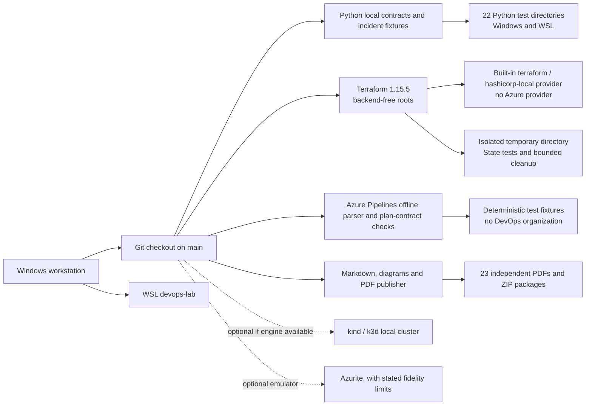

# Local learning architecture

- Status: DESIGNED and partly LOCAL_VERIFIED, 2026-11-27 (Pacific/Auckland).
- Purpose: run the repository's educational contracts without Azure credentials or cloud resources.
- Lab data is synthetic unless a source is explicitly identified. Nothing here emulates the full Azure control plane.

## Execution view



## Confirmed local runtime boundary

- Windows Terraform 1.15.5 is available. The E0 pass ran recursive `fmt -check`, backend-free `init` and `validate` on the AZ07-01 and AZ07-02 Terraform roots, and all five Terraform mock contract tests.
- Windows Python 3.13.9 and the `devops-lab` WSL Python runtime each ran 407 tests in 22 directories successfully. The runner invokes chapter-local tests; E2 must extend aggregate CI coverage to shared tools and any new cross-chapter contract suites.
- The AZ07-02 State verifier now copies the lab into a fresh OS temporary directory, bounds subprocess time, suppresses raw State output and cleans only the owned directory. The test uses a real local lock/provider flow, not Azure Blob leases.
- Docker CLI availability did not imply a working Linux Engine in the previous host check. `kind`/`k3d` results are therefore not claimed; recheck the engine at E2 before planning Kubernetes execution. WSL does not have the Terraform CLI in the recorded baseline.
- `az` being installed does not prove authentication or access. Stage 2 scripts and tests must not run Azure sign-in or API operations.

## Required lab contracts

1. Every fixture names its source class: synthetic, local-provider, official demo, read-only Azure, or live Azure.
2. Every failure-injection experiment has setup, baseline, injected fault, expected category, diagnosis evidence, minimum recovery, same-probe verification, reset and teardown.
3. Each Terraform root has backend-free static/mock acceptance where possible. No test performs a cloud apply. AzureRM/AzAPI plans are not local evidence.
4. Local State and evidence outputs are isolated per run; secrets and raw State never enter the source package.
5. The offline Azure Pipelines test verifies parsed structure and the specific exact-plan/scope contract. It cannot establish Azure DevOps server compilation or execution.
6. Publication checks ensure all 23 PDFs and source files are in sync; all final PDFs must still be visually inspected after the Stage 2/3 changes.

## Reproducible entry points

From the repository root, the current executable WSL Python check and Terraform checks are:

```powershell
wsl -d devops-lab -- bash /mnt/d/workshop/nov/azure-cloudops/textbook/tools/test_all.sh --python
terraform fmt -check -recursive -diff textbook/chapters
terraform -chdir=textbook/chapters/AZ07-01/labs/terraform-core init -backend=false -input=false
terraform -chdir=textbook/chapters/AZ07-01/labs/terraform-core validate -no-color
terraform -chdir=textbook/chapters/AZ07-01/labs/terraform-core test -no-color
```

Windows also ran the same 22 test directories with a PowerShell harness during E0. The current `test_all.sh` does not aggregate shared scripts/tests outside chapter labs; E2 will add and verify a cross-platform aggregate runner before CI claims complete coverage.

## Limits

Local tests do not establish Azure route selection, RBAC, Policy, provider schema behavior against the live service, Azure DevOps execution, AKS scheduling, private DNS integration, service billing, or production reliability. An Azurite or local Kubernetes pass, if later obtained, proves only that local emulator/cluster's documented subset.
