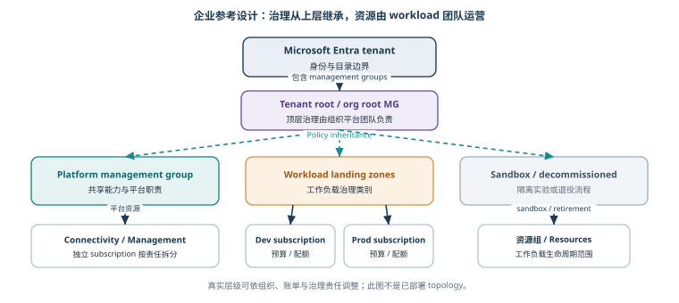
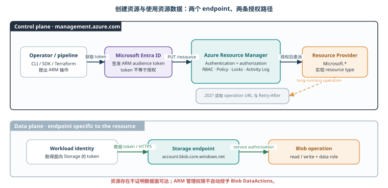
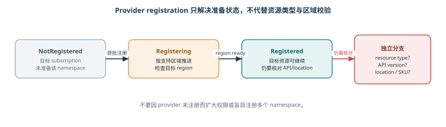

::::: cover
[AZURE CLOUDOPS · ENTERPRISE ENGINEERING]{.kicker}

# 一个订阅，怎样成为企业治理环境？

[Azure Landing Zone、ARM 与控制平面]{.subtitle}

::: cover-meta
- **讲次**：01 / 23
- **核心机制**：治理层级、ARM 请求、Provider 委派
- **证据边界**：官方文档分析 + 本地 allow-only 范围模型
- **适用场景**：虚构银行的账单查询服务
:::

::: scenario
银行平台团队准备让交易查询服务进入 Azure。应用团队要求独立部署开发与生产环境；安全团队要求策略和审计由平台统一维护；运营团队则要知道一次资源创建失败究竟来自身份、策略、Provider 注册还是服务本身。
:::

### 本讲目标

读完后，你应该能解释 Landing Zone 是一组有治理边界的设计，而不是一个 Azure 产品；沿着 management group、subscription、resource group 和 resource 追踪适用的授权范围；拆开 ARM 控制面与 Storage 数据面；并根据错误证据区分权限、策略、Provider 注册、API 版本和区域支持问题。

**本讲问题：** 当 Terraform 发出一次 create/update 请求时，哪一层决定“谁可以改什么”，哪一层真正实现某个 Azure resource type？

:::::

## 先把企业边界画出来

“Landing Zone”不是一个资源类型，也不是一个可以单独部署后就自动满足治理要求的 Azure 开关。Microsoft Cloud Adoption Framework 把它作为一种面向多订阅环境的架构：平台 Landing Zone 提供共享治理与平台能力；workload Landing Zone 放置工作负载团队拥有和运营的环境。策略可从 management group 层级向订阅和资源继承。组织可以用 accelerator 实现这一架构，也可以依据自己的要求采用其他实现方式。

在虚构银行中，我们把平台责任和应用责任分开。平台层可能拥有 connectivity、management、security 等订阅；一个工作负载的开发和生产环境可以各自落在不同订阅，以形成账单、配额、权限和变更边界。若个人练习只有一个订阅，就把同一组职责映射为管理组下的实验资源组，清楚标明它只是最小 lab，而不是完整企业 Landing Zone。

图 1-1 把“谁归谁管理”与“策略从哪里向下继承”画在同一条层级上。平台和工作负载不靠资源命名区分；管理组、订阅、资源组的 scope 以及明确的组和角色分配才组成可操作的边界。图中的层级是参考设计，不是本仓库真实部署。

Subscription 同时承担管理、计费和规模边界。它可以承载配额和治理差异，也能把平台团队与工作负载所有者隔开。Resource group 主要是资源组织和管理范围；Microsoft 建议同一资源组内资源拥有相近生命周期，但这条建议不会自动证明组内资源在技术上可以同时安全删除。要避免一个账单数据库和一个短命探针共用容易被批量删除的生命周期，得在设计和操作流程里表达清楚。

Azure Landing Zone 的经典层级通常还包括 tenant root group、一个组织管理的 intermediate root、platform 和 landing zones 等节点。Microsoft 的参考结构把 management、connectivity、identity 等平台子组与 workload 管理组分开；并不要求每家公司照抄同一棵树。按区域创建大量 management groups 通常也不是好起点：区域位置属于资源和部署决策，管理组更适合表达稳定的治理差异。

::: why
**架构判断：** 如果变化的是“哪些工作负载可以部署哪些类型资源”，management group policy 可能是合适的共同护栏；如果变化的是“谁可以操作某个订阅里的数据”，则应把角色分配收敛到更窄的 subscription、resource group 或资源 scope，并明确这是 control-plane 还是 data-plane 权限。
:::

## 一次 ARM 请求经过了哪些边界？

Azure Portal、Azure CLI、PowerShell、SDK、Terraform 和直接 REST 调用，最终可以使用同一组 Azure management API。管理请求进入 Azure Resource Manager（ARM）的控制平面端点。调用方先取得面向 ARM 的 Microsoft Entra access token；ARM 对请求做身份验证与授权，再把符合条件的请求转给目标 Resource Provider。Provider 为其资源类型实现具体操作。一个调用的成功不只取决于 token：scope、操作、策略、资源锁、Provider 状态、API 版本、区域和 Provider 后端都会影响结果。

图 1-2 没有把 RBAC、Policy、Locks 和 Activity Log 排成一个并未由资料证明的内部执行顺序。它们是 ARM 提供的控制平面治理能力；真实请求还取决于 Provider 和具体资源类型。不要把这一张概念图误读成每个 Provider 内部实现的完整时序。

REST 调用可能是同步的，也可能返回 202 Accepted 并带有异步操作跟踪信息。遇到 202，自动化程序要依据响应中的 Azure-AsyncOperation 或 Location 等头、Retry-After 提示和相应的状态 API 轮询；“请求已经受理”不等于“资源已达到可用状态”。Terraform 或流水线只能把最终资源状态和应用级健康检查都纳入验收，不能只看 create 命令返回成功。

控制面和数据面也不是一条权限链。创建 Storage Account 是 ARM 控制面操作；读写 Blob 则访问存储账户的数据端点。ARM 的资源锁、管理角色和管理策略默认不会变成 Blob 的数据权限。反过来，数据端点一时不可用也不必然表示 ARM endpoint 故障。事故排查必须先确认自己正在访问哪一个端点、调用了哪一类操作。

## Resource Provider 注册为何会报错？

Resource Provider 是一组面向 Azure resource types 的 REST operations。例如 Microsoft.Storage 定义 Storage 相关的管理资源操作。Provider namespace 下的 resource type、可用 API version 与 location 都可能变化，资源支持范围也可能受到订阅类型或服务 SKU 限制。因此，看到 NoRegisteredProviderFound 时，单凭错误名称就立即执行注册，可能会掩盖区域或 API version 不匹配。

注册状态是 subscription 级的准备条件。首次使用 Portal、ARM template 或 Bicep 时，Azure 在许多情形下会自动注册相关 Provider；有些辅助 Provider 仍需单独准备。官方建议只注册即将使用的 Provider，因为注册会在 Microsoft Entra tenant 中添加与 Provider 相关的应用。某些调用者因缺少 Microsoft.Resources/register/action 而不能注册；不要把 Contributor 或 Owner 当成解决每种 Provider 错误的默认修复。

注册过程中可能观察到 Registering。Provider 注册按受支持的区域推进；应用不应不加区分地等到所有区域完成才继续。需要关注的是目标 resource type 在目标 region 可用，且当前 API version 合法。注册不能让一个不可用 SKU 或不支持的区域突然变得可用，也不能修复错误的 resource ID。

### 只读检查示例

下面的命令会查询订阅里的 Provider 元数据。它是命令参考，不是本次执行记录；运行前需要一个已授权的登录会话和相应读权限。本任务没有调用 Azure CLI、切换默认订阅或注册 Provider。

~~~powershell
# 先用只读方式检查当前上下文；不要静默切换订阅
az account show --query "{tenant:tenantId, subscription:id, name:name}" --output json

# 查询目标 Provider 的注册状态、资源类型和支持位置
az provider show --namespace Microsoft.Storage --query "{state:registrationState, types:resourceTypes[].resourceType}" --output json
~~~

第一条命令会输出敏感的 tenant 与 subscription 标识。不要把原始响应写入 Git、截图或公开日志。若只看注册状态，仍须进一步针对实际 resource type 检查 API version 与 locations。生产工具宜要求调用者明确目标 subscription，避免读取隐式默认上下文后让操作落到另一个订阅。

## Worked example：一个资源部署失败，先沿证据分叉

假设 pipeline 想创建一个 Private DNS Zone，收到错误 MissingSubscriptionRegistration。团队不应先提高权限或在 tenant 范围注册多个 Provider，而应先确认请求的 ARM subscription scope 与实际目标，然后用只读 API检查：

1. 目标订阅是否确实是获批的实验订阅，而不是本机默认订阅。
2. 错误指出的 Provider namespace 是什么，目标资源类型是否属于该 Provider。
3. 当前注册状态是否为 NotRegistered、Registering 或 Registered。
4. resource type 在目标区域是否可用，Terraform/API 版本是否受支持。
5. 若需要注册，授权是否覆盖这一项订阅级变更，并由责任人批准。
6. 重新部署后，是否还出现 Policy、RBAC、quota 或服务级参数错误。

这一流程把“注册”和“排障”分开。ARM 文档指出只有在订阅启用某 Provider 后，才可使用相应 Provider；错误文档也指出 NoRegisteredProviderFound 可能对应未注册、API version 或 location 问题。修复动作应针对错误分支而非宽泛地增加权限。

如果错误是 AuthorizationFailed，则检查实际调用 identity、操作字符串和目标 scope 的有效角色，而非注册 Provider。如果错误来自 Policy deny，要查看 assignment 的 scope、参数和 exemption；重新注册 Provider 通常无关。若 ARM 创建返回成功但应用读取 Blob 失败，则诊断 token audience、data-plane role、网络 ACL、DNS 和数据 endpoint，不要因为 Storage Account 资源本身存在就认定 Blob 访问已通。

## 从实际本地代码看 scope 继承

本讲配套实验读取一个虚构层级和 allow-only role assignment fixture。核心代码在 labs/scope-model/scope_model.py：它沿 scope 节点的 parent 链找出适用于目标的角色分配，再按 Actions 或 DataActions 检查操作。测试覆盖 management-group 祖先、同级订阅隔离以及控制面/数据面权限分离。

这段程序不是 Azure RBAC emulator。它省略了 deny assignments、NotActions、DataNotActions、ABAC 条件、组成员解析、PIM 激活、角色定义可分配 scope、服务专属授权规则和传播延迟。它只让读者在本地看清“同一 principal 的赋权 scope 往下继承，兄弟分支不继承”这一可由官方资料支持的结构性问题。

~~~python
    def inherited_assignments(self, principal: str, target: str) -> tuple[Assignment, ...]:
        chain = self.scope_chain(target)
        rank = {scope_id: index for index, scope_id in enumerate(reversed(chain))}
        matches = [
            assignment
            for assignment in self.assignments
            if assignment.principal == principal and assignment.scope in chain
        ]
        return tuple(sorted(matches, key=lambda item: rank[item.scope]))

    def matching_grants(self, principal, target, operation, plane):
        field = "actions" if plane == "control" else "data_actions"
        requested = operation.casefold()
        return tuple(
            assignment
            for assignment in self.inherited_assignments(principal, target)
            if any(
                fnmatch.fnmatchcase(requested, rule.casefold())
                for rule in getattr(assignment, field)
            )
        )
~~~

上面摘录对应本仓库真实源文件中的关键算法；完整实现和 fixture 可直接运行。allow-only 模型里没有“默认拒绝角色”这个 Azure API 结论：某次模型返回 false，只代表 fixture 中没有符合项。真实 Azure 的授权还要按 Azure RBAC、identity 和资源服务自己的行为核查。

## 实验：画出可继承的权限，不连 Azure

:::: {.lab title="实验 1-1｜范围继承与控制面/数据面分离"}
::: labmeta
- **目标**：预测一个角色分配是否覆盖目标 resource，并区分 Actions 与 DataActions。
- **前提**：Python 3.11+；无需 Azure CLI 登录、订阅或第三方依赖。
- **输入**：scenarios/banking-lz.json，全部为虚构 scope、principal 和操作。
- **架构**：root management group → platform/workload management groups → subscription → resource group → resource。
- **变更**：只执行纯 Python 计算；不访问网络，不创建 Azure 资源。
- **验证状态**：LOCAL_VERIFIED：2026-11-26 在本机 Python 3.13.9 上执行 7/7 单元测试；它不验证 Azure RBAC enforcement。
- **成本与清理**：Azure 增量费用 USD 0；运行后无云端或本地服务需要清理。
:::

从 textbook/chapters/AZ00-01/labs/scope-model 目录执行：

~~~powershell
python -m unittest -v
python scope_model.py
~~~

先预测 dev-operators 能否读取开发 Storage Account 的 Blob、生产 Blob，以及能否修改 Storage Account 控制面配置。

**实际观察（本机 Python 3.13.9，2026-11-26）：**7 项单元测试全部通过。程序输出显示开发资源上的 fixture 的 DevNetworkOperator 与 Storage Blob Data Reader 分别命中 Actions 和 DataActions；生产订阅没有继承开发 RG 角色。root 管理组的 Reader 则沿 fixture 的祖先链到达生产资源。

~~~text
Ran 7 tests in 0.004s
OK
dev-operators -> storage-dev [control] Microsoft.Storage/storageAccounts/read: ALLOW; grants=DevNetworkOperator (illustrative)@rg-dev
dev-operators -> storage-dev [data] Microsoft.Storage/storageAccounts/blobServices/containers/blobs/read: ALLOW; grants=Storage Blob Data Reader@storage-dev
dev-operators -> storage-prod [control] Microsoft.Network/virtualNetworks/write: NO MATCH; grants=none
platform-auditors -> storage-prod [control] Microsoft.Resources/subscriptions/read: ALLOW; grants=Reader@tenant-root
~~~

本地代码的结果只描述输入 fixture。换一套 parent 或 role assignment，模型就会得出另一结果。它不是 az role assignment list 的替代，也没有伪装成订阅的真实观察。Azure subscription 授权、Provider 注册和 resource provider operation 在本讲都没有执行；它们仍是 LIVE_NOT_RUN。

## Fault cards：把相似报错拆成可验证假设

::: {.fault title="故障 1｜NoRegisteredProviderFound"}
- **症状**：部署报 Provider 未注册、API version 不支持或 location 无匹配。
- **假设**：Provider registration state 未准备好；资源类型不存在于该 Provider；版本或区域错误；目标 subscription 选错。
- **区分**：用只读 Provider 元数据检查 namespace、resourceTypes、apiVersions 和 locations；先核对 URI 中 subscription 与 resource ID。
- **最小修复**：只在具体授权范围内注册必要 Provider，或改为受支持的资源类型、API version、location。
- **恢复验证**：重新检查同一 resource type 元数据，再运行目标环境的 plan/部署；本地模型不能替代这一步。
:::

::: {.fault title="故障 2｜ARM 创建成功，但 Blob 读请求仍然被拒绝"}
- **症状**：Storage Account 的控制面资源存在，应用的 Blob 操作返回 403 或连接错误。
- **假设**：数据角色缺失或 scope 不匹配；token audience 错误；私有 DNS/网络路径失败；共享密钥/SAS 的访问策略不同。
- **区分**：分别探测 DNS、TCP/TLS、data endpoint、token 和 Blob 操作；查看资源的 data-plane role assignments。
- **最小修复**：只修复已确认的网络或数据角色问题；不要把 Contributor 升为 Owner。
- **恢复验证**：用相同身份、相同 Blob endpoint、相同请求复测，且保留一个无权操作仍被拒绝的负向断言。
:::

::: {.fault title="故障 3｜返回 202 后流水线过早宣告成功"}
- **症状**：管理 API 已接受请求，但目标资源仍为 Creating/Updating，或之后转入 Failed。
- **假设**：调用者把受理结果误当最终状态；没有尊重 Retry-After；只验证了 ARM resource existence。
- **区分**：检查响应的 Azure-AsyncOperation/Location 和轮询状态；随后检查资源属性及应用级健康探针。
- **最小修复**：遵循资源 Provider 的 long-running operation contract，并设置有界超时和明确错误处理。
- **恢复验证**：确认 operation 与 resource state 成功，并使用工作负载探针验证预期行为。
:::

## Exercises：用 scope 和状态推理

::: {.exercise title="练习 1｜订阅放在哪一层？"}
一个平台团队维护共享 DNS、监控和网络连接；三个业务单元各自有 Dev 与 Prod。要求平台能维护共享能力，业务单元负责 workload，Prod 与 Dev 的预算和配额不得相互隐藏。请给出一个 management-group / subscription 边界草图，并指出哪些差异不应靠增加 management group 表达。
:::

::: {.solution title="练习 1 的详细解答"}
一种合理起点是在 tenant 下设稳定的组织根；根下分 Platform 与 Workload landing zones。Platform 下把共享 connectivity、management、security 等订阅按实际责任拆分。Workload 下按稳定的治理/网络要求组织 management groups；业务 workload 的 Dev 和 Prod 可以使用独立 subscription，从而形成预算、配额、RBAC、策略和删除 blast-radius 的显式边界。区域通常通过资源和部署设计表达，不要为每个 region 自动复制一层管理组。具体数量取决于组织责任、billing agreements 和规模，图不是“唯一标准架构”。
:::

::: {.exercise title="练习 2｜三个授权结论"}
fixture 中某角色在 Dev resource group 获得 Microsoft.Network/virtualNetworks/write；某 Storage data role 在 Dev Storage Account scope 获得 Blob read。判断：A. 前者能否自动操作 Prod VNet；B. 后者能否自动写 Storage Account ARM 属性；C. Dev Blob read 是否可由本地模型外推为真实 Azure 允许。
:::

::: {.solution title="练习 2 的详细解答"}
A 不可以。Dev resource group 是 Prod subscription 的兄弟分支，scope chain 不包含 Dev RG。B 不可以。模型将 Actions 与 DataActions 分离，Blob data read 只命中 data plane。C 也不可以。模型只验证 fixture 结构和代码行为；真实授权要考虑角色定义、deny assignments、条件、identity 成员、PIM、scope 和具体存储 endpoint。
:::

::: {.exercise title="练习 3｜把 202 Accepted 当作何种证据？"}
部署 API 返回 202 Accepted，响应有 Retry-After。应用团队说“环境已上线”。列出你还需要什么证据，才能把验收状态提升为恢复完成。
:::

::: {.solution title="练习 3 的详细解答"}
202 只说明异步请求已受理。先按返回的 Azure-AsyncOperation 或 Location URL、Retry-After 间隔轮询该操作，检查终态与错误；再读取目标资源的实际配置和 provisioning 状态；最后从用户可达的同一数据面路径运行应用健康探针。若操作终态成功但探针失败，应继续区分网络、身份、数据权限和应用健康，不把控制面状态等同于端到端功能。
:::

## 本讲要点

:::: summary
::: {.card tag="边界"}
Landing Zone 是治理、共享平台和工作负载责任的组合架构；最小 lab 可以映射它的少数机制，但不能声称已部署完整企业层级。
:::

::: {.card tag="请求路径"}
ARM 管理请求与资源 endpoint 上的数据请求属于不同平面。token、RBAC、Policy、锁、Provider、异步操作和最终健康检查提供不同证据。
:::

::: {.card tag="诊断"}
Provider 注册、资源类型、API version、region 和订阅 scope 是不同分支。只读元数据先定位，任何变更都必须经过授权和费用门槛。
:::

::: {.card tag="本地证据"}
scope_model.py 是 allow-only 教学模型。它能让继承和兄弟 scope 边界可执行，但不证明 Azure RBAC enforcement。
:::
::::

## 参考资料与研究记录

本讲使用 Microsoft Learn 官方文档独立核查 Azure 行为。访问日期：2026-11-26。文中把官方 contract、架构建议与本地 fixture 结果分开标注。

::: refs
1. [Azure Resource Manager overview](https://learn.microsoft.com/en-us/azure/azure-resource-manager/management/overview) · [Control plane and data plane](https://learn.microsoft.com/en-us/azure/azure-resource-manager/management/control-plane-and-data-plane)
2. [ARM asynchronous operations](https://learn.microsoft.com/en-us/azure/azure-resource-manager/management/async-operations)
3. [Resource providers and types](https://learn.microsoft.com/en-us/azure/azure-resource-manager/management/resource-providers-and-types) · [Provider registration errors](https://learn.microsoft.com/en-us/azure/azure-resource-manager/troubleshooting/error-register-resource-provider)
4. [Azure landing zones](https://learn.microsoft.com/en-us/azure/cloud-adoption-framework/ready/landing-zone/) · [Management groups](https://learn.microsoft.com/en-us/azure/cloud-adoption-framework/ready/landing-zone/design-area/resource-org-management-groups) · [Subscription design](https://learn.microsoft.com/en-us/azure/cloud-adoption-framework/ready/landing-zone/design-area/resource-org-subscriptions)
5. [Azure RBAC scope](https://learn.microsoft.com/en-us/azure/role-based-access-control/scope-overview) · [Azure Policy scope](https://learn.microsoft.com/en-us/azure/governance/policy/concepts/scope)
:::
图示为本仓库编写的概念解释图，不是 Azure Portal 截图。实验运行结果会在 B1 接受前依据真实本地命令补记；Azure subscription 查询与 resource provider registration 均未运行。
