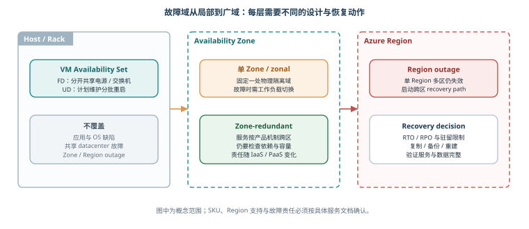
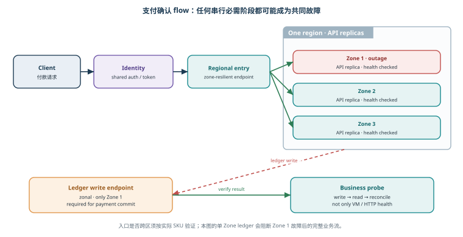

::::: cover
[AZURE CLOUDOPS · ENTERPRISE ENGINEERING]{.kicker}

# 多区部署，为什么仍会全站不可用？

[Azure Well-Architected Framework 与可靠性]{.subtitle}

::: cover-meta
- **讲次**：02 / 23
- **核心机制**：Availability Set / Zone / Region、关键依赖、SLI/SLO
- **证据边界**：Microsoft 文档分析 + 本地确定性故障模型
- **适用场景**：虚构银行的结算查询与支付确认流程
:::

::: scenario
平台团队把 API 副本放进三个 Availability Zone，演练时切断 Zone 1，API 仍然有实例；可是业务探针报告支付确认失败。数据库仍只在 Zone 1，登录令牌依赖的身份服务也不可达。拓扑图里有三个区，用户关键路径上却仍有串行单点。
:::

### 本讲目标

读完后，你应该能区分 Availability Set、zonal resource、zone-redundant resource 和多区域设计各自能隔离的故障；从一条用户关键路径找出串行依赖；把业务需求写成可观测的 SLI、SLO、error budget、RTO 与 RPO；并设计一次不把“ARM 操作成功”误当作“业务恢复”的验证。

**本讲问题：** 如果工作负载有三个 zone，什么共享依赖、数据路径或恢复步骤仍能让整条业务流失败？

:::::

## 可靠性从用户关键路径开始

Azure Well-Architected Framework 的 Reliability 支柱要求工作负载按业务目标应对故障、限制影响并恢复。它不等于“多放几个 VM”或“把资源名字标上 Zone”。先列出用户与系统的 critical flows，再标注每个 flow 必须经过的依赖。登录、读取账户、提交付款和写入账本是不同的业务流，可能有不同的关键级别和目标。

Microsoft 的 Reliability checklist 把这套工作分成连续决策：保持设计简洁；识别并评级关键流；做 failure mode analysis；定义可靠性与恢复目标；按目标增加冗余、扩展和自愈能力；再测试恢复并持续观测系统健康。架构图只表示设计意图，不能证明真实请求走过每一条边。

图 2-1 中的范围表示可设计的隔离边界，不表示一个等级自动包含下一个等级。Availability Set 的 fault domain 与 update domain 针对 VM 的部分硬件故障和计划维护；availability zone 覆盖的是区域内更大的物理隔离域；region outage 则需要跨区域恢复设计。操作系统、应用缺陷、错误配置、共享身份服务和数据逻辑都可能跨越这些边界。

## Availability Set、Zone 与 Region 分别做什么

**Availability Set** 是一组 VM 的逻辑分组。Azure 平台为其中的 VM 分配 fault domain（FD）和 update domain（UD）。FD 把共享电源和网络交换设备的 VM 分开；UD 把计划维护时会同时重启的 VM 分组。文档说明一个 set 最多配置 3 个 FD 和 20 个 UD；两个或更多 VM 配置在 set 中才有相关的 VM SLA 条件。它不保护应用或操作系统自身故障，也可能受到影响多个 FD 的数据中心级网络故障。它是 VM 可用性选项，不是跨 zone 方案。新建 VM 方案应根据当前产品建议比较 VM Scale Sets Flexible orchestration、zones 和实际服务限制。

**Availability Zone** 是同一 region 内由独立电力、冷却与网络支撑的物理隔离组；一个 zone 可由一个或多个 datacenter 构成。一个 *zonal* 资源固定在选定 zone，便于隔离其他区的故障，却不会自动在自己的 zone 出事时切换。若要让 zonal VM 容忍单区故障，应用团队必须安排跨区实例、流量分配、数据复制、健康探测和 failover。对于 *zone-redundant* 资源，服务提供方通常负责跨区分布和平台 failover；具体产品、SKU、region 和配置行为要查服务自己的 reliability guide。资源即使位于支持 zones 的 region，也不代表选用的 SKU 已启用 zone redundancy。

**Region** 是更大的地理边界。多个 zone 保护不了 region-wide outage、跨区共用的身份服务、错误发布或依赖项的共同故障。多区域 active-active、active-passive、异步备份后重建等策略，在费用、数据驻留、复制延迟、容量、运维复杂度和 RTO/RPO 上不同。即使主要业务受数据驻留约束而不能启用第二个 region，也需要明确 region outage 后可接受的恢复目标、备份位置和人工决策。

| 资源部署方式 | 主要隔离边界 | 谁负责哪部分 failover | 不能据此推断 |
|---|---|---|---|
| Availability Set VM | VM fault domain、计划维护 update domain | 平台提供 placement；工作负载仍须有健康探针、负载分配、数据和应用恢复方案 | 不代表跨 Zone、跨 datacenter 或跨 Region |
| Zonal resource | 被选定的一个 Zone | 资源所有者负责跨区冗余、流量转移与数据策略 | 固定 Zone 不等于 zone-resilient |
| Zone-redundant service | 服务支持范围内的多个 Zone | 平台通常处理该服务的跨区分布和 zone failover；工作负载须测端到端关键流 | 不代表应用依赖项、SKU、全部服务都具备相同保证 |
| Multi-region workload | 多个 Region 或跨区备份 | 工作负载所有者负责区域切换、数据一致性和 failback；具体服务也可能提供托管能力 | 不自动达到零 RTO、零 RPO 或满足驻留要求 |

## 把一条业务流画成依赖图

虚构的“支付确认”流经过入口路由、应用副本、身份校验和账本写入。三个应用副本跨 Zone 分布，只让**应用这一层**在 Zone 1 故障时仍可能有容量。若账本是 zonal 单实例，flow 仍失败；若 DNS、密钥获取、消息队列或共享认证路径没有相同的恢复目标，也可能出现同类问题。每条串行依赖都要标明：它在请求时是否必需、健康信号是什么、谁能切换、切换会丢失多少数据。

图 2-2 把身份依赖画在区域外，表示它可能不在该应用的三个 VM zone 内；这不声称它会与 Azure Region 发生何种相关故障。身份服务是否可达要由其自身的服务文档、租户配置和实际观察确认。图中的虚线区域是尚未通过故障演练的依赖假设。

做 failure mode analysis 时，把“失效”拆成可检验的假设，而不是把 `Availability: 99.99%` 写在服务名称旁：

1. 对关键流测成功率和延迟，并规定什么业务结果算成功。
2. 对每个依赖记录单区、区域、身份、配置、容量与变更故障的影响。
3. 标明依赖是串行必需、可替代，还是降级后仍可接受。
4. 写明检测信号、采取动作、目标恢复时间、目标数据点和验证负责人。
5. 在可控的 nonproduction 环境中验证工作负载自己的行为，不尝试复刻或证明 Microsoft 内部 failover。

## SLI、SLO、error budget 与 SLA

**SLI** 是按定义测量的指标，例如“支付确认请求中，2 秒内返回正确且可对账结果的比例”。**SLO** 是组织选定的目标与窗口，例如合成案例规定 30 天滚动窗口内 99.95% 的关键流成功率。目标属于工作负载和业务所有者；它不能从某个 VM 或数据库 SLA 直接抄来。**Error budget** 是该 SLO 窗口内可容忍的坏结果份额，供团队决定变更风险、告警和可靠性投入。**RTO** 描述业务中断后恢复服务的最长目标时长，**RPO** 描述恢复时可接受的数据丢失窗口；两者不是可用率百分比。

**SLA** 是服务提供商按具体服务、条件、测量方式和排除条款定义的承诺，可能涉及服务抵扣。它不是对你的端到端业务体验的保证，也不会自动成为 workload SLO。业务流还依赖应用代码、网络、身份、配置和运维过程；应从用户角度定义 SLI，并逐项查看依赖的 SLA 范围和可观测限制。

若以时间可用率作一个简单预算演算，30 天窗口有 `30 × 24 × 60 = 43,200` 分钟。99.95% SLO 允许 `43,200 × (1 - 0.9995) = 21.6` 分钟不可用，也就是 21 分 36 秒。这个换算只适用于把坏状态按时间计量的 SLI；如果 SLI 是成功请求比例，应按请求分母和业务有效请求规则计算预算，不能直接替换成分钟。

在完全独立的故障假设下，串行依赖的可用率可近似相乘：入口 99.99% × 应用 99.95% × 数据库 99.95% × 身份路径 99.99% ≈ **99.88%**。两个各自为 99.9% 且彼此独立的并行副本，其“至少一个可用”的概率是 `1 - (1 - .999)² = 99.9999%`。这些只是数学示例：共同电源、同一发布、共享网络、错误配置或测量分母会破坏独立假设，公式不能代替故障模型，也不能宣称 Azure 服务的实测 SLA。

## 演算示例：API 仍健康，付款路径却停了

虚构的清算服务把关键流目标定为月度 99.95%，支付写入的 RTO 为 30 分钟，恢复时 RPO 不超过 5 分钟。这些数字只用于工程推演，真实服务须由业务、法务和运营共同批准。监控合成探针以“创建后读取并核对一笔测试付款”作为成功判定，而不是只检查 VM heartbeat 或 HTTP 200。

服务有三个跨区 API 副本，Zone 1 中的账本依赖一个 zonal 写入端点。Zone 1 故障时，API 仍能接收请求，却无法完成账本提交。把 API 副本数从 3 增加到 5 不会修复串行数据依赖。最小可行改进是核对数据库 SKU 与 region 是否支持所需的 zone redundancy、检查同步/异步复制和提交语义、验证存活区容量，并定义 ledger failover 后的读取一致性与回滚边界。

随后还要分别演练两种情况：**单 Zone 故障**应该由相应服务的机制和 workload 设计维持关键流；**Region 故障**需要另一个 recovery path，可能是可用的第二 Region，也可能是满足驻留要求的异地备份与恢复。跨区备份只能按真实复制延迟与恢复过程证明 RPO/RTO。部署命令返回成功、Azure resource health 显示恢复、探针重新 HTTP 200，三者各自都不足以证明支付数据完整且业务已经恢复。

## 配置演练：用业务指标验收跨可用区设计

**企业设计练习。** 假设支付 Web 层部署在同区域两个可用区，资料附件在支持的 Storage 帐户。Portal 中在 VM → Availability options 选 Availability zone，实际对照 VM 资源 `zones` 及后端池成员和探针；在 Storage account → Redundancy 查是否满足 ZRS（AZ04-04）；在数据库规格与网络依赖查各自的 zone HA 前提。容量设计要回答单区退出时剩余后端能否承担业务峰值。

**预测与验证。** 两台 VM 位于不同可用区，却都使用同一单区数据库时，模拟数据库故障后 API 的浅层健康可能仍为 200，付款交易失败。对照下方 fixture，把 region/zone 失效和 database 单元失效分开，记录哪条依赖阻断用户路径。实际获批时在 Monitor 对同一交易 SLI 看成功数/有效请求数，结合已批准的恢复探针。最小修复是恢复共享关键依赖的冗余或可用路径，修复后重验同一交易。两个 Web 实例同时增加会放大成本，却不改变这条失效链。

本地实验无云权限或计费。未来只读需资源与监控读取权限，主动失效测试或多区部署另行授权。估计各区实例及区间流量、冗余存储和数据库成本；仅从隔离副本撤销演练覆盖。

## 实验：用故障矩阵检查“冗余到哪里”

本地实验执行一个小型确定性模型。每个关键流由入口、应用、账本和身份四个必需阶段组成；每个阶段可以有一个或多个替代实例。一个故障会把列出的实例标记为不可用。只有所有必需阶段至少有一条健康路径时，模型才输出 `AVAILABLE`。矩阵比较 Availability Set 的 FD 故障与共同 datacenter 故障、跨区应用但单区数据库、跨区关键组件以及共享身份中断。

:::: {.lab title="实验 2-1｜用依赖与故障域推演关键流"}
::: labmeta
- **目标**：检验增加应用副本是否足够，并测出串行依赖与共享故障的影响。
- **前提**：Python 3.11+；不需要 Azure CLI、登录、订阅或容器。
- **输入**：`labs/reliability-model/scenarios/settlement.json`，拓扑和故障名均为虚构。
- **方法**：确定性 AND/OR 路径检查；SLO 预算只按分钟换算。
- **观察**：分别切换 FD、Zone、共享身份和 Region 故障，比较关键业务流是否仍有完整依赖路径。
- **成本与清理**：不调用云端，不创建资源，不产生 Azure 费用；删除可忽略的 Python `__pycache__` 即可。
:::

从 `textbook/chapters/AZ01-01/labs/reliability-model` 执行：

~~~bash
python -m unittest -v
python reliability_model.py
~~~
::::

模型将给出 `zone-redundant` 设计在 Zone 1 故障时可用，但在共享身份或 Region 故障时不可用；“三 Zone app + 单 Zone ledger”在 ledger 所在区故障时不可用。Availability Set 设计可承受一个 VM FD 故障，但对更大的 datacenter 事件没有跨区保证。未建模的事件会输出 `NOT_MODELED`，不会被误报为 `AVAILABLE`。

**本地模型输出：** Zone 1 故障时，单区 ledger 设计为 UNAVAILABLE，跨区关键路径仍为 AVAILABLE；共享身份或整个 Region 故障时，两种设计都不可用。30 天时间型 SLO 为 99.95% 时，模型算得 error budget 为 21.60 分钟。这些结果来自给定 fixture。

~~~text
zone-1-outage:
  multi_zone_api_single_zone_ledger: UNAVAILABLE
  zone_redundant_path: AVAILABLE
identity-provider-outage:
  zone_redundant_path: UNAVAILABLE
region-outage:
  zone_redundant_path: UNAVAILABLE
Time-based SLO 99.95000% over 43200 minutes allows 21.60 minutes of bad time.
~~~

:::: why
**证据边界：** 该程序只检查 JSON 里列出的逻辑依赖。它没有概率分布、真实 Azure SKU、健康探针、容量竞争、复制延迟、DNS/网络协议、SLA 计算或恢复操作；它不是 Azure 模拟器，也不证明任一云服务的 failover。模型结论只能帮助设计测试问题。
::::

## 故障卡：先问用户路径，再问副本数

:::: {.fault title="故障 1｜跨 Zone API 返回健康，但账本提交失败"}
- **症状**：HTTP health endpoint 成功，结算关键流超时或重复提交。
- **假设**：数据库仍固定在一个 zone；跨区复制/切换未启用；重试没有幂等键。
- **区分**：同时检查真实写入与读回、账本一致性、错误率、复制延迟和请求去重；区分应用探针与业务探针。
- **最小修复**：按服务文档启用合适的 zone redundancy 或设计受控切换，补充幂等性和容量验证。
- **恢复验证**：用同一合成付款 ID 写入、读取并对账，确认没有丢失或重复；实测恢复时间与数据点。
::::

:::: {.fault title="故障 2｜Availability Set 内多台 VM 同时受影响"}
- **症状**：多个 VM 同时不可用，虽被分配到不同 fault domains。
- **假设**：事件影响共享 datacenter 网络/电力，或属于应用、OS、身份等 FD 不能隔离的故障。
- **区分**：对照实例视图、Activity Log、平台健康、OS/应用日志、共享上游状态；不要把 FD 数量当成隔离所有故障。
- **最小修复**：依区域与工作负载要求，规划 zone-resilient 部署或明确接受更长恢复时间；先评估成本、依赖和数据策略。
- **恢复验证**：检查关键用户流恢复，不只看 VM 状态或 set 中仍有实例。
::::

:::: {.fault title="故障 3｜单 Zone 正常，Region recovery 超过 RTO"}
- **症状**：单区故障可自动转移，但区域级故障要等待基础设施、身份、容量或人工批准。
- **假设**：把 zone redundancy 当成跨区域 DR；IaC、镜像、密钥、配额或恢复责任人也依赖故障区域。
- **区分**：逐项核对第二区域资源容量、复制/备份的实际 RPO、部署凭据、DNS/流量切换、业务审批和 failback 步骤。
- **最小修复**：把 recovery plan 补齐并在隔离环境演练；若驻留限制阻止第二区域，明确该风险和可接受 RTO。
- **恢复验证**：记录服务恢复时间、恢复数据点、完整性核验、用户流探针和返回主区域的条件。
::::

## 练习：从目标推回设计

:::: {.exercise title="练习 1｜算可用率预算"}
某 30 天窗口的时间型可用率 SLO 为 99.9%。最多允许多少分钟不可用？本月已记录 35 分钟不可用，预算剩余多少？说明请求成功率 SLI 是否也能这样按时间换算。
::::

:::: {.solution title="练习 1 的详细解答"}
30 天有 43,200 分钟，预算为 `43,200 × (1 - 0.999) = 43.2` 分钟。已用 35 分钟，剩余 8.2 分钟。请求成功率 SLI 的分母是有效请求数，坏请求占比取决于请求量与结果；应从 request-based SLI 直接计算，不能仅按时间换算。
::::

:::: {.exercise title="练习 2｜识别共享依赖"}
三个 API VM 分布在三个 Zone，但它们共用一个 zone-bound 数据写端点和同一个 token 获取依赖。分别发生 Zone 1 故障、身份依赖故障和 Region outage 时，哪些关键流可能失败？列出还需观测的证据。
::::

:::: {.solution title="练习 2 的详细解答"}
若写端点位于 Zone 1，Zone 1 outage 会让账本写入失败，即使 API 副本仍可响应；身份依赖中断会阻断 token 获取或授权；Region outage 会让该区域内的入口、API 与数据端点失去服务。要检查用户流探针、应用错误、数据写入/读回、令牌请求错误、服务健康和复制状态，并依据具体服务 guide 确认其故障语义。不要从部署标签推断自动切换。
::::

:::: {.exercise title="练习 3｜验收恢复，而不只是切换"}
某次非生产 DR 演练在 12 分钟后 HTTP health probe 转绿，负责人宣布“已恢复”。要证明满足 RTO 30 分钟与 RPO 5 分钟，还缺哪些证据？
::::

:::: {.solution title="练习 3 的详细解答"}
要定义中断起点和 end-to-end 恢复终点，验证业务关键流和可用容量，并记录数据恢复点与丢失窗口是否不超过 5 分钟。还要确认账本校验/一致性、待处理队列、身份/网络/密钥依赖、DNS/流量切换、用户探针及 failback 条件。HTTP 探针只说明一个 endpoint 返回状态，不等于交易完整或 RPO 达标。
::::

## 本讲要点

:::: summary
::: {.card tag="边界"}
Availability Set、单 Zone、zone redundancy 与跨 Region 对应不同故障范围；配置名不等于业务韧性。
:::

::: {.card tag="依赖"}
关键流的所有串行必需阶段都要可用；共享身份、数据、网络和变更仍可能形成共同故障。
:::

::: {.card tag="目标"}
SLI 衡量用户体验，SLO 是工作负载目标，error budget 是该目标允许的失败额度；SLA 是有条件的供应方承诺。
:::

::: {.card tag="恢复"}
把检测时间、failover、数据点、应用校验和 failback 一起计时；用业务探针和完整性证据验收。
:::
::::

## 参考资料

资料复核采用 Microsoft Learn。区域与 SKU 支持查各服务的 reliability guide、可用区表和 SLA 条款。图示为原理图，故障矩阵是本地演算。

::: refs
1. [Reliability principles](https://learn.microsoft.com/en-us/azure/well-architected/reliability/principles) · [Reliability checklist](https://learn.microsoft.com/en-us/azure/well-architected/resiliency/design-requirements)
2. [Zones](https://learn.microsoft.com/en-us/azure/reliability/availability-zones-overview) · [Service support](https://learn.microsoft.com/en-us/azure/reliability/availability-zones-service-support)
3. [Zone resiliency](https://learn.microsoft.com/en-us/azure/reliability/availability-zones-zonal-resource-resiliency)
4. [VM availability sets](https://learn.microsoft.com/en-us/azure/virtual-machines/availability-set-overview) · [VM reliability](https://learn.microsoft.com/en-us/azure/reliability/reliability-virtual-machines)
5. [Region/zone guidance](https://learn.microsoft.com/en-us/azure/well-architected/resiliency/regions-availability-zones) · [DR planning](https://learn.microsoft.com/en-us/azure/well-architected/design-guides/disaster-recovery)
6. [SLO metrics](https://learn.microsoft.com/en-us/azure/well-architected/reliability/metrics) · [SLA terms](https://learn.microsoft.com/en-us/azure/reliability/concept-service-level-agreements)
7. [Reliability testing](https://learn.microsoft.com/en-us/azure/well-architected/resiliency/reliability-test) · [Reliability tradeoffs](https://learn.microsoft.com/en-us/azure/well-architected/reliability/tradeoffs)
:::
