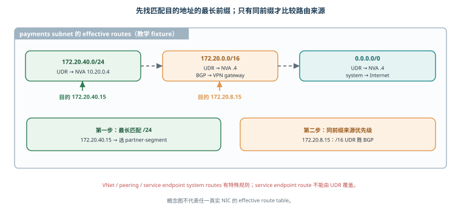
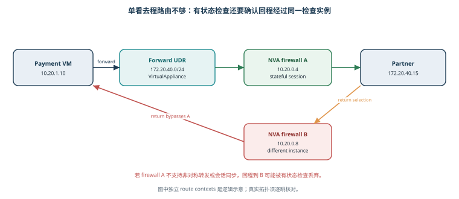
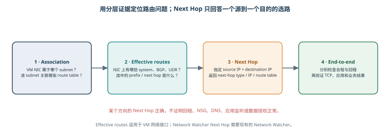

::::: cover
[AZURE CLOUDOPS · ENTERPRISE ENGINEERING]{.kicker}

# 两端都配了路由，付款为什么仍被防火墙丢弃？

[Azure VNet、UDR 与有效路由]{.subtitle}

::: cover-meta
- **讲次**：03 / 23
- **核心机制**：system / BGP / UDR、longest-prefix match、next hop、回程路径
- **证据边界**：Microsoft 官方路由文档 + 本地合成路由模型
- **适用场景**：虚构银行 hub-spoke 清算链路
:::

::: scenario
支付 VM 把清算请求发往合作方网络。Network Watcher 显示去程下一跳是防火墙，合作方也能收到请求；合作方的响应却从另一个 NVA 实例返回。有状态检查器没有这条会话，于是丢弃响应。网络团队只查了一个 `/0` 默认路由，忽略了 NIC 所在 subnet、重叠的 `/16` 与 `/24`、BGP 路由以及回程的另一张 route table。
:::

### 本讲目标

读完后，你应该能从 VM NIC 找到 subnet 与 route table 关联；按最长前缀和同前缀来源优先级预测 Azure 选出的路由；解释常见 system-route 例外；用 Network Watcher Next Hop 检查一个源地址到一个目的地址的选路；并分别检查有状态网络设备的去程和回程。

**本讲问题：** 对同一个目的地址，哪个路由生效？即使去程正确，回包会不会经过另一个下一跳？

:::::

## 路由属于源 subnet 的决策

Azure 为每个 VNet subnet 配置 route table。它包含 Azure 创建的 system routes，也可能包含通过 VPN / ExpressRoute gateway 学到的 BGP routes，以及管理员创建的 user-defined routes（UDR）。UDR 存在于 route table 中；route table 可以关联多个 subnet，而一个 subnet 最多关联一张 route table。没有显式 route-table association 的 subnet 仍有 system routes，也可能有已传播的 BGP routes。

因此，查 VM 的网络路径要从**实际 NIC 所属 subnet**开始。只看门户里一张名为 `rt-hub` 的表，不能证明待查 NIC 使用它；若 VM 有多张 NIC，还要找出流量实际使用的源 IP 与 NIC。Effective routes 是 NIC 级视图，合并对应 route table、system routes 和已传播 BGP routes；它比只看自定义条目更接近平台当前展示的候选路由。

图中用相同 `/16` 的 UDR 和 BGP 展示来源优先级，用更窄的 `/24` 展示前缀优先级。route table 里的每一条 route 都声明 address prefix 和 next-hop type；若 next hop 是 `VirtualAppliance`，还要填它的 IP。NVA 要转发第三方流量时，其 NIC 还必须启用 IP forwarding。路由选择只把包交给下一跳，不会自动替 NVA 配好转发、NAT、防火墙策略或返回路径。

## Longest-prefix match：先比前缀长度

Azure 先找覆盖目的 IP 的最长（最具体）前缀。若 route table 有 `10.0.0.0/16` 和 `10.0.0.0/24`，目的 `10.0.0.5` 命中 `/24`；目的 `10.0.1.5` 不在 `/24` 内，只命中 `/16`。**路由前缀长短优先于来源优先级**，不能把 UDR、BGP、system 排序当成三张表简单互相覆盖。

银行例子中，`172.20.40.15` 同时落在 `0.0.0.0/0`、`172.20.0.0/16`、`172.20.40.0/24` 中，选择 `/24`。目的 `172.20.8.15` 不在 `/24`，转而选 `/16`。不属于这些网段的 `203.0.113.10` 才落到默认 `/0`。

## 同前缀时再比路由来源

若多个候选路由拥有相同 address prefix，Microsoft 文档给出的来源顺序是 **UDR > BGP > system**。例如，system `0.0.0.0/0 → Internet` 与 UDR `0.0.0.0/0 → VirtualAppliance` 前缀相同，则 UDR 生效。它会把 subnet 的默认出站流量转给 NVA；NVA 自身必须有可行的后续路由和正确策略。

`None` 表示对匹配流量丢弃，而不是一个待探测的主机。它常用于刻意隔离目标前缀，也可能把合法管理或依赖流量黑洞掉。核对时要记录被选中的 prefix、来源、next-hop type 和 next-hop IP，再判断这条路径是否满足安全边界。

:::: note
**官方文档的例外也会影响判断。** 与 VNet、VNet peering 或 service endpoint 有关的 system routes 有专门优先规则，可能胜过更具体的 BGP route；`VirtualNetworkServiceEndpoint` route 不能由 route table 覆盖。本讲的本地选择器会对这些特殊 route 拒绝给出推测答案。检查真实网络时应按对应服务文档和 NIC 的 effective routes 复核。
::::

::: warn
微软当前 UDR 文档还列出 `VirtualApplianceEcmp` 的 public preview：多个 NVA next-hop IP 可参与 ECMP，且文档明确不保证 flow-level symmetry，也不共享 NVA 会话状态。本文不启用或测试该预览功能；active-active NVA 是否安全取决于设备对非对称转发或会话同步的支持。
:::

## 去程选到防火墙，不代表回程也经过它

每个出站 subnet 根据自己的 effective routes 对目的 IP 做选路。请求从 `payments` subnet 去合作方时，`rt-payments` 可能选中 NVA `10.20.0.4`；响应进入 Azure 后，另一个 subnet、gateway 或 NVA 的决策可能选出不同路径。两端都存在路由条目，只说明配置了候选规则，不证明返回流经过与请求相同的有状态检查实例。

在 Azure Virtual WAN 的双角色 NVA 指引中，微软描述了 active-active 实例对相同前缀做 ECMP 时，流量可能落到不同 NVA 实例；平台不保证 flow-level symmetry，而有状态 firewall inspection 会丢弃这种非对称流。除非 NVA 支持非对称转发，或支持会话共享/同步，否则这种设计不应被假定为可用。这个结论对应文档描述的场景，不能泛化成“任意 Azure 流量都会如此”。

本地诊断时，先写出五元组的两侧端点与每个可见路由上下文：正向源 subnet / 目的 IP、反向源上下文 / 原客户端 IP、预期检查实例。然后对两向分别计算路由。相同的“去程已到达”日志只能证明请求到达某个观测点；没有成功的返回路径，TCP 建连和业务读写仍会失败。

## Worked example：从候选项推出实际下一跳

虚构支付 subnet 有以下候选项：

| 目的前缀 | 来源 | Next hop | 用途 |
|---|---|---|---|
| `0.0.0.0/0` | system | `Internet` | 默认系统路由 |
| `0.0.0.0/0` | UDR | `VirtualAppliance 10.20.0.4` | 强制检查默认出站 |
| `172.20.0.0/16` | BGP | `VirtualNetworkGateway` | 学到的合作方汇总路由 |
| `172.20.0.0/16` | UDR | `VirtualAppliance 10.20.0.4` | 对相同汇总前缀强制经 NVA |
| `172.20.40.0/24` | UDR | `VirtualAppliance 10.20.0.4` | 更具体的合作方业务网段 |

对 `172.20.40.15`，`/24` 最具体，下一跳是 NVA `.4`。对 `172.20.8.15`，`/24` 不匹配，两个 `/16` 同长，UDR 胜 BGP，仍走 NVA `.4`。对 `203.0.113.10`，两个 `/0` 同长，UDR 胜 system，走 NVA `.4`。若从 `172.20.40.0/24` 删去 UDR，目的 `172.20.40.15` 就可能按 BGP `/16` 去 VPN gateway；这不是 `/0` 路由“优先级低”造成的，而是更具体的 `/16` 胜过 `/0`。

接下来不要停在“去程 next hop 是 `.4`”。要从响应所在的实际 subnet / NIC 路由上下文查询回到 `10.20.1.10` 的路由。如果回程选出另一台有状态 firewall `.8`，两边检查器的会话状态可能不一致。修复要遵循最小范围：统一能观察该流的路由，或使用确认支持非对称/同步状态的设备；每次变更后复查两个方向和真实连接结果。

## 观察证据：effective routes、Next Hop 与连接测试

从 VM NIC 查看 effective routes，可检查 Azure 为该接口显示的有效 prefix 和 next hop：

~~~powershell
az network nic show-effective-route-table `
  --resource-group $ResourceGroup `
  --name $NicName `
  --output table
~~~

Network Watcher **Next Hop** 针对一台 VM 上指定的源 IP 和目的 IPv4 地址返回 next-hop type、IP address 和 route table ID。若 UDR 提供选中路由，响应指出包含该路由的 route table；否则 route table 会标示 `System Route`。网络团队可用它确认一个方向的路由选择：

~~~powershell
az network watcher show-next-hop `
  --resource-group $ResourceGroup `
  --vm $VmName `
  --nic $NicName `
  --source-ip 10.20.1.10 `
  --dest-ip 172.20.40.15
~~~

`--nic` 在 VM 多 NIC 且任一 NIC 启用 IP forwarding 时尤其重要；CLI 文档规定这种情况下需要指定目标 NIC。Next Hop 是一个源到目的的点查询。它不证明路由器实际转发成功、NSG 允许流量、对端监听端口、DNS 解析正确、TLS/应用成功，也不证明回程使用相同下一跳。接着应分别对反向端点查询，并按故障假设使用适当的 TCP、NSG、DNS、NVA 与业务探针检查。

## 实验：选路与回程检查器

本地实验把每个 subnet 的合成 system、BGP 路由与已关联 UDR 合并；按最长前缀、同前缀来源顺序输出选中 route。它还对两个独立 route contexts 做点到点比较：请求去程通过 firewall `.4`，返回路径分别通过 `.8` 或 `.4`。这演示一个假设下的路径不对称，不重现 Azure SDN 或真实 NVA。

:::: {.lab title="实验 3-1｜逐个目的地址推演路由与回程"}
::: labmeta
- **目标**：从 prefix 与来源预测 next hop；识别同一有状态检查器是否出现在两个建模方向。
- **前提**：Python 3.11+；本地终端；无需 Azure CLI、身份登录、订阅或容器。
- **输入**：`labs/route-model/scenarios/banking-hub-spoke.json`，所有地址、VM、NVA 与路由均为合成数据。
- **方法**：IPv4 前缀包含与窄化的路由选择；遇到特殊 system route 或同优先级多路由时拒绝猜测。
- **验证**：运行 16 个单元测试，并分别检查 `/24`、`/16`、`/0`、None blackhole、asymmetric 与 symmetric 路径；负例还验证未知 next-hop 拼写和无效 next-hop IP 会被拒绝。
- **成本与清理**：程序没有 Azure API；不创建网络或其他资源。可删除本地 `__pycache__`。
:::

从仓库根目录运行：

~~~powershell
Push-Location textbook/chapters/AZ02-01/labs/route-model
python -m unittest -v
python route_model.py
Pop-Location
~~~
::::

**本地观察（2026-11-26，Python 3.13.9）：** 13 个单元测试通过。`172.20.40.15` 选择 `/24` UDR；`172.20.8.15` 选择同前缀 UDR 而不是 BGP；非合作方目的选择 `/0` UDR 而不是 system Internet。返回通过 `10.20.0.8` 的变体被标记 `ASYMMETRIC_AT_STATEFUL_INSPECTOR`；回到 `.4` 的变体被标记 `SYMMETRIC_THROUGH_INSPECTOR`。

**E0 审计复验（2026-11-27）：** 发现模型原先接受拼错的 `next_hop_type`，可能把无效 fixture 当成有效选路；现依官方 next-hop 类型边界拒绝未知值、拒绝非 `VirtualAppliance` 路由上的 `next_hop_ip`，并自动将已知特殊 next-hop 标为不支持而不猜测。新增 3 个负例，16 个测试通过。现有 Azure 行为仍未查询。

~~~text
return-via-other-nva:
  forward from payments to 172.20.40.15: 172.20.40.0/24 [udr] -> VirtualAppliance(10.20.0.4)
  return from hub-return-a to 10.20.1.10: 10.20.1.0/24 [udr] -> VirtualAppliance(10.20.0.8)
  stateful-path result: ASYMMETRIC_AT_STATEFUL_INSPECTOR

return-via-same-nva:
  forward from payments to 172.20.40.15: 172.20.40.0/24 [udr] -> VirtualAppliance(10.20.0.4)
  return from hub-return-b to 10.20.1.10: 10.20.1.0/24 [udr] -> VirtualAppliance(10.20.0.4)
  stateful-path result: SYMMETRIC_THROUGH_INSPECTOR
~~~

:::: why
**模型边界：** 代码只模拟 fixture 明确列出的 IPv4 prefix、普通 system/BGP/UDR 路由和简单下一跳选择。它不建模 Azure NIC effective-route 查询、special VNet/peering/service-endpoint 规则、BGP 收敛、ECMP、路由传播开关、UDR 生效时序、NVA 转发、gateway datapath、NSG、DNS、TCP 建连或真实流量。它没有 Azure 客户端，也不是 emulator；输出只证明给定 JSON 的选择结果。
::::

## Fault cards：从具体方向找区分证据

:::: {.fault title="故障 1｜Next Hop 指向预期 NVA，但 TCP 仍超时"}
- **症状**：指定 VM 与目的地址的 Next Hop 显示 `VirtualAppliance`，端口连接仍失败。
- **假设**：NVA 没有相应转发/防火墙规则；NVA NIC 未启用 IP forwarding；NSG 或远端 ACL 丢弃；回程走不同网关或设备。
- **区分**：检查实际 NIC 与源 IP、effective routes、NVA 两侧流日志、VM/NVA NSG、远端监听与反向 Next Hop；按同一时间戳关联。
- **最小修复**：只修复证实失败的转发、策略或回程 route；不要先改 `/0`。
- **恢复验证**：从真实客户端验证 TCP 与业务操作，再核对返回路径和 NVA 会话日志。
::::

:::: {.fault title="故障 2｜BGP 明明学到路由，流量仍走 UDR"}
- **症状**：effective routes 同时列出 BGP 和 UDR，看起来 BGP gateway 已正常，但 Next Hop 是 NVA。
- **假设**：两条路由前缀相同，UDR 源优先级更高；或 UDR 前缀更具体。
- **区分**：比较完整 CIDR 前缀长度，然后比较 source；确认 route-table association 与该 NIC 对应。
- **最小修复**：删除、缩窄或修正错误 UDR；若需保留检查路径，按目标网段明确设计，而不是依赖模糊的默认路由。
- **恢复验证**：检查 NIC effective routes 与目标 IP 的 Next Hop，随后分别验证去程、回程和应用流。
::::

:::: {.fault title="故障 3｜请求到达，返回被 stateful firewall 丢弃"}
- **症状**：服务端日志显示收到请求，但调用方超时；单看请求方向的路由没有异常。
- **假设**：回程 next hop 是另一台 NVA；ECMP 或其他路由决策使两个方向落到不同会话状态。
- **区分**：在反向 VM/subnet 上查回到原客户端 IP 的 Next Hop；对照两侧 NVA 流日志和会话 ID；确认设备是否支持状态同步。
- **最小修复**：恢复经同一实例的回程，或采用厂商确认支持该转发模式的同步/非对称设计。
- **恢复验证**：从两端重新发起连接，观察同一会话在预期检查器上建立并完成，不以单向探测代替。
::::

## Exercises：算路由，再選驗證方法

:::: {.exercise title="练习 1｜重叠路由谁获胜？"}
一个 subnet 的路由有 `0.0.0.0/0 system → Internet`、`0.0.0.0/0 UDR → NVA .4`、`172.20.0.0/16 BGP → VPN gateway`、`172.20.0.0/16 UDR → NVA .4` 和 `172.20.40.0/24 UDR → NVA .8`。分别计算目的 `172.20.40.15`、`172.20.8.15`、`203.0.113.10` 的路由。若目的 `172.20.40.15` 的 `/24` 改成 `None`，意味着什么？
::::

:::: {.solution title="练习 1 的详细解答"}
`172.20.40.15` 选择 `/24` UDR → NVA `.8`，其前缀比两个 `/16` 和 `/0` 更具体。`172.20.8.15` 落在 `/16`，两条 `/16` 同前缀，UDR 胜 BGP，走 NVA `.4`。`203.0.113.10` 只命中 `/0`，同前缀 UDR 胜 system，走 NVA `.4`。若 `/24` 下一跳是 None，该段匹配流量被丢弃；其他较宽可达路由不会因为存在而自动兜底。要先确认这是否为有意隔离规则。
::::

:::: {.exercise title="练习 2｜分开判断去程与回程"}
支付 VM `10.20.1.10` 去合作方 `172.20.40.15` 的 Next Hop 是 `VirtualAppliance 10.20.0.4`。合作方响应返回后，Azure 一侧 route context 指向 `VirtualAppliance 10.20.0.8`。防火墙是 stateful，但供应商尚未确认 session synchronization。现在能得出哪些结论？下一步查什么？
::::

:::: {.solution title="练习 2 的详细解答"}
只能确认两个查询上下文分别选出 `.4` 和 `.8`；不能据此断言某个具体 TCP 包已经经过全部中间设备，也不能宣称 Azure 一定会丢弃。此结果构成非对称检查路径的强假设。应在反向路径实际承载的 VM/NIC 上核对源与目的 IP、有效前缀、route association，并关联两台 NVA 的流/会话日志；向设备供应商确认非对称转发与状态同步能力。修复后还要验证双向连接及业务结果。
::::

:::: {.exercise title="练习 3｜Network Watcher Next Hop 能证明什么？"}
Next Hop 返回 `VirtualAppliance` 与路由表 ID。列出至少四个尚未证明的条件，并给出下一组区分测试。
::::

:::: {.solution title="练习 3 的详细解答"}
它没有证明 NVA 正在转发、NVA 策略允许、NSG 允许、对端监听、DNS/TLS 正确、响应可回到同一 stateful instance，或业务数据已正确处理。先检查关联 NIC 的 effective routes 与 NVA 状态；按流方向核对路由和过滤规则；再做适当的 TCP/连接诊断，最后用读写或业务探针确认端到端结果。Next Hop 只回答给定 VM、源 IP 与一个目标 IP 的所选下一跳。
::::

## 本讲要点

:::: summary
::: {.card tag="作用域"}
Route table 按 subnet 关联，NIC effective routes 才显示当前 VM 接口所见的 system、BGP 和 UDR 组合。
:::

::: {.card tag="优先级"}
先 longest-prefix match；只有同前缀才比较 UDR > BGP > system，并单独处理 VNet、peering、service endpoint 例外。
:::

::: {.card tag="路径"}
Next Hop 是单方向的点查询。有状态网络设备要同时核对去程、回程以及具体 NVA 会话能力。
:::

::: {.card tag="诊断"}
先确认 NIC、subnet、route-table association 与 effective route，再做 Next Hop、连接和业务验证；不能把选路等同于连通。
:::
::::

## References 与研究记录

本讲于 2026-11-26 查阅 Microsoft Learn 与 Azure CLI 官方文档。路由功能、预览状态、region 和服务支持会变化；真实变更前须重新核对目标 VNet、具体 SKU、传播状态、Next Hop 输出及成本。命令没有在 Azure 环境运行。

::: refs
1. [Virtual network traffic routing](https://learn.microsoft.com/en-us/azure/virtual-network/virtual-networks-udr-overview) — route table、system/BGP/UDR、longest prefix、同前缀来源优先级、特殊路由和 ECMP preview。
2. [Manage route tables](https://learn.microsoft.com/en-us/azure/virtual-network/manage-route-table) — association、创建/查看路由、VM NIC effective routes 与 Next Hop 工作流。
3. [Network Watcher Next Hop overview](https://learn.microsoft.com/en-us/azure/network-watcher/next-hop-overview) — next-hop type、IP、route table ID；当前页面标示 2026-02-25 更新。
4. [Azure CLI `az network watcher show-next-hop`](https://learn.microsoft.com/en-us/cli/azure/network/watcher?view=azure-cli-latest#az-network-watcher-show-next-hop) — 必需参数、可选 NIC 与 CLI 支持状态。
5. [Azure Virtual WAN routing policies](https://learn.microsoft.com/en-us/azure/virtual-wan/how-to-routing-policies) — dual-role NVA active-active 的 ECMP、非对称流量与有状态检查边界。
6. [Hub-spoke network topology in Azure](https://learn.microsoft.com/en-us/azure/architecture/networking/architecture/hub-spoke) — Azure Firewall 与返回流路径设计背景。
:::

图示是机制解释，不是 Azure Portal 实拍或真实银行网络。本地 JSON 的路由结果不证明任何 Azure NIC、NVA、连接、availability 或服务 SLA。
