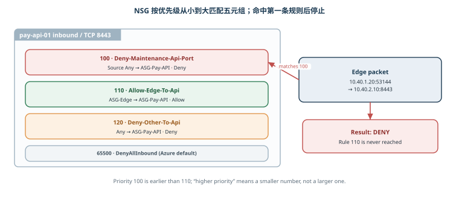
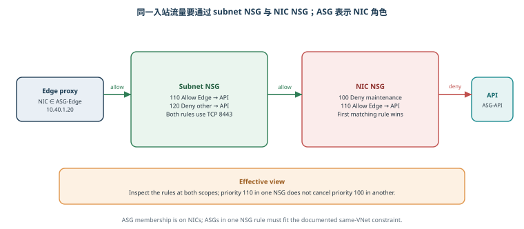
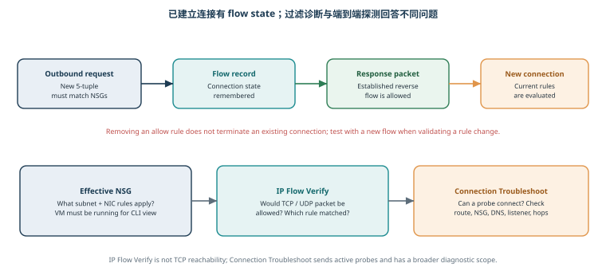

::::: cover
[AZURE CLOUDOPS · ENTERPRISE ENGINEERING]{.kicker}

# 防火墙规则写了 Allow，为什么 VM 仍然拒绝连接？

[Azure NSG、ASG 与网络诊断]{.subtitle}

::: cover-meta
- **讲次**：04 / 23
- **核心机制**：stateful NSG、priority、ASG、effective security rules
- **证据边界**：Microsoft 网络安全文档 + 本地合成规则模型
- **适用场景**：虚构银行支付 API 与账本
:::

::: scenario
网络组在 payments subnet 的 NSG 中加入了“允许 edge 到 API”的 8443 规则；变更后探针仍失败。规则列表里 `Allow-Edge-To-Api` 看起来正确，但 API NIC 还关联另一张 NSG，其中 priority 100 的临时维护 deny 先于 priority 110 的 allow 匹配。团队还在同一个连接上反复测规则，旧 TCP 会话仍活着，误以为改动没有生效。
:::

### 本讲目标

读完后，你应该能按五元组找出 NSG 的第一条匹配规则；解释 subnet 与 NIC 两层过滤和 ASG 成员关系；推演已建立 flow 对回包与规则变更的影响；用 effective security rules 和 IP Flow Verify 找到具体规则；再决定何时需要 Connection Troubleshoot 做真正的连接探测。

**本讲问题：** 怎样区分“规则逻辑允许”“平台判定这个 packet 可过”和“应用确实能连通”？

:::::

## NSG 过滤的是一个方向上的 packet tuple

一个 NSG rule 根据 source address、source port、destination address、destination port、protocol、direction 和 action（Allow / Deny）匹配流量。Azure 文档把五个流字段称为 5-tuple：源 IP、源端口、目标 IP、目标端口和协议。方向决定它属于入站还是出站。一个规则没有匹配目标端口 8443 的 TCP 入站包，就不会因为“源地址属于银行内网”而自动放行。

自定义 NSG priority 的范围是 100–4096。数字越小越早处理、priority 越高；一旦 packet 命中一条规则，同一个 NSG 就停止继续比较后面的规则。不能把 110 读成“比 100 更优先”。在同一 NSG、同一方向，priority 不能重复。

每个 NSG 还带有不能删除的默认规则：

| 方向 | 默认 priority | 默认规则 | 常见作用 |
|---|---:|---|---|
| Inbound | 65000 | AllowVNetInBound | 允许 `VirtualNetwork` service tag 范围内的通信 |
| Inbound | 65001 | AllowAzureLoadBalancerInBound | 允许 Azure Load Balancer 健康探测 |
| Inbound | 65500 | DenyAllInbound | 拒绝其余入站流量 |
| Outbound | 65000 | AllowVnetOutBound | 允许 `VirtualNetwork` service tag 范围内的出站 |
| Outbound | 65001 | AllowInternetOutBound | 允许出站到 `Internet` service tag |
| Outbound | 65500 | DenyAllOutBound | 拒绝其余出站流量 |

默认规则 priority 比自定义范围靠后，因此合适的自定义规则可覆盖默认行为。`VirtualNetwork` 是 service tag，不是把某个 VNet CIDR 写死；peered VNet 的前缀也可能纳入其展开结果。排障时要查看 effective rules，而不是凭标签名称猜规则边界。

## 多个 NSG 是多层过滤，不是合并 priority

NSG 可以关联到 subnet、NIC，或两者。Azure 对入站流量先处理 subnet NSG，再处理 NIC NSG；如果两处都关联，入站端口必须在两张 NSG 中都开放。对 NIC 列出的 effective security rules 汇总了适用于该 NIC 的 subnet 与 NIC 规则。不同 NSG 内的 priority 数字互不覆盖：subnet NSG 的 priority 110 Allow 不会抵消 NIC NSG 的 priority 100 Deny。

**Application Security Group（ASG）** 用 NIC 成员表达应用角色，例如 `asg-edge`、`asg-pay-api` 与 `asg-ledger`。NSG 规则可把 ASG 设为 source 或 destination，减少依赖易变 IP 地址的规则。ASG 不是用户、服务主体或防火墙策略本身；它只帮助 NSG 以 NIC 角色选择流量。规则只有在目标 NIC 确实属于引用的 ASG 时才匹配。微软文档要求同一个 ASG 的 NIC 位于同一 VNet；在同一条 NSG 规则中互相引用的 source / destination ASG，也必须包含同一 VNet 的 NIC。

设计账本访问时，还要注意默认的 `AllowVNetInBound` 会允许其 tag 范围内的 VNet 流量。若目标是“只允许 API 访问数据库 1433”，需要把 `Allow API → Ledger` 放在 `Deny other → Ledger` 前面，随后让更低优先级的明确 deny 覆盖默认 VNet allow。只增加 allow 规则不等于完成最小权限设计。

## Worked example：为什么 8443 的 Allow 没有生效？

目标是从 `edge-proxy-01`（`asg-edge`）访问 `pay-api-01`（`asg-pay-api`）的 TCP 8443。两张 NSG 分别关联 subnet 和 NIC：

| Scope | Priority | Source → Destination | Protocol / port | Action |
|---|---:|---|---|---|
| Subnet NSG | 110 | `asg-edge` → `asg-pay-api` | TCP / 8443 | Allow |
| Subnet NSG | 120 | Any → `asg-pay-api` | TCP / 8443 | Deny |
| NIC NSG | 100 | Any → `asg-pay-api` | TCP / 8443 | Deny |
| NIC NSG | 110 | `asg-edge` → `asg-pay-api` | TCP / 8443 | Allow |

首先，在 subnet NSG 中，源 NIC 是 `asg-edge` 成员，所以 priority 110 Allow 命中。随后入站 packet 到 NIC NSG；priority 100 的 Any → API deny 先匹配，处理停止，NIC 的 priority 110 Allow 永远没有机会执行。最终结果是 **Deny**。如果只打开 subnet NSG 页面，所有字段看起来都正确，依然会漏掉 NIC 层的拒绝。

最小修复是确认临时维护规则是否仍需保留；若需保留，按意图收窄其 source 或 destination，而不是盲目把所有 Allow 改成更小数字。再通过 effective rules 查看两个 scope，使用一个新的 TCP 连接验证。优先级改动只影响新连接；现有连接可能继续维持。

## Stateful flow：回包与规则修改的时间边界

NSG 为已建立连接维护 flow record。若 VM 的 outbound TCP 443 请求已被允许，通常不需要另一条 inbound 规则专门放行该会话的响应包；入站允许的连接也具有对应的返回流语义。NSG 是 stateful filter。

**重要的运维后果：规则改变只作用于新连接。** 删除已允许的规则不会立即切断现有 SSH/TCP 会话。若故障排查总是复用浏览器 keep-alive、数据库池连接或长连探针，就可能看到旧 flow 继续工作，而新客户端连接已被拒绝。验证变更时应建立全新的五元组（例如新 source port），并确认复用的客户端连接已关闭。

连接状态和规则表是两个不同证据：effective rules 描述当前适用于 NIC 的规则集合；flow state 记录已有连接；网络探测则发起新的 packet 或 connection test。三个结果看似不一致时，先比较方向、五元组与连接是否复用。

## 从有效规则到网络探测

### 先检查 NIC effective security rules

Azure CLI 的 `az network nic list-effective-nsg` 汇总 NIC 与所在 subnet 上的有效 NSG。该命令只有在 NIC/subnet 至少关联一张 NSG，且 VM 正在运行时才返回结果；多 NIC VM 应逐个 NIC 检查：

~~~powershell
az network nic list-effective-nsg `
  --resource-group $ResourceGroup `
  --name $NicName
~~~

查询中要确认实际 NIC、方向、source / destination、priority、action，以及匹配规则来自哪张 NSG。若结果没有预期的 ASG 规则，检查 NIC membership 与 ASG 所属 VNet；若只看到默认规则，说明 custom rule 可能没有应用到此接口或被过滤条件排除。

### 用 IP Flow Verify 点查一个 packet

IP Flow Verify 以 VM NIC 为目标，按方向、TCP/UDP、local IP/port 与 remote IP/port 检查应用于该 NIC 的 NSG 规则；当前文档还说明它检查 Azure Virtual Network Manager（AVNM）应用到该 VNet 的 security admin rules。输出 `Access allowed` 或 `Access denied`，并给出匹配的规则和 NSG；如果匹配的是默认规则，不会提供可编辑规则链接。

~~~powershell
az network watcher test-ip-flow `
  --resource-group $ResourceGroup `
  --vm $VmName `
  --nic $NicName `
  --direction Inbound `
  --protocol TCP `
  --local 10.40.2.10:8443 `
  --remote 10.40.1.20:53144
~~~

该命令在 Azure CLI 文档中为 Core GA；Network Watcher IP Flow Verify 要求 VM 所在 subscription 和 region 有 Network Watcher，并要求相应权限。它只验证安全规则决定，不验证路由、TCP 握手、远端监听或业务成功。它仅支持 TCP 和 UDP 的 IP Flow 查询；要诊断 ICMP 或 VM scale sets 的规则，使用相应的 NSG diagnostics。若问题涉及路由，回到 AZ02-01 的 effective routes / Next Hop；若规则允许但连接失败，再用 connection diagnostics。

### Connection Troubleshoot 会做主动连接测试

Connection Troubleshoot 的目标比 IP Flow Verify 更宽：它可以对 TCP 或 ICMP 做连接探测，检查 NSG、UDR、DNS、guest firewall、目标端口是否监听等问题，并返回连通状态、探测统计和路径 hop。当前 Microsoft Learn 文档描述了 agentless experience，不再要求先安装 Network Watcher VM extension；支持的 source / destination 类型仍受产品文档列出的范围限制。此诊断会发送主动探测，应选授权的非生产端点并控制目标端口。

截至 2026-11-26，Azure CLI 的 `az network watcher test-connectivity` 在官方命令参考中仍标为 **Core Preview**。不要把 CLI preview 当成 GA 接口，也不要因为浏览器门户有诊断入口就默认已批准对某个生产 endpoint 发包。

可按证据层次推进：先查 NSG association 与 NIC effective rules，再用 IP Flow Verify 定位具体安全/admin rule；若规则允许，检查 route、DNS、guest firewall 与 listener，最后对授权目标运行 Connection Troubleshoot 或应用级 probe。IP Flow 的 `Allow` 只代表规则判定允许该 packet。

## 实验：规则优先级、ASG 与现有 flow

本地实验实现一个非常小的自定义规则判定器：按 priority 升序检查方向、TCP/UDP、地址/ASG、端口范围；对目标 NIC 分别求 subnet 与 NIC 上的结果；已有连接通过显式 flow table 允许响应。JSON 中的账号、NIC、地址、NSG 与流量均为虚构。

:::: {.lab title="实验 4-1｜定位一条被 NIC NSG 阻止的付款连接"}
::: labmeta
- **目标**：证明另一层 NSG 可以否决 subnet Allow；检验 lower-number priority 和 stateful return flow。
- **前提**：Python 3.11+；本地终端；无需 Azure CLI、身份登录、订阅或容器。
- **输入**：`labs/nsg-model/scenarios/banking-payment.json`；ASG membership 与规则均为合成。
- **方法**：每张 fixture NSG 内 first-match；逐层汇总；只对显式允许的五元组记录 flow state。
- **验证**：运行 13 项测试，检查第一匹配 deny、ASG 成员、两层 NSG、已建立回包与新连接。
- **成本与清理**：没有 Azure API 调用，不创建资源；删除本地 `__pycache__` 即可。
:::

从仓库根目录运行：

~~~powershell
Push-Location textbook/chapters/AZ02-02/labs/nsg-model
python -m unittest -v
python nsg_model.py
Pop-Location
~~~
::::

**本地观察（2026-11-26，Python 3.13.9）：** 13 项测试全部通过。合成 inbound packet 在 subnet NSG 被 priority 110 Allow，但在 NIC NSG 被 priority 100 Deny；同一模型中的 API→ledger outbound 由两层 Allow 并记录 flow state，ledger 回包以 `ALLOW_ESTABLISHED_FLOW` 返回。此结果是 fixture 输出，不是 Azure 运行结果。

~~~text
edge-to-api-blocked-at-nic:
  associated-filter results (scope listing, not a packet-order trace):
    nsg-payments-subnet: ALLOW by Allow-Edge-To-Api
    nsg-pay-api-nic: DENY by Deny-Maintenance-Api-Port
  verdict: DENY

api-to-ledger-allowed:
  associated-filter results (scope listing, not a packet-order trace):
    nsg-payments-subnet: ALLOW by Allow-Api-To-Ledger
    nsg-pay-api-nic: ALLOW by Allow-Api-To-Ledger
  verdict: ALLOW

ledger-response-on-established-flow:
  established flow record matched; current rules were not re-evaluated
  verdict: ALLOW_ESTABLISHED_FLOW
~~~

:::: why
**模型边界：** 它只检查 fixture 中的自定义 IPv4 TCP/UDP 规则与一个简化 flow-state 表；没有实现 Azure 默认 NSG rules、真实 `VirtualNetwork` service tag 扩展、AVNM 管理规则、effective-NSG API、ICMP、连接探针、NVA 路由、VM OS 防火墙或应用监听。未命中自定义规则返回 `NOT_MODELED_DEFAULT_RULES`，不会冒充实际默认结果。测试证明 JSON 输入在该算法下的结果，不证明 Azure 应用规则的结果。
::::

## Fault cards：把安全规则问题缩到一个层次

:::: {.fault title="故障 1｜规则列表有 Allow，IP Flow Verify 返回 Denied"}
- **症状**：目标 8443 有一条 allow 规则，Network Watcher 仍报告 Access denied。
- **假设**：更小数字 priority 的 deny 先匹配；NIC NSG 或 subnet NSG 另一层 deny；规则 direction、protocol、source port、ASG membership 不匹配。
- **区分**：查看目标 NIC 的 effective NSG；用准确的 local / remote 地址、端口与 direction 做 IP Flow Verify；核对 matched rule 所属 NSG。
- **最小修复**：按 least privilege 删除过期 deny 或缩小范围；把必要 allow 放到合适 priority，而不是放宽 Any。
- **恢复验证**：建立新连接并查看同一 NIC、同一五元组是否命中预期 allow；再验证业务操作。
::::

:::: {.fault title="故障 2｜ASG 规则没有匹配"}
- **症状**：规则引用 `asg-edge`，请求却命中后续 Deny 或默认规则。
- **假设**：源 NIC 没加入 ASG；规则目标引用错组；源与目标 ASG 包含的 NIC 不在同一个 VNet；查错了 NIC。
- **区分**：检查 NIC 的 ASG membership、NIC 所在 VNet、目标 NIC 的实际 IP 与关联 NSG effective rules。
- **最小修复**：修正角色组成员或规则引用；跨 VNet 通信应选用支持该拓扑的 IP/service tag/架构路径，不把 ASG 当全局目录。
- **恢复验证**：对 ASG 成员和非成员分别用新连接测试，确认只允许预期角色。
::::

:::: {.fault title="故障 3｜删掉 Deny 后，旧 session 仍能访问"}
- **症状**：现有 TCP 会话仍在传输；操作者误以为 NSG 变更失败。
- **假设**：此连接已有 flow record；客户端池或 HTTP keep-alive 重用了旧五元组。
- **区分**：用新 source port 或新 client session 发起连接，分别看旧 flow 与新 flow；记录变更时间和五元组。
- **最小修复**：在安全变更窗口建立新连接复验；按组织规定显式清理客户端池或重启应用，不以中断所有会话作为常规验证。
- **恢复验证**：确认新连接命中预期规则，旧连接行为与已知 flow state 一致，用户关键操作成功。
::::

## Exercises：验证 packet、flow 与业务

:::: {.exercise title="练习 1｜判断两个 scope 的实际结果"}
edge proxy 的 TCP 8443 inbound 在 subnet NSG 命中 priority 110 Allow；NIC NSG 同方向有 priority 100 Any→API Deny 和 priority 110 Edge→API Allow。最终结果是什么？跨两张 NSG 的 priority 110 与 100 应怎样比较？
::::

:::: {.solution title="练习 1 的详细解答"}
subnet NSG 的本地 first match 是 110 Allow；到 NIC NSG 后，priority 100 Deny 先于 110 Allow 且更宽泛，命中后停止。最终为 Deny。不同 NSG 的 priority 不能作全局排序，也不能相互覆盖；入站流量必须通过 subnet 和 NIC 两层。修复时先确认 100 规则目的，再收窄或移除冲突范围。
::::

:::: {.exercise title="练习 2｜一次规则修改后该测哪条连接？"}
API 到 ledger 的 outbound TCP 会话已经建立。团队移除 Allow 规则后，旧会话的回包仍可到达；新建连接失败。这个现象与 NSG statefulness 是否矛盾？怎样设计验证？
::::

:::: {.solution title="练习 2 的详细解答"}
不矛盾。已建立 flow record 让已有连接继续按状态收发，规则变化只作用于新连接。测试应区分同一连接与新五元组：记录 source/destination port 与开始时间，保留旧 session 观察其状态，再用新连接重新匹配规则。若新流被拒绝，用 effective NSG 与 IP Flow Verify 确认具体方向和 rule；不要仅看旧连接仍在传数据就判变更未生效。
::::

:::: {.exercise title="练习 3｜IP Flow Verify 显示 Access allowed 后还需证明什么？"}
Network Watcher 对 TCP 请求返回 Access allowed。列出四个尚未证明的条件，并选择下一项工具或 probe。
::::

:::: {.solution title="练习 3 的详细解答"}
它没有证明 UDR 指向正确、NVA/路由器实际转发、对端 TCP 端口监听、guest firewall/TLS/DNS 正常，或应用返回有效的业务响应。先按故障假设检查 effective routes/Next Hop、NVA 与 guest firewall，再用 Connection Troubleshoot 测受授权 endpoint 的连接，最后用应用级读写探针验证业务。IP Flow Verify 也只检查 TCP/UDP 安全与 admin rules，不是 ICMP 测试。
::::

## 本讲要点

:::: summary
::: {.card tag="规则"}
NSG 逐个方向按五元组匹配；priority 数字越小越先处理，命中第一条后停止。
:::

::: {.card tag="范围"}
Subnet 与 NIC 两层都可能过滤。ASG 用 NIC membership 标出角色；它不是身份授权，也不是跨 VNet 全局组。
:::

::: {.card tag="状态"}
NSG stateful；已建立 flow 的回包自动依赖连接状态。规则变更要用新连接复验。
:::

::: {.card tag="证据"}
Effective NSG 看应用规则；IP Flow Verify 判单个 TCP/UDP packet 的安全规则；Connection Troubleshoot 才做主动连接探测。
:::
::::

## References 与研究记录

本讲于 2026-11-26 查阅 Microsoft Learn 与 Azure CLI 官方文档。NSG 限额、诊断能力、CLI 预览状态、agentless 区域和权限可能变化；部署或诊断前应重查目标 region、VM/NIC 状态与价格。命令没有在 Azure 环境运行。

::: refs
1. [Network security groups overview](https://learn.microsoft.com/en-us/azure/virtual-network/network-security-groups-overview) — 五元组规则、priority、first match、默认规则、stateful flow record 与既有连接行为。
2. [Application Security Groups overview](https://learn.microsoft.com/en-us/azure/virtual-network/application-security-groups) — NIC membership、ASG 源/目标和 same-VNet 约束。
3. [Diagnose a virtual machine network traffic filter problem](https://learn.microsoft.com/en-us/azure/virtual-network/diagnose-network-traffic-filter-problem) — subnet/NIC 关联、effective security rules、运行中 VM 和 IP Flow Verify 工作流。
4. [IP Flow Verify overview](https://learn.microsoft.com/en-us/azure/network-watcher/network-watcher-ip-flow-verify-overview) — NSG 与 AVNM rules、TCP/UDP tuple、matched rule 和 Network Watcher 要求。
5. [Connection Troubleshoot overview](https://learn.microsoft.com/en-us/azure/network-watcher/network-watcher-connectivity-overview) — active probes、agentless experience、结果、限制与诊断类型；当前页面标示 2026-11-17 更新。
6. [Azure CLI `az network nic list-effective-nsg`](https://learn.microsoft.com/en-us/cli/azure/network/nic?view=azure-cli-latest#az-network-nic-list-effective-nsg) — effective NSG CLI command。
7. [Azure CLI `az network watcher test-ip-flow`](https://learn.microsoft.com/en-us/cli/azure/network/watcher?view=azure-cli-latest#az-network-watcher-test-ip-flow) — 输入 tuple、NIC 参数与 Core GA 状态。
8. [Azure CLI `az network watcher test-connectivity`](https://learn.microsoft.com/en-us/cli/azure/network/watcher?view=azure-cli-latest#az-network-watcher-test-connectivity) — CLI 当前标记 Core Preview。
:::

本讲图示为机制解释，不是 Azure Portal 实拍或真实银行网络。本地规则输出不证明 Azure 实际有效规则、ICMP、AVNM 管理规则、路由、连通性或业务授权。
