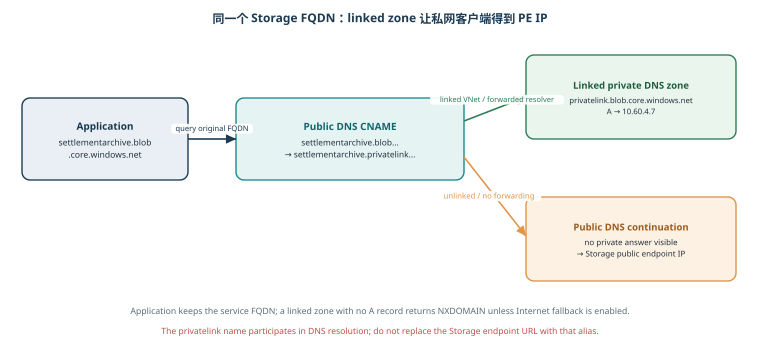
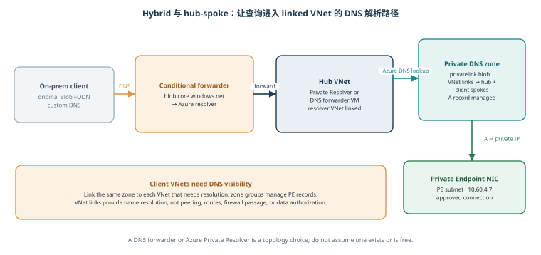
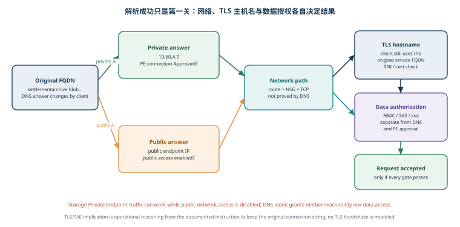

::::: cover
[AZURE CLOUDOPS · ENTERPRISE ENGINEERING]{.kicker}

# DNS 已经返回私网 IP，为什么 Storage 还是拒绝请求？

[Azure Private DNS、Private Link 与 Private Endpoint]{.subtitle}

::: cover-meta
- **讲次**：05 / 23
- **核心机制**：CNAME、Private DNS zone、VNet link、endpoint approval、data-plane authorization
- **证据边界**：Microsoft Learn + 本地合成 DNS/访问决策模型
- **适用场景**：虚构结算归档 Storage Blob
:::

::: scenario
支付服务的 `settlementarchive.blob.core.windows.net` 已经解析为 `10.60.4.7`，工程师据此宣布“Private Link 已打通”。然而 Storage 返回 403。另一个办公网客户端仍解析到公网地址；把连接串改成 `settlementarchive.privatelink.blob.core.windows.net` 后，TLS hostname validation 又失败。排障被压缩成“私网 DNS 是否正确”，却漏掉 resolver 路径、Private Endpoint 审批、公网访问策略、TLS 主机名和数据授权五道不同的判断。
:::

### 本讲目标

读完后，你应该能沿着原始服务 FQDN 解释 Azure Storage 的 CNAME 与 private A 记录；判断 private DNS zone 对某客户端是否可见；解释 VNet link、custom DNS forwarder 与 Private Resolver 的分工；把解析、endpoint 状态、网络通路、TLS hostname 和 Storage 授权拆开验证；并在没有 Azure 登录的条件下运行一个明确标注边界的本地决策实验。

**本讲问题：** 哪些证据能证明“名称解析到私网”“Private Endpoint 已获准”“请求能穿过网络”“TLS 主机名匹配”以及“调用者有权读数据”？

:::::

## Private Endpoint 把服务映射到 VNet 内的私有地址

Private Endpoint 是 Azure 在指定 subnet 中创建的一张只读网络接口（NIC），分配该 VNet 地址空间内的私有 IP，映射到 Private Link-backed 服务的一个 target subresource。Storage Account 的 `blob`、`file`、`queue`、`table`、`dfs`、静态网站等是不同子资源；需要访问多个服务时必须分别设计对应 endpoint。Private Endpoint 所在 VNet 与 PE 同 region、同 subscription；目标 Private Link resource 可以位于不同 region。PE 连接由客户端发起，服务提供者不会通过客户网络路由向客户发起连接。[1][2]

Private Endpoint 请求本身有生命周期。由资源所有者具备相应权限时连接可能自动批准；否则资源所有者需要审阅请求。连接状态包括 `Approved`、`Pending`、`Rejected` 与 `Disconnected`，只有 `Approved` 的 PE 才可用于发送流量。把 A 记录写好不会批准该连接，也不会把 `Pending` 变成可用 endpoint。

一个 PE 的 NIC、私有地址和资源连接是网络机制；数据面的 DNS 名称仍使用 Storage 官方服务地址。以下章节沿用 fictional Blob endpoint，以便把 DNS、安全与客户端身份分开讲解。

## 原始 FQDN、CNAME 与 Private DNS A 记录

Azure Storage Private Endpoint 推荐 Blob 私有 zone 名称为 `privatelink.blob.core.windows.net`。客户端仍请求 `settlementarchive.blob.core.windows.net`。官方文档描述的记录链是：原始 Storage FQDN 的 CNAME 指向 `settlementarchive.privatelink.blob.core.windows.net`；客户端所在网络若能查询到这个 private zone 中的 A 记录，就得到 PE 的私有地址。zone 中没有可见的私有回答时，公网 DNS 可继续到 Storage public endpoint；而已链接的 private zone 中若查不到对应 A 记录，解析可能返回 NXDOMAIN。对 Private Link zone，VNet link 的当前 CLI 解析策略名为 `NxDomainRedirect`；遇到 NXDOMAIN 时它让 Azure DNS 回退公共解析，Private Endpoint DNS 指南将其描述为 Fallback to Internet。[1][2][9]

| 查询环境 | private zone 是否可见 | 记录 | 预期的 DNS 决策 | 仍未证明 |
|---|---|---|---|---|
| linked VNet，Azure-provided DNS | 是 | PE A record 存在 | 私有 IP | endpoint Approved、路由、TLS、授权 |
| spoke VNet，custom DNS 不转发 | 否 | 不可见 | 通常落到 public DNS | 请求是否被公有网络策略拒绝 |
| on-prem，经 linked hub resolver 转发 | 是 | PE A record 存在 | 私有 IP | VPN/ExpressRoute 路由与服务授权 |
| linked zone，PE A record 缺失 | 是 | 无匹配记录 | NXDOMAIN；有 fallback 时可转公网解析 | fallback 下公网路径是否允许 |

Public DNS 中可见 CNAME 链是为兼容 hybrid 与渐进迁移而设计；一次公网 DNS 查询只支持“全局 Azure namespace 存在这个名称”，不会证明 PE 已关联、不会显示 PE private IP，也不授予数据访问。[5]

**不要把 DNS alias 当成应用 endpoint。** Storage 文档明确要求沿用相同 connection string，不要用 `privatelink` 子域 URL 连接。DNS 改变解析结果，应用 Host header 与 TLS 验证所用服务 hostname 仍应是 Storage 的原始 FQDN。后半句关于 TLS/SNI 的表述是运维推论：同一公开服务名被解析到另一个 IP 不应让客户端改为请求 private alias；本地模型没有执行 TLS 握手，也没有验证证书链。[2]

## VNet link 决定哪些客户端能查询 private zone

创建 Private DNS zone 后，需要把 zone link 到一个或多个 VNet。链接后的 VNet 可通过 Azure DNS 查询该 private zone；link 本身只提供 DNS 可见性，不会建立 VNet peering、VPN、UDR、NSG 通路或 Storage 数据授权。VNet link 可以仅用作 **resolution**；启用 autoregistration 时，则会为该 VNet 中的 VM 自动创建记录。这是 VM 名称自动注册功能，与 PE 的 FQDN / A 记录生命周期不同。[3]

在 hub-spoke 中，通常把共享 zone 建在可治理的 DNS hub，并将同一个 zone link 到需要查询它的 hub/spoke VNets。不要在每个 spoke 建一个同名的独立 private zone，期望 Azure 自动合并记录；微软的场景指导要求在共享一个 PE 的拓扑中使用单一 zone 并添加 VNet links。若多个 PE 指向同一类型或同一服务，则需遵循该服务当前的 PE DNS 设计，避免同名 zone/record 的删除与冲突；Microsoft 文档明确警告，把已服务关联的同一 private zone 再关联到不同 PE 可能删除原 A 记录。[1][4]

Custom DNS 改变了查询路径。若 VNet 内 VM 使用自己的 DNS server，Azure-provided DNS 不会因 VNet link 自动介入；需配置自定义 DNS 转发，或使用 Azure Private Resolver。对于 on-prem 查询，常见模式是在连接的 Azure VNet 中运行 DNS forwarder，或把请求转给 Azure Private Resolver；Microsoft 的示例建议 conditional forward 到服务公共 DNS zone，例如 `blob.core.windows.net`，再由 Azure 解析路径命中 linked private zone。Resolver/forwarder 所在 VNet 必须具备链接 zone 的解析路径。私有 zone 的 link、resolver 转发规则和网络连接是三个需要分别核对的配置。[4]

### Private DNS zone group 管理 PE 记录

创建 PE 时可将它与 Private DNS zone group 集成。zone group 将 PE 与 zone 强关联；PE 地址或相关配置改变时，平台会维护对应记录，删除 PE 时也会删除 group 中的记录。hub-spoke 拓扑可以把 zone 建在 hub，spoke 通过 links 共用。当前微软集成文档列出：每个 zone group 最多五个 zones；同一 group 中每个 zone 名称只关联一个 zone resource；一个 PE 不支持多个 zone groups。不要把这些 DNS 记录维护行为误读为网络连通性或授权结果。[4]

## Private Endpoint、TLS 与数据授权是不同门

一次 HTTPS 请求至少有这些相互独立的问题：

1. **Name resolution**：原始 FQDN 解析到哪个地址？客户端 resolver 是否看见正确 private zone？
2. **Endpoint lifecycle**：PE connection state 是否为 `Approved`？
3. **Network path**：route、NSG、NVA/firewall、TCP 443 和目标服务路径是否允许？
4. **TLS identity**：客户端以原始服务 FQDN 进行 hostname/certificate 检查时是否通过？
5. **Data authorization**：Storage 的 Microsoft Entra RBAC、SAS 或 account key 机制是否授权了所请求的数据操作？

Private Endpoint 不会自动关闭 Storage public endpoint。若目标是只允许 private path，需要单独配置 Storage 的 public network access / firewall。相反，Storage 文档说明经 PE 的相关 VNet 流量即使在 public network access disabled 时仍可到达；这不绕过 Blob data-plane authorization。DNS 解析到私有地址不授予读写 Blob 的权限；地址仍是公网也不必然表示数据可读。[1][2]

**TLS 主机名注意：** 对 Storage 继续使用原始 connection string / service FQDN，是 Microsoft 明确写明的要求。由此推导客户端应以原始 hostname 做 TLS SNI 与 certificate hostname 验证；Private Endpoint IP 不应替代 TLS name。此处是基于客户端连接行为的解释，不是本地实验对真实 Azure 证书或 TLS 握手的观测。若自建代理终止 TLS，代理的 hostname 与证书配置需要另行验证。

## Network diagnostics：普通 NIC 工具也有边界

PE NIC 不是普通 VM NIC 的诊断对象。当前 Private Endpoint 文档说明，Azure Portal 不显示 PE NIC 的 effective routes 和 security rules，且入站到 PE 的 NSG flow logs 不可用。部署 PE 的 subnet 默认关闭 private endpoint network policies；要让 NSG 或 UDR 规则作用于 PE，需要在 subnet 上启用相应 policy。启用时影响该 subnet 中所有 PE。对于 network policy 规则的 region 支持与限制，部署前还须重查目标 region。[5][6]

因此不能把 `az network nic list-effective-nsg` 对普通 VM NIC 的输出，或某 VM 到 endpoint 的 IP Flow Verify 结果，直接当成 PE NIC 的完整规则视图。先检查实际 PE 状态、DNS zone group、zone records、links 和客户端 resolver；再检查访问路径中的 VM/NVA/firewall、TCP 443 和服务端 network policy。任何主动 connection probe 都只针对 owner 明确授权的测试 endpoint 执行；探测成功仍要单独做 Blob 数据面的最小授权读测试。

## 演算示例：DNS 是私网 IP，为什么读取 Blob 仍然失败？

假设 `payments-spoke` 的 VM 以原始 FQDN 查询 `settlementarchive.blob.core.windows.net`，得到 `10.60.4.7`。这只证明在这次查询所使用的 resolver、缓存状态和客户端上下文下，返回了这个私网地址。下一步先核对 PE connection state、PE NIC 所在 subnet 的网络策略，再检查路由与 TCP/TLS；只有 HTTP 请求抵达 Storage 后，服务端才会依照数据面身份判断是否允许 `Blob List` 或读取对象。

若 Storage 返回 HTTP 403，优先检查调用者的数据权限、SAS scope/expiry/permissions、key 使用方式、容器 ACL 等适用机制，而不是继续改 DNS。若请求在 TLS handshake 前失败，则检查 endpoint 状态、DNS stale record、route/NSG/NVA 和目标端口。若得到 Storage service error，要保留 status、request ID 与时间戳，按 Storage 数据面故障流程进一步区分 network denial 与 authentication/authorization denial。诊断不能只依赖一个 DNS 输出。

| 观察 | 能支持的判断 | 不能单独推出 |
|---|---|---|
| `Resolve-DnsName` 返回 `10.60.4.7` | 当前客户端解析到了 fixture/PE 私网地址 | TCP 可达、TLS 成功、PE Approved、数据有权限 |
| PE connection state=`Approved` | Private Link connection 已批准 | client resolver 指向私网、客户端路由正确 |
| TCP 443 probe 成功 | 此时此路径可建立 TCP 连接 | TLS hostname、Blob 操作和授权成功 |
| TLS hostname 验证成功 | 证书与客户端所请求 hostname 在该连接中匹配 | 用户有权读取 Blob |
| Blob 读取成功 | 该身份/凭据、网络、对象和时点的读操作成功 | 其他身份、容器、写操作或不同网络也成功 |

## 本地实验：resolver 上下文与访问门

本地 fixture 使用虚构账号 `settlementarchive` 和文档保留地址。它演示规则之间的依赖，不模拟 Azure DNS、Private Link、TLS 或 Storage API。

:::: {.lab title="实验 5-1｜找出 DNS 与 Storage 访问的独立失败门"}
::: labmeta
- **目标**：对比 linked/unlinked VNet、custom DNS forwarding、missing A record、fallback、PE approval、public access 和数据授权。
- **前提**：Python 3.11+；本地仓库；不需要 Azure CLI、认证、网络访问或容器。
- **输入**：`labs/private-dns-model/scenarios/storage-private-endpoint.json`；所有地址和名称均为 fixture。
- **方法**：决策函数先选择 DNS answer，再判 PE status / public access / `data_authorized` assertion。
- **验证**：18 项 unittest；执行示例脚本以观察 8 个场景。
- **成本与清理**：不调用 Azure、不发送 DNS/HTTP/TLS 请求、不创建资源；仅生成可删除的 `__pycache__`。
:::

从仓库根目录运行：

~~~powershell
Push-Location textbook/chapters/AZ02-03/labs/private-dns-model
python -m unittest -v
python dns_model.py
Pop-Location
~~~
::::

本讲模型的核心代码摘自 `labs/private-dns-model/dns_model.py`：

~~~python
if not zone_visible:
    return Resolution(
        "PUBLIC_ENDPOINT", endpoint.public_ip, endpoint.service_fqdn,
        "private zone is not visible to this resolver; use the fixture public answer",
    )
if context.private_a_record_present:
    return Resolution(
        "PRIVATE_ENDPOINT", endpoint.private_ip, endpoint.service_fqdn,
        "linked private zone contains the endpoint A record",
    )
if context.fallback_to_internet:
    return Resolution(
        "PUBLIC_ENDPOINT", endpoint.public_ip, endpoint.service_fqdn,
        "linked private zone has no A record; fallback-to-Internet selects the fixture public answer",
    )
return Resolution(
    "NXDOMAIN", None, endpoint.service_fqdn,
    "linked private zone has no matching A record and fallback is disabled",
)
~~~

模型还将服务访问分开判定：

~~~python
if answer.kind == "PRIVATE_ENDPOINT":
    if endpoint.connection_status != "Approved":
        return answer, "ENDPOINT_NOT_APPROVED"
    if not data_authorized:
        return answer, "DATA_PLANE_AUTH_DENIED"
    return answer, "PRIVATE_ACCESS_ALLOWED"
~~~

**本地模型输出：** linked zone 中的 A 记录与 Approved PE 指向 `10.60.4.7`；未转发的自定义 DNS 返回 fixture 中的 public answer，公网访问关闭后请求被拒。缺少 A 记录时得到 NXDOMAIN；Pending PE 即使已有私有 A 记录也不能通行；私有解析和 Approved PE 都不能替代 data authorization。

~~~text
payments-spoke-private-success: DNS=PRIVATE_ENDPOINT 10.60.4.7; data-path=PRIVATE_ACCESS_ALLOWED
custom-resolver-without-forwarding: DNS=PUBLIC_ENDPOINT 198.51.100.26; data-path=PUBLIC_NETWORK_ACCESS_DISABLED
linked-zone-record-missing: DNS=NXDOMAIN NO_ADDRESS; data-path=DNS_NXDOMAIN
linked-zone-record-missing-with-fallback: DNS=PUBLIC_ENDPOINT 198.51.100.26; data-path=PUBLIC_NETWORK_ACCESS_DISABLED
private-endpoint-awaiting-approval: DNS=PRIVATE_ENDPOINT 10.60.4.7; data-path=ENDPOINT_NOT_APPROVED
private-address-without-data-authorization: DNS=PRIVATE_ENDPOINT 10.60.4.7; data-path=DATA_PLANE_AUTH_DENIED
~~~

:::: why
**模型边界：** 这是合成决策表，不是 Azure Private DNS emulator。它不发送真实 DNS 查询，也不实现递归解析、CNAME、TTL/cache、Azure DNS、VNet link、Private Resolver、Private DNS zone group、Storage firewall、PE NIC、路由、NSG、TLS、证书、SAS、Managed Identity、RBAC 或 Storage API。`public_ip` 是 RFC 5737 文档测试地址；`data_authorized` 是输入值，不是权限求值。输出仅说明 fixture 下的算法结果。
::::

## 配置演练：让支付应用只从私网读取 Blob

**未来 Azure 练习（文档步骤，未执行）。** 使用已授权的 spoke、客户端和非生产数据。Storage、PE/subnet 与 Private DNS zone 分别由其资源 owner 配置；读取 Blob 的身份单独授权。IaC 示例见 Storage 与 Private Endpoint 模块：它们把 Storage ID、`blob` 子资源和 zone 名传给 PE。示例从禁用公用访问的帐户起步；现网迁移应先验证私网访问再关闭公网。[1–5]

| 步骤 | 归属与配置 | 放行依据 |
|---|---|---|
| 1. 准备帐户 | Storage accounts → Create，选 `StorageV2`、获批区域和冗余，启用仅 HTTPS，关闭匿名 Blob 访问。在授权网络内准备实验容器与 Blob | 记录帐户 ID、原始 Blob service FQDN、Blob 名和读取主体 |
| 2. 连接服务 | Storage → Networking → Private endpoint connections。PE 选 VNet/subnet、帐户 ID 和 Target sub-resource `blob`，API `groupIds` 为 `["blob"]` | 等连接为 `Approved`，记录 endpoint NIC 私有 IP。`file`、`dfs` 各有针对该服务的端点 |
| 3. 链接 DNS 区域 | Private DNS zones → `privatelink.blob.core.windows.net` → Virtual network links。链到用 Azure DNS 的客户端 VNet 或解析器 VNet，`registrationEnabled=false` | 自定义 DNS 还要配置原服务后缀转发，见 AZ08-01 |
| 4. 由 PE 维护记录 | PE → DNS configuration，配置 Private DNS zone group。Terraform 的 `private_dns_zone_ids` 引用 zone ID | A 记录应指向 endpoint IP；受管理记录跟随 PE 生命周期 |
| 5. 关闭公网路径 | Storage → Networking → Public network access，选 `Disabled`。对于现网切换，先验证私网路径与业务请求 | 用批准的外部测试环境证实公网被拒。应用仍连接原始服务 FQDN |

**预测与最小修复。** 在本地 fixture 的 linked spoke，原 FQDN 落到 `10.60.4.7`。已加 VNet link 却解析到公网地址，先查实际 resolver 与转发，再核对 A 记录和缓存。私网解析正确但返回 403 时，从 Storage 错误码区分公网路径限制和对象权限。修复具体失败门后用同一调用方重跑。结束后释放独占 PE 和关联，按留存要求处理帐户与数据，保留共用 zone/link。PE、DNS、存储和流量有独立计费。

## Read-only 诊断命令

以下只读命令是文档模板，尚未在 Azure 执行。从观察到问题的客户端查询原始 FQDN，并先填入获批的资源值。

~~~powershell
# Set all variables to owner-approved names before running from the spoke.
$Fqdn = "$StorageName.blob.core.windows.net"
Resolve-DnsName $Fqdn
Test-NetConnection $Fqdn -Port 443
curl.exe -sS -o NUL -w '%{http_code}\n' "https://$Fqdn/"
az storage blob show --account-name $StorageName `
  --container-name $Container --name $Blob --auth-mode login `
  --query '{name:name,bytes:properties.contentLength}'
~~~

按顺序记录四门：DNS 终点是 PE IP；TCP 443 可建立；HTTPS 默认校验证书，以原名称发出 SNI/Host（HTTP 状态说明已过相应 TLS 握手，403 仍可能成立）；最后以获批身份读取同一个 Blob 的元数据。容器级 Storage Blob Data Reader 为授权示例。命令会访问 Azure 或主动探测，必须有针对该范围的批准。记录客户端、实际 DNS server 和 UTC 时间，不输出令牌。

确认资源配置时，以资源 read scope 执行只读查看：

~~~powershell
$DnsZone = 'privatelink.blob.core.windows.net'
az network private-endpoint show --resource-group $PeResourceGroup --name $PeName
az network private-endpoint dns-zone-group list `
  --resource-group $PeResourceGroup --endpoint-name $PeName
az network private-dns link vnet list `
  --resource-group $DnsResourceGroup --zone-name $DnsZone
az network private-dns record-set a list `
  --resource-group $DnsResourceGroup --zone-name $DnsZone
az storage account show --resource-group $StorageResourceGroup `
  --name $StorageName --query publicNetworkAccess --output tsv
~~~

先核对实际 PE connection state、FQDN/private IP、zone group、VNet links、A record 和 Storage public network setting。再比较来自 linked VNet、custom DNS 与授权 on-prem resolver 的解析。若网络层显示可达，才在获得明确数据访问授权后，用最小读取请求验证目标 Blob 操作；预先记录认证方式、容器/对象、request ID 和错误码。不要在学习笔记里贴出 storage key、SAS token、principal ID 或完整 account connection string。

## 故障卡：定位失败发生在哪道门

:::: {.fault title="故障 1｜VM 得到公网 IP，Storage public access 已关闭"}
- **症状**：客户端可以解析 Storage FQDN，却超时或被拒；PE 已存在。
- **假设**：VM 使用未配置转发的 custom DNS；spoke 没有 private zone link；客户端查到的不是 PE 私有 A 记录；Public network access 已关闭。
- **区分**：从实际 VM 查询原始 FQDN 并记录当前 resolver；只读检查 VNet links 与 zone A records；核对 PE NIC 的记录来源和 zone group。
- **最小修复**：补齐已批准的 DNS forwarding/link/zone record 流程。若 PE 的 DNS zone group 管理该记录，优先修复集成配置，避免手工 A 记录与平台生命周期互相覆盖。
- **恢复验证**：同一 VM 再查原 FQDN 得到 PE private IP；再对授权端点建立 TCP/TLS 连接并单独验证最小 Blob 读取。DNS 成功不等于业务成功。
::::

:::: {.fault title="故障 2｜Private DNS 返回私网地址，但连接仍失败"}
- **症状**：`Resolve-DnsName` 得到 private IP，连接超时或 PE 流量不可用。
- **假设**：PE connection state 不是 Approved；subnet policy / route / NSG / NVA 返回路径不正确；客户端没有到 PE subnet 的网络路由；DNS 记录过期。
- **区分**：只读查看 PE connection state、private IP、VNet link、zone group、route 与沿途防火墙；在授权条件下单独做 TCP 443 probe。PE NIC 的 Portal effective route/security rule 视图不可用，不能把缺少视图当成无规则。
- **最小修复**：只修复证实失败的连接状态或网络策略；不要扩大到 `Any`、关闭全部安全规则或为了诊断临时开放公网。
- **恢复验证**：清理 resolver cache 或使用记录了客户端上下文的新查询；对同一个授权 endpoint 重新探测，检查 TLS hostname 后再做数据操作。
::::

:::: {.fault title="故障 3｜TLS hostname 错误或 Blob 返回 403"}
- **症状**：Private IP 可达，但客户端报告 certificate/hostname mismatch 或 Storage 返回授权失败。
- **假设**：应用将 URL/Host 改成 `privatelink` alias 或直接用 IP；自建 TLS proxy 的 SNI/证书配置错误；调用者只有 management-plane 权限、没有所需 data-plane 权限；SAS scope/expiry 不符。
- **区分**：检查应用实际请求 hostname 与 TLS 证书验证错误；保留 Storage status/request ID；核实此次具体数据操作使用的身份/凭据和所需 data action。
- **最小修复**：继续使用官方 Storage FQDN；按最小权限添加适用的数据授权，或更正 SAS 条件；不要授予 Owner 角色替代诊断。
- **恢复验证**：使用同一 hostname 和受支持的认证路径，对指定测试对象执行最小读请求，并记录网络和授权边界。
::::

## 练习：将解析、网络与授权分开

:::: {.exercise title="练习 1｜Spoke 的 DNS 回答为什么不同？"}
`payments-spoke` 中的 Azure-provided DNS 能查询 linked private zone；`reporting-spoke` 使用 custom DNS，但没有 conditional forwarder；两台 VM 请求同一 Storage FQDN。说明最可能的解析差异，并列出至少两项尚未证明的条件。
::::

:::: {.solution title="练习 1 详细解答"}
`payments-spoke` 的 Azure DNS 查询能看到 linked zone 的 PE A 记录时，应把原始 FQDN 解析到 PE private IP。`reporting-spoke` 的 custom resolver 若不转发到能够解析该 linked zone 的路径，通常得到公共 DNS 链上的 public endpoint，或受 private-zone/delegation 配置影响得到其他失败结果。前提是其 resolver 规则与 zone scope 符合本例；不能只凭 VNet 地址推断 DNS 行为。即使返回 PE IP，也仍需确认 endpoint Approved、客户端路由和 TCP 443、TLS hostname、Storage data-plane 权限。
::::

:::: {.exercise title="练习 2｜linked zone 缺少 A record"}
VM 的 VNet link 已完成，查询一个 Storage account 的原始 FQDN 得到 NXDOMAIN。团队要求把 Storage public IP 手工写进 private zone。给出更安全的诊断顺序与为何不应直接手工固定 public IP。
::::

:::: {.solution title="练习 2 详细解答"}
先查看 PE connection、PE FQDN/private IP、Private DNS zone group、A record、link status，以及当前查询是否进入预期 Azure DNS resolver。缺少 PE record 时，确认 PE 是否集成了正确的 zone group，且该服务使用推荐的 zone 名称。若该 private zone 对所有匹配域名都返回 NXDOMAIN，检查 VNet link 的 Fallback to Internet 方案是否适用。手工 public A record 会形成难以自动更新的副本；微软指出 public IP 改变时该记录不会自动同步。DNS zone group 的平台记录管理也可能删除/覆盖手工记录。
::::

:::: {.exercise title="练习 3｜private DNS + Approved PE + public access disabled，读操作仍 403"}
判断哪些层面已提供证据；为什么 `Private Endpoint` 不等于 Storage 数据授权？选择下一步诊断并说明不要做什么。
::::

:::: {.solution title="练习 3 详细解答"}
Private DNS 输出支持 resolver 当前给出了 PE 私有 IP；`Approved` 支持 PE connection 已批准；public access disabled 说明公网入口不是预期路径。仍未证明 route/NSG/TLS 成功，也没有证明调用身份对指定 Blob 的数据操作有权。保留错误码与 request ID，检查 authentication mode、RBAC data action、SAS permissions/expiry/scope 或 key 方式，然后在批准的测试对象上重试最小读操作。不要把 management-plane `Reader` / `Contributor` 等权限当成 Blob 数据访问授权，也不要因 403 就打开公网或授予 `Owner`。
::::

## 本讲要点

:::: summary
::: {.card tag="DNS"}
沿用 Storage 原始 FQDN；CNAME 链加上客户端可见的 private zone A record，才可能把连接引向 PE 私有 IP。
:::

::: {.card tag="解析路径"}
VNet link 提供 zone 可见性；custom DNS/on-prem 还需正确 forwarding 或 Private Resolver 路径。link 本身不是网络连通性。
:::

::: {.card tag="安全门"}
PE 必须 Approved；Storage public access/firewall、TLS hostname、网络路径和数据授权是不同条件。
:::

::: {.card tag="证据"}
DNS answer、PE status、TCP/TLS probe 与 Blob 读请求回答不同问题。Local model 只验证合成规则，不模拟 Azure。
:::
::::

## Private Link 诊断记录模板

在经批准的未来实验中，把每一条观测绑定到同一 client、service FQDN、时间窗口与请求。记录 resolver/VM/VNet、回答类型与 IP、Private Endpoint 状态、zone/link/record、被测端口、TLS hostname 结果、Storage HTTP status/request ID 和认证方式类别。不要记录 token、key、SAS 或完整连接串；读失败和访问未授权也应保留为负面证据。

| 诊断阶段 | 最小记录 | 结论边界 |
|---|---|---|
| DNS | client + resolver + query time + original FQDN + answer/TTL | 只解释此次 name resolution |
| Endpoint / path | PE state + private IP + link/zone group + route/probe | 不证明 TLS 或 Blob 权限 |
| TLS / request | original hostname + certificate result + Storage status/request ID | 不把 403 当成 DNS failure |
| Data authorization | identity/credential type + intended data operation + allow/deny | 不外推到其他对象或身份 |
## 参考资料

Private Link、DNS 服务和价格可能随区域与账户条件变化；部署前按当前 offer、运行时长和数据量重新估算费用。

::: refs
1. [What is a private endpoint?](https://learn.microsoft.com/en-us/azure/private-link/private-endpoint-overview) — NIC/private IP、目标子资源、批准状态与仅 Approved 可发流量；页更新 2026-08-11。
2. [Use private endpoints for Azure Storage](https://learn.microsoft.com/en-us/azure/storage/common/storage-private-endpoints) — Storage PE、public endpoint 未自动禁用、同 connection string / auth、禁止使用 privatelink URL、CNAME/A 记录示例；页更新 2025-07-16。
3. [What is a virtual network link?](https://learn.microsoft.com/en-us/azure/dns/private-dns-virtual-network-links) — zone link、resolution-only 与 VM autoregistration；页更新 2024-06-06。
4. [Azure Private Endpoint DNS integration scenarios](https://learn.microsoft.com/en-us/azure/private-link/private-endpoint-dns-integration) — VNet/hub-spoke/on-prem resolver 流程、推荐转发域、Private DNS zone group 管理及限制；页更新 2025-09-30。
5. [Azure Private Endpoint private DNS zone values](https://learn.microsoft.com/en-us/azure/private-link/private-endpoint-dns) — Storage zone 名称、CNAME 解析、DNS 与访问控制独立、NXDOMAIN/fallback、同一 zone 与 PE 的记录冲突提示；页更新 2026-08-11。
6. [Manage network policies for private endpoints](https://learn.microsoft.com/en-us/azure/private-link/disable-private-endpoint-network-policy) and [Private endpoint overview](https://learn.microsoft.com/en-us/azure/private-link/private-endpoint-overview) — subnet network policy 默认行为、selective NSG/UDR 配置、PE NIC diagnostics limitations；页更新分别 2025-04-25 与 2026-08-11。
7. [Azure DNS pricing](https://azure.microsoft.com/en-us/pricing/details/dns/) — private DNS zone/query 与 Private Resolver endpoint/ruleset 收费维度；需按当前区域、账户与运行时长估价。
8. [Azure Private Link pricing](https://azure.microsoft.com/en-us/pricing/details/private-link/) — endpoint-hours、data processing 与传输费；partial-hour 和账户价格应在部署前复核。
9. [Azure CLI `az network private-endpoint`](https://learn.microsoft.com/en-us/cli/azure/network/private-endpoint?view=azure-cli-latest), [`az network private-dns link vnet`](https://learn.microsoft.com/en-us/cli/azure/network/private-dns/link/vnet?view=azure-cli-latest), and [`az network private-dns record-set a`](https://learn.microsoft.com/en-us/cli/azure/network/private-dns/record-set/a?view=azure-cli-latest) — 只读查询命令语法及当前 `NxDomainRedirect` 选项。
:::
