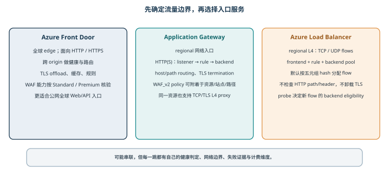
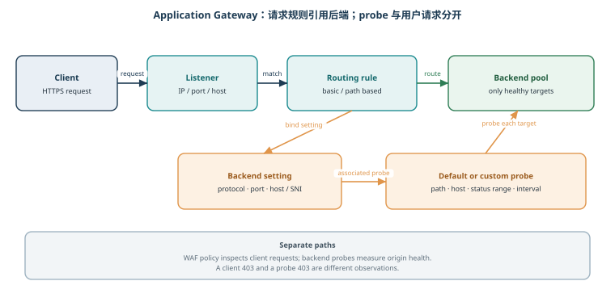
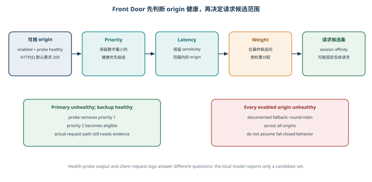

::::: cover
[AZURE CLOUDOPS · ENTERPRISE ENGINEERING]{.kicker}

# TCP 已经连通，为什么入口仍把后端判为不健康？

[Azure Load Balancer、Application Gateway 与 Front Door]{.subtitle}

::: cover-meta
- **讲次**：06 / 23
- **核心机制**：L4 flow hash、HTTP 路由、backend health 与 origin selection
- **证据边界**：Microsoft Learn + 本地合成探针决策模型
- **适用场景**：虚构结算 API 的双区域入口设计
:::

::: scenario
虚构支付 API 的两个后端都在 TCP 443 监听。为比较入口选择，工程师给 Load Balancer 配置 TCP probe、给 Application Gateway 保留默认 HTTP probe、给 Front Door 配置 HTTP health probe。后端首页 / 返回 302 登录重定向，专用 /ready 返回 200；某次故障中 /ready 又返回 503。谁会让流量继续进入这个后端？答案取决于入口在哪里、probe 实际请求了哪个 path、协议与状态码如何配置，以及“健康”这个词由谁定义。
:::

### 本讲目标

读完后，你应该能区分 L4 flow 入口与 HTTP(S) 应用路由；根据 probe 的协议、path、Host/SNI、状态码范围和采样窗口预测 backend eligibility；解释 Front Door 如何按健康、优先级、延迟和权重缩小 origin 候选集；并用症状定位 probe、路由、WAF、TLS 或实际业务故障所在的入口层。

**本讲问题：** probe 报 Healthy 究竟证明了什么，又留下哪些请求路径和业务行为没有验证？

:::::

## 入口的范围先于入口的功能

Azure Load Balancer、Application Gateway 与 Front Door 都能参与流量交付，但它们面对的范围和可观察字段不同。Load Balancer 处理 TCP/UDP flow；默认以源/目标 IP、源/目标端口和协议五元组做 hash。它不会拆开 HTTP 请求，也不会按 URL path 选择 API，因此默认 TLS 握手仍由客户端直接与所选后端完成。[1][2]

Application Gateway 是区域入口。它能通过 HTTP(S) Layer 7 proxy 检查 listener 所匹配的协议、端口、IP 与 hostname，再由 routing rule 关联 backend pool 和 backend setting。Basic rule 把 listener 请求送往一个 pool；path-based rule 可把不同 URL path 送往不同 pool。路径规则匹配 URL path，不匹配 query 参数。[4][5] 当前产品还支持同一资源上的 TCP/TLS Layer 4 proxy；本讲讨论路由和 probe 时聚焦 HTTP(S)，本地模型不模拟这项 L4 功能。

Front Door 面向全球 Web/API 入口，在 Microsoft edge 接收 HTTP(S) 请求，并从启用且健康的 origins 中计算路由候选集。其服务范围与 Application Gateway 不同：Front Door 是 global，Application Gateway 是 regional。[4][10]

这些资源可以组合成多跳入口，但每个 hop 都会有独立的 listener、probe、TLS/WAF 策略、日志和失败模式。串联不能让一个 probe 自动证明下一跳健康，也会增加延迟和运行成本。先写下客户端真正访问的 hostname 与 path，再决定哪些服务必须承担全球交付、区域 HTTP 路由或 L4 flow 分配。

## “Healthy”是一个 probe 合同

一个探针只回答自己发出的请求是否满足配置合同。它不会自动知道业务是否可用、授权用户能否登录、依赖数据库是否能完成写入，也不会证明客户端请求经过同一 hostname、同一 listener 和同一安全策略。

Azure Load Balancer 支持 TCP、HTTP 和 HTTPS probes。TCP probe 完成指定端口的连接握手；端口有 listener 响应即可让这一项检查成功，即使 HTTP 应用只返回重定向或服务错误。HTTP/HTTPS probe 对指定 path 发送 GET，成功条件是状态码恰好为 200；302、403、404 或 503 都会把 backend 判为 down。Standard Load Balancer 在某个 endpoint 探针 down 后，把新 TCP flow 交给剩余健康实例；已建立的 TCP flow 可以继续。所有探针 down 时，它不再发送新 flow；当 backend pool 有多个实例时，Standard 可让已建立的 TCP flow 继续存活。[3]

Application Gateway 的默认 HTTP(S) probe 接受 200 到 399。它使用关联 backend setting 的 protocol 与 port，默认检查根路径；默认 Host 为 127.0.0.1，除非 backend settings 配置了 hostname。依赖虚拟主机或路径的应用通常需要 custom probe，并把 probe 关联到承载该 backend 的 setting 和 rule。HTTPS 后端还要通过证书链、subject/name 与有效期校验，否则状态码即使为 200 也未必 Healthy。[6][7][8]

Front Door 的 HTTP(S) probe 把 200 OK 视为健康，其他状态码或无有效响应都算失败。它依据最近 N 个样本中至少 X 个成功的条件评估 origin，并用探针测得的 latency 参与路由。新建 profile 的默认 probe method 是 HEAD；HEAD 只请求响应头，通常比下载响应体的 GET 更适合作轻量健康检查。每个有用户流量的 edge location 会发送探针，因此 origin 收到的探针量可能远高于单个部署区域的一条周期请求。[11]

表 6-1 假设 TCP 端口开放，并且每个 HTTP probe 确实得到表中状态码。这里比较的是 probe eligibility，不代表客户端业务请求结果。

| Probe / response | 200 | 204 | 302 | 404 | 503 |
|---|---:|---:|---:|---:|---:|
| Load Balancer TCP，端口开放 | 健康¹ | 健康¹ | 健康¹ | 健康¹ | 健康¹ |
| Load Balancer HTTP | 健康 | 不健康 | 不健康 | 不健康 | 不健康 |
| Application Gateway 默认 HTTP | 健康 | 健康 | 健康 | 不健康 | 不健康 |
| Front Door HTTP(S) | 健康 | 不健康 | 不健康 | 不健康 | 不健康 |

¹ TCP probe 不读取 HTTP 状态码；此行表示端口握手成功。若 TCP listener 不响应，则此 probe 失败。

这个差异会把一次 302 登录重定向变成有用的诊断信号：Load Balancer 的 TCP probe 可以仍然通过；Load Balancer HTTP 与 Front Door 会因为不是 200 而判失败；Application Gateway 默认 probe 则会把 302 当健康。若团队希望检测“可承载匿名业务请求”，就应设计清晰、低开销的 readiness endpoint，并让每个入口对齐该 endpoint 的 Host、path、协议与健康标准。不要为了让仪表板变绿而随意扩大可接受状态码范围；如果 302 实际意味着应用重定向到不可用的登录依赖，接受 302 只会隐藏故障。

Application Gateway 的 Backend Health 报告以 server、pool、backend setting 组合呈现 Healthy、Unhealthy 或 Unknown。Unknown 可以表示控制面无法联系 gateway 实例，也可能是 backend FQDN 无法解析。刷新报告不会立刻重新执行一次探针；报告依 probe refresh interval 更新。[7]

## 后端入选不是同一种分配算法

Load Balancer 的规则把 frontend 地址和端口映射到 backend pool 与后端端口。默认五元组 hash 是 flow 级别分配：多个 HTTP 请求若复用同一 TCP connection，入口不会为每个 request 按 path 再选一次 VM。需要改变会话亲和性时，可以选择不同的 tuple distribution mode；这仍是 L4 flow 分配，不会变成 HTTP 路由。[2]

Application Gateway 先由 listener 匹配客户端请求，再使用 rule 关联的 pool 与 backend setting。setting 影响 gateway 到后端的协议、端口、hostname 和 probe 绑定。path-based rule 可以把 /api 与 /admin 等不同路径送到不同 backend pool；TLS 可以在 gateway 终止后以明文送往后端，也可以重新建立后端 TLS。是否允许明文后端连接应由威胁模型与合规要求决定，而不是认为“前端是 HTTPS”就代表全链路都加密。[4][5][9]

Front Door 的候选计算是多阶段的：先从健康 origin 中移除 disabled origin；再保留优先级数值最小的健康 origin；然后根据延迟敏感度筛出延迟范围内的 origin；最后按 weight 比例分配。启用 session affinity 时，会话首个请求按路由过程选择 origin，后续请求可以沿用首选 origin。[12]

这里有一条不直观的失败规则：当 origin group 内所有 origin 的 health probe 都失败时，Front Door 会在所有 origin 间 round robin。应用团队不应把“探针全红”误读为“Front Door 一定 fail closed”；只有实际请求日志与 origin health 证据才能证明当时哪个请求去了哪里。[11] 本地模型会显示全不健康的候选集合，但不会伪造某个实际请求被分配到哪个 origin。

## 用真实报表分离 probe、WAF、TLS 与业务症状

当客户端收到 502、403 或超时，先记下请求到达的入口 hostname、时间、path、协议和响应状态。接着沿实际拓扑逐跳定位：Front Door 的 origin health 与访问日志说明 edge 怎样看 origin；Application Gateway Backend Health 列出对应 backend address、setting、端口、协议和最近 probe 回复；Load Balancer 的 rule、probe 与 backend health 指标说明新 flow 是否有健康 endpoint。不能用一层的正常状态证明另一层没故障。

Application Gateway 502 且所有后端 Unhealthy 时，先核对 probe hostname 与 path，再检查相应 backend setting 的端口/协议、目标 DNS、NSG/route 和 HTTPS certificate chain、subject/name、validity。已知的只读 Azure CLI 报表命令是：

~~~powershell
az network application-gateway show-backend-health --resource-group <rg> --name <gateway>
~~~

这是供有权限且范围获批的未来只读诊断使用的命令。当前讲次没有登录 Azure，也没有运行该命令。[7][16]

如果后端健康报告正常但用户看到 403，检查实际请求是否被 WAF policy 拒绝、listener/routing rule 是否匹配，以及后端应用的授权行为。WAF policy 是入口的请求安全过滤策略：它不会自动证明后端可用，backend probe 也不会替代 WAF 命中日志。Application Gateway 的 WAF policy 可依 WAF_v2 支持范围关联到 gateway、listener 或 path-based rule；Front Door 的 WAF 功能随 Standard / Premium tier 而不同。[13]

若用户报 5xx 而 probe 全绿，检查 probe 是否过浅或探测了错误路径。例如根路径仍然返回 200，而实际 /ready 或支付依赖返回 503。若 Front Door 健康样本抖动，先确认 probe method、path、响应码和 origin 当前负载，再调整样本窗口；增加 edge probe frequency 会带来更多 origin 请求，不是无成本的精度旋钮。

## 本地实验：相同后端状态，不同 probe 判定

模型读取 JSON fixture 中的虚构 backend 状态：TCP listener 是否开放、path 的状态码、Front Door 最近样本、priority 与一个简化的 TLS 校验布尔值。下面函数来自本讲实验源码；其输出是合成逻辑执行结果，不是 Azure 发出的 probe。

~~~python
def lb_healthy(backend: Backend, protocol: str, path: str = "/") -> bool:
    if protocol == "TCP":
        return backend.tcp_open
    if protocol == "HTTP":
        return backend.tcp_open and backend.status(path) == 200
~~~

对于每一个 fixture，模型同时算出 Load Balancer TCP/HTTP、Application Gateway default/custom path、简化的 HTTPS 后端校验以及 Front Door 样本窗口结果。它用一组候选 origin 输出 priority 阶段结果，并明确不执行真实 request assignment。

本地一次合成场景的输出：

~~~text
login redirect: / returns 302 while /ready returns 200:
  pay-east: LB/TCP=healthy LB/HTTP(/)=unhealthy AppGW/default(/)=healthy AppGW(/ready)=healthy AppGW/HTTPS(/ready)=healthy FrontDoor=unhealthy
  pay-west: LB/TCP=healthy LB/HTTP(/)=healthy AppGW/default(/)=healthy AppGW(/ready)=healthy AppGW/HTTPS(/ready)=healthy FrontDoor=healthy
  Front Door priority candidates: pay-west
~~~

这一结果只复现了 fixture 规则。它说明如果端口还在监听，TCP health 不能发现 302；App Gateway 默认的 200–399 范围接受 302；Front Door 和 Load Balancer HTTP 不接受 302；两条 /ready 路径得到的 200 可以符合各自的 probe 合同。它没有发出 HTTP GET/HEAD、TCP 握手或 TLS 请求，也不证明真实 Azure 控制面与数据面行为。

运行本地实验、查看完整输入和限制：

~~~powershell
cd textbook/chapters/AZ02-04/labs/probe-model
python -m unittest -v
python probe_model.py
~~~

**模型边界：** 不创建 server、不发网络包、不实现 X.509/SNI、不模拟 Front Door edge mesh、latency 采样、weight/session affinity、WAF、Application Gateway rule 执行、Load Balancer flow hashing/连接状态、Azure API 或 Azure authorization。HTTPS 的 Application Gateway fixture 只读取一个人工输入的“证书与 hostname 校验通过”布尔值；它不是证书解析器。Load Balancer HTTPS probe 的证书行为不在模型范围内。

## Fault cards：沿实际数据路径收集证据

:::: {.fault title="故障 1｜TCP probe 全绿，付款 API 持续返回 503"}
- **症状**：Load Balancer 将所有 VM 视为健康；访问 /charge 返回 503。
- **假设**：probe 只测 TCP listener；HTTP probe 只测根路径；业务路径依赖项失败；实际请求复用已有 TCP flow。
- **区分**：对比 probe 协议/path 与用户请求；在同一后端检查 readiness response；记录新建连接和既有连接的差异。
- **最小修复**：为应用定义反映“能接收新请求”的轻量 health contract；按需换成 HTTP probe/path，不要在探针中执行有副作用的业务操作。
- **恢复验证**：用同一失败 path 发起新请求并保留状态码；确认探针健康切换与后端池变化，分别验证已有连接处理。
::::

:::: {.fault title="故障 2｜Application Gateway 返回 502，后端全为 Unhealthy"}
- **症状**：Listener 能接收请求，Backend Health 报告无可用后端。
- **假设**：default probe 发往 / 或 Host 127.0.0.1 得到意外响应；custom path/port 错误或未关联 setting；FQDN/DNS、NSG/UDR 或 TLS 证书/SNI 出错。
- **区分**：查看 show-backend-health 的 pool、backend setting、端口/协议、状态与 details；从报表对应证据开始查，再核对目标 listener 与证书配置。
- **最小修复**：只更正证实出错的 Host/path、setting、DNS、网络规则或证书信任配置；不要将 400–503 全部接受为 Healthy 来掩盖症状。
- **恢复验证**：等 probe refresh 后确认目标 server Healthy，再对同一 client hostname/path 做端到端请求；保留 gateway 与应用响应证据。
::::

:::: {.fault title="故障 3｜Front Door 的 origin probes 全失败"}
- **症状**：所有已启用 origin 都连续不满足 health sample 条件。
- **假设**：probe path 返回登录跳转；HEAD 与 GET 实现不同；origin TLS/DNS/网络访问失败；所有后端共同依赖不可用。
- **区分**：检查 probe method/path/response、每个 origin 的样本与应用日志、probe 到 origin 所需的公网或 Private Link 路径；关联客户端访问日志。
- **最小修复**：恢复真实 readiness 条件或修复 origin path/证书/依赖；保持备用 origin 的健康合同一致。Front Door 文档说明全不健康时会 round robin 到所有 origins，不要期待自动 fail closed。
- **恢复验证**：确认满足成功样本阈值，观察健康 origin 恢复；用同一客户端请求确认预期路由与状态码。
::::

## Exercises：预测差异，再选择证据

:::: {.exercise title="练习 1｜302 与 TCP listener"}
同一个 TCP 8443 listener 正常接受连接；根路径返回 302，/ready 返回 200。分别预测 Load Balancer TCP probe、Load Balancer HTTP probe（path=/）、Application Gateway 默认 probe 与 Front Door（path=/）的状态，并说明为何这不能证明实际付款请求成功。
::::

:::: {.solution title="练习 1 详细解答"}
Load Balancer TCP probe 健康，因为它检查连接能否建立，不读 HTTP；Load Balancer HTTP probe 不健康，因为只接受 200；Application Gateway 默认 probe 健康，因为 302 位于 200–399；Front Door probe 不健康，因为非 200 计为失败。以上只描述 probe 合同。它们不证明 /charge 返回正确结果、数据库可写、请求通过 WAF/授权或响应符合业务要求。应另以无副作用的专用 readiness endpoint 与经授权的业务功能检查回答这些问题。
::::

:::: {.exercise title="练习 2｜应用健康但 App Gateway unhealthy"}
后端直接从 VM 返回 HTTPS 200，但 Application Gateway Backend Health 显示 certificate name mismatch。为什么“浏览器直接访问成功”仍不足以说明 gateway 到 backend 正常？下一项需要核对什么？
::::

:::: {.solution title="练习 2 详细解答"}
客户端浏览器建立的是 client→gateway 或 client→backend 的 TLS 会话，不能替代 Application Gateway→backend 这一跳。Application Gateway 对后端 HTTPS 会检查证书链、subject/name 与有效期，并使用 backend setting/custom probe 的 hostname/SNI 条件。核对 Backend Health details、所选 backend setting 和 probe hostname、后端实际证书链以及 FQDN；修复最小的名称或信任配置后，等待新 probe 结果并重做同一入口请求。
::::

:::: {.exercise title="练习 3｜Front Door 没有健康 origin"}
Primary priority=1 与 backup priority=2 都不满足 probe 阈值。团队认为 Front Door 必然拒绝所有请求。判断这个结论是否安全，并说明生产处置与验证应记录什么。
::::

:::: {.solution title="练习 3 详细解答"}
结论不安全。Microsoft 文档说明某 origin group 中所有 origin probe 都失败时，Front Door 会在所有 origins 间 round robin。要确认实际请求行为，应关联 origin health、probe 结果和同一时间的客户端访问日志，而不是只看一个全红状态灯。生产处理先恢复健康合同或后端服务，并确保备用 origin 可独立承载；然后确认成功样本达到阈值，再用同一 hostname/path 验证请求。不要把未观察到的 round-robin 请求当成真实故障证据。
::::

## 本讲要点

:::: summary
::: {.card tag="范围"}
Load Balancer 按 L4 flow 工作；Application Gateway 在区域内提供 HTTP(S) 路由并也支持 TCP/TLS L4 proxy；Front Door 在全球 edge 分发 Web/API 请求。
:::

::: {.card tag="探针"}
TCP listener、HTTP 200、Application Gateway 200–399 和 Front Door 最近 N 个样本的成功阈值，是不同的健康合同。
:::

::: {.card tag="路径"}
Listener、routing rule、backend setting、probe、WAF policy 与实际业务请求各有证据。一个绿色 probe 不能证明完整用户路径。
:::

::: {.card tag="全红时"}
Front Door 在所有 origin 不健康时仍可能 round robin 到 origin 集合；必须检查访问日志与 origin 行为，不应默认 fail closed。
:::
::::

## Future read-only / live evidence record

这份记录模板用于通过 Stage 3 成本与授权门禁后的实验。本讲没有 Azure 登录、资源清单查询、probe、WAF 请求或 billing query。

| Evidence stage | 最小记录 | 能证明什么 |
|---|---|---|
| Topology | client hostname、时间、每一跳 Front Door/App Gateway/LB 资源与配置版本 | 确定请求和 probe 的入口范围 |
| Probe | pool/origin、probe protocol/method/path/Host、样本阈值、最近结果与响应 | 解释此配置下的一次健康判断 |
| Routing | listener/rule/backend setting、priority/latency/weight、最终 origin/VM 日志 | 关联某个真实请求与转发目标 |
| TLS / WAF | client TLS 与 origin TLS 证书信息、WAF policy 命中及 action | 区分证书与安全策略响应 |
| Business | 请求 ID、API path、真实响应码、无副作用的功能断言 | 说明应用路径是否达到预期 |
| Cost / cleanup | 资源清单、region/SKU/runtime、估算、删除与 residual audit、billing status | 记录实际项目花费与尚未结算部分 |

Application Gateway v2 的官方计费说明区分资源可用期间的固定成本与 capacity-unit 成本；Front Door 按 profile 小时或部分小时及 request/traffic 维度计费。Load Balancer 也有与 SKU/流量配置相关的价格维度。由于当前没有批准的区域、offer、SKU、规模、运行时间或 Azure 账单数据，本讲不作部署成本估值，也不将离线实验记为 Azure spend evidence。[14]

遇到入口故障时，可以用下表选择第一份最能区分假设的证据；它帮助缩小调查范围，不替代对完整请求链的验证。

| 症状 | 第一份区分性证据 | 不要直接推断 |
|---|---|---|
| LB probe 绿但 API 返回 5xx | probe protocol/path；新 flow 与既有 TCP flow；同一后端的 readiness 和业务 path | listener open 就代表应用可用 |
| Application Gateway 502 | 对应 pool/backend setting 的 Backend Health status、details、port/protocol、probe response 与证书诊断 | 外部客户端能 TLS 连接就代表 gateway-to-backend TLS 正常 |
| Front Door 间歇 5xx | origin health 样本与同一时间的请求日志、所选 origin | 单个全绿/全红概览证明了请求去哪一台 |
| 客户端得到 403 | WAF policy action、listener/rule 命中、应用授权日志 | 403 一定是 backend probe 失败 |
| 客户端连接超时 | 请求经过的每一跳、DNS/路由/NSG、listener 与 probe source/path | probe 成功就证明了所有客户端路径 |

## References 与研究记录

本讲于 **2026-11-26** 查阅 Microsoft Learn 与 Azure 官方 pricing 页面。引用页面可能持续更新；任何云部署前都必须重新确认 SKU、接口、价格与资源限制。以下命令仅查证文档语法，未在 Azure 登录或订阅中执行。

::: refs
1. [What is Azure Load Balancer?](https://learn.microsoft.com/en-us/azure/load-balancer/load-balancer-overview) — L4 TCP/UDP、public/internal scope、Standard 和已退休 Basic SKU；页更新 2026-08-21。
2. [Azure Load Balancer algorithm](https://learn.microsoft.com/en-us/azure/load-balancer/concepts) — 五元组 hash、session affinity、TLS pass-through 和 flow 语义；页更新 2026-08-18。
3. [Azure Load Balancer health probes](https://learn.microsoft.com/en-us/azure/load-balancer/load-balancer-custom-probe-overview) — TCP/HTTP/HTTPS probe 语义、200 条件与 Standard flow 行为。
4. [Application Gateway components](https://learn.microsoft.com/en-us/azure/application-gateway/application-gateway-components) — listener、HTTP(S) Layer 7 和 TCP/TLS Layer 4 proxy。
5. [Application Gateway request routing rules](https://learn.microsoft.com/en-us/azure/application-gateway/configuration-request-routing-rules) — Basic/path-based rule、listener、backend pool/settings 与优先级。
6. [Application Gateway health probes overview](https://learn.microsoft.com/en-us/azure/application-gateway/application-gateway-probe-overview) — 默认探针、Host/path、200–399、探针到 setting/rule 的关联。
7. [Application Gateway backend health](https://learn.microsoft.com/en-us/azure/application-gateway/application-gateway-backend-health) — Healthy/Unhealthy/Unknown 报表、refresh interval 与只读 CLI 示例。
8. [Troubleshoot Application Gateway backend health](https://learn.microsoft.com/en-us/troubleshoot/azure/application-gateway/application-gateway-backend-health-troubleshooting) — HTTPS backend 证书链、subject 与有效期检查及 502 排查。
9. [TLS termination and end-to-end TLS with Application Gateway](https://learn.microsoft.com/en-us/azure/application-gateway/ssl-overview) — 前端终止与到后端再加密的边界。
10. [What is Azure Front Door?](https://learn.microsoft.com/en-us/azure/frontdoor/front-door-overview) and [Front Door FAQ](https://learn.microsoft.com/en-us/azure/frontdoor/front-door-faq) — 全球 edge delivery、origin health、TLS offload，以及 Front Door 与 regional Application Gateway 的范围差异。
11. [Azure Front Door health probes](https://learn.microsoft.com/en-us/azure/frontdoor/health-probes) — 200 健康条件、HEAD/GET、样本阈值、edge probe 量与全 origin 失败行为；页更新 2026-11-06。
12. [Traffic routing methods for Front Door origins](https://learn.microsoft.com/en-us/azure/frontdoor/routing-methods) — 健康过滤、优先级、latency sensitivity、weight 与 session affinity。
13. [Application Gateway WAF policy overview](https://learn.microsoft.com/en-us/azure/web-application-firewall/ag/policy-overview) and [Secure your Front Door deployment](https://learn.microsoft.com/en-us/azure/frontdoor/secure-front-door) — WAF policy scope、tier capability 与 origin security。
14. [Application Gateway pricing model](https://learn.microsoft.com/en-us/azure/application-gateway/understanding-pricing), [Front Door billing](https://learn.microsoft.com/en-us/azure/frontdoor/billing), [Load Balancer pricing](https://azure.microsoft.com/en-us/pricing/details/load-balancer/) — 官方价格维度；本讲未选择 Azure region 或 SKU 做估算。
15. [Azure CLI: az network application-gateway show-backend-health](https://learn.microsoft.com/en-us/cli/azure/network/application-gateway?view=azure-cli-latest) — 只读 backend health 查询语法；没有 Azure login 或 query。
:::

本地实验与三幅 SVG 是可编辑的教学材料，不是 Azure Portal 实拍。本地状态码和样本仅用于展示探针契约间的差异；它们不验证 Azure networking、origin 分配、WAF、真实 TLS、应用可用性或任何 live billing。
