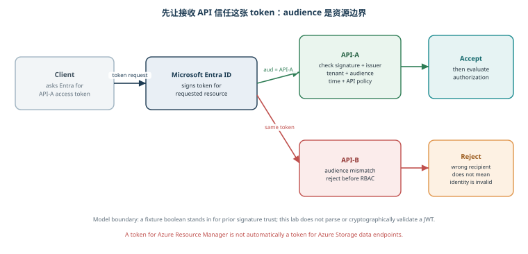
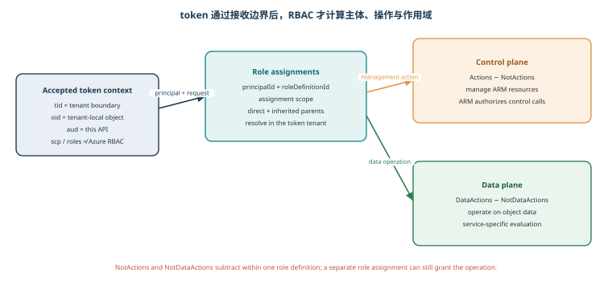
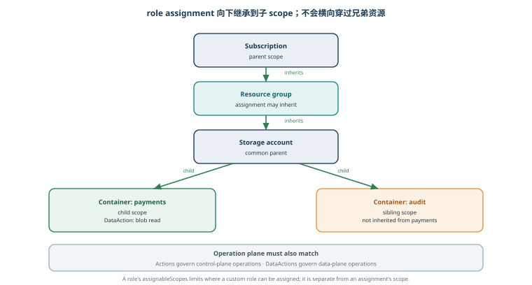

::::: cover
[AZURE CLOUDOPS · ENTERPRISE ENGINEERING]{.kicker}

# token 已经拿到了，为什么 Blob API 仍然返回拒绝？

[Microsoft Entra ID、访问令牌与 Azure RBAC]{.subtitle}

::: cover-meta
- **讲次**：07 / 23
- **核心机制**：token 接收边界、租户内 principal、role definition 与 scope
- **证据边界**：Microsoft Learn + 本地合成授权模型
- **适用场景**：虚构结算服务读取 Storage Blob
:::

::: scenario
结算工作负载能从 Microsoft Entra ID 拿到 access token。它把 token 发给 Azure Storage Blob endpoint，却得到拒绝；团队看到 token 里有 `scp=ledger.read`，又看到自己在订阅上有 Reader，因而怀疑 Storage API 故障。排查不能只问“token 有没有”：先确认 token 是发给哪个 API、由哪个 tenant 签发、代表哪个 tenant-local principal；然后确认该 principal 在目标资源或父 scope 上，是否有覆盖这项控制面或数据面的 Azure RBAC 权限。
:::

### 本讲目标

读完后，你应能沿着请求接收顺序判断：API 是否信任该 token；token 的 audience 是否指向当前接收 API；issuer 与 tenant 是否符合该 API 的信任策略；token principal 能否对应到目标租户内的 RBAC principal；role assignment 是否落在目标资源的祖先 scope；该角色是否以 `Actions` 或 `DataActions` 授权当前操作。

**本讲问题：** 哪个 identity、audience、action 与 scope 决定这次请求？

:::::

## 先定位拒绝发生在流水线的哪一段

访问令牌能证明一项经过认证的身份陈述，但只有预定接收方才能解释它，并且仍须按接收方自己的授权规则判定请求。不要把“客户端取得 token”“API 接受 token”和“API 授权操作”当成同一步。

在 Microsoft identity platform 中，access token 的 `aud` 标明预期 audience。Web API 要检查 token 的 audience 是否属于自己；访问 token 的接收 API 还要按其配置验证 issuer、签名密钥与 token 所属 tenant。单租户与多租户应用使用的 issuer 验证方式不同，不能把 `iss` 写成一个随意接受所有 tenant 的字符串。[1][2]

`aud` 的具体编码会受 token 版本影响：v2 token 的 `aud` 是 API client ID；v1 token 可以是 client ID 或请求中的 resource URI。应用不应硬编码“所有 Azure token 都采用同一种 `aud` 形状”，而应按自己 API 的受支持 token 版本与 metadata 来验。[1] 例如，发给 Azure Resource Manager 的 token 不会因此自动成为 Azure Storage Blob 的访问 token。Azure Storage 文档也明确把 Entra OAuth 身份认证与随后由 Storage 服务执行的授权分成两步。[3]

验证边界还包括时间与身份上下文。`exp` 是令牌过期时间；`nbf` 表示令牌开始可用的时间。`tid` 用于把身份声明置于具体 tenant 语境中；`oid` 是该 tenant 中 principal 的对象标识符。跨 tenant 接受令牌的 API，不能只因主体字符串相同就把不同 issuer/tenant 下的主体视为同一身份。[1][2]

`scp` 与 `roles` 可能代表发给某个应用 API 的委派 scope 或应用角色。它们不是 Azure subscription、resource group 或 resource 上的 Azure role assignment。反过来，Azure RBAC 有一个 Reader assignment，也不会自动让任意应用 API 接受一个缺失该 API 所需 scope 的 token。要问清当前 API 使用哪一种授权路径，以及是否同时要求应用层授权与 Azure RBAC。[2][4]

## 身份不是一串显示名称

Azure RBAC 的 role assignment 至少把 principal、role definition 与 scope 联系起来。principal 可以是用户、组、service principal 或 managed identity；assignment 记录的是 Entra principal 的 object ID，而不是便于人阅读的显示名称。[5]

对于应用身份，需区分 app registration 的 application/client ID 与该 tenant 内 service principal 的 object ID。Azure RBAC assignment 指向该租户中的 principal object；部署脚本应确认使用了正确 tenant 下的对象 ID、对象类型和 subscription。相同应用可以在不同 tenant 形成不同的 service principal 实例；仅比较应用名称或 client ID，不能证明当前 assignment 指向正在发请求的 principal。[5]

一个可审计的请求描述应该同时保留：签发 token 的 tenant、token 中的 principal 对象标识、接收 API 的 audience、目标 resource ID、操作名和执行时刻。若 API 是多租户的，还要把 tenant-specific issuer metadata、允许的租户策略与资源所属租户一起核对。认证身份、Azure RBAC principal 和资源所属 tenant 是互相关联但不能互相替代的证据。[1][5]

## role definition 描述可做的事；assignment 决定对谁、在哪里生效

Azure role definition 含一个或多个权限集合；role assignment 将该角色授给某个 principal，并指定 assignment scope。Azure scope 从 management group、subscription、resource group 到单个 resource 组成父子层级。父 scope 上的 assignment 可应用到下级；在子 scope 上的 assignment 不会反向扩大到父级，也不会横向授予兄弟资源。[5][6]

这里有两个容易混淆的 scope：role definition 的 `AssignableScopes` 表示自定义角色可在哪些范围内被分配；role assignment 的 `scope` 表示某个 principal 的这个角色在哪些资源上生效。它们是不同的边界。定义了一个可在 subscription 使用的 custom role，并不代表有人已经把它分给某个 principal；在一个 resource group 上分配角色，也不意味着同一角色可以分配到该租户的任何位置。[4]

Azure RBAC 的角色权限还分控制面与数据面。`Actions` / `NotActions` 描述对 Azure 资源管理操作的权限；`DataActions` / `NotDataActions` 描述直接操作对象数据的权限。像列出 Storage account、更新资源配置与读取 Blob 内容，虽可能属于同一个产品，却可能是不同授权操作。[4]

微软用 Storage Reader 举例：对 Storage account 有控制面 Reader 权限，不等于可读取 Blob 内容；当数据请求走 Microsoft Entra 用户身份授权时，数据权限须由相应 DataAction 等授权配置提供。Storage Blob Data Reader 则含有管理容器资源和读取 Blob 数据的相应权限。[3][4] 不过 Storage 还支持 Shared Key、SAS 等不同授权方法；本讲和本地模型只讨论 Entra token + Azure RBAC 这一路径，不能据此解释所有 Storage 请求的授权结果。[3]

## NotActions 是集合扣除，不是全局拒绝

有效权限的第一层计算可读作：当前 role definition 的 `Actions` 减去同一角色 `NotActions` 中匹配的操作；数据面则看 `DataActions` 减去同一角色 `NotDataActions`。这帮助以通配符定义一组权限，再在该角色内部收窄。[4]

但是，`NotActions` 和 `NotDataActions` 不是 deny assignment。若一个 role assignment 的定义排除了某操作，而另一个适用角色又授予了它，Azure RBAC 仍可允许该操作。真正的 deny assignment 是另一个机制。团队若把 Contributor 定义中的 NotActions 当成不可覆盖的安全拒绝，就会错误判断多角色合并后的权限。[4]

可用一个检查元组快速组织证据：

| 项 | 要核对的值 | 常见误判 |
|---|---|---|
| API 信任 | endpoint / 预期 audience、issuer 与 tenant policy、有效期 | 同一身份的所有 token 可以发给所有 Azure 服务 |
| principal | token 的 tenant + object ID 对应的 assignment principalId 与类型 | app/client ID、服务主体 object ID 可互换 |
| 操作与角色 | 实际 operation、控制面/数据面、role definition allow/not-list 与 condition | Reader 名称足以证明能读资源里的数据 |
| assignment scope | 目标 resource ID、assignment scope 与祖先链 | 子 scope 授权兄弟资源；AssignableScopes 等于 assignment scope |

这个表是排查顺序，不是通用授权算法。Azure 的 deny assignment、assignment condition、组成员资格、PIM 激活、服务自身访问模式与 provider-specific 授权都会影响实际结果；它们不在下方合成模型中。[4][5]

## 演算一次请求：每个边界都能单独失败

假设虚构结算工作负载在租户 A 中运行，拿到面向 Azure Resource Manager 的 token，却把它发送到 Azure Storage Blob API。即使 token issuer、时间与身份都正确，Storage 接收方也应按自己预期的 audience 拒绝该 token。此时还没进入“这个 principal 有没有 Blob Data Reader assignment”的 RBAC 计算。[1][3]

接着工作负载改为请求 Storage 可接受的 token audience。token 此刻通过了 Storage 的接收边界，并不代表数据读取已经获准。若角色仅包含对 Storage account 的控制面读取 Action，数据面 blob-read DataAction 仍没有对应授权。再把 Blob Data Reader 分配给该 tenant principal，但 scope 设为 `payments` container，则其子资源可继承该授权；兄弟的 `audit` container 不会从该 assignment 获得授权。[4][5]

如果 role assignment 设在 Storage account scope，则该范围内的子 container 可以继承适用权限。若它设在 resource group scope，影响会扩大到该组下面符合角色定义的资源。具体所需的最小 scope 要结合操作和服务支持确认；不要为了让一个 403 消失而直接把权限提升到 subscription。角色 assignment 的范围越宽，principal 泄露后的可影响资源越多。[5][6]

最后要核对真正调用的 operation。Azure 控制面调用由 ARM 处理；数据面 API 的授权可由资源 provider 或 ARM 执行。一个“读取 Storage”的自然语言描述过于宽泛，必须落实到如读取资源元数据或读取 blob 内容，并确认当前 API 实际走了哪条身份授权路径。[4]

## 只读诊断：让 principal、角色、scope 与请求对应起来

在已获批准且租户/subscription 上下文明确的未来诊断中，可以用 Azure CLI 列出目标 principal 在 resource 及其祖先上的角色 assignment。官方文档说明默认列表范围有限：`--all` 可查看更多下级 assignment，`--include-inherited` 包含父 scope assignment，`--include-groups` 可包含用户所属组的 assignment。用 object ID 可以避免 CLI 为 assignee 名称额外查询 Microsoft Graph。[7][8]

~~~powershell
$scope = "/subscriptions/<subscription-id>/resourceGroups/<rg>/providers/Microsoft.Storage/storageAccounts/<account>"
$principalObjectId = "<tenant-local-principal-object-id>"

az role assignment list --all `
  --assignee-object-id $principalObjectId `
  --include-inherited --include-groups `
  --scope $scope `
  --fill-principal-name false `
  --query "[].{principalId:principalId, role:roleDefinitionName, roleId:roleDefinitionId, scope:scope, condition:condition}" `
  --output table

az role definition list --name "<role-name-or-id>" --output json
~~~

以上是文档语法示例，没有在本项目的 Azure session 中执行。若要判断 Blob 数据权限，需进一步读取匹配角色中的 `DataActions` 与 `NotDataActions`，不要只看表格中的角色名称。assignment 上的 `condition` 也可能改变适用范围；CLI 返回列表只能说明当前身份可见的配置，不等价于服务端对同一请求的最终授权结果。[4][7][9]

排障时先保存一次真实失败的请求元数据：客户端拿 token 的 authority/tenant、资源 API、调用时间、resource ID、HTTP method/API operation、服务错误码和 correlation/request ID。再核对 token 的来源与预期 audience；服务端报告具体 operation 与 resource；检查 principal object ID 是否属于正确 tenant；然后比对角色定义和目标 scope 上直接及继承的 assignments。不要把“401 就一定是 token”或“403 就一定是 RBAC 缺角色”当作跨服务规则；必须以具体服务的响应详情和日志字段为准。

对 Blob 数据访问，Microsoft 文档说明角色变更不会立即生效：页面给出一般最多 30 分钟的说明，也列出数据权限变更通常可需最多 10 分钟、管理组 scope 或少见资源类型的 DataAction 可能更久（最高到 12 小时）。这些是文档描述的传播情况，不是所有角色变更都必须等待的固定 SLA；核对具体服务、scope 与变更时间，并保留复查证据。[3]

## 本地实验：token boundary 与 Azure RBAC 分成两阶段

`labs/authorization-model` 使用 JSON fixture 构造虚构 token、role definition、assignment 与 scope 树。一次判断依序检查合成 trust assertion、issuer、tenant、audience、`nbf` / `exp`，再使用 `tid + oid` 查找适用 assignment，沿目标 scope 的父链匹配 action。它支持角色内 `NotActions` / `NotDataActions` 扣除和多个 assignment 的授权合并。

几个关键用例及其含义：

| 合成请求 | 模型结果 | 它展示什么 |
|---|---|---|
| ARM audience token 发往 Storage audience 的 API | TOKEN 阶段拒绝 | audience 先于 RBAC 检查 |
| 只有 control-plane Reader，尝试 Blob read DataAction | RBAC 阶段拒绝 | 管理资源可读不等于数据可读 |
| Blob Data Reader assignment 位于 payments container | payments 可读；audit 不匹配 | 子 scope assignment 不横向继承 |
| 同一 DataAction 位于 Storage account scope | payments 子 scope 匹配 | 父 scope assignment 向下适用 |
| 一项 role 的 NotDataActions 排除 delete，另一 role 授权 delete | 合并后允许 | not-list 不是全局 deny |

运行模型与单元测试：

~~~powershell
cd textbook/chapters/AZ03-01/labs/authorization-model
python -m unittest -v
python authorization_model.py
~~~

该实验没有创建 JWT，不读取密钥、不请求 Entra token、不调用 Azure 或 Graph，也不发送网络请求。`signature_trusted` 是测试夹具传入的前置断言，不代表本地完成了签名、密钥轮换、issuer metadata、算法或 token version 验证。模型只接受一个预期 issuer/tenant/audience；不实现 token 缓存、撤销、组解析、application API scope 校验、assignment 条件、PIM、deny assignment、传播延迟、Storage key/SAS 或 Azure provider 的服务特定规则。它只证明代码对 fixture 输入的分支行为，不证明 Azure 实际授权。

下面是一次本地 fixture 的实际输出片段。它只显示模型判定，不来自任何 Azure endpoint：

~~~text
wrong-audience: DENY at TOKEN; audience is not this API
control-reader-is-not-data-reader: DENY at RBAC; assignments matched, but none grants this operation on this plane
data-role-at-child-scope: ALLOW at RBAC; at least one applicable role grants this operation
sibling-scope-is-not-inherited: DENY at RBAC; no matching principal assignment at target or ancestor
~~~

## 故障卡：分开查认证、受众、主体与权限

:::: {.fault title="故障 1｜API 认为 token 不适用于自己"}
- **症状**：请求在应用或服务的身份验证边界失败，或错误提示 token / credential 无效。
- **优先假设**：错误资源的 token、issuer/tenant 不匹配、签名/密钥或 token lifetime 不合要求。不要先新增角色 assignment。
- **区分证据**：接收 endpoint、请求 resource/scope、token 版本、`aud`、`iss`、`tid`、`exp` / `nbf`，以及 API 的配置 metadata。只在批准的环境中安全检查 claims，不复制 bearer token 到日志、工单或教材。
- **处理方向**：让客户端按接收 API 获取正确 token；按该 API 与 tenant policy 修复 issuer 或签名验证配置。不要通过接受任意 audience 或 issuer“消除”拒绝。
::::

:::: {.fault title="故障 2｜token 可用，Blob read 仍没有授权"}
- **症状**：请求已到 Storage 的数据端点，但读取受保护的 Blob 被拒绝。
- **优先假设**：仅有 ARM control-plane 权限、principal ID 对错租户、DataAction 缺失、scope 不覆盖资源，或当前请求使用了另一种 Storage authorization mode。
- **区分证据**：真实 endpoint 与认证模式；tenant-local principal object ID；目标资源 ID；可见的直接/继承 role assignments；每个 role definition 的 `DataActions` / `NotDataActions`；必要的服务错误详情。
- **处理方向**：确认缺少的具体数据操作后，授予最小数据角色和最小 scope；若请求使用 Shared Key 或 SAS，则按那条路径调查，不用 Entra RBAC 的单一路径模型解释。
::::

:::: {.fault title="故障 3｜新增 assignment 后仍间歇失败"}
- **症状**：同一工作负载的操作在不同调用或资源上结果不同。
- **优先假设**：刚变更的 assignment 尚在传播；多份身份凭证来源、token tenant/object ID 不同、请求打到不同资源 scope、应用缓存旧 token、组 assignment 或 role condition 没被当前清单包含，或 provider 使用不同授权流程。
- **区分证据**：对照每个失败 request 的 `tid` / `oid` / `aud` 与目标 resource ID、operation、时间、correlation ID；确认实际凭证链；列出目标 scope 的直接及继承 assignment，并检查组、条件和拒绝分配。
- **处理方向**：先找出发生分叉的第一个字段，再改最窄的配置。检查并复验服务文档描述的授权传播窗口；不要因短暂未生效而直接扩大 scope。仅看到一个角色名或一次成功请求，不足以证明所有实例、所有 scope 和所有 API 都通过。
::::

## Exercises：在增加权限前先定位边界

:::: {.exercise title="练习 1｜audience 与 RBAC 的先后顺序"}
工作负载持有一个 issuer 与有效期都符合 API 配置的 token，`aud` 指向 Azure Resource Manager；它把 token 发往 Storage Blob endpoint。该 principal 同时在 Storage account 上有 Blob Data Reader。预计先在哪个阶段发生什么？要收集哪些字段区分 token 边界与数据授权问题？
::::

:::: {.solution title="练习 1 详细解答"}
先由 Storage 接收 API 判断 token 是否是发给自己的；Azure RBAC assignment 不会把错误 audience 的 token 变成 Storage token。按服务端错误语义与实际返回证据确认它是否在 token 接收阶段失败。记录 endpoint/resource audience、`iss` / `tid`、token 版本及时间窗口，再确认调用的资源与 operation。只应在获批的安全上下文中查看 claims，不能把 bearer token 本身复制到日志。若换成正确的 Storage audience 后服务仍拒绝，再调查 principal、DataAction、scope 与 Storage 的授权模式。
::::

:::: {.exercise title="练习 2｜看得到 Storage account，却读不了 Blob"}
Principal 在 resource group 有 Reader role assignment，且该 assignment 继承到 Storage account。它可以读取 account 的资源配置，却不能通过 Entra 身份列出 Blob。列出两个不同的 permission plane，并说明下一项应检查的 role definition 字段。
::::

:::: {.solution title="练习 2 详细解答"}
读取 account 配置属于控制面操作，主要看 role 的 `Actions` / `NotActions`；列出或读取 Blob 内容属于数据面 DataAction。检查是否有适用于目标 container/account 的 `DataActions`，以及 `NotDataActions` 是否在该 role 内扣除了所需操作。也核验请求是否确实走 Entra ID authorization；Shared Key / SAS 是 Storage 的其他授权方法。不能因 Reader assignment 在父 scope 生效，就推断数据操作也随控制面权限自动放行。
::::

:::: {.exercise title="练习 3｜not-list 与 scope 边界"}
Role A 的 `DataActions` 包含 Blob 的通配权限，而 `NotDataActions` 扣除了 delete。另一个 assignment 在同一 principal、同一有效祖先 scope 上授予 delete。与此同时，Role A 只分配给 `payments` container。判断 delete 是否被 Role A 的 not-list 全局阻止，以及该 assignment 是否覆盖兄弟 `audit` container。
::::

:::: {.solution title="练习 3 详细解答"}
not-list 只从 Role A 自己的权限集合中扣除 delete；Role B 的另一条适用授权可以再次授予它，因此这不是全局 deny。Role A 在 payments container scope 的 assignment 不会横向继承到 audit；若 Role B 的 assignment 位于覆盖两者的祖先 scope，它会按自己的 role definition 与 scope 参与审查。最终结论还要检查 deny assignments、conditions、principal/group 等 Azure 机制和服务具体行为。
::::

## 本讲要点

:::: summary
::: {.card tag="边界"}
API 先验证 token 的信任链、tenant、audience 与时间；不同 Azure API 的 token 资源目标不能互换。
:::

::: {.card tag="主体"}
Azure RBAC 使用 tenant 内 principal object ID。`scp` / `roles` claim 不是 Azure role assignment。
:::

::: {.card tag="权限"}
`Actions` / `NotActions` 管控制面；`DataActions` / `NotDataActions` 管数据面。not-list 是角色内扣除，不是全局拒绝。
:::

::: {.card tag="范围"}
role assignment 向下作用于子 scope，不会从子资源横向授权兄弟。优先从实际 operation 与 resource ID 查最小必要权限。
:::
::::

## References 与研究记录

本讲于 **2026-11-26** 查阅 Microsoft Learn、Microsoft identity platform 与 Azure CLI 官方文档。以下内容用于机制解释与只读诊断命令语法；没有在 Azure 中获取 token、查询租户或角色、进行登录或执行角色变更。服务配置与页面可能更新，部署前应按当前租户、云环境和 API 文档重新确认。

::: refs
1. [Access token claims reference — Microsoft identity platform](https://learn.microsoft.com/en-us/entra/identity-platform/access-token-claims-reference) — `aud`、`iss`、`tid`、时间 claims，以及 v1/v2 access-token 差异。
2. [Access tokens in the Microsoft identity platform](https://learn.microsoft.com/en-us/entra/identity-platform/access-tokens) — 接收 API 的 token audience、issuer、签名与 tenant-independent issuer 验证。
3. [Authorize Blob Access with Microsoft Entra ID](https://learn.microsoft.com/en-us/azure/storage/blobs/authorize-access-azure-active-directory) — Blob 请求的身份认证后再由 Storage 服务授权；Storage audience 与 Entra / Shared Key / SAS 路径。
4. [Understand Azure role definitions](https://learn.microsoft.com/en-us/azure/role-based-access-control/role-definitions) — `Actions`、`NotActions`、`DataActions`、`NotDataActions`、`AssignableScopes`，以及 not-list 与 deny assignment 的区别。
5. [Understand Azure role assignments](https://learn.microsoft.com/en-us/azure/role-based-access-control/role-assignments) — principal object ID、role definition、assignment scope 与 conditions。
6. [Understand scope for Azure RBAC](https://learn.microsoft.com/en-us/azure/role-based-access-control/scope-overview) — management group、subscription、resource group、resource 的继承层次。
7. [List Azure role assignments using Azure CLI](https://learn.microsoft.com/en-us/azure/role-based-access-control/role-assignments-list-cli) — `--all`、`--include-inherited`、`--include-groups` 的列表范围。
8. [az role assignment — Azure CLI reference](https://learn.microsoft.com/en-us/cli/azure/role/assignment?view=azure-cli-latest) — `--assignee-object-id`、`--scope` 与 assignment 列表参数。
9. [az role definition — Azure CLI reference](https://learn.microsoft.com/en-us/cli/azure/role/definition?view=azure-cli-latest) — 使用角色名或 ID 查看 role definition 的语法。
:::

## 现场证据记录：留结论所需的最少上下文

以下模板面向未来已授权的现场调查。它只要求记录定位拒绝边界所需的信息，不保存原始 bearer token、client secret、签名密钥或完整敏感主体资料。若 API 响应包含个人信息、资源敏感名称或内部 IP，须按项目数据分类规则脱敏后才能进入教材或共享报告。

| 证据段 | 最小记录 | 这项记录不能单独证明 |
|---|---|---|
| 请求 | 时间与时区、API hostname/resource、method/operation、资源 ID、request/correlation ID、服务错误码 | 所有实例都执行相同 API/授权路径 |
| token 边界 | 预期 audience、issuer/tenant policy、验证器结果、时间窗；安全环境中仅记录脱敏后的必要 claim 摘要 | 未验证签名的本地解码结果可信；完整 token 应保存或分享 |
| 身份 | tenant ID、principal object ID、principal type、凭证来源、有效组成员关系证据 | 显示名或 app/client ID 一定指向当前 tenant 的服务主体对象 |
| RBAC | 实际操作、role definition ID、Actions/DataActions 与 not-list、assignment ID、scope 链、condition、相关 deny assignment | CLI 列表可见的 assignment 就是服务对当前请求的最终决定 |
| API 路径 | endpoint 与 Storage 身份授权方式；控制面/数据面；相关服务错误详情 | Entra RBAC 解释 Shared Key、SAS 或匿名访问结果 |
| 结论 | 首个拒绝边界、支持证据、未证实假设、最小修复及同一 request path 的复验记录 | 一次成功请求证明所有 tenant、资源、角色与实例均正确 |

调查结论应写成可复核的因果句，例如“请求因 audience 不匹配，在 token 接收层被拒绝，尚无 RBAC 评估证据”；或“token 通过 API 的验证，但当前 Entra 数据授权路径没有发现覆盖 Blob read 的 DataAction”。如果没有可观察到的实际服务响应、assignment 视图或所需授权模式证据，就标为待验证，而不是把本地模型结果写成 Azure 事实。
