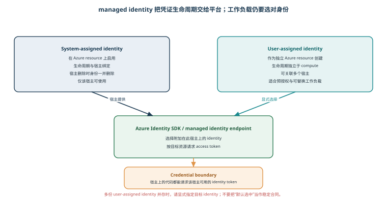
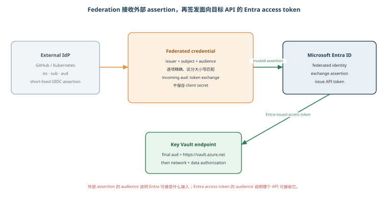
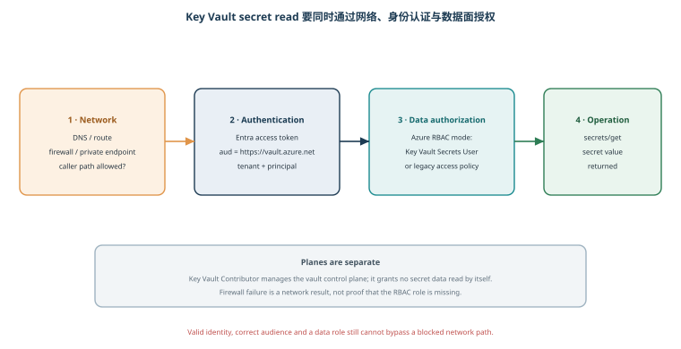

::::: cover
[AZURE CLOUDOPS · ENTERPRISE ENGINEERING]{.kicker}

# Key Vault 已经收到请求，为什么工作负载还是拿不到 secret？

[Managed Identity、Key Vault 与 Workload Identity Federation]{.subtitle}

::: cover-meta
- **讲次**：08 / 23
- **核心机制**：managed identity 选择、OIDC 信任交换、Key Vault 数据授权
- **证据边界**：Microsoft Learn + 本地合成 credential-flow 模型
- **适用场景**：Azure 应用与 CI workflow 读取一个受保护的 secret
:::

::: scenario
结算服务运行在 Azure App Service，CI workflow 则运行在 Azure 之外。服务过去把 client secret 放在应用设置里，CI 又把另一份凭证放进 pipeline variable。团队想改用平台管理的 identity，但上线演练仍拿不到 Key Vault secret：某些请求选中了另一份 user-assigned identity，另一些 token 的 audience 指向 token exchange；剩下的请求则被 vault 的网络设置或数据权限挡住。要分清这些失败，必须沿着“取得哪个身份 → 外部 token 是否被信任 → Entra token 发给哪个 API → 请求从哪里到达 → 哪种数据授权模式允许操作”逐段检查。
:::

### 本讲目标

读完后，你应能根据身份生命周期选择 system-assigned 或 user-assigned managed identity；在同一 host 附加多份 identity 时明确选择目标；逐项比对 federated credential 的 `issuer`、`subject` 和 `audience`；分开解释外部 OIDC assertion 与 Entra 面向 Key Vault 的 access token；识别 Key Vault control plane 与 data plane 授权；并把 network、token、data-role 作为独立证据收集。

**本讲问题：** 哪个身份被选中、哪份信任关系被接受，以及 Key Vault 的哪一项独立访问门槛拒绝了请求？

:::::

## Azure workload 不需要自己保存 managed-identity 密钥

Managed identity 是 Microsoft Entra tenant 中由 Azure 管理的 workload identity。Azure host 上的应用通过 Azure Identity SDK 等客户端获取访问令牌，SDK 使用运行环境提供的身份能力；应用代码不必保存一份 service-principal password。生产环境通常使用 managed identity 访问支持 Microsoft Entra authentication 的 Azure resource。[1][2]

System-assigned identity 在支持它的 Azure resource 上启用，生命周期随宿主走；删掉宿主时，绑定的 identity 也会删除。它只能由该 resource 使用。User-assigned identity 则独立创建、独立管理，可关联一份或多份 Azure resource；当宿主频繁替换、需在部署前授予目标权限，或多个 workload 有意共享同一权限边界时，这种生命周期会更合适。[1]

共享 UAMI 会让多个宿主以同一 principal 身份访问服务，因此它也扩大了这些宿主共同的权限边界。不要因为 UAMI 可以共享就默认所有 workload 共用一份；应让 identity 的权限集合、应用与环境边界保持一致。对 VM 等宿主，managed identity 的安全边界是关联的 resource：在该 host 上运行的代码都可能请求它可用的 managed identity token。隔离应用代码和保护宿主本身仍然重要。[2]

若一个 host 同时启用 system-assigned identity 和 UAMI，请求可通过 client ID、resource ID 或 object ID 指定目标 UAMI。IMDS 默认规则中，system-assigned identity 存在时，省略 selector 会默认使用它；没有 system identity 且只附加一个 UAMI 时会选中那份 identity；若多个 UAMI 并存则需明确选择。微软建议即使当前只有一个 UAMI，也明确传入它的 selector，避免未来附加第二份 identity 后出现行为变化。[3]

使用 Azure Identity 客户端库能避免手写 token endpoint 和缓存逻辑。例如，以下 Python 片段明确指定 UAMI 的 client ID，并将 credential 交给 Key Vault Secrets SDK：

~~~python
from azure.identity import ManagedIdentityCredential
from azure.keyvault.secrets import SecretClient

credential = ManagedIdentityCredential(client_id="<user-assigned-identity-client-id>")
client = SecretClient(
    vault_url="https://<vault-name>.vault.azure.net/",
    credential=credential,
)
secret = client.get_secret("<secret-name>")
# 把 secret.value 只交给需要它的代码，不输出到日志。
~~~

这是 Azure SDK 的调用形状示例，本讲没有安装 cloud SDK、请求 token、访问 vault 或读取 secret。`ManagedIdentityCredential` 在没有指定 UAMI 时使用 system-assigned identity；如需 UAMI，可通过 `client_id` 明确选择。[4]

VM 的 IMDS 示例把目标资源的 App ID URI 放在 `resource` 参数中；该 URI 会成为令牌的 `aud`。IMDS 请求还要求 `Metadata: true` header，用于降低 SSRF 风险。业务代码优先交给受支持的 SDK，而不是把 bearer token、IMDS URL 或 client ID 当作 secret 存在应用配置里。[3]

## Workload federation：外部 OIDC token 是输入凭证，不是 Key Vault token

在 GitHub Actions、Kubernetes 或其他外部运行环境中，平台可向某个 workflow 或 workload 签发短时 OIDC token。管理员在 Microsoft Entra 的 app registration 或 UAMI 上创建 federated identity credential，声明允许的外部 issuer、subject 和 audience。外部 workload 把满足该信任关系的 assertion 交给 Microsoft identity platform；Entra 验证后才向 workload 签发 Entra access token，后者再用于访问已授权的资源。[5]

### 两种 audience 属于两张不同的 token

| Token | 接收方 | 需要核对的 audience | 失败意味着什么 |
|---|---|---|---|
| 外部 OIDC assertion | Microsoft identity platform 的 federated exchange | FIC 配置中的值；常见值是 `api://AzureADTokenExchange` | Entra 不接受这份外部 assertion，尚未得到资源 token |
| Entra access token | Key Vault data endpoint | `https://vault.azure.net` | Key Vault 不把这张 token 识别为发给自己的 token |

FIC 的 `issuer`、`subject` 和 `audience` 要和外部 token 的对应 claim 精确匹配；当前匹配区分大小写。GitHub `subject` 中的组织、仓库、分支、tag 或 environment 信息会限定可请求 token 的 workflow。通配符不受支持。配置值写错时，credential 仍可能成功保存，直到 token exchange 才显露为失败。[5][6]

外部 `aud = api://AzureADTokenExchange` 只表示 Entra 可以接受这份 assertion 作为 exchange 输入，不代表 Key Vault 接受该 audience。成功交换后，工作负载还必须请求面向 Key Vault 的 Entra token，再由 Key Vault 检查身份与数据操作权限。不要把外部 token 复制到应用日志、流水线输出或诊断材料中；应记录关联的 workflow/run ID 和错误码等非 bearer 证据。

若使用 GitHub Actions，将信任关系收窄到预期的组织、repository 与 branch/environment，并保护 workflow 文件、审批规则和部署环境。FIC 信任的是声明匹配的 workload；修改工作流的触发条件或可写分支，可能改变哪些代码能以该 identity 请求 token。具体主体格式由外部 IdP 决定，应从该平台的官方配置取得实际 `iss`、`sub` 和 `aud`，不要凭示例字符串猜测。[5][6]

## Key Vault 把 control plane 和 secret data plane 分开

Key Vault 的 control plane 用于创建、配置、标记或删除 vault；data plane 用于读取或写入 key、secret 和 certificate。两者都使用 Microsoft Entra authentication，但 authorization 独立。Key Vault data plane 可使用 Azure RBAC 或旧式 access policy。微软建议使用 Azure RBAC 模型；在该模型里，`Key Vault Contributor` 管理 vault control plane，不授权读写 secret 内容。`Key Vault Secrets User` 则允许读取 secret 内容。[7]

若 vault 仍在 access-policy 模式，控制面写权限可能允许主体修改 access policy，从而给自己增加 data-plane 权限。迁移到 Azure RBAC 时，原 access policies 会失效；必须先建立等效角色分配并检查应用后果，否则会造成服务中断。[7][8]

| Built-in role | 本讲关注的权限 | 能否据此读取 secret 内容 |
|---|---|---|
| Key Vault Contributor | 管理 vault control plane | 否 |
| Key Vault Reader | 读取 vault 与对象 metadata | 否 |
| Key Vault Secrets User | 读取 secret 内容 | 是，限其 role assignment 覆盖的范围 |
| Key Vault Secrets Officer | 管理 secret 内容，不管理角色分配 | 能读写 secret；应按所需职责分配 |

这几项角色只帮助辨认边界。实际操作仍需核对角色定义、vault permission model、scope 和可能存在的条件。[7]

正确的 token 不会自动授予 secret 读取权限。还要确认调用 identity 的 tenant-local principal ID 与 role assignment 指向同一主体、角色包含该数据操作、assignment scope 覆盖目标 vault，并且 vault 当前使用与调查一致的 authorization model。对于多数应用，微软建议按应用和环境划分 vault，并把数据角色分配在 vault scope；只有存在明确的单 secret 隔离理由时才考虑更细粒度的对象级 assignment。[7]

网络也是独立门槛。Key Vault firewall、trusted-service 例外、VNet service endpoint、private endpoint、DNS 与路由决定请求是否能从当前网络到达。即使 identity 有效且拥有 `Key Vault Secrets User`，网络策略仍可阻止请求；反过来，允许网络到达也不代表调用方通过 Entra authentication 或 data authorization。[9] 本教材的本地模型只用一个布尔值表示网络结果，不模拟 DNS、private DNS zone、路由、firewall 规则、TLS 或 Key Vault 的实际错误响应；Private Link 路径请结合 AZ02-03 的网络检查方法分析。

### 把一次读取拆成四个证据点

| 顺序 | 需要的证据 | 适合先排除的误区 |
|---:|---|---|
| 1. identity selection / federation | host 附加的 identity；SDK selector；或外部 IdP 的 `iss`、`sub`、`aud` 与 FIC 配置 | “有 token”不代表选中了预期 workload principal |
| 2. Entra token | 目标 resource audience、tenant、principal object ID、时间窗口 | exchange audience 不等于 Key Vault audience |
| 3. 网络路径 | vault endpoint、DNS 结果、调用来源、firewall/private endpoint 配置与日志 | 403 不必然是 RBAC 缺角色 |
| 4. data authorization | vault permission model、principal、secret 操作、角色或 access-policy permission、scope | `Key Vault Contributor` 不是 secret reader |

该顺序用于整理诊断材料，不代表所有服务端错误都按相同顺序返回。Key Vault SDK 可能先收到带 `WWW-Authenticate` 的 401 challenge，再根据 tenant 和 resource 信息请求 token；network/firewall 结果也可能取决于请求实际走到哪一条 endpoint。[10]

## Worked example：CI workflow 通过 UAMI 读取部署配置

设想 `ledger` 仓库的 `main` branch workflow 需要从 `kv-ledger-prod` 读取一项部署配置。UAMI `ci-ledger-reader` 在 Entra 中配置一条 FIC：issuer 是 GitHub 的 OIDC endpoint，subject 精确对应该仓库和分支，audience 是 `api://AzureADTokenExchange`。workflow 取得的外部 OIDC assertion 若三项全部匹配，Entra 就将其交换为代表 `ci-ledger-reader` 的 access token。

CI 接着访问 Key Vault endpoint，最终 Entra access token 的 audience 应指向 `https://vault.azure.net`。vault 使用 Azure RBAC permission model，管理员在 `kv-ledger-prod` scope 为 UAMI 分配 `Key Vault Secrets User`。同时，runner 的网络出口必须符合 vault firewall 或 private-endpoint 设计。此时各项门槛职责不同：FIC 决定外部 workflow 能否成为 UAMI；Entra token audience 决定该 token 是否发给 Key Vault；网络设置决定请求路径是否可达；data role 决定 UAMI 是否能执行 `secrets/get`。

若 exchange 成功但 Key Vault 回 403，应分别核对实际 principal、vault permission model、Secrets User assignment 和 network/firewall 证据。不要仅因为看到 403 就给 pipeline 添加 Contributor、扩大订阅 scope 或放开 public network。每次增加授权前，先确认目标 identity、具体操作和 vault scope。

## 本地实验：identity、exchange、token、network、data role

`labs/credential-flow` 对虚构输入执行五段式判断：选择附加在 host 上的 system-assigned/UAMI；对 WIF 请求精确匹配 FIC claims；比对合成 Entra token 的 Key Vault audience、tenant 与 principal；检查一个独立 network gate；最后根据 fixture 中的 permission model 检查符号化 secret 操作。输出不含 token 字符串或 secret value。

在仓库根目录运行：

~~~powershell
python -m unittest discover -s textbook/chapters/AZ03-02/labs/credential-flow -p "test_*.py" -v
python textbook/chapters/AZ03-02/labs/credential-flow/credential_flow_model.py
~~~

以下是虚构 fixture 的预期输出片段，不来自 Entra、Azure 或真实 workflow：

~~~text
managed-identity-secret-read: ALLOW at COMPLETE; all fixture gates passed
multiple-identities-require-selector: DENY at CREDENTIAL; multiple user-assigned identities require an explicit selector
federated-workload-secret-read: ALLOW at COMPLETE; all fixture gates passed
contributor-is-control-plane-only: DENY at AUTHZ; no Key Vault data role grants this operation
network-blocks-authorized-identity: DENY at NETWORK; vault network path is blocked by the fixture
wrong-final-token-audience: DENY at TOKEN; Entra access token audience is not Key Vault
~~~

测试还覆盖 FIC subject 大小写不符、外部 audience 错误、把 exchange audience 误用为 Key Vault audience、未附加的 UAMI、没有数据角色、遗留 access policy 仅在对应模式下生效，以及 key-vault Contributor 不具有 secret data read。RBAC 的角色权限在模型中只是少量符号化映射，不是 Azure 完整 role definition；scope inheritance、deny assignment、ABAC condition、PIM、group membership、token signature/lifetime、token caching、permission propagation、claims challenge、实际 Key Vault 网络行为均不在模型内。

## 只读诊断准备：先确认 principal，再查目标 vault

未来获准的只读诊断可以先取得明确的 vault resource ID 和已确认的 tenant-local principal object ID，再检查 vault 的 permission model 和对应 scope 上的 role assignment。下方 CLI 只是文档语法模板，本项目没有 Azure 登录，也没有运行它：

~~~powershell
$vaultScope = "/subscriptions/<subscription-id>/resourceGroups/<resource-group>/" +
              "providers/Microsoft.KeyVault/vaults/<vault-name>"
$principalObjectId = "<verified-tenant-local-principal-object-id>"

az role assignment list `
  --all `
  --include-inherited `
  --assignee-object-id $principalObjectId `
  --scope $vaultScope `
  --query "[].{principalId:principalId, role:roleDefinitionName, scope:scope}" `
  --output table
~~~

该列表只显示当前调用身份可见的配置，不证明服务端对某次 `secrets/get` 请求的最终决定，也不检查 private endpoint DNS 或 firewall。先核对 principal object ID 再解释 assignment；若 vault 使用 access-policy model，应沿旧策略配置查权限；若使用 RBAC model，检查适用的 Key Vault data role 与 scope。不要执行 permission model 切换或 role assignment 写入来“试试看”。[7][11]

## 故障卡：追到第一个失败的身份边界

:::: {.fault title="故障 1｜请求拿到了 token，但主体不对"}
- **症状**：Azure host 有多份 managed identity；调用结果像是缺权限，assignment 又似乎存在。
- **优先假设**：SDK 使用 system-assigned 默认身份，或 UAMI selector 指向另一份 identity。
- **区分证据**：宿主实际附加的 identity、credential 配置中的 client ID、错误关联 ID，以及获批诊断中解析出的 principal object ID。不要把整个 bearer token 贴到日志。
- **处理方向**：明确选择目标 UAMI；将该 principal 与 vault assignment 对齐。若宿主确实应使用 system identity，则移除含糊 selector 并验证部署配置。
::::

:::: {.fault title="故障 2｜Federated token exchange 没有匹配 FIC"}
- **症状**：CI 已取得外部 OIDC assertion，但 Entra 无法为 workload 交换资源 access token。
- **优先假设**：`iss`、`sub` 或 incoming `aud` 与 FIC 不同；大小写、branch、tag 或 environment 字符串不一致。
- **区分证据**：外部 IdP 的工作流配置、FIC 配置、AADSTS 错误码与安全保存的非敏感 workflow/run 元数据。不要保存 assertion 本身。
- **处理方向**：以 IdP 实际声明校正 FIC 并收窄主体范围。对 exchange 失败，不要改 Key Vault RBAC，因为此时还没完成资源 token 交换。
::::

:::: {.fault title="故障 3｜Key Vault 返回拒绝，网络与 data role 混在一起"}
- **症状**：token acquisition 成功，secret 请求被 401 或 403 拒绝。
- **优先假设**：401 检查最终 token audience、tenant 与 Key Vault challenge；403 分开检查 network path 和 data-plane authorization。
- **区分证据**：实际 vault hostname、非敏感请求 ID / correlation ID、network path、vault permission model、调用 principal object ID 与只读可见的 role/access policy。
- **处理方向**：补齐确实缺失的最小 data role 或修复真实网络路径；不要给 `Key Vault Contributor` 当作 secret role，也不要仅为排错打开所有网络入口。
::::

## Exercises：避免修错边界

:::: {.exercise title="练习 1｜选择哪份 UAMI？"}
一个 App Service 同时有 system-assigned identity 与两份 UAMI。应用 SDK 省略 identity selector，token 成功取得，但其 principal 没有目标 vault 的 Secrets User。解释可能原因，并给出可验证的修复方式。
::::

:::: {.solution title="练习 1 详细解答"}
IMDS 默认规则在宿主启用 system-assigned identity 时，会在请求未指定身份时默认选中它。应用可能拿到了有效但与期望不同的主体 token。明确把目标 UAMI 的 client ID 传给受支持的 SDK credential；核对 host 已附加该 UAMI，再以已验证的 principal object ID 检查 vault scope 上的 data role。不要只根据 token 成功就认为身份正确，也不要先给 system identity 增权。
::::

:::: {.exercise title="练习 2｜两个 audience 分别属于哪一步？"}
GitHub workflow 的 FIC audience 是 `api://AzureADTokenExchange`。Entra exchange 成功，之后对 Key Vault 发送的 token 却仍以该值作为 audience。请求会通过哪一步失败？成功路径的两个 audience 应如何分别解释？
::::

:::: {.solution title="练习 2 详细解答"}
FIC audience 用于匹配来自 GitHub 的外部 assertion。exchange 成功后，工作负载还需取得面向目标 Key Vault 的 Entra access token，其 resource audience 为 `https://vault.azure.net`。若发给 Key Vault 的 token 仍是 `api://AzureADTokenExchange`，Key Vault 不会把它视为面向自己的 token。随后还要通过 network 和 data-plane authorization。
::::

:::: {.exercise title="练习 3｜带正确角色仍返回 403"}
某 UAMI 在 vault 上有 `Key Vault Secrets User`，token 的 Key Vault audience 与 principal 也正确，但请求从受限 runner 走 public endpoint；vault 只允许 private endpoint 网络。下一步该收集什么证据？为什么再分配 Contributor 无帮助？
::::

:::: {.solution title="练习 3 详细解答"}
检查调用端 DNS 是否解析到预期 private endpoint，路由与 endpoint 链路是否可达，vault firewall/private networking 配置与请求来源是否匹配，并用 request ID 对照 vault diagnostic logs。题设中的 data role 已覆盖 secret read；Contributor 管理 vault control plane，也不会让被阻断的请求穿越网络边界。应定位网络路径，不扩大角色或放开公共访问。
::::

**本讲总结：** 选对身份，分别匹配 FIC 输入与 Key Vault token 的 audience，再独立核验 network 和 data role；先定位拒绝证据，再改最小范围配置。

## Primary references

1. [Managed identities for Azure resources overview](https://learn.microsoft.com/en-us/entra/identity/managed-identities-azure-resources/overview)
2. [Managed identities developer introduction and guidelines](https://learn.microsoft.com/en-us/entra/identity/managed-identities-azure-resources/overview-for-developers)；[managed identities FAQ](https://learn.microsoft.com/en-us/entra/identity/managed-identities-azure-resources/managed-identities-faq)
3. [Acquire a token on a VM with managed identity](https://learn.microsoft.com/en-us/entra/identity/managed-identities-azure-resources/how-to-use-vm-token)
4. [Azure Identity `ManagedIdentityCredential` for Python](https://learn.microsoft.com/en-us/python/api/azure-identity/azure.identity.managedidentitycredential?view=azure-python)；[Key Vault Secrets SDK for Python](https://learn.microsoft.com/en-us/python/api/overview/azure/keyvault-secrets-readme)
5. [Workload identity federation concepts](https://learn.microsoft.com/en-us/entra/workload-id/workload-identity-federation)
6. [Workload identity federation considerations](https://learn.microsoft.com/en-us/entra/workload-id/workload-identity-federation-considerations)；[case-sensitive FIC matching](https://learn.microsoft.com/en-us/entra/identity-platform/reference-breaking-changes#august-2024)
7. [Azure RBAC guide for Key Vault](https://learn.microsoft.com/en-us/azure/key-vault/general/rbac-guide)
8. [Migrate Key Vault to Azure RBAC](https://learn.microsoft.com/en-us/azure/key-vault/general/rbac-migration)
9. [Configure network security for Azure Key Vault](https://learn.microsoft.com/en-us/azure/key-vault/general/network-security)
10. [Key Vault authentication, requests, and responses](https://learn.microsoft.com/en-us/azure/key-vault/general/authentication-requests-and-responses)
11. [Azure CLI: list role assignments](https://learn.microsoft.com/en-us/cli/azure/role/assignment?view=azure-cli-latest)
