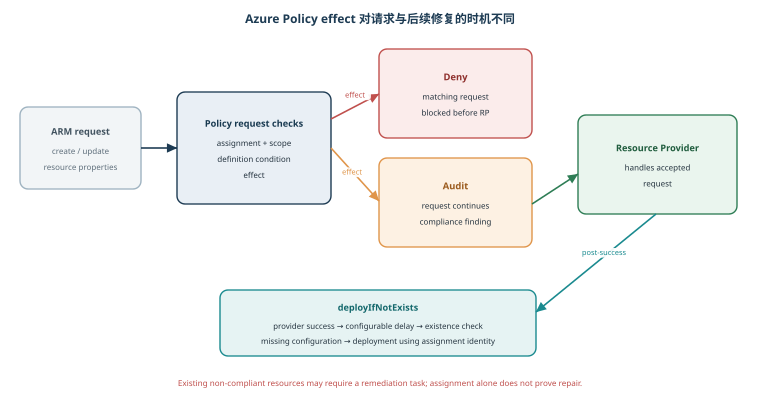
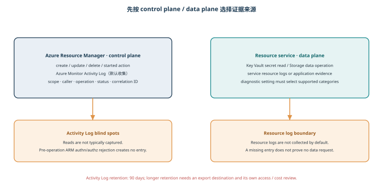
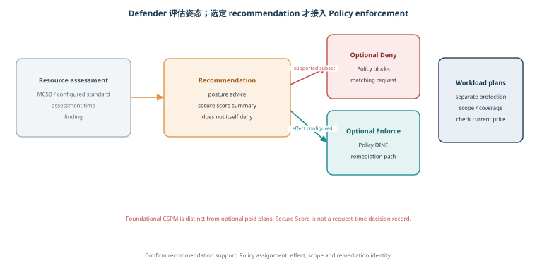

::::: cover
[AZURE CLOUDOPS · ENTERPRISE ENGINEERING]{.kicker}

# 安全建议已经出现，为什么资源仍然成功创建？

[Azure Policy、Activity Log 与 Defender for Cloud]{.subtitle}

::: cover-meta
- **讲次**：09 / 23
- **核心机制**：策略请求时评估、控制面日志、云安全态势与修复
- **证据边界**：Microsoft Learn + 本地合成治理模型
- **适用场景**：调查 Storage 配置漂移、授权失败与安全建议
:::

::: scenario
平台团队发现一项 Storage 账户允许公共网络访问。Defender for Cloud 显示安全建议；一位管理员说“策略已经开启”，但同类资源仍创建成功。几分钟后，另一个部署请求失败，却在 Activity Log 中找不到记录。要回答这些问题，先分清三条链：Azure Policy 在特定请求或合规评估中执行 effect；Activity Log 记录已开始的管理操作；Defender for Cloud 汇总安全态势并给出建议，只有部分建议能配置成 Policy 强制效果。
:::

### 本讲目标

读完后，你应能按请求时机解释 Audit、Deny 与 deployIfNotExists；从 Activity Log 和资源日志中选择符合问题的数据源；说明 Defender 的 posture recommendation 何时仍只是建议、何时通过 Azure Policy 变成约束；并在日志缺失时避免把“未观察到”误当成“没有发生”。

**本讲问题：** 这项配置是谁评估的、请求在哪一步停止，以及哪一种记录能证明发生过什么？

:::::

## 三种机制回答三种不同的问题

Azure Policy 管治理规则：哪些配置合规，哪些请求被拒绝，或哪些关联配置需要部署。Azure Monitor Activity Log 管控制面活动证据：哪些已开始的管理操作改变了 Azure resource，状态是什么。Microsoft Defender for Cloud 管安全态势、建议与工作负载保护；它可以把一部分建议配置为 Azure Policy effect，但“看见建议”本身并不表示创建请求会被拦截。[1][2][3]

| 问题 | 优先证据 | 不能单独推出的结论 |
|---|---|---|
| 为什么新建请求被拒绝？ | Azure Policy assignment、definition、effect、请求结果与错误信息 | 一个未通过的安全建议不一定就是 Deny |
| 现有资源是否合规？ | 该资源适用 assignment 的 compliance state 和 evaluation details | “合规”不代表所有未配置的安全要求都已覆盖 |
| 谁何时修改了资源？ | 该 scope 的 Activity Log operation、caller、status、resource ID、correlation ID | 日志里没有可见事件不一定等于没有尝试 |
| 谁读取了 secret 或 blob？ | 目标服务的 data-plane resource log（若已配置）及应用证据 | Activity Log 通常不记录资源读取 |
| 安全建议是否会阻止部署？ | Defender recommendation 的 effect 设置与对应 Policy assignment | 默认显示 recommendation 不等于已启用 Deny |

## Azure Policy：effect 决定这条规则怎样生效

Policy assignment 将一个 policy definition 或 initiative 绑定到管理组、subscription、resource group 或 resource scope。定义中的条件匹配资源时，单个 effect 决定 Policy 在该路径上的行为。具体可用 effect 取决于定义、资源类型与 mode；一个策略并不会自动覆盖所有 resource provider 的请求方式。[1]

| Effect | 创建或更新请求 | 已存在的违规资源 | 主要边界 |
|---|---|---|---|
| Audit | 该 effect 本身记录治理结果，不阻止 Resource Provider 处理请求 | compliance evaluation 可标为 non-compliant | 是观察信号，不是请求拒绝 |
| Deny | 在 Resource Manager 请求到达 Resource Provider 前拒绝匹配的请求 | 合规扫描可显示既有资源违规；拒绝新请求不等于修复既有资源 | 只在适用的 assignment、definition、scope 与请求路径上生效 |
| deployIfNotExists | Resource Provider 成功后，延迟检查相关配置；缺少目标配置时部署模板 | 要求配置 remediation task，assignment 还要有可执行部署的 managed identity 与权限 | 不是即时修复；模板、identity、权限与重试都要单独验证 |
| Disabled | 不执行该定义的 effect | 不提供该规则的 enforcement | 关闭规则与排除资源不是同一治理决定 |

Policy 在请求期间处理 Resource Manager mode 下的 effect 时，append/modify 可能先改变输入，随后检查 Deny 和 Audit；成功的资源请求交给 Resource Provider 后，auditIfNotExists/deployIfNotExists 才做存在性检查。deployIfNotExists 可设置延迟；成功请求以后也可能要等评估或 remediation task。[1][2]

因此，“该资源已 Non-compliant”与“该请求一定会失败”不是同一种观察。Audit 会让匹配资源显示 non-compliant，却允许请求继续到 provider。Deny 会阻止符合条件的新建或更新；已存在资源仍要靠评估来识别，单凭 Deny assignment 不会把它自动改好。deployIfNotExists 则依赖 deployment identity 与目标资源权限；对历史资源，明确的 remediation task 才是常见修复入口。[2][3]

::: example
**Storage 漂移示例：** 若 assignment 的 effect 是 Audit，启用公共网络的账户可以由请求继续创建，随后成为 non-compliant。改成适用的 Deny 后，新的匹配请求可被拒绝；旧账户仍需单独调查与修复。若控制项是 deployIfNotExists，则先检查配置的延迟、assignment identity、所需 role 与 remediation task 状态，不能从“已创建 assignment”推断资源已经修复。
:::

management group 或 subscription 上的 assignment 可能传递到下级；排除与 exemption 表示不同的治理范围。多个 assignment 可以同时生效，某个 Audit 结果不抵消另一个 Deny。解释一次结果时，要定位实际 definition、assignment、effect、scope 与请求资源类型。[1][2]

## Activity Log：控制面记录有边界

Azure Monitor 自动收集 Activity Log。它面向 Azure control plane，记录创建、更新、删除、操作以及部分 Resource Manager deployment error。管理操作通常提供 operation、status、event time、caller、resource ID 与 correlation ID 等线索；多个 event 可能共享 correlation ID，帮助串起较大的管理操作。[4][5]

Activity Log 不等于所有 Azure activity 的审计记录。它通常记录变更或已启动的 action，不通常捕获 read operation。它不是 authentication 或 authorization audit log：如果 Azure Resource Manager 在操作开始前就因 authentication/authorization 拒绝请求，该请求不会产生 Activity Log entry，也不会触发 Activity Log alert 或流向由 diagnostic setting 配置的目标。[4]

| 事件 | 常见证据来源 | 解释时的限制 |
|---|---|---|
| Resource Manager 创建 / 更新 / 删除 | Activity Log | 依 scope、时间窗、operation、status 与 caller 过滤 |
| 已启动的 ARM 操作失败 | Activity Log 的 operation 状态和错误详情 | 错误原因还可能需看服务部署细节 |
| 操作开始前的 ARM 身份验证 / 授权拒绝 | ARM / CLI 错误、调用端记录、身份配置 | Activity Log 缺项符合文档行为；它不能证明“没有人尝试” |
| Key Vault secret read、Storage data read | 服务自己的 resource log 或应用证据 | data-plane log 不默认收集；先确认诊断类别与配置 |
| Policy effect action | Activity Log 的 Policy category 可包含 effect action 记录 | 不把它当成每种授权失败的完整审计 |

系统默认保留 Activity Log 90 天，然后删除。较长保留期需用 diagnostic setting 将所需类别导出到合适目标，并核对目标成本、访问控制和留存策略。新事件通常在 3–20 分钟内可供分析，所以刚发生事件的短暂缺失也需考虑可见延迟。[4]

诊断时先确认时间范围、subscription、scope、过滤器与当前 CLI/portal context，再核对 operation、status、caller、resource ID 和 correlation ID。若查 secret/blob 内容读取，应转向目标 resource 的 diagnostic setting、resource logs 与应用端记录。若是 ARM 前置 authz 拒绝，保留 CLI / deployment 错误、调用时间、correlation/request ID（若有）和当时身份；不要因 Activity Log 无事件就断言没有请求。

## Defender for Cloud：态势建议不自动等于 enforcement

Microsoft Defender for Cloud 汇集 CSPM、DevSecOps 与 CWPP 能力。对 Azure 环境启用后，它按配置的标准和策略评估资源、生成 recommendations，并可用 secure score 汇总部分安全发现。分数是 posture 摘要，不是某次创建请求的决策结果；不同 Defender portal 与 Azure portal 中的 Secure Score 模型可能不同，不能把分值变化直接当作单个 Policy effect 的证据。[6][7]

默认 Microsoft Cloud Security Benchmark (MCSB) 会评估相应的安全控制并给出建议。某项建议可指导团队采取行动，但是否在部署时阻止不合规配置，仍取决于它是否属于支持的 subset、对应 effect 如何配置，以及相应 Azure Policy assignment 是否适用。[8]

| Defender 观察 | 能说明什么 | 还需要验证什么 |
|---|---|---|
| Recommendation / non-compliant finding | 某项评估条件发现待处理问题 | 资源、标准、control、assessed time、适用 Policy assignment |
| Deny effect（受支持建议） | Azure Policy 可在请求阶段阻止匹配的新建 / 更新请求 | 实际 assignment、effect、scope、definition 和请求结果 |
| Enforce / deployIfNotExists（受支持建议） | 通过 Azure Policy 的部署 effect 提供自动修复路径 | managed identity、role、template、evaluation delay、remediation 状态 |
| Workload protection plan | 对应服务类别的保护能力已启用 | 具体 plan、适用资源、告警来源与当前价格 |

Deny 与 Enforce 只适用于一部分 Azure recommendations。Deny 依 Azure Policy 阻止不符合要求的新资源；Enforce 使用 deployIfNotExists 路径进行 remediation。不能把所有 MCSB recommendation 都说成默认阻断或自动修复。Defender for Cloud 有 foundational CSPM 能力，也有可产生费用的附加计划；免费试用、使用上限与价格会按 plan 改变。此教材不启用 plan、不作价格估算，也不把“已看到建议”当作 Defender 功能已全量启用。[8][9]

## Worked example：同一个账户，四种不同的证据

某团队创建名为 stledgerprod 的 Storage account，设置为允许 public network。组织在上级 scope 配置一项 Audit assignment。创建请求成功后，Azure Policy 将配置标成 non-compliant；Defender for Cloud 也可能出现相应的 MCSB recommendation。此时 Activity Log 可帮助确认 ARM write 是否开始、由谁执行、结果如何，但不能证明读取了哪一个 blob。

团队将该控制配置为 Deny 后，后续符合条件的请求可能被 Azure Policy 在 Resource Provider 处理前拒绝；应检查具体错误、assignment/effect、scope 和 Policy compliance details。先前已存在的账户不会因 Deny assignment 自动关闭公共网络访问。若选择 deployIfNotExists，需检查定义是否会改动目标配置、assignment managed identity 的权限，以及后续 evaluation/remediation 结果。

另一个部署者若在 ARM 操作启动前因权限不足被拒绝，Activity Log 里没有该尝试是文档定义的行为。应用若读取 Key Vault secret，则那是 data-plane 操作，需要 Key Vault resource logs（已启用所需诊断类别时）或应用证据。Defender 的分数与 recommendation 不能补上这两类缺失的事件证据。

## 本地实验：分别预测 policy outcome、日志边界与 Defender effect

labs/governance-evidence-model 使用虚构输入构造三个独立判定：

1. **Policy**：对 create/update/existing 三个阶段及 Audit、Deny、deployIfNotExists 三种 effect，判断该 effect 是否阻止请求、给出什么合规信号、以及是否需要 post-success remediation 路径。
2. **Activity evidence**：区分已启动的 management write、通常不记录的 management read、需 diagnostic setting 的 data-plane read，以及操作开始前的 ARM authn/authz 拒绝。
3. **Defender**：把 recommendation 本身与可选的 Audit、Deny、Enforce 设置分开；另行提示 workload plan 的费用状态需要人类核价。

~~~powershell
python -m unittest discover -s textbook/chapters/AZ03-03/labs/governance-evidence-model -p "test_*.py" -v
python textbook/chapters/AZ03-03/labs/governance-evidence-model/governance_evidence_model.py
~~~

示例输出来自 fixture，不来自 Azure：

~~~text
audit-allows-matching-create: ALLOWED_NON_COMPLIANT
deny-blocks-matching-update: BLOCKED_BY_POLICY
dine-existing-resource: REMEDIATION_TASK_REQUIRED
started-management-write: ACTIVITY_LOG_EXPECTED
pre-operation-authz-rejection: NO_ACTIVITY_LOG_ENTRY
key-vault-data-read-no-diagnostics: RESOURCE_LOGS_REQUIRE_DIAGNOSTIC_SETTING
defender-recommendation-only: RECOMMENDATION_ONLY
defender-deny-enabled: REQUEST_ENFORCEMENT_VIA_AZURE_POLICY_DENY
~~~

这是教学用决策夹具，不是 Azure Policy evaluator、ARM、Azure Monitor、Defender API 或费用计算器。它不解析 policy JSON、alias、initiative、exemption、policy mode、资源 provider 行为、真实 compliance state、遥测延迟、日志 schema 变化、事件投递或计划计费。真实控制行为必须在获批环境中用精确 assignment 与事件证据单独验证。

## 只读诊断模板：离线阅读，不要在 Stage 3 前执行

以下是 Azure CLI 只读查询的文档模板。它仍然会访问真实 subscription；本项目当前尚未通过 Stage 3 L0 scope/authorization gate，也没有授权执行 live query。只有未来的 L0 preflight 明确纳入该 subscription、命令和身份后，才可运行。参数必须换成已批准的最小 scope 与时间窗。

~~~powershell
# 观察一个资源最近的 Policy compliance state（仅在获批的 L0 scope 内执行）
az policy state list `
  --resource "/subscriptions/<approved-subscription>/resourceGroups/<approved-rg>/providers/Microsoft.Storage/storageAccounts/<approved-account>" `
  --top 50

# 观察一个 resource group 最近的 ARM Activity Log（仅在获批的 L0 scope 内执行）
az monitor activity-log list `
  --resource-group "<approved-resource-group>" `
  --offset 7d `
  --max-events 100
~~~

Policy state 与 Activity Log 回答不同问题；两者都不能取代资源的 data-plane diagnostic logs。读取 Defender recommendation 时，应同时保存 recommendation/control、资源 ID、评估时间、适用标准和建议的 effect 设置。对任何命令输出应用最小访问、脱敏与保存期限规则；不要导出 token、secret value 或无关的用户身份材料。[10][11]

## 故障卡：不要从缺少一条记录跳到结论

:::: {.fault title="故障 1｜Policy assignment 存在，但请求仍成功"}
- **可能原因**：assignment 的 effect 是 Audit；scope 未覆盖资源；definition 条件未匹配；resource type/mode 不在规则支持范围；刚完成的合规评估尚未更新。
- **区分证据**：assignment ID、policy definition/effect、scope、资源类型和条件值、compliance details、request result。
- **下一步**：先证明请求适用哪条 assignment，再判断是否需要显式 Deny 或其他 effect。不要仅凭门户中看见一项 assignment 推断“已强制”。
::::

:::: {.fault title="故障 2｜部署被拒绝，但 Activity Log 没有失败事件"}
- **可能原因**：ARM 在 operation 开始前拒绝身份验证或授权；或查询的 scope、时间窗、过滤器/context 不匹配。
- **区分证据**：客户端/CI 的原始错误码、请求和 correlation ID（若有）、当前 CLI tenant/subscription、目标资源 scope、身份凭据与权限。
- **下一步**：先检查调用端和 assignment/RBAC；不要用 Activity Log 的缺项证明从未发起请求。
::::

:::: {.fault title="故障 3｜Defender 有 recommendation，却没有阻止创建"}
- **可能原因**：该 recommendation 仅用于评估；Deny / Enforce 不支持该项；effect 仍为 Audit/Disabled；assignment scope 或策略条件不匹配。
- **区分证据**：标准与 recommendation ID、支持的 effect、effect 参数、Policy assignment 与请求错误。
- **下一步**：先识别 control 目标和支持的 enforcement 路径，再按变更流程验证 policy、identity 与 remediation。不要直接开启所有 Defender workload plan。
::::

:::: {.exercise title="练习 1｜为什么 Audit 后资源仍然创建？"}
一个 Storage 账户允许 public network access。资源由 ARM 成功创建，随后 Policy state 显示 Non-compliant。解释 Audit effect 与 Deny effect 的区别，并指出已存在资源应怎样处理。
::::

:::: {.solution title="练习 1 参考答案"}
Audit 只报告匹配的治理条件，不能阻止请求到达 Resource Provider；所以资源可创建成功并在后续 compliance evaluation 中显示 non-compliant。Deny 会阻止适用条件下的新建或更新请求，但不会自动改写历史资源。历史资源要通过经审查的修复流程，或在定义支持且权限正确时建立 DINE remediation task。
::::

:::: {.exercise title="练习 2｜失败请求为什么没有 Activity Log？"}
CLI 显示 ARM 权限拒绝，Activity Log 搜索不到失败事件。应用团队还想确认某个 Key Vault secret 是否被读取。分别选择证据来源，并说明缺项能证明什么。
::::

:::: {.solution title="练习 2 参考答案"}
若 ARM 在操作开始前拒绝 authentication/authorization，该请求不会产生 Activity Log entry；检查 CLI 错误、调用身份、目标 scope 和非敏感 request/correlation ID。Secret read 是 data-plane 操作；Activity Log 通常不记录 read，应检查已启用的 Key Vault resource log 类别与应用端证据。没有日志只可能说明该源没有可见记录，不能证明没有尝试或读取。
::::

:::: {.exercise title="练习 3｜Recommendation 是否就是生产拦截？"}
Defender for Cloud 显示 MCSB recommendation；门户摘要分数下周变高。哪些证据能证明新资源创建会被拒绝？为什么不能只看分数？
::::
:::: {.solution title="练习 3 参考答案"}
确认该 recommendation 支持 Deny；找到对应 Policy definition 与有效 assignment，核对 effect、scope、条件、资源类型和请求执行路径；再用获批的具体请求结果或 Policy event/compliance details 验证。Secure Score 是姿态摘要，且不同门户模型不相同；分值变化不能证明某个 request-time Deny 生效。
::::

**本讲总结：** Policy effect 决定规则怎样作用于请求与现有资源；Activity Log 只覆盖它定义的管理事件边界；Defender recommendation 需与实际 enforcement 配置分开验证。用和问题匹配的日志源、assignment 与请求证据，避免从分数或日志缺项推出超出证据的结论。

## Primary references

1–2. [Azure Policy effect basics](https://learn.microsoft.com/en-us/azure/governance/policy/concepts/effect-basics)；[compliance states](https://learn.microsoft.com/en-us/azure/governance/policy/concepts/compliance-states)
3. [deployIfNotExists effect](https://learn.microsoft.com/en-us/azure/governance/policy/concepts/effect-deploy-if-not-exists)；[remediate non-compliant resources](https://learn.microsoft.com/en-us/azure/governance/policy/how-to/remediate-resources)
4–5. [Activity Log](https://learn.microsoft.com/en-us/azure/azure-monitor/fundamentals/activity-log)；[event schema](https://learn.microsoft.com/en-us/azure/azure-monitor/platform/activity-log-schema)
6–7. [Defender for Cloud overview](https://learn.microsoft.com/en-us/azure/defender-for-cloud/defender-for-cloud-introduction)；[Secure Score](https://learn.microsoft.com/en-us/azure/defender-for-cloud/secure-score-security-controls)
8. [Manage MCSB recommendations](https://learn.microsoft.com/en-us/azure/defender-for-cloud/manage-mcsb)；[Defender policy reference](https://learn.microsoft.com/en-us/azure/defender-for-cloud/policy-reference)
9. [Connect Azure subscriptions and plan costs](https://learn.microsoft.com/en-us/azure/defender-for-cloud/connect-azure-subscription)
10–11. [Azure CLI policy-state list](https://learn.microsoft.com/en-us/cli/azure/policy/state?view=azure-cli-latest)；[Activity Log query guide](https://learn.microsoft.com/en-us/azure/azure-monitor/platform/activity-log-view)
