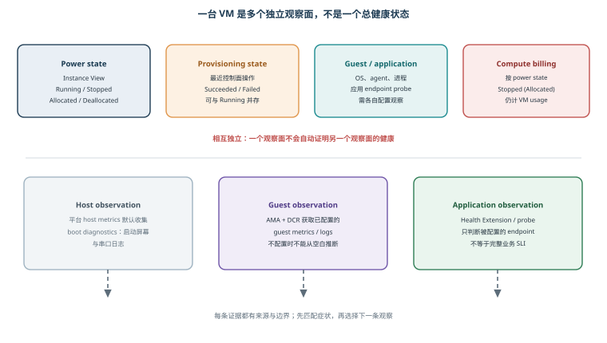
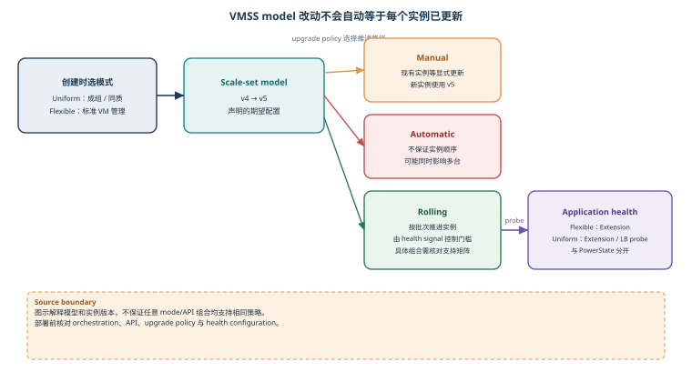
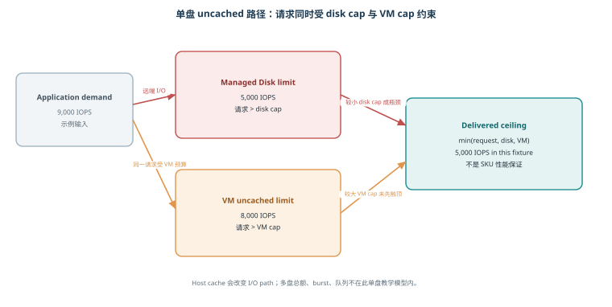

::::: cover
[AZURE CLOUDOPS · ENTERPRISE ENGINEERING]{.kicker}

# VM 显示 Running，为什么应用仍不可用？

[VM、VMSS、Managed Disk 与运维]{.subtitle}

::: cover-meta
- **讲次**：10 / 23
- **核心机制**：虚拟机状态向量、VMSS 实例更新、磁盘与 VM 性能上限
- **证据边界**：Microsoft Learn + 本地合成运维模型
- **适用场景**：诊断启动失败、实例版本漂移、应用探测失败和磁盘延迟
:::

::: scenario
值班人员看到一台 VM 显示 Running，但业务探针超时。最近一次磁盘扩容操作标记为 Failed；主机 CPU 指标正常；虚拟机没有已配置的 guest 数据采集。团队只看一行状态，便争论是 Azure 主机、来宾系统还是应用出了问题。另一个 VMSS 已更新模型，却仍有实例运行旧版本。这里的关键不是寻找一个叫“健康”的总状态，而是确认每个信号由谁产生、覆盖哪一层，以及下一个最能区分假设的证据是什么。
:::

### 本讲目标

读完后，你应能区分 VM power state 与 provisioning state；解释为什么 Running 不代表 guest OS 或应用就绪；按 orchestration 与 upgrade policy 分析 VMSS 模型和实例版本差异；根据磁盘与 VM 两级配额定位单盘 I/O 上限；并为启动、guest 和应用故障选择正确的观察面。

**本讲问题：** 哪个生命周期状态与依赖层，能解释当前症状？

:::::

## 一个 VM 故障，至少要读五种不同的信号

Azure VM 的 power state 描述最近一次观察到的供电/分配状态；provisioning state 描述最近一次用户发起的控制面操作结果。它们回答不同问题：Running 说明 VM 在标准运行状态，ProvisioningState/Failed 说明最后一项资源操作失败；二者可以同时出现。ProvisioningState/Succeeded 也只说明那项控制面操作成功，不证明操作系统启动完毕、扩展代理正常或应用通过业务检查。[1]

再往里是 guest OS 和应用。Azure Monitor 默认收集 VM host 的平台指标与 Activity Log；要收集 guest OS 性能计数器和事件，通常需在 VM 内安装 Azure Monitor Agent，并关联定义数据源和目的地的 Data Collection Rule。主机 CPU 平稳只能说明主机观察面没有显示相应压力，不能推导 guest memory、进程、文件系统或 HTTP endpoint 健康。[2]

Boot diagnostics 提供启动过程的串口日志和屏幕快照，适合定位操作系统启动阶段的证据；它不是持续的应用探针，也不证明某个业务请求可达。扩展或 Serial Console 的访问条件还取决于当前服务、身份、网络和 VM 状态，需按对应文档单独确认。[3]

图 10-1 的下方三条证据通道互不替代：host 指标和 boot diagnostics 看平台与启动；guest 数据采集看 OS 内部；应用探测看配置的 endpoint。排查时先记录 power state、provisioning state、最近操作及其错误，再补充与假设对应的 guest 或应用证据。Azure 资源接口的状态是观测点，不是自动生成的完整健康结论。

| 观察到的现象 | 它能说明什么 | 还需补的证据 |
|---|---|---|
| Stopped (Allocated) | VM 仍分配在 host 上，但不运行；VM instance usage 仍计费 | 是否应释放分配；磁盘和网络资源是否仍会计费 |
| Stopped (Deallocated) | VM 已释放底层硬件租约；VM instance usage 不计费 | 保留的 Managed Disk、网络等是否仍有费用 |
| Running + provisioning Failed | 最近一次控制面操作失败，但 VM power state 仍可为 Running | 失败操作与错误详情；guest/app 是否健康 |
| Running + provisioning Succeeded | 最近一项控制面操作成功，VM 在运行 | guest 数据、扩展状态和应用 endpoint |
| Host 指标正常，guest 指标缺失 | 默认平台 host 指标可用；guest 采集尚未证明已配置 | AMA、DCR 关联、来宾内的 OS/应用证据 |
| Boot diagnostics 有截图 | 有一张启动画面或串口日志可供查看 | 截图时间、guest 是否完成启动、应用依赖和业务探针 |

Cost Management 的实际账单与账单延迟不在本地练习范围内。停止后仍保留的 disks 与 networking 可能继续计费；本教材不估算某个 SKU、区域或计费合同的价格。[1]

## VMSS：声明模型与实例运行版本是两个位置

Virtual Machine Scale Set 先确定 orchestration mode。Uniform 以相同 VM profile 成组管理实例；Flexible 在标准 Azure IaaS VM 之上协调实例，因此保留更多标准 VM API 和异构实例的自由度。模式在 scale set 创建时确定，之后不能互换。[4]

扩容模型发生变化后，现有实例何时采用新模型，由 upgrade policy 决定。Manual 让现有实例继续使用当前版本，直到操作人员触发更新；新实例使用最新模型。Automatic 不保证实例下线顺序，升级时甚至可能同时影响全部实例。Rolling 将实例按批次推进，并使用 health signal 控制升级过程。应用健康信号来自实例内的 Application Health Extension，或在 Uniform 场景使用的负载均衡健康探针；这是应用探测，不是 power state。[5][6]

图 10-2 是模型层解释，不等于对任意 VMSS 配置的可部署承诺。当前 Microsoft Learn 的升级策略文章描述 Flexible rolling 及其 Application Health Extension 前提；当前 orchestration modes 页面同时列出 Flexible 的 upgrade policy 功能，并在“不支持参数”部分要求 Virtual Machine Scale Set upgrade policy 为空。官方页面之间存在需要在具体 API/配置上确认的边界。本讲不把该组合断言成普遍可用；设计 Flexible VMSS 时应核对所用 API 版本和该模式的当前支持矩阵。[4][5]

### 一次模型漂移应该怎么判断

假设 scale-set model 从 image version 4 更新到 version 5，而一个实例仍在 version 4：

- 在 Manual policy 下，这可以是预期结果；检查实例是否被显式更新。
- 在 Automatic policy 下，不要假定某个确定的滚动顺序或最小同时影响数。
- 在 Rolling policy 下，检查 batch 设置、失败时的暂停行为、实例健康状态和实际支持的 orchestration 组合。
- 对单个实例看起来正常但持续运行旧配置的情况，比较 model 与 instance view，再判断是尚未推进、健康门阻止，还是部署路径根本不受支持。

不要把“scale set desired model 已更新”写成“所有 VM 已使用新版本”。扩展状态和应用探针也可能因 endpoint、端口、返回码或配置错误而显示 unhealthy/unknown；这种结果描述探测器视角，不一定能单独区分应用故障与探测配置故障。[6]

## Managed Disk 性能受两层上限约束

Managed Disk 有自己的 IOPS 与吞吐配额；VM size 也有磁盘 I/O 配额。对一个 host caching 为 None 的远端 managed disk 请求，先受磁盘能力限制，再与 VM 的远端存储预算共同作用。对一个单盘、无 cache/burst 的简化模型，交付量不超过请求、disk cap 与 VM cap 三者中的最小值。实际多盘、不同 cache path、burst 与工作负载排队更复杂，不能把这个局部公式推广成所有 VM 的性能保证。[7]

例如，教学输入请求 9,000 IOPS，disk cap 为 5,000，VM uncached cap 为 8,000。局部模型给出的上限是 5,000 IOPS，因此仅扩大 VM 不会解除 disk cap；若 disk cap 为 12,000、VM cap 为 8,000，则模型上限是 8,000，才需继续检查 VM 级预算。上述数字只是练习值，不对应任一 Azure SKU；IOPS 与 MB/s 要各自计算，也要查看缓存路径和所有挂载盘争用的 VM 总额度。

当业务说“磁盘慢”，先确认延迟来自应用、guest 文件系统/队列、磁盘本身，还是 VM 总 I/O cap。host 指标有助于判断平台侧负载和限制；guest 指标、磁盘队列与应用延迟用于进一步定位。若 guest data 未采集，就不能从空白图表得出“OS 正常”或“没有 I/O”。

## 运维诊断：按证据边界逐层前进

1. **读两个控制面状态。** 获取 VM instance view，分别记录 PowerState 与 ProvisioningState；找到最后一项失败操作及其 correlation/request context。
2. **确认 guest 是否启动。** 用 boot diagnostics 观察启动截图与串口输出；按当前支持条件使用 Console 或串口访问。启动证据无法代替 network path 或 app health probe。
3. **确认 guest 采集。** 检查 Azure Monitor Agent 是否安装、DCR 是否关联、指定数据源和 destination 是否包含需要的指标/事件。
4. **验证应用信号。** 对 VMSS 的健康扩展或 load-balancer probe，检查目标 endpoint、端口、路径、超时、响应内容及该信号与业务 SLIs 的差别。
5. **分析 VMSS 模型推进。** 比较 VMSS model 与 instance model、升级模式、批次和 health gate。将模式支持性作为独立前提验证。
6. **分析 I/O 限制。** 同时比较 disk 与 VM 的 IOPS/throughput 边界，并确认 host caching、磁盘集合和观测时间窗。

下面的 Azure CLI 命令只读取一个指定 VM 的 instance view。**它仍会访问 Azure subscription；本讲构建和测试阶段未执行。** 只有未来 Stage 3 L0 已批准的 subscription、resource group、VM 和查询范围内才可运行。该输出也不会自动提供完整的应用或 guest 健康结论。[8]

~~~bash
az vm get-instance-view --resource-group <approved-rg> --name <approved-vm>
~~~

## 离线实验：让每个信号只回答它能回答的问题

运行本地 vm-operations-model。输入和输出全部来自固定 JSON fixture，不调用 Azure CLI、SDK、IMDS、subscription、monitoring endpoint 或网络。练习四个判断：

1. Stopped (Allocated) 与 Stopped (Deallocated) 的 VM compute-billing 标签不同；两者都不推断 disk/network 费用消失。
2. PowerState/Running 可以与 ProvisioningState/Failed 并存；失败的最后操作不自动说明应用状态。
3. VMSS model 与实例版本可不同；Manual 保留现有版本，Rolling 的教学模型要求对应的应用健康配置。Flexible 的策略支持问题仍需查当前文档。
4. 一个 uncached 单盘模型分别计算 IOPS 与吞吐瓶颈；boot diagnostics available 仅表示有启动证据。

~~~powershell
python -m unittest discover -s textbook/chapters/AZ04-01/labs/vm-operations-model -p "test_*.py" -v
python textbook/chapters/AZ04-01/labs/vm-operations-model/vm_operations_model.py
~~~

以下输出由合成 fixture 产生，不是 Azure 查询结果：

~~~text
stopped-allocated: COMPUTE_BILLED
stopped-deallocated: COMPUTE_NOT_BILLED_ATTACHED_RESOURCES_MAY_REMAIN
running-last-operation-failed: RUNNING_POWER_WITH_FAILED_CONTROL_OPERATION_APP_UNKNOWN
guest-telemetry-missing: HOST_AND_GUEST_EVIDENCE_DIFFER
manual-instance-drift: EXISTING_INSTANCE_REMAINS_ON_OLD_MODEL
uniform-rolling-health-missing: ROLLING_HEALTH_GATE_CONFIGURATION_REQUIRED
disk-cap-bottleneck: DISK_LIMITS_IOPS_BEFORE_VM_LIMIT
vm-cap-bottleneck: VM_LIMITS_IOPS_BEFORE_DISK_LIMIT
boot-diagnostics-only: BOOT_EVIDENCE_DOES_NOT_PROVE_APP_HEALTH
~~~

本地模型只验证显式规则，不模拟 Azure API、监控、服务性能或费用。Flexible upgrade-policy 文档冲突是外部边界，不由测试解决。

::: exercise
**练习 1｜运行但操作失败** 
Instance View 显示 PowerState/Running 与 ProvisioningState/Failed。哪些结论成立？请提出下一条最有区分力的证据。
:::

::: solution
**参考答案：** VM 仍为 Running；最近控制面操作失败，guest/app 健康未知。先读取失败错误，再按假设查启动、guest 或应用探针。
:::

::: exercise
**练习 2｜模型已更新，实例未更新** 
VMSS 的 model version 已是 5，实例仍为 version 4。它是否必然是故障？请根据 upgrade policy 给出下一步。
:::

::: solution
**参考答案：** 不一定。Manual 会保留未显式更新的实例；Automatic 不保证顺序；Rolling 要检查批次、health gate 与当前 mode/API 支持。
:::

::: exercise
**练习 3｜I/O 仍低于应用需求** 
请求 9,000 IOPS，单盘 cap 是 5,000，VM uncached cap 是 8,000。哪一层是该教学模型的瓶颈？增大 VM 是否足够？
:::

::: solution
**参考答案：** disk cap 更低，局部上限为 5,000 IOPS；只增大 VM 不会突破磁盘上限。真实系统还要查 cache/burst、VM 总额、guest 队列与 workload。
:::

::: exercise
**练习 4｜有启动截图就表示服务恢复了吗？** 
Boot diagnostics 有最新截图，但应用健康扩展为 Unknown。列出两种仍可能成立的解释。
:::

::: solution
**参考答案：** 截图只证明当时有启动画面；应用未就绪、依赖失败或 probe 配置错误都可能让 endpoint 仍不可达、状态为 Unknown。
:::

**本讲总结：** 分开读取 power、provisioning、guest、app 和 billing/resource 证据；VMSS desired model 不等于实例已推进，disk 与 VM 各有限额。遇到模式文档冲突时，保留未决项并按当前 API 矩阵复核。

## Primary references

[1] [States and billing](https://learn.microsoft.com/en-us/azure/virtual-machines/states-billing) · [2] [VM monitoring](https://learn.microsoft.com/en-us/azure/virtual-machines/monitor-vm) 
[3] [Boot diagnostics](https://learn.microsoft.com/en-us/azure/virtual-machines/boot-diagnostics) · [4] [VMSS orchestration](https://learn.microsoft.com/en-us/azure/virtual-machine-scale-sets/virtual-machine-scale-sets-orchestration-modes) 
[5] [VMSS upgrade policy](https://learn.microsoft.com/en-us/azure/virtual-machine-scale-sets/virtual-machine-scale-sets-upgrade-policy) · [6] [Application Health Extension](https://learn.microsoft.com/en-us/azure/virtual-machine-scale-sets/virtual-machine-scale-sets-health-extension) 
[7] [VM and disk performance](https://learn.microsoft.com/en-us/azure/virtual-machines/disks-performance) · [8] [Azure CLI az vm](https://learn.microsoft.com/en-us/cli/azure/vm?view=azure-cli-latest)