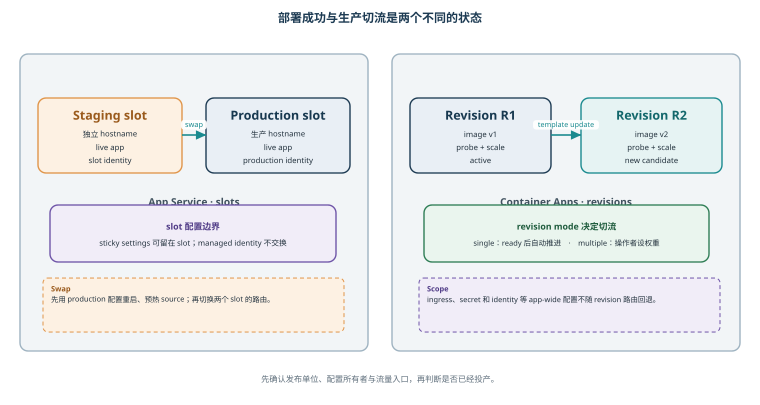
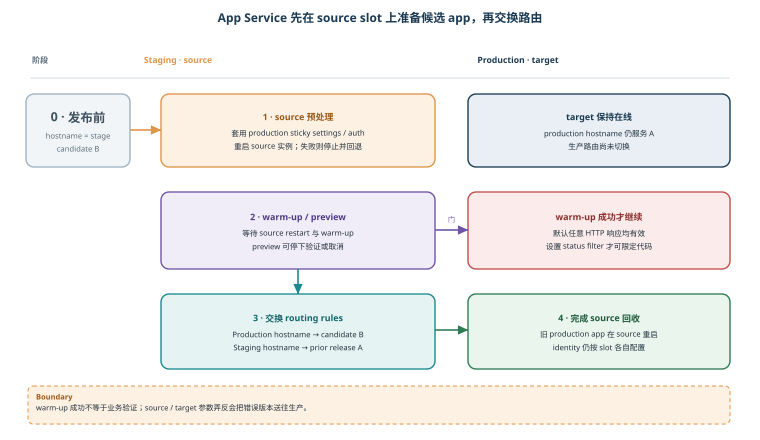
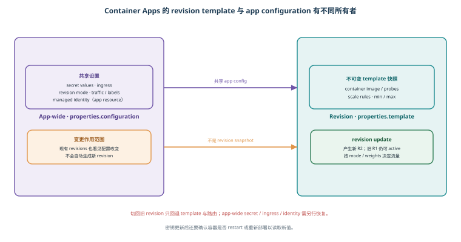
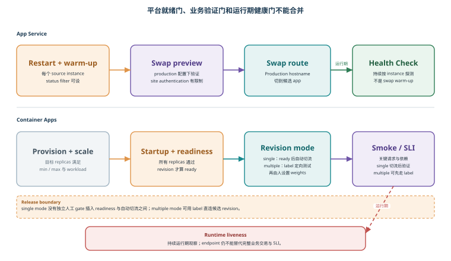

::::: cover
[AZURE CLOUDOPS · ENTERPRISE ENGINEERING]{.kicker}

# 新版本已就绪，为什么发布仍可能出错？

[App Service、Container Apps 与发布回滚]{.subtitle}

::: cover-meta
- **讲次**：11 / 23
- **核心机制**：slot swap、revision scope、探针与流量切换
- **证据边界**：离线发布模型、Azure F1 计划实测
- **适用场景**：发布预热、灰度流量、身份与配置漂移、回滚
:::

::: scenario
候选版本在 App Service staging slot 能返回 HTTP 响应，团队便执行 swap；随后生产环境访问数据库失败。另一组 Container Apps 已创建新 revision，但生产 URL 仍把 100% 流量送往旧版本。两个团队都说“部署成功”，却把不同的状态当成了同一个发布门。排障要先问：版本存在哪里、哪些配置跟它一起移动、哪个控制面真正改变了生产路由？
:::

### 本讲目标

读完后，你应能说明 App Service slot swap 与 Container Apps revision 的发布单位差异；追踪配置、密钥、身份、探针和流量规则分别属于 slot、revision 还是 app；判断平台就绪信号能证明什么；并选择能恢复路由、配置或应用状态的回滚步骤。

**本讲问题：** 生产请求此刻由哪个版本、哪组运行时配置和哪条健康门决定？

:::::

## 先找发布单位，再讨论“切换”

App Service deployment slot 是一个有独立 hostname 的 live app。slot 之间共享所属 App Service plan 的承载资源；Standard、Premium 或 Isolated plan 才支持多个 slot。创建 slot 本身没有额外 slot 费用，但不能据此推断所需 plan、实例或应用依赖没有费用。swap 改变 slot 上运行的 app 内容与一部分配置，同时保持 slot 名称和 hostname 的含义；正式投产时通常让 production 始终作为 target。[1]

Container Apps revision 是一次 template-scope 变更生成的不可变快照。revision 可以激活或停用；多个 revision mode 可让多个版本并行并显式分配流量。于是 slot swap 是两个 live slot 之间的分阶段交换，revision rollout 是一组 revision 状态和 ingress 权重的协调。两者都能做蓝绿式发布，但恢复动作与配置边界不同。[4]

| 维度 | App Service | Container Apps |
|---|---|---|
| 发布单位 | 有 hostname 的 app slot | template 变更创建的 revision |
| 切流动作 | swap 两个 slot 的路由 | single mode 就绪后自动推进；multiple mode 配置流量权重 |
| 配置边界 | 可交换配置与 slot-specific 配置并存 | revision template 与 app-wide configuration 分层 |
| 回退基础 | 通常可把原 slot 再 swap 回来 | multiple mode 可把权重送回仍 active 的旧 revision |
| 需要单独确认 | 计划层、slot 设置、hostname、identity、外部数据 | revision 健康、active mode、ingress、全局 secrets 与 identity |

## App Service swap：先让新 app 使用生产配置

App Service 不是在最终一刻才把 staging 进程搬进 production。swap 开始时，平台先把 target slot（通常为 production）的 slot-specific app settings、connection strings、连续部署设置和 App Service authentication 设置应用到 source slot。这些改变会重启 source slot 的实例。所有 source 实例重启后，平台在 source 上执行预热；成功后才交换路由，production hostname 继续指向 production slot，而该 slot 此时承载已预热的候选 app。随后 staging 接收之前的 production app，并完成对应的设置与重启。[1]

swap with preview 会在第一阶段后暂停，让操作者验证 source 在 production slot 配置下的表现，再完成或取消。若任一 source 实例未能重启，swap 会回退 source 的改动并停止。预热配置也需要明确：若设置了 `WEBSITE_SWAP_WARMUP_PING_PATH`，平台按指定路径探测；`WEBSITE_SWAP_WARMUP_PING_STATUSES` 可限定可接受的 HTTP 状态码，默认情况下任意 HTTP 响应都算预热成功。因此“swap 成功”本身可能只表示页面能响应，不能替代业务 smoke test。开启 App Service authentication 的 slot 不支持 swap with preview。[1]

App settings、connection strings 和部分配置可设为 slot-specific，使数据库地址等环境值留在相应 slot；遗漏 sticky 标记时，配置可能随内容交换。managed identity 不交换，身份配置属于具体 slot。Health Check 配置也不是 slot-specific，会随 swap 到 destination；生产与 staging 使用不同健康路径时，切换后可能探测错误的 endpoint。检查项应逐一列出“跟 app 走”与“留在 slot”，而不是把一份配置 JSON 当成完整发布包。[1][2][3]

### Warm-up、Health Check 与 smoke test 各自回答不同问题

App Service swap warm-up 处理的是 source 实例能否完成重启并对预热请求作出响应。App Service Health Check 则按配置路径定期探测各实例：连续达到阈值的失败会使实例从该 app 的负载均衡轮转中移除，平台继续探测并可能在持续不健康时替换实例。只有一个 active instance 时，为避免将整个 app 从负载均衡中移除，平台不会执行同样的摘流行为。Health Check 需要至少两个实际运行实例和足够 plan 容量才具备摘除单个坏实例的空间；配置仍不是端到端交易证明。[2]

因此 release gate 至少要分开：进程启动、健康路径、业务关键依赖、关键用户请求和业务 SLI。健康路径应在应用完全预热且关键依赖不可用时返回失败；否则平台只能按一个过弱的 endpoint 作出正确但不够有用的判断。App Service Health Check 不跟随 302 redirect，production 自定义域名重定向也可能让默认 hostname 的探测得到非 200 结果。[2]

## Container Apps：revision 快照与 app-wide 设置

Container Apps 把变更分成两个范围。`properties.template` 中的 image/container 和 scale rules 等变更创建新 revision，并只作用于该 revision。`properties.configuration` 中的 revision mode、ingress、traffic weights、labels、registry 凭据、Dapr 和 app secrets 等变更作用于 app，不创建新 revision。更新 app secret 不会自动生成新版本；使用环境变量引用 secret 的容器需要重启或部署新 revision 才能读取更新值。managed identity 变更也不会自动创建 revision 或重启正在运行的 app。[4][9][10]

这会影响“回滚”的含义。把流量切回旧 revision 只能回退到旧 template；它不能自动撤销已经全局更新的 secret、ingress 或 identity。若新版本已读到不兼容的共享 secret，旧 revision 也可能同时受影响。发布记录应把镜像摘要、revision template、app-wide config、身份与角色授权、外部数据库变更分别留痕；路由回退不是完整恢复。

Container Apps identity 属于 container app resource。System-assigned identity 跟随 app 生命周期；user-assigned identity 可由多个资源复用。修改 identity 不创建 revision，因此版本号本身不能证明当前请求使用了哪种身份或 RBAC 是否正确。App Service 则为每个 slot 保持其 identity 配置，swap 不会把 staging identity 当成 production identity 自动交换。[3][9]

## Probe ready 之后，才决定谁接收流量

Container Apps 的 startup probe 检查应用是否完成初始启动，与 liveness probe 分开运行。liveness 判断运行中的容器是否仍响应；readiness 判断某个 replica 是否可接请求。探针超过 failure threshold 后，不同 probe type 会产生不同结果；按实际启动时间配置初始延迟、周期和阈值，避免在应用仍初始化时误判。一个弱 readiness endpoint 仍可能把无法完成业务请求的 replica 标成 ready，所以探针实现与发布 smoke test 要覆盖实际依赖层。[5]

single revision mode 下，新 revision 只有在 provisioning 成功、按新旧 replica 数与 min/max 设置扩到目标规模、且所有 replicas 的 startup 和 readiness probes 通过后才算 ready；在此之前旧 revision 继续收到 100% ingress 流量。ready 后平台自动把流量转给新 revision，并自动 deprovision 旧 revision。multiple revision mode 下，操作者管理 active revisions 和流量；revision weight 的总和必须为 100%。label URL 可直接访问一个 revision，不依赖主 application URL 的 traffic split，适合定向 smoke test。[4][6]

Ingress 决定请求能否抵达 container app：确认环境的 internal/external 可见性、HTTP/TCP transport、对外入口和容器 `targetPort` 一致。对 HTTP ingress，应用入口暴露在 443，再由平台转发到容器监听端口。Scaling 则按 HTTP 并发、TCP 连接或事件规则增减 replicas；它改变容量，不证明业务健康。scale-to-zero、startup latency、每 revision 的 min/max 与 readiness gate 要共同纳入发布窗口。多条 scale rule 中任何一条触发都可能导致扩容。[7][8]

## 用同一条 release contract 诊断和回退

先记录当前线上 version 与配置，而不只记 build number：App Service 记录 source/target slot、sticky settings、identity、Health Check path 和 warm-up status filter；Container Apps 记录 active revision、revision mode、traffic weights/labels、ingress target port、probe 和 app-wide secret/identity。然后按顺序验证平台准备、replica/实例健康、业务 smoke test，最后切生产流量。路由切换前先确认数据库 schema 对新旧代码都兼容，避免应用 rollback 后仍无法读取已迁移的数据。

| 观察 | 下一步检查 | 不应直接得出的结论 |
|---|---|---|
| App Service swap 完成但依赖返回 403 | production slot identity 与目标资源 RBAC；app setting 的 slot 标记 | staging slot identity 已随代码进入 production |
| warm-up 接受 503，swap 仍完成 | `WEBSITE_SWAP_WARMUP_PING_STATUSES`、健康 endpoint、业务 smoke test | HTTP 响应等同业务可用 |
| slot swap 后 Health Check 失败 | 两个 slot 的健康路径是否一致；redirect/status 与身份限制 | platform host 必然故障 |
| ACA 新 revision healthy 但 production URL 仍旧版本 | active revision mode、traffic weights、labels 和 ingress | 发布新 revision 就会自动让它接收全部流量 |
| ACA 改 secret 或 identity 后旧版本也受影响 | app-wide scope、revision 对 secret 的读取/重启状态、RBAC | 旧 revision 是完整独立的旧环境 |

multiple mode 回退时，可在旧 revision 仍 active 且所需配置兼容的条件下把 ingress 权重设回旧版本，并验证真实业务探针；App Service 可在原 slot 仍保留且数据兼容时反向 swap。若旧 revision 已 deprovision、旧内容不在 slot、app-wide 设置已变更，或数据库写入已经改变，则需显式部署已知版本、恢复兼容配置或执行数据补救。自动流量切换不保证状态回滚。

下面两条是未来可用于查看 slot 与 revision 的只读命令模板；本讲构建、测试和发布时均未执行。它们仍会访问 Azure subscription，只有 Stage 3 L0 批准具体 subscription、resource 和查询范围后才能使用。输出只描述平台配置，不代表 smoke test 或业务 SLI 已通过。[1][4]

~~~bash
az webapp deployment slot list --resource-group <approved-rg> --name <approved-app>
az containerapp revision list --resource-group <approved-rg> --name <approved-container-app>
~~~

### 实测：发布在计划核验阶段停止

LAB-IR-11 获批在 Australia East 创建专用资源组和 Linux F1 计划，再计划向单一 Web App 依次发布原版、故障版和原版 ZIP。Azure Activity Log 记录了资源组和计划创建成功。计划详情中的 F1/Free 已通过检查，CLI 输出却省略了脚本读取的顶层 `reserved` 字段。脚本在创建 Web App 前停止，随后确认计划与资源组均已删除。[11]

创建成功只解决了控制面的一部分。开始发布前还要从 ARM 计划详情核对 `properties.reserved` 和目标范围，再用同一 HTTPS 探针核对实际版本、HTTP 状态和响应体。本次云端流程停在第一道核验。`200 → 500 → 200` 来自两份 ZIP 在本机的运行，Azure 上的发布与回退仍待验证。

## 离线实验：模型版本、全局配置与路由要分开回退

运行本地 `app-release-model`。固定 JSON fixture 输入模拟 slot swap 的预热状态、Container Apps change scope、single revision readiness gate 和 multiple revision traffic weights。它不运行 Azure CLI、容器、探针 endpoint、identity token 或网络请求；结果是用来检查假设的合成模型，不是 Azure 环境观测。[1][4][5][6][9][10]

~~~powershell
python -m unittest discover -s textbook/chapters/AZ04-02/labs/app-release-model -p "test_*.py" -v
python textbook/chapters/AZ04-02/labs/app-release-model/app_release_model.py
~~~

合成 fixture 会覆盖：未过滤的 HTTP 503 仍符合默认 warm-up 模型；指定只接受 200 时阻止 slot swap；slot identity 留在各自 slot；single mode 未 ready 时流量不变；multiple mode 的 readiness gate 与 100% 权重和；secret/identity 等 app-wide 变化不生成 revision。

~~~text
slot-default-warmup-503: WARMUP_ACCEPTED_WITHOUT_STATUS_FILTER
slot-status-filter-503: WARMUP_REJECTED
appservice-swap: PROD=release-b STAGING=release-a IDENTITIES=PROD_SLOT,STAGING_SLOT
aca-single-unready: PROD_TRAFFIC=release-a:100
aca-multiple-ready: TRAFFIC=release-a:90,release-b:10 SUM=100
aca-rollback-route: TRAFFIC=release-a:100,release-b:0 APP_SCOPE_UNCHANGED
aca-secret-update: NEW_REVISION=NO SECRET_SCOPE=APP RESTART_OR_REDEPLOY_REQUIRED
aca-identity-update: NEW_REVISION=NO APP_IDENTITY_SCOPE=RESOURCE
~~~

### 练习 1：Staging warm-up 返回 503

App Service 预热路径返回 503，但没有设置状态码筛选，swap 完成。生产仍然失败。指出能解释现象的设置，并给出一条更强的发布门。

**参考答案：** 默认 slot warm-up 接受任意 HTTP 响应。配置状态码筛选，并在生产配置下执行依赖检查和关键请求 smoke test；不要把 swap 成功等同于业务通过。

### 练习 2：revision 更新后仍有 0% 流量

Container Apps 已经创建并激活 release-b。生产 URL 仍返回 release-a。哪些控制面字段能区分 revision 创建与生产切流？

**参考答案：** 检查 active revision mode、release-a/release-b 的 traffic weights、`latestRevision` 与 labels。multiple mode 可以保留旧 revision 接收 100%，新 revision 存在不意味着流量已切换。

### 练习 3：改 secret 后路由回旧版本

release-b 因新 secret 的格式而失败；将 ingress weight 回到 release-a 后旧版仍异常。解释原因和应核对的回退对象。

**参考答案：** secret 属于 app-wide configuration，路由只回滚 revision template，不能恢复全局 secret。检查 secret 的历史值、revision 是否已重启/重新读取、旧版本的兼容性与身份访问。

### 练习 4：探针通过但用户请求失败

新 revision 的 readiness probe 已成功，但一类真实请求仍失败。列出两个 readiness 不能证明的条件。

**参考答案：** probe 可能只检查进程或浅层路径；它不能证明所有业务依赖、身份授权、请求内容、跨区下游或 SLA 均可用。增加针对关键交易的 smoke test 和业务指标门。

**本讲总结：** slot、revision、app-wide configuration 与生产路由是不同对象。逐层验证部署、配置、identity、probe、ingress 和业务请求；回退时分别恢复代码、流量、配置及数据兼容状态。

## Primary references

[1] [Deployment slots](https://learn.microsoft.com/en-us/azure/app-service/deploy-staging-slots) · [2] [App Service Health Check](https://learn.microsoft.com/en-us/azure/app-service/monitor-instances-health-check) 
[3] [App Service managed identity](https://learn.microsoft.com/en-us/azure/app-service/overview-managed-identity) · [4] [Container Apps revisions](https://learn.microsoft.com/en-us/azure/container-apps/revisions) 
[5] [Container Apps health probes](https://learn.microsoft.com/en-us/azure/container-apps/health-probes) · [6] [Traffic splitting](https://learn.microsoft.com/en-us/azure/container-apps/traffic-splitting) 
[7] [Container Apps ingress](https://learn.microsoft.com/en-us/azure/container-apps/ingress-how-to) · [8] [Container Apps scaling](https://learn.microsoft.com/en-us/azure/container-apps/scale-app) 
[9] [Container Apps managed identity](https://learn.microsoft.com/en-us/azure/container-apps/managed-identity) · [10] [Container Apps deployment troubleshooting](https://learn.microsoft.com/en-us/azure/container-apps/troubleshoot-deployment-errors) 
[11] [App Service Plans ARM schema](https://learn.microsoft.com/en-us/rest/api/appservice/app-service-plans/get?view=rest-appservice-2025-03-01)
