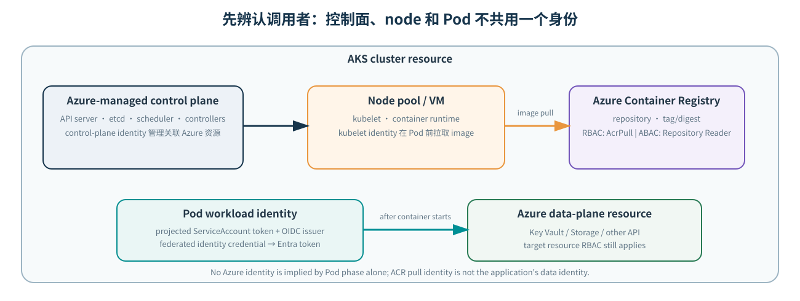
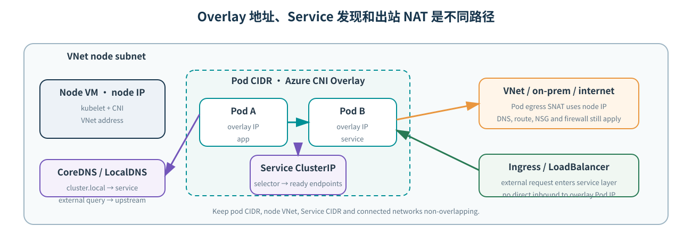
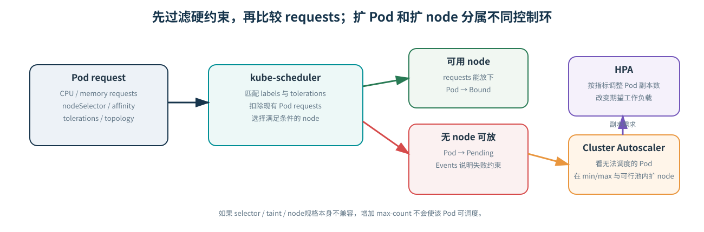
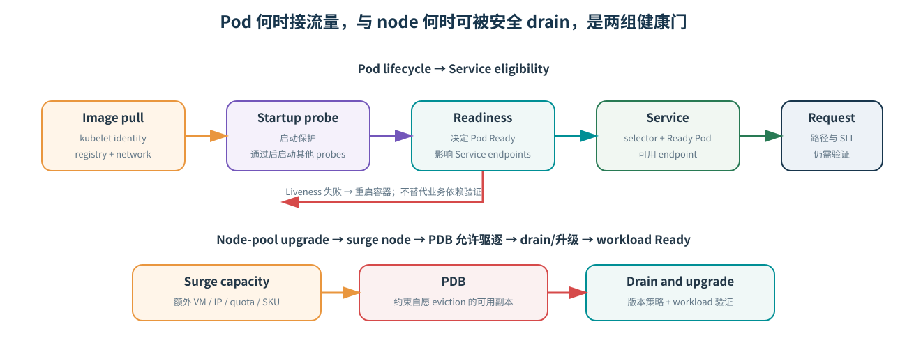
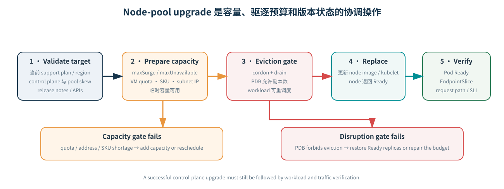

::::: cover
[AZURE CLOUDOPS · ENTERPRISE ENGINEERING]{.kicker}

# Pod 已提交，为什么还没有业务流量？

[AKS、Azure CNI 与 Azure Container Registry]{.subtitle}

::: cover-meta
- **讲次**：12 / 23
- **核心机制**：control plane、node pool、scheduler、kubelet、CNI 与 CoreDNS
- **证据边界**：Microsoft Learn + 本地合成诊断模型
- **适用场景**：Pending、ImagePullBackOff、DNS 失败、探针不就绪与节点升级
:::

::: scenario
一次发布创建了新 Deployment。Pod 长时间停在 Pending；另一命名空间的 Pod 已分配到 node，却循环显示 ImagePullBackOff；第三个副本显示 Running，但 Service 没有可用 endpoint。团队把三种状态都称作“AKS 不健康”，于是同时重启 node pool、改 ACR 权限并调整探针。真正的排障起点应是：请求卡在 scheduler、kubelet 拉镜像、容器启动、readiness、Service/DNS，还是节点维护？
:::

### 本讲目标

读完后，你应能沿 Pod 从 API 请求到 Service endpoint 的状态顺序定位失败门；区分 control-plane identity、kubelet identity 与 Pod workload identity；解释 Azure CNI Overlay 的地址和出站路径；预测 scheduler 与 autoscaler 的响应；并在升级时判断 PDB、surge capacity 和版本策略的影响。

**本讲问题：** 哪一个组件持有当前失败状态，下一条证据应从哪里取得？

:::::

## 先把 “ready” 拆成连续的门

Deployment 创建 Pod，只是把期望状态写入 Kubernetes API。控制器产生 Pod 对象，scheduler 选择 node，node 上的 kubelet 请求容器运行时拉取镜像并创建容器；startup、readiness 与 liveness probe 再分别控制启动保护、是否接收 Service 流量和是否重启容器。只有 selector 找到 Ready Pod，Service 才能把它列入可用 endpoint。每一站成功都不替后一站作证。[1][2]

| 观察到的状态 | 主要负责者 | 下一条有区分力的证据 | 不能直接推出 |
|---|---|---|---|
| `Pending`，没有 node | scheduler | `kubectl describe pod` 的 Events、requests、selector、taints、affinity | ACR 身份已失败；容器尚未运行 |
| 已分配 node，`ErrImagePull` / `ImagePullBackOff` | kubelet 与 registry 路径 | pod Events 中的 401、403、DNS、timeout、manifest 或 architecture 错误 | workload identity 配置错误；应用代码已启动 |
| `Running`，但 `Ready=False` | 容器与 readiness probe | `describe pod`、容器日志、probe endpoint、Service selector | 容器已接收 Service 流量 |
| Pod `Ready=True`，调用仍失败 | Service、DNS、network policy、路由或应用 | EndpointSlice、Service selector、DNS 查询、请求源/目标路径 | “Pod ready”代表完整业务 SLI 已通过 |
| node drain / upgrade 卡住 | eviction、PDB、容量与升级控制面 | node pool 状态、PDB allowed disruptions、事件、surge 与配额 | 一定是 control plane 故障 |

诊断命令要贴合状态阶段。比如 Pod 尚无 node 时，反复检查容器日志不会有日志；Pod 已被分配 node 且出现 401 时，增加 node 数也不会补足 registry 授权。

## 管理面和工作节点各自负责什么

AKS 由 Azure 管理 Kubernetes control plane，工作负载运行在 node 上的 VM。API server 接受 Kubernetes API 请求；etcd 保存集群状态；scheduler 为未绑定 Pod 选择 node；controllers 让实际状态靠近期望状态。Node 上的 kubelet 维护 Pod，container runtime 管理容器生命周期；网络数据面由所选模式提供。[1]

AKS Automatic 与 Standard 的运维责任不同，但两者都使用 Azure 管理的 control plane。Automatic 为节点、升级、网络等常见操作提供更多预配置；Standard 让平台团队更直接地配置 node pool、网络、伸缩与升级。不能把某个模式的默认值当成另一模式的事实。[1][3]



身份是按调用者分开的：

- **Control-plane identity** 为 AKS 控制面管理所需 Azure 资源提供权限，例如与集群关联的网络资源。它不等于应用 Pod 的身份。[14]
- **Kubelet identity** 由 node 上的 kubelet 用来向 ACR 获取私有镜像。集群的 ACR 集成会把拉取权限授给 agent-pool/kubelet 关联的托管身份。[4][14]
- **Workload identity** 让容器启动后的应用使用 Kubernetes ServiceAccount 的 projected token，经 OIDC federation 换取 Microsoft Entra token，再按目标资源 RBAC 访问 Key Vault 等服务。[5]

因此，应用 Pod 尚未创建时，Pod 内的 SDK 和 workload identity 都不可能解决镜像拉取失败。反过来，kubelet 有权读取镜像，也不会自动给应用 Key Vault 或 Azure SQL 的数据权限。

## 用 Azure CNI Overlay 追踪地址与 DNS

在 Azure CNI Overlay 中，node IP 来自 VNet subnet；Pod IP 来自单独规划的 pod CIDR。Pod 与 node 使用不同地址空间。集群扩容时，node 获得 pod CIDR 中的地址块；Pod 对 VNet 外目的地发包时，流量使用 node IP 做 SNAT。集群外端点不能直接用 pod overlay 地址连入 Pod；要通过 Kubernetes Service 或 ingress / load-balancing 层暴露应用。[6]

pod CIDR、node VNet、Service CIDR、peered VNet 和本地网络必须按具体拓扑规划，避免重叠。Overlay 节省 VNet 中为 Pod 预留的地址，但不意味着网络策略、NSG、出站 DNS 或防火墙可被忽略。CNI Overlay 的 Pod 间流量不会因为“overlay”一词就必然封装；Azure 文档说明其 pod-to-pod 路径在 Azure 网络栈中路由，子网 NSG 规则仍适用。[6]



AKS 默认使用 CoreDNS 为 Pod 和 Service 提供集群内解析；它在 `kube-system` 中运行，内部 Service 查询由 Kubernetes 服务发现处理，外部域名则按 DNS 配置转发到上游。LocalDNS 是每个 node 上的缓存/代理路径，具体是否启用取决于 AKS 模式、Kubernetes 版本和 node-pool 配置；排障时先读实际 `dnsPolicy` 与集群配置，不要只凭“应该有缓存”推断。[7]

常见分流方式：

1. 集群内短名解析失败：检查命名空间、Service 名、Pod 的 `/etc/resolv.conf`、CoreDNS Pod/Service 与查询事件。
2. 集群内 Service 可解析但连接失败：核对 Service selector、EndpointSlice、targetPort、Pod readiness 与 network policy。
3. 外部域名失败而 `*.svc.cluster.local` 正常：检查 CoreDNS 上游、node/VNet DNS、UDP 与 TCP 53 的出站路径及自定义 DNS 服务器。
4. ACR 私有 endpoint 的 pull 失败：同时核对 kubelet 到 registry 的 DNS、私网路由/NSG、TLS/443 和数据端点，不要只看 Azure RBAC。[8]

## Scheduler 按 requests 和约束选 node

Scheduler 看到的是 Pod 的资源请求与 node 的可分配容量，不是监控面板上某一瞬间的 CPU 使用百分比。除 CPU、memory requests 外，node selector、required affinity、taint/toleration、拓扑约束和可用扩展池都会影响候选节点。Taint 对不匹配的 Pod 是排斥条件；toleration 允许其考虑该 node，但不保证一定调度到那里。Node selector 与 required affinity 则会排除不匹配的 node。[9]

假设一个 node 的 allocatable CPU 为 3,600m，已有 Pod 的 requests 共 3,000m，新 Pod 请求 800m。即使采样到的 CPU 实际用量只有 1,400m，该 node 也没有足够的 request 空间。Pending 描述的是 scheduler 按资源和约束找不到可用位置，不是 CPU 使用率过高的直接证据。



HPA 根据指标调整 workload 的 Pod 副本数；Cluster Autoscaler 观察因资源限制无法调度的 Pod，再按 node-pool 的 min/max、可用 VM 与约束扩缩 node。二者控制不同对象：HPA 增加副本并不创建 node，Cluster Autoscaler 扩 node 也不会修正错误的 image、selector 或 ACR 权限。[10]

**推理示例：** 若没有任何可扩展 node pool 能满足 Pod 的硬性 selector、taint 和资源规格，单纯提高 autoscaler 的 max-count 仍无法使 Pod Ready。这是对 scheduler 约束与 autoscaler 扩池条件的合并推理，必须用 Events、pool 规格、quota 和区域容量分别验证。[9][10]

## ACR pull 是 node 身份和数据面网络的联合门

Private ACR 的拉取发生在 Pod 应用启动之前。kubelet 需要定位 repository:tag/digest、访问 registry 数据面并获得 pull 授权；三项检查彼此独立：

| Registry 模式 | kubelet identity 所需数据面角色 | 常见误区 |
|---|---|---|
| RBAC Registry Permissions | `AcrPull` | 有 `Contributor` 并不等于对 registry image 有数据面 pull 权限 |
| RBAC Registry + ABAC Repository Permissions | `Container Registry Repository Reader`，可按 repository 配条件 | `AcrPull` 在 ABAC 模式不生效；`az aks --attach-acr` 不支持替 ABAC registry 配这个角色 |

若需要列举 repository catalog，ABAC-enabled registry 还需要相应的 `Container Registry Repository Catalog Lister` 权限；仅按完整 repository 名称拉取的权限和浏览 catalog 是不同能力。更改现有 registry 的 assignment mode 前，先为 kubelet identity 准备等效 ABAC 角色，否则旧角色可能立即不再授予数据面访问。[4][11]

当事件显示 `ImagePullBackOff`，按证据拆成：image 名/tag/digest 与架构；kubelet identity 和适用角色；registry firewall/private DNS/egress；令牌传播或 credential cache。`401` 常指向身份/权限，`manifest unknown` 指向 image 引用，TLS timeout 指向网络；错误字样只是分类线索，应结合 Events 与目标 endpoint 的 DNS/网络状态。[8]

### Workload identity 的信任边界

Pod workload identity 不是 kubelet 的镜像 pull credential。Workload ID 依赖 OIDC issuer、projected ServiceAccount token 和 federated identity credential 的 `issuer`、`subject`、`audience` 精确匹配；token exchange 通过后，Microsoft Entra identity 再按目标资源 RBAC 获得权限。AKS Standard 需要先启用 OIDC issuer 与 Workload ID；AKS Automatic 则按当前服务默认预配置这项能力。无论模式如何，应用仍需用受支持的 Azure Identity/MSAL 流程读取投射的凭据。[5]

## `Running` 不是 Ready，也不是业务成功

Startup probe 在慢启动期间保护容器；startup 成功前，readiness 与 liveness 不会开始判断。Readiness 决定 Pod 是否接收 Service 流量；不 ready 的 Pod 会从可用 Service backend 中移除。Liveness 用于发现进程自身无法恢复的状态并触发容器重启。三者回答不同问题。[2]



Probe 应检查对应层。Liveness 只验证应用进程是否能继续运行；若把暂时不可用的数据库放入 liveness，依赖故障可能触发所有 Pod 重启并加重故障。Readiness 可以根据关键依赖决定是否继续接流量，但 probe 成功仍不证明用户授权、数据正确性或端到端 SLI。慢启动应用使用 startup probe，避免 liveness 在启动过程中提前杀掉容器。[2][8]

排障时分开回答：容器是否启动？startup 是否通过？Pod Ready 条件是否为 True？Service selector 是否选中该 Pod？EndpointSlice 是否列出 Ready endpoint？请求是否能从真实来源路径到达？每个问题都需要对应对象和日志来证明。

## Node-pool upgrade 需要容量和可驱逐性

AKS control plane 和 node pool 都有 Kubernetes 版本。普通 `az aks upgrade` 通常一并升级 control plane 与 node pools；`--control-plane-only` 只升级控制面；`az aks nodepool upgrade` 只升级目标池。不能降级；node pool 版本必须满足当前支持的版本偏差策略。文档当前给出的常规规则是：node-pool minor 版本不得高于 control plane，且最多落后两个 minor；执行前必须查看该 region、support plan 和集群当前提供的目标版本。[12]

Node upgrade 会增加临时容量或使用 maxUnavailable，逐步 cordon/drain 节点，再更新和恢复 node。PodDisruptionBudget 限制自愿驱逐后的可用副本数；maxSurge 提供额外节点但会占用 VM quota、网络地址和可用 SKU 容量。若 PDB 不允许驱逐，单纯把 maxSurge 调大不等于允许违反 PDB；先确认副本数、PDB、拓扑分布和目标 node 上的请求容量。[13]



图 12-4 与图 12-5 解释同一条 readiness 证据如何影响 Service 和节点维护。维护完成不能只凭 node 显示 Ready；还要检查工作负载重新调度、Pod Ready、EndpointSlice 和应用请求。升级成功也不代表目标版本适配所有已移除 API；先查 release notes、弃用 API 和 admission/webhook 依赖。[12][13]

## 配置演练：为什么有 Pod 却没有可用 endpoint？

**未来 Azure 练习（文档配置，未执行）。** 使用隔离 namespace、获批 ACR 镜像和能访问 API server 的客户端。在 AKS 管理面检查 `networkProfile.networkPlugin`、`networkPluginMode`、kubelet identity 和 registry permission mode。Terraform AKS 模块展示 `network_profile`、节点池和 OIDC 字段。ACR 按 RBAC-only/ABAC 模式授权 kubelet；workload identity 管理应用启动后的数据访问（AZ03-02）。

| Kubernetes 配置 | 放什么 | 如何判定失败门 |
|---|---|---|
| Deployment `spec.template.spec` | `resources.requests`、`image`、`serviceAccountName`；readiness 使用实际接流路径及端口 | `Pending` 查 FailedScheduling；`ImagePullBackOff` 查镜像、ACR DNS/授权；`Running` 且 `Ready=False` 查探针 |
| Service 与 EndpointSlice | 应用 label 进 `spec.selector`；`targetPort` 对照实际监听端口 | 查 EndpointSlice 地址、端口和 `conditions.ready`。没有匹配 Pod 时修 selector，Pod 不 ready 则修探针或依赖 |
| PDB 与 Agent pool | PDB selector 对上 Pod，按可用副本要求设 `minAvailable` 或 `maxUnavailable`；节点池 `upgradeSettings.maxSurge` 需预留 IP 与计算容量 | 看 `disruptionsAllowed` 和 ready 副本。无额外健康副本时贸然放松 PDB 可能中断业务 |

~~~{.powershell title="未来获批读取 · 使用指定 context"}
kubectl --context $Context -n $Namespace describe pod $Pod
kubectl --context $Context -n $Namespace get endpointslice `
  -l "kubernetes.io/service-name=$Service" -o yaml
kubectl --context $Context -n $Namespace get pdb
~~~

若 Pod 已 ready 且标签正确但 HTTP 仍超时，检查 EndpointSlice 端口与容器监听，修复 `targetPort` 后复验同一请求。Azure 资源权限与 Kubernetes RBAC 分开授予。结束后回收独占 namespace 和镜像；节点、registry、日志与网络可能持续计费。下方模型在本地运行。

## 离线实验：逐层判定失败门

运行固定 JSON fixture 的本地 `aks-readiness-model`。模型针对请求资源、taint/toleration、autoscaler 边界、ACR RBAC/ABAC pull、workload identity 信任、probe 状态、Service DNS 和 PDB drain 输出诊断类别及下一项检查。它不访问 Azure、Docker、AKS API、OIDC endpoint、DNS、registry 或任何网络；不读取用户凭据，也不创建 Kubernetes 对象。

合成模型验证明确写出的约束与诊断分流；它不模拟 Kubernetes scheduler、kubelet、Azure CNI、CoreDNS、ACR authorization 或 AKS upgrade 实现。

```powershell
python -m unittest discover -s textbook/chapters/AZ04-03/labs/aks-readiness-model -p "test_*.py" -v
python textbook/chapters/AZ04-03/labs/aks-readiness-model/aks_readiness_model.py
```

以下只读命令是文档示例，尚未在 Azure 执行。先确认 kube context、namespace 与目标集群；kubectl 访问集群需要 Kubernetes RBAC，Azure CLI 访问资源则需要相应的 Azure scope。[1][8][12]

```powershell
kubectl config current-context
kubectl get pods -n <approved-namespace> -o wide
kubectl describe pod <approved-pod> -n <approved-namespace>
kubectl get service,endpointslices -n <approved-namespace>
kubectl get nodes -o wide
az aks get-upgrades --resource-group <approved-rg> --name <approved-aks>
```

V1.0.1 云端预算为 USD 0.00，只运行本地模型。将来若开展单独演练，需先核价并取得具体订阅、资源、操作与清理范围授权。

## Fault card：Pod 卡在 `Pending`

**症状：** Deployment 副本没有分配 node，状态长时间为 Pending。

**假设与判别：** 先看 Events 的 `FailedScheduling` 约束。对照 Pod requests 与 node allocatable；检查 nodeSelector/required affinity 是否有匹配池、taint 是否有 toleration、Pod topology spread 是否过严。确认有可行池后，才检查 autoscaler 的 enabled/min/max、pool template、VM quota、区域容量与 subnet IP。

**最小修复：** 修正无意的硬性 selector/taint，或为确实需要的 workload 建立具备对应规格和容量的 node pool。不要通过无限放大 max-count 掩盖配额、CIDR 或硬性调度约束。

**恢复验证：** Pod 已绑定预期 node；镜像 pull 成功；startup 和 readiness 通过；Service EndpointSlice 包含 Ready Pod；再从业务请求路径检查 SLI。

## 练习

### 练习 1：CPU 低，Pod 仍 Pending

一个 node 的 allocatable CPU 为 3,600m，现有 Pod 的 requests 合计 3,000m。新 Pod 请求 800m。监控显示 node CPU 使用率约 40%，其余约束都满足。它能否调度？Cluster Autoscaler 可能做什么？

**参考答案：** 该 node 按 requests 只余 600m，不能承载 800m 请求，所以当前不可调度。若一个已启用且未到 max 的兼容 node pool 有足够规格与 quota，Cluster Autoscaler 可能扩容；40% 的瞬时 CPU 使用率不会把已声明的 requests 变成可用调度容量。实际还需检查节点池约束与区域配额。

### 练习 2：ACR 从 RBAC-only 切到 ABAC 后停止拉取

Pod 以前成功 pull，当前事件出现 401。已知 kubelet identity 仍有 `AcrPull`，registry 已切换为 RBAC + ABAC Repository Permissions。最小修复和后续检查是什么？

**参考答案：** ABAC-enabled registry 不再使用旧 `AcrPull` assignment。为实际 kubelet identity 授予 `Container Registry Repository Reader`，按需要为 repository 加条件；需要列举 catalog 时另查 `Catalog Lister`。检查 identity/resource scope 与传播，随后检查 registry DNS、private endpoint、TLS/443、镜像路径与节点架构。不要把 `az aks --attach-acr` 当成 ABAC 角色配置方式。

### 练习 3：Ready 为 False 但 liveness 正常

进程运行，liveness 成功，readiness 因依赖服务暂时不可用而失败。Service 现在没有选择该 Pod 作为可接流量 endpoint。团队建议立刻重启 Pod，为什么这不是默认最小修复？

**参考答案：** Readiness 负责流量资格，liveness 负责容器是否需要重启。进程健康但下游暂不可用时，readiness 暂停该副本接流量而 liveness 不重启，可避免把依赖故障放大成重启风暴。再验证依赖、重试策略、探针目标与业务 SLI。

### 练习 4：升级 drain 被 PDB 阻止

两个副本中只有一个 Ready，PDB 要求 `minAvailable: 1`。升级需要驱逐当前唯一 Ready 的 Pod。增加 maxSurge 就能继续吗？

**参考答案：** 不一定。maxSurge 只准备额外 node；PDB 仍禁止让健康副本数低于 1。先恢复或补足 Ready 副本，并检查拓扑 spread、requests 和服务容量，再按窗口升级。不要绕过 PDB 后把升级命令成功误当作业务无损。

### Senior engineer 面试题

请设计一个从 Git commit 到 AKS Pod Ready 的分层证据链，说明 image digest、ACR kubelet 权限、ABAC 条件、node pool constraints、DNS/egress、startup/readiness、Service endpoint 和 upgrade PDB 如何影响发布门。指出哪些信息可由离线 fixture 证明，哪些必须由目标 Azure subscription 与真实业务流量证明。

## 本讲要点

从 API 对象到业务请求，Pod 要经过调度、镜像拉取、进程启动、readiness、Service endpoint、DNS 与网络路径。Control-plane、kubelet 和 workload identity 不能互换；Azure CNI Overlay 的地址规划和 SNAT 不替代 DNS/NSG/网络策略；HPA、Cluster Autoscaler 与 node-pool upgrade 也控制不同资源。每次修复都应以当前失败层的证据为起点，并以 Ready endpoint 与真实请求路径恢复作终点。

## 参考资料

[1] [AKS core concepts](https://learn.microsoft.com/en-us/azure/aks/core-aks-concepts) · [2] [AKS cluster reliability and probes](https://learn.microsoft.com/en-us/azure/aks/best-practices-app-cluster-reliability) · [3] [AKS Automatic and Standard](https://learn.microsoft.com/en-us/azure/aks/intro-aks-automatic)

[4] [AKS-ACR authentication](https://learn.microsoft.com/en-us/azure/aks/cluster-container-registry-integration) · [5] [AKS Microsoft Entra Workload ID](https://learn.microsoft.com/en-us/azure/aks/workload-identity-overview) · [6] [Azure CNI Overlay](https://learn.microsoft.com/en-us/azure/aks/concepts-network-azure-cni-overlay)

[7] [AKS DNS concepts](https://learn.microsoft.com/en-us/azure/aks/dns-concepts) · [8] [Troubleshoot AKS image pulls from ACR](https://learn.microsoft.com/en-us/troubleshoot/azure/azure-kubernetes/connectivity/cannot-pull-image-from-acr-to-aks-cluster) · [9] [AKS scheduler best practices](https://learn.microsoft.com/en-us/azure/aks/operator-best-practices-advanced-scheduler)

[10] [AKS cluster autoscaler overview](https://learn.microsoft.com/en-us/azure/aks/cluster-autoscaler-overview) · [11] [ACR ABAC repository permissions](https://learn.microsoft.com/en-us/azure/container-registry/container-registry-rbac-abac-repository-permissions) · [12] [AKS node-pool upgrades](https://learn.microsoft.com/en-us/azure/aks/upgrade-node-pools)

[13] [AKS upgrade options and recommendations](https://learn.microsoft.com/en-us/azure/aks/upgrade-options)

[14] [AKS managed identities](https://learn.microsoft.com/en-us/azure/aks/managed-identity-overview)
