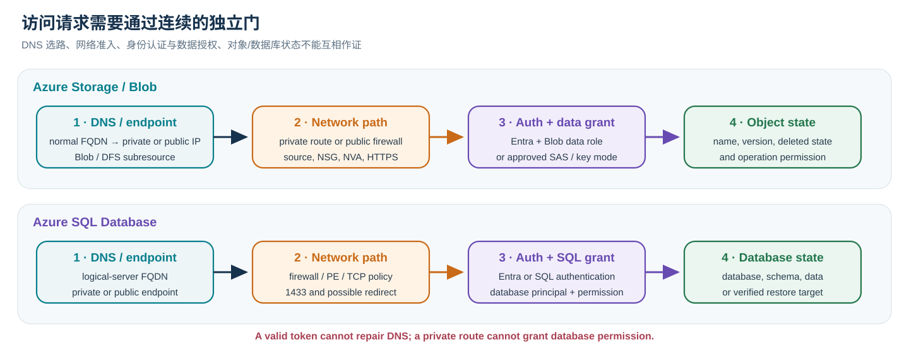
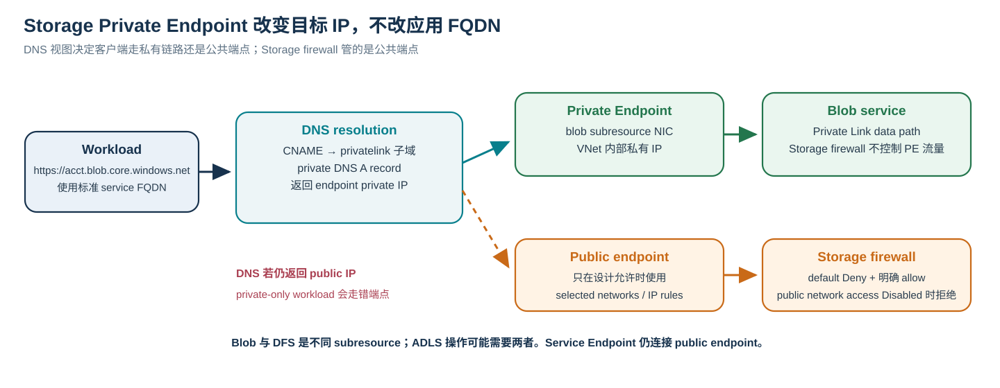
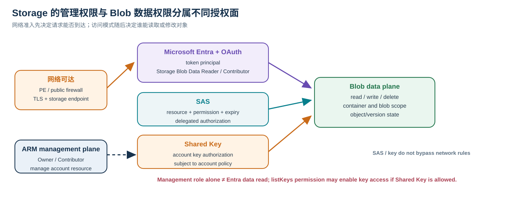
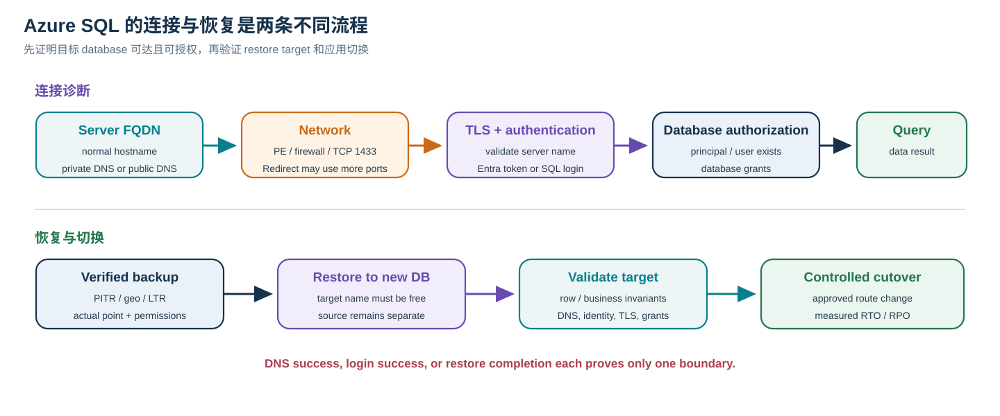
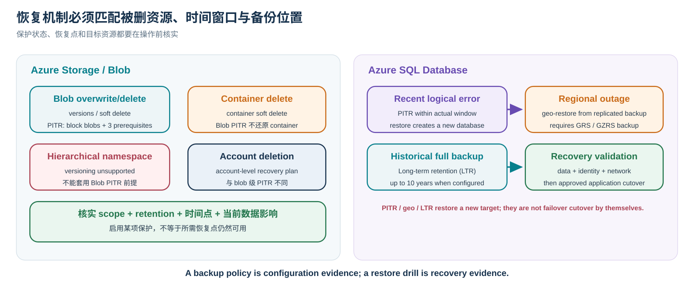

::::: cover
[AZURE CLOUDOPS · ENTERPRISE ENGINEERING]{.kicker}

# DNS 已解析，为什么数据仍然读不到？

[Azure Storage 与 Azure SQL Database]{.subtitle}

::: cover-meta
- **讲次**：13 / 23
- **核心机制**：Storage Private Endpoint、Blob 数据授权、SQL 连接策略、备份恢复
- **证据边界**：Microsoft Learn + 本地合成决策模型
- **适用场景**：403、连接超时、私有 DNS 走错、误删对象与数据库恢复
:::

::: scenario
一个应用先后出现两种故障：Blob 请求超时；SQL Server FQDN 已能解析，连接也通过了 TCP 1433 握手，却在随后等待超时。运维先扩大 Blob 权限，再重置 SQL 密码，结果都没有改变网络路径。另一个业务团队遇到表数据误写，想用“恢复数据库”覆盖现有 SQL Database，却尚未核对实际备份时间点、保留期和恢复目标。每个请求都跨越多个边界：先到达正确端点，再通过网络与传输策略，然后完成身份认证和数据授权；发生数据损坏时，还必须选对资源粒度与实际恢复点。
:::

### 本讲目标

读完后，你应能把 Storage 和 Azure SQL 请求分别拆成 DNS/endpoint、网络、身份/数据授权、对象/数据库状态四道门；解释 Blob RBAC 与管理面 RBAC 的差别、SQL Redirect 与 Proxy 的网络后果；按 blob/container/account 和数据库 PITR/geo-restore/LTR 选择不同恢复机制；并把恢复结果验证和应用切换作为独立步骤。

**本讲问题：** 哪个边界导致当前请求失败？证据能证明恢复了正确的数据，还是只证明恢复操作结束？

:::::

## 先把“访问失败”拆成四个独立门

一次读请求至少有四类证据，不能用其中一类替代其他类：

| 观察到的状态 | 优先检查 | 下一条有区分力的证据 | 不能直接推出 |
|---|---|---|---|
| Storage 请求超时 | DNS、目标 IP、端点与路由 | 从实际 workload resolver 查询标准 FQDN；检查 PE 子资源、NSG、NVA 和 TCP/TLS | Storage data role 不足；对象不存在 |
| Storage 返回 403 | 当前授权模式、身份和数据权限 | 确认 principal、Storage data role、role scope、SAS 权限/过期、Shared Key 策略 | 肯定是 firewall；有 Azure `Reader` 就有 Blob 读取权 |
| SQL 预登录或连接超时 | SQL FQDN、public/PE、TCP 与连接策略 | 先检查 DNS，再按实际 `Redirect`/`Proxy` 策略核对端口 | 密码错误；数据库用户缺少 `SELECT` |
| SQL 连接建立但 `Login failed` / `Cannot open database` | 登录身份与数据库授权 | 核对 Entra token/login、数据库 principal、数据库名及权限 | Private Endpoint 路径错误 |
| Blob 显示 NotFound、误删或恢复请求失败 | 对象状态、资源范围、时间点与保护配置 | 查 blob/version/container 状态、实际保留窗口和所选恢复机制 | Blob PITR 能还原容器或整个账号 |

请求顺序可以压缩成“DNS 选路 → 网络准入 → 身份认证与数据授权 → 数据状态”。Storage 和 SQL 的细节不同，但“网络可达”不等于“有权读数据”；“token 有效”也不等于“SQL 数据库中已经存在用户”。恢复则是另一条流程，不是读路径的自动延伸。[1][4][5][8]



## Azure Storage：标准 FQDN 如何走到私有端点

Storage Private Endpoint 在指定 VNet 中建立带私有 IP 的网络接口，连接到账户的某个 Storage 子资源。应用继续使用原来的标准 URL，例如 `https://<account>.blob.core.windows.net`；DNS 从适当的网络视图把它解析到私有端点 IP。不要把 `privatelink` 子域或 IP 写进应用连接串。自定义 DNS、混合 DNS 或私有 DNS zone link 错误，都可能让同一个标准 hostname 在不同客户端解析到不同 endpoint。[2][3]



Storage 的网络控制针对不同路径：

- **Public endpoint**：可以开放全部网络，也可保留公共端点但将默认规则设为 Deny，再允许指定 IP、subnet 或受支持的资源；也可以禁用 public network access。
- **Private Endpoint**：客户端通过私有 IP 到达 Storage 子资源。Storage firewall 规则控制 public endpoint，不控制 private endpoint 流量；VNet 路由、NSG、private endpoint 网络策略与 NVA 仍可能影响此路径。[1][2]
- **Service Endpoint**：为 subnet 提供 VNet 身份和 Azure backbone 路由，但客户端仍使用 Storage public endpoint，且要配置 Storage virtual network rule。它不等于 Private Endpoint。[1]
- **子资源**：`blob`、`dfs`、`file`、`queue`、`table` 等是不同的 target subresource。Data Lake Storage 操作可能需要同时规划 `blob` 和 `dfs` 两个私有端点。[2]

如果目标是 private-only，先从每个需要访问的 workload 验证标准 FQDN、private DNS zone、endpoint 连接状态、路由和授权，再关闭公共访问。复制 Blob 时，发起复制的客户端通常需要同时能到达源和目标账号；只建立一侧的 Private Endpoint 不会替另一侧提供网络路径。[2]

## Blob 授权：管理 Storage 账号不等于读取 Blob

Storage 管理面和数据面是不同的授权面。`Owner`、`Contributor` 或 `Storage Account Contributor` 可以管理资源，却不自动授予通过 Microsoft Entra ID 读取 Blob 的数据权限。读取请求通常由 Entra principal 获取 OAuth token，再由 Blob service 按数据角色授权；`Storage Blob Data Reader` 提供 Blob 只读访问，`Storage Blob Data Contributor` 包含读写删权限。角色应授予适当 scope，并等待角色变更传播。[4]

有个易误判的例外：包含 `Microsoft.Storage/storageAccounts/listKeys/action` 的管理角色，可能允许调用者取到账户 key，再通过 Shared Key 模式访问数据；这不代表管理角色本身成为 Blob data role。若账号禁用了 Shared Key，这种访问模式会被策略拒绝。SAS 则把特定资源、权限和有效期授予持有人；它控制授权范围，不能让客户端绕过网络规则或连接一个无法解析/到达的 endpoint。[4][5]



定位 403 时先记录错误代码、使用的 auth mode 和 principal；然后核对 Storage data role 或 SAS/Shared Key 状态、assignment scope 与传播。若 principal/权限无误，再看对象 path、ACL（若该账号使用相关访问控制）、对象版本和操作类型。不要为一个 Blob 读取故障授予账号级 Owner，也不要把扩大 public firewall 当作授权修复。[4]

## Azure SQL Database：TCP 1433 握手不是查询成功

客户端使用逻辑 SQL server 的标准 FQDN，例如 `<server>.database.windows.net`。启用 Private Endpoint 后，私有 DNS 应使受控网络中的标准 FQDN 解析到 endpoint 的私有 IP。创建 SQL Private Endpoint 本身不会自动禁用 public routing；要实现私有端点专用访问，还要单独拒绝 public network access，并在变更前验证需要的私有路径。[6]

Azure SQL Database 有 `Redirect`、`Proxy` 和 `Default` 连接策略。当前 Microsoft 文档说明，Azure 内客户端默认使用 Redirect，Azure 外客户端默认使用 Proxy；逻辑 server 可配置的策略仍需按实际客户端网络确认。Proxy 的后续流量经 SQL gateway；Redirect 在建立初始连接后将会话导向数据库集群。只放行 TCP 1433 时，客户端可能先完成握手，随后因 Redirect 所需的更高端口被防火墙、NVA 或本地网络挡住而超时。检查当前策略与实际端口要求，再判断是否调整网络或策略；不要先轮换凭据。[7][15]



连接已经到达 SQL 服务后，仍要分清认证与数据库授权：

1. **Microsoft Entra authentication**：SQL server 必须完成 Entra 配置；token 对应的人或工作负载 principal 需要被 SQL 识别。[8]
2. **Database principal**：数据库中要存在相应 user/login 映射。托管身份能取得 token，不会自动得到数据库用户。
3. **Database permission**：principal 还要拥有目标操作所需的 SQL 权限。Azure ARM `Contributor` 不能代替数据库 `SELECT`、写入或执行权限。
4. **SQL authentication**：若应用采用 SQL login，凭据有效性、密码轮换和目标数据库仍需分别核对；不要把登录口令或完整连接串写入共享日志。

一个经过批准的现场诊断模板可以从真实应用运行环境检查 DNS 与初始 TCP：

```powershell
Resolve-DnsName "$storageAccount.blob.core.windows.net"
Resolve-DnsName "$sqlServer.database.windows.net"
Test-NetConnection "$sqlServer.database.windows.net" -Port 1433
```

这只是模板，没有在本项目运行。请从实际 workload 或能代表其 DNS/路由的批准主机执行；`Test-NetConnection` 会发起网络探测，应先确认目标与窗口。1433 成功也不能证明 Redirect 后续端口、TLS、登录或数据库权限都成功。

## 恢复方案按资源范围和真实恢复点选择

Storage 的版本和删除保护有不同资源范围。Blob versioning 保存 Blob 的历史版本，但不保护 container 或 account 删除；container 删除需要 container soft delete 一类的保护；账号级删除则需要单独设计账号级恢复路径。并非所有 Storage 功能都支持 hierarchical namespace。[9][10]

Azure Blob Point-in-time restore 支持针对 **block blob** 的操作恢复；它不能还原已删除 container 或 storage account。启用 PITR 前必须启用 Blob soft delete、change feed 和 blob versioning。版本会随写入增加，带来额外存储成本；层级命名空间账号不支持 blob versioning，不能照搬这组 PITR 前提。请求恢复前要确认目标 blob/container 范围、实际 retention 起点、所选时间以及对当前数据的覆盖影响。[10][11]

Azure SQL Database 的自动备份有不同恢复用途。以下是方法边界；实际可恢复的时间点和权限要查当前数据库设置与备份清单，不要用默认值代替现场证据。[12][13][14]

| 方法 | 适用问题 | 目标与前提 | 关键限制 |
|---|---|---|---|
| **Point-in-time restore (PITR)** | 最近的逻辑误写、误删或数据库级恢复 | 在实际 PITR 保留窗口内选择时间；创建新 database | 默认保留期当前文档为 7 天；可配置 1–35 天，Basic 为 1–7 天。要核对实际 tier 和设定 |
| **Geo-restore** | primary region 不可用时，使用最新异地复制备份恢复 | 目标 region/server 上创建新 database；备份存储需 GRS 或 GZRS | 恢复点来自最近复制备份；复制延迟可能造成数据损失，且突发灾难时目标 region 容量不保证 |
| **Long-term retention (LTR)** | 需要超过 PITR 窗口的历史 full backup | 需要事先配置并确认目标 LTR backup 存在；还原成新 database | 默认未启用，可配置最长 10 年；策略存在不等于目标时间点已有备份 |

SQL Database 的这些恢复操作创建新的 database，不能覆盖现有目标数据库。恢复结束后还要单独验证数据、schema、数据库 principal/权限、网络 endpoint、DNS、应用连接配置和依赖，再走批准的应用切换。Geo-restore、PITR 和 LTR 不能互相替代；它们也不会自动实现应用层故障切换。业务 RTO/RPO 要靠经批准的演练量测，不能从“启用了备份”直接推导。[13][14]



## 配置演练：Blob 只读与 SQL 隔离恢复

**未来 Azure 练习，当前未执行。** 目标是让报表身份只读一个 Blob 和一个 SQL 视图，并在数据误删时从恢复点读取旧数据。准备获批的 StorageV2、SQL Database、私网客户端、资源 owner 和 DBA。正常和拒绝用例都使用合成数据。[2][4–13]

| 配置归属 | 选项和字段 | 如何验证 |
|---|---|---|
| Storage account → Redundancy | 区域与类型支持时选 ZRS（`Standard_ZRS`）。本仓库 `textbook/terraform/modules/storage/main.tf` 用 LRS 并开启版本与软删除供读代码 | 核对冗余模式。LRS、ZRS 覆盖不同区域内故障域；GRS 异步复制到次区，需另定区域故障 RPO |
| Storage account → Networking / Configuration | 私有访问按 AZ02-03 配 Blob PE，设 `publicNetworkAccess=Disabled`。如用 selected networks 要核对 `networkAcls.defaultAction` 与规则；独占实验帐户可关闭 `allowSharedKeyAccess` 和匿名 Blob | 网络放行、共享密钥、匿名是独立开关。测试授权网络与拒绝路径 |
| Container → Access control (IAM) | 报表主体取容器级 Storage Blob Data Reader，验证命令见 AZ02-03。临时委托时可用 HTTPS、单对象、只读、短过期的 user delegation SAS | 委托者在帐户或上级作用域需 `generateUserDelegationKey/action`，并有相应对象数据权限。禁 Shared Key 后 Blob user delegation SAS 可用；帐户/服务 SAS 被拒。不要记录 SAS URL |
| SQL logical server → Networking | Private endpoint 子资源 `sqlServer`，zone `privatelink.database.windows.net`。使用原始 FQDN，另禁公网访问。按实际客户端核查 Proxy/Redirect 所需端口和路径 | DNS、TCP/TLS、login、执行 SELECT 各有证据。开放防火墙无法授予数据库权限 |
| SQL logical server → Microsoft Entra ID；目标 DB | 设置 Entra admin，在目标 DB 创建 contained user 并给对象最小权限。SQL authentication 使用独立凭据与 DB 授权；Entra-only 开启时拒绝 SQL authentication | Azure 控制面角色与数据库权限分别检查。以实际主体验证 SELECT 成功、非授权查询被拒 |

~~~{.sql title="文档示例 · 在目标数据库执行 · 需要授权 DBA"}
CREATE USER [app-pay-reader] FROM EXTERNAL PROVIDER;
GRANT SELECT ON OBJECT::dbo.PaymentSummary TO [app-pay-reader];
~~~

此处假定主体和视图已存在且 Entra 主体可被解析。客户端验证 TLS，连接 `<server>.database.windows.net` 并指定目标 DB 与获批身份。TCP 成功而登录失败时查 token 目标和 DB 用户；已登录却 SELECT 被拒时查对象授予。检查对象授权比扩大管理员权限更精准。

**恢复与验收。** Blob 在 Data protection 选支持的版本、软删除和保留周期。先用小对象验证版本找回，容器误删走容器恢复。SQL 在 Backups 查保留与最早时间，从数据库 Restore 选故障前的 UTC 时间并恢复到隔离的新数据库。比较记录数、金额与写入标记，再做受控读写；先保留生产连接串。结束时按保留要求移除自己的试验库、对象、端点及临时授权。算力、备份、Blob 版本、端点均可能计费。本轮只有下方本地模型。

## 离线实验：根据证据定位失败门

实验用 JSON 案例输入模拟 Storage 读请求、SQL 连接、Blob 恢复和 SQL 恢复。模型对每个案例先返回一个分类与下一条建议证据：

```powershell
python -m unittest discover -s textbook/chapters/AZ04-04/labs/data-boundary-model -p "test_*.py" -v
python textbook/chapters/AZ04-04/labs/data-boundary-model/azure_data_boundary_model.py
```

示例输出 `sql-redirect-ports-blocked-after-handshake: PASS` 代表 fixture 预期分类是“握手之后的 Redirect 端口受阻”，而不是密码错误；它不是一次真实连接。其他 fixture 展示 public endpoint/DNS 选错、Storage management role 不含 Blob data access、SAS 无法穿透 public network disable、HNS 与 Blob PITR 不兼容、SQL LTR 备份未核实等边界。

实验不调用 Azure CLI，不读取本机凭据，不发送 DNS/网络请求，不连接 SQL，不执行 Storage 读写或恢复。它只检查合成字段，不会验证角色、DNS、端口、备份和目标数据库是否真实存在。

### 练习 1：Private DNS 返回了公共地址

Storage 账号禁用了 public network access。应用使用标准 Blob FQDN，Entra token 和 `Storage Blob Data Reader` 均已确认，但从应用 VNet 得到 public IP。第一修复是什么？

**参考答案：** 先修正应用实际使用的 DNS 解析链和 private DNS zone link，并从 workload 路径确认标准 FQDN 指向 Private Endpoint IP。数据角色不是当前 DNS 选路错误的修复；也不应为了确认权限重新打开 public network access。[2][3]

### 练习 2：SQL 握手成功后超时

应用能连接 SQL FQDN 的 TCP 1433，但登录前等待超时。logical server 使用 `Redirect`，出站策略只允许 1433。下一条证据是什么？

**参考答案：** 按应用网络位置确认有效连接策略，并检查 Redirect 后续流量的目标与高端口范围是否被 NSG、NVA 或企业防火墙阻止。先确认网络阶段，再考虑登录凭据；不要仅凭 1433 握手判定 SQL 已可用。[7][15]

### 练习 3：SAS 仍然返回网络拒绝

有效期内的 Blob SAS 从开发者笔记本请求，账号 public access 已关闭；应用私有端点 DNS 正常。为什么 SAS 不能成功？

**参考答案：** SAS 授权令牌不提供网络可达性。笔记本必须通过被允许的网络路径访问目标；或者应由实际应用网络使用标准 FQDN 和 Private Endpoint。不要把 SAS URL 发到日志或工单。[1][5]

### 练习 4：删除 container 后请求 Blob PITR

账号曾开启 soft delete 和 versioning，业务团队选择 container 删除之前的时间，希望用 Blob PITR 还原整个 container。应先核对什么？

**参考答案：** Blob PITR 不处理 container 操作。检查是否在删除前启用了 container soft delete、删除时间是否仍在实际保留窗口；若保护未启用或窗口已过，不能把 Blob PITR 当成可用恢复点。[9][11]

### 练习 5：选择 SQL 恢复方式

业务表在上午误写。当前数据库的 PITR 时间窗已核实包含错误前时间，某个旧 LTR backup 也存在。应如何验证后再切换？

**参考答案：** 先记录精确 cutoff、目标 server/region、恢复权限和唯一的新数据库名；选定 PITR 或经业务批准的已验证 LTR backup，恢复到新 database。核验关键行数/业务不变量、权限和应用网络连接，再由变更流程批准路由或连接串切换。目标建好只证明恢复操作完成，不能证明数据正确或业务已恢复。[12][13]

### Senior engineer 面试题

设计一个从 workload 到 Blob 读取、再到 Azure SQL 灾难恢复的证据链。指出哪几项能由本章合成 fixture 证明，哪些需要从实际 VNet/DNS、Entra、SQL database 和备份清单中读取，哪些必须通过经批准的恢复演练与业务不变量验证。

## 本讲总结

Storage 和 SQL 的请求都要通过 DNS/endpoint、网络、身份认证、数据授权及目标状态等多个门。Private Endpoint 依赖 DNS 把标准 FQDN 导向私有 IP；Storage data role 与 ARM 管理角色不同；SQL TCP 握手也不等于 Redirect、TLS、登录和数据库授权均已成功。恢复机制必须匹配 Blob、container、account 或数据库的资源范围，并基于真实存在且仍在保留期内的恢复点。新的恢复目标还要验证数据、权限、连通性和应用切换。只有现场访问、备份清单和受控恢复演练，才能提供超出离线模型的证据。

## Primary references

[附] [Storage redundancy](https://learn.microsoft.com/en-us/azure/storage/common/storage-redundancy) · [Prevent Shared Key](https://learn.microsoft.com/en-us/azure/storage/common/shared-key-authorization-prevent) · [User delegation SAS](https://learn.microsoft.com/en-us/azure/storage/blobs/storage-blob-user-delegation-sas-create-cli) · [Entra SQL authentication configuration](https://learn.microsoft.com/en-us/azure/azure-sql/database/authentication-aad-configure?view=azuresql)

[1] [Azure Storage network security FAQ](https://learn.microsoft.com/en-us/troubleshoot/azure/azure-storage/blobs/networking/storage-network-security-faq) · [2] [Use private endpoints for Azure Storage](https://learn.microsoft.com/en-us/azure/storage/common/storage-private-endpoints) · [3] [DNS security and private name resolution](https://learn.microsoft.com/en-us/azure/networking/design-guide/dns-security)

[4] [Authorize Blob access with Microsoft Entra ID](https://learn.microsoft.com/en-us/azure/storage/blobs/authorize-access-azure-active-directory) · [5] [Authorize operations for data access](https://learn.microsoft.com/en-us/azure/storage/common/authorize-data-access?tabs=blobs) · [6] [Azure Private Link for Azure SQL Database](https://learn.microsoft.com/en-us/azure/azure-sql/database/private-endpoint-overview)

[7] [Connectivity architecture for Azure SQL Database](https://learn.microsoft.com/en-us/azure/azure-sql/database/connectivity-architecture) · [8] [Microsoft Entra authentication for Azure SQL](https://learn.microsoft.com/en-us/azure/azure-sql/database/authentication-aad-overview) · [9] [Azure Storage data protection overview](https://learn.microsoft.com/en-us/azure/storage/blobs/data-protection-overview)

[10] [Blob versioning](https://learn.microsoft.com/en-us/azure/storage/blobs/versioning-overview) · [11] [Point-in-time restore for block blobs](https://learn.microsoft.com/en-us/azure/storage/blobs/point-in-time-restore-overview) · [12] [Automated backups in Azure SQL Database](https://learn.microsoft.com/en-us/azure/azure-sql/database/automated-backups-overview)

[13] [Restore a database from a backup](https://learn.microsoft.com/en-us/azure/azure-sql/database/recovery-using-backups) · [14] [Azure SQL business continuity and RTO/RPO](https://learn.microsoft.com/en-us/azure/azure-sql/database/business-continuity-high-availability-disaster-recover-hadr-overview) · [15] [Troubleshoot common Azure SQL connection issues](https://learn.microsoft.com/en-us/azure/azure-sql/database/troubleshoot-common-errors-issues)
