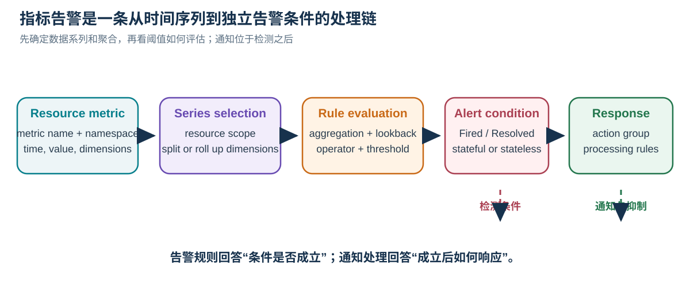
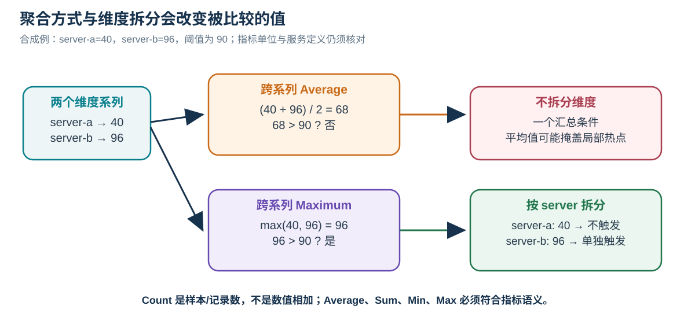
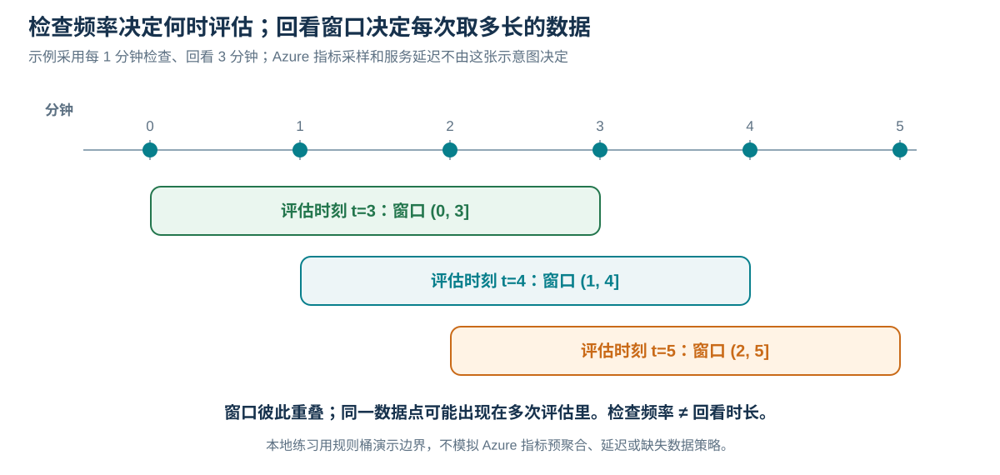
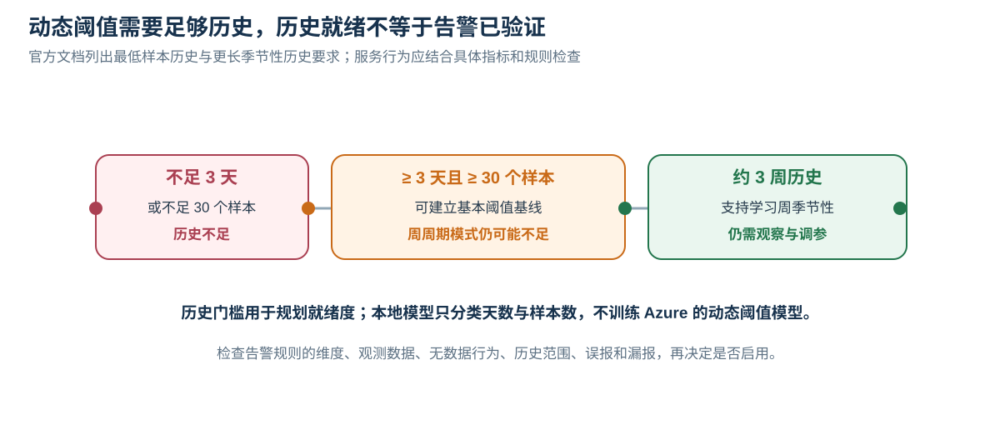
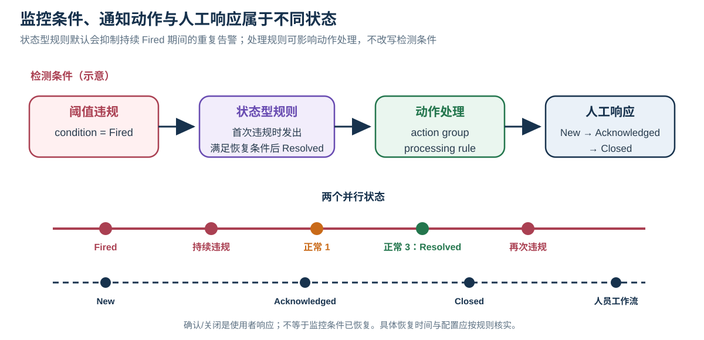

::::: cover
[AZURE CLOUDOPS · ENTERPRISE ENGINEERING]{.kicker}

# 为什么平均值正常，告警却漏掉了热点？

[Azure Monitor 指标与告警]{.subtitle}

::: cover-meta
- **讲次**：14 / 23
- **核心机制**：指标序列、聚合、维度、评估窗口、静态/动态阈值与状态
- **证据边界**：Microsoft Learn + 可重复的离线合成模型
- **适用场景**：告警漏报、重复通知、阈值不稳定与无数据排查
:::

::: scenario
一个服务把 40 台实例的响应时间合成一条 Average 曲线。99% 的实例表现良好，一台实例却达到 96 ms；团队将阈值设为 90 ms，图表显示平均值只有 68 ms，告警没有触发。另一个值班人员看到同一条告警在每次检查中重复通知，便把阈值调高。问题可能来自聚合、维度、窗口、状态或通知处理；在调整阈值前，先弄清每次评估究竟比较了哪些数据。
:::

### 本讲目标

读完后，你应能解释 Azure Monitor 指标时间序列由哪些字段构成；辨别 Average、Sum、Count、Min、Max 的语义；判断维度拆分和汇总如何改变告警粒度；区分检查频率与回看周期；说明静态/动态阈值、状态型/无状态告警及通知处理各自解决的问题；并用离线模型复现可解释的告警案例。

**本讲问题：** 哪些样本被聚合、怎样分组、何时回看，最终触发了哪一种监控状态？

:::::

## 指标是一组带维度的时间序列

Azure Monitor 指标是按时间采集的数值。一个点至少要结合时间戳、资源、指标命名空间、指标名称、数值和维度来解释。`Requests` 或 `CpuPercentage` 并非脱离资源与单位的全局数字：提供此指标的资源提供程序定义可用维度、时间粒度和聚合方式。某项指标是否存在、多久产生一次、如何预聚合，须以对应资源的指标定义为准。[1][2]

图表和告警都在处理指标时间序列，但用户看到的曲线不必与告警条件完全同构。图表可以按时间粒度重新汇总或按维度分组；规则则有自己的 scope、指标、维度条件、聚合粒度、评估频率和阈值。排查时应将图表的聚合与时间粒度对齐到告警规则，再检查是否有维度筛选差异。[1][4]



## 聚合和维度会改变告警所看到的信号

假设同一时间有两个实例：A 为 40 ms，B 为 96 ms，阈值为 90 ms。汇总 Average 为 68 ms，因此条件 `Average > 90` 不成立；汇总 Maximum 为 96 ms，因此 `Maximum > 90` 成立。按实例维度拆分时，每个维度组合各自评估，便能指出 B 超限。汇总能减少序列数量，却会隐藏局部热点；拆分能定位异常，却可能让序列和通知数量增加。[3][4]

| 聚合 | 直觉含义 | 常见误读 |
|---|---|---|
| Average | 窗口内数值的平均水平 | 把局部尖峰稀释掉；平均不代表每个实例健康 |
| Sum / Total | 数值总和 | 对已是速率或累计值的指标再次求和可能失去业务意义 |
| Count | 窗口内记录/样本的个数 | Count 不是把样本中的数值相加；资源提供程序的数据形态影响解释 |
| Min / Max | 窗口内最低/最高值 | 一个极端点可能支配结果；需核对采样与预聚合语义 |



先问“我要保护的是整体容量还是任一实例”，再选聚合与维度。若既需要总量趋势又需要单实例异常，可以维护职责不同的规则，而不是期望一个聚合同时准确回答两种问题。维度条件能将规则扩展为多条时间序列；每个维度组合独立判断阈值。只有被规则包含的系列会评估。要同时监测未拆分的总体信号，创建一条对应的汇总规则。[3][4]

## 检查频率不等于回看时长

**检查频率（Check every / frequency）**是规则多久评估一次；**聚合粒度或回看周期（Aggregation granularity / lookback period）**决定每次评估汇总多长时间的数据。例：每 1 分钟评估一次，回看 5 分钟，窗口会不断滑动并彼此重叠。某点可能被纳入多次评估。评估频率更短可以更快发现变化，也可能增加对短时噪声的响应；回看时间更长可以平滑短时波动，也可能延后或弱化短暂异常。规则的服务延迟、指标上报节奏和实际配置仍须一起检查。[3][4]



Azure 资源提供程序可能已在上报前对数据做过预聚合，时间粒度也因指标而异。因此，手算窗口只用于理解规则，不足以预测服务上的确切点值或触发时刻。看似“图表里有尖峰、告警没触发”时，核对资源 scope、metric name/namespace、维度筛选、aggregation、period/frequency 和图表时间粒度；然后检查数据是否到达、评估是否跨过阈值。[1][4]

## 阈值定义异常边界；动态阈值依赖历史

静态阈值用操作员明确给出的数值和比较符号，例如 `Average > 90`。它适用于边界稳定且含义清楚的指标，但单位、粒度、业务时段和聚合需匹配。`GreaterThan` 与 `GreaterThanOrEqual` 对等于阈值的样本结论不同；先确认运算符，再讨论数值。若指标有多个维度，Azure Monitor 可在规则中指定维度条件，并对匹配的时间序列分别评估。[3]

动态阈值从指标历史中学习正常范围，不是把一个固定阈值改成另一个固定数值。Microsoft 文档说明，规则至少需要三天与 30 个样本后才具备触发条件；识别周周期通常需要更长的历史（约三周）。历史不足时，模型可能仍在学习，不能把“已创建规则”当成动态基线已经可靠。部署前应观察历史拟合与异常边界，按指标季节性、目标维度、误报/漏报成本决定是否采用。[5]



## 告警状态和通知处理是两个控制面

指标告警可为状态型（stateful）或无状态（stateless）。状态型指标告警默认启用：条件首次成立时进入 Fired；持续违规期间不会每次检查都作为新告警重复产生；条件连续恢复满足要求后才 Resolved。Azure 指标告警的恢复判定需要连续三次评估未触发条件。无状态告警则可在每次条件成立的评估中重复触发，也不会以同样的状态生命周期发出恢复事件。具体规则类型与配置要在规则详情中确认。[6][7]

监控条件的 Fired / Resolved 与使用者对告警记录的 New / Acknowledged / Closed 是两套状态。Acknowledged 表示有人响应，不表示指标已回到阈值范围；Resolved 表示监控条件已恢复，也不表示事故已经复盘。Action group 定义告警触发后的响应目标；alert processing rule 可按过滤、日程或抑制策略影响动作处理，不会把检测条件改成正常。变更处理规则后，生效存在传播时间，更新后应验证实际通知路径。[6][8]



## 排查告警时收集能区分假设的证据

| 症状 | 先核对 | 有区分力的证据 | 避免直接推断 |
|---|---|---|---|
| 图表越线但告警未触发 | 规则 scope、指标名/namespace、维度、聚合、frequency、窗口、operator | 规则评估结果、规则条件、对齐粒度后的同一系列图表 | “阈值服务坏了” |
| 整体正常但一个实例过载 | 汇总聚合及拆分维度 | 每个维度系列的值与被选中的条件 | “Average 高于阈值就能覆盖每个实例” |
| 触发时间比图表尖峰晚 | 指标采样/上报、回看窗口、检查频率、评估历史 | 时间戳、窗口边界、实际样本 | 只看图表缩放后的单个峰值 |
| 告警重复出现 | 状态型/无状态、每次评估条件、通知规则 | 告警状态历史和每次评估值 | 仅通过抬高阈值消除噪声 |
| 告警已确认但持续失败 | 条件状态与使用者响应分开 | 当前 Fired/Resolved 与最近评估 | “Acknowledged 就是恢复” |
| 动态告警过于宽松或没有触发 | 历史范围、样本量、季节性、维度、学习状态 | 规则图表、历史数据量、实际拟合区间 | 规则创建成功代表模型已经成熟 |

诊断顺序：保存规则的精确配置；重现告警时间段的 scope、聚合、维度和窗口；检查原始可观察系列与数据延迟；再区分阈值判断、监控状态和通知路由。一次只改动一个因素，并记录变更前后的评估证据。如果值班人员实际收到的通知不符预期，另行检查 Action Group、处理规则过滤器、日程和最近修改时间。[4][8]

## 离线实验：复现聚合差异和告警状态

实验目录：`labs/metric-alert-model/`。Python 仅使用标准库，执行时不登录、不查询或变更 Azure，也不发送通知。每个 fixture 都标出点值、维度、聚合、回看窗口、评估时刻和预期事件，可复现地验证规则**抽象**中的差异。

```powershell
python -m unittest discover -s textbook/chapters/AZ05-01/labs/metric-alert-model -p "test_*.py" -v
python textbook/chapters/AZ05-01/labs/metric-alert-model/metric_alert_model.py
```

案例 `average-rollup-hides-a-hot-series` 把 40 和 96 合成为 68，因此不超过 90；`split-dimension-finds-the-hot-server` 独立评估两个实例，只对 B 触发。其它 fixture 练习 Count 的记录数语义、最大值聚合、重叠窗口、连续恢复评估、无状态重复告警、通知抑制及动态阈值历史门槛。查看完整期望结果和字段含义：`labs/metric-alert-model/README.md` 与 `fixtures/metric-alert-cases.json`。

本地模型以输入的 bucket 为完整数据集，使用 `(评估结束时刻 - lookback, 评估结束时刻]` 作为窗口，并对 fixtures 明示的系列值进行常规统计。Azure 指标源可能预聚合、延迟或缺失；服务的维度、动态模型、告警限制与恢复细节并未被模拟。通过本地测试只能证明该模型符合预期规则，不能证明 Azure 中的规则配置正确或发生过实时通知。

## 练习与参考答案

::: exercise
**练习一。** 三个服务器的 CPU 分别为 21%、24%、96%，阈值为 90%。如果规则按实例取 Average 汇总，为什么可能漏报？如何配置才可单独告警于过载实例？
:::

::: solution
整体 Average 为 47%，不会越过 90%。按服务器维度拆分后，对每个序列分别应用聚合和阈值，96% 序列会触发。是否使用 Maximum 还要与指标在时间窗口中的采样语义相符。
:::

::: exercise
**练习二。** 一条规则每 1 分钟检查、回看 10 分钟。它是每十分钟触发一次吗？同一个样本能否参与多次评估？
:::

::: solution
不是。每分钟都会进行一次检查，每次将回看十分钟的窗口聚合；相邻窗口重叠，故同一数据点可能被多次纳入。检查频率和聚合粒度描述不同设置。
:::

::: exercise
**练习三。** 值班人员 Acknowledge 了告警，但服务指标仍超限。监控条件是否必然 Resolved？告警正在 Fired 时处理规则抑制通知，是否等于条件正常？
:::

::: solution
都不是。Acknowledge 属于人工响应，不证明监控条件恢复；处理规则的抑制影响后续动作处理，不改写告警规则评估的 Fired 状态。应分别检查当前条件、响应状态与动作处理证据。
:::

## 参考资料

::: refs
1. [Metrics in Azure Monitor — data platform](https://learn.microsoft.com/en-us/azure/azure-monitor/metrics/data-platform-metrics) — 指标时间序列与维度。
2. [Metrics aggregation and display explained](https://learn.microsoft.com/en-us/azure/azure-monitor/metrics/metrics-aggregation-explained) — 聚合类型、时间粒度与图表显示。
3. [Create or edit a metric alert rule](https://learn.microsoft.com/en-us/azure/azure-monitor/alerts/alerts-create-metric-alert-rule) — 静态/动态阈值、维度、检查频率和 lookback。
4. [Troubleshoot metric alerts in Azure Monitor](https://learn.microsoft.com/en-us/azure/azure-monitor/alerts/alerts-troubleshoot-metric) — 聚合粒度、维度序列和图表对齐。
5. [Dynamic thresholds in Azure Monitor alerts](https://learn.microsoft.com/en-us/azure/azure-monitor/alerts/alerts-dynamic-thresholds) — 历史数据、训练和季节性。
6. [Azure Monitor alerts overview](https://learn.microsoft.com/en-us/azure/azure-monitor/alerts/alerts-overview) — 告警状态与状态型/无状态处理。
7. [Types of Azure Monitor alerts](https://learn.microsoft.com/en-us/azure/azure-monitor/alerts/alerts-types) — 指标告警特点和默认状态。
8. [Azure Monitor alert processing rules](https://learn.microsoft.com/en-us/azure/azure-monitor/alerts/alerts-processing-rules) — 动作过滤、抑制与安排。
:::
