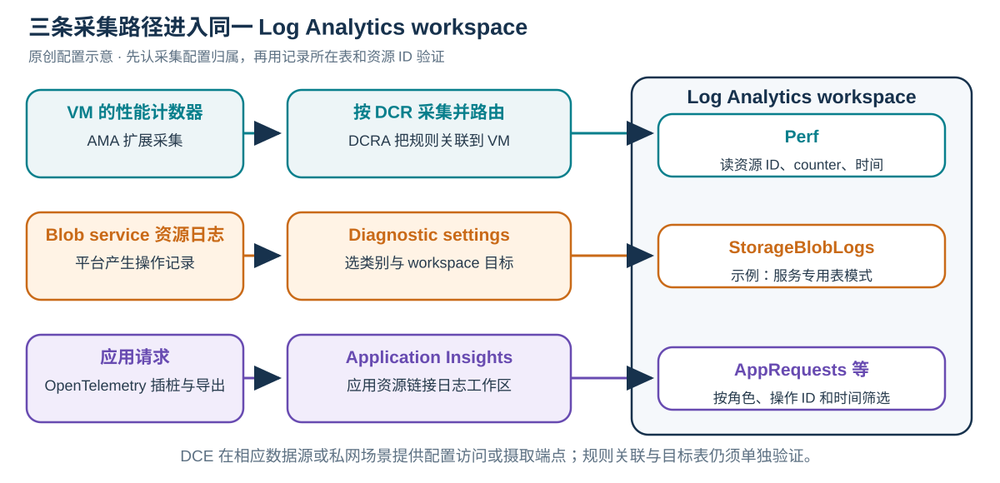
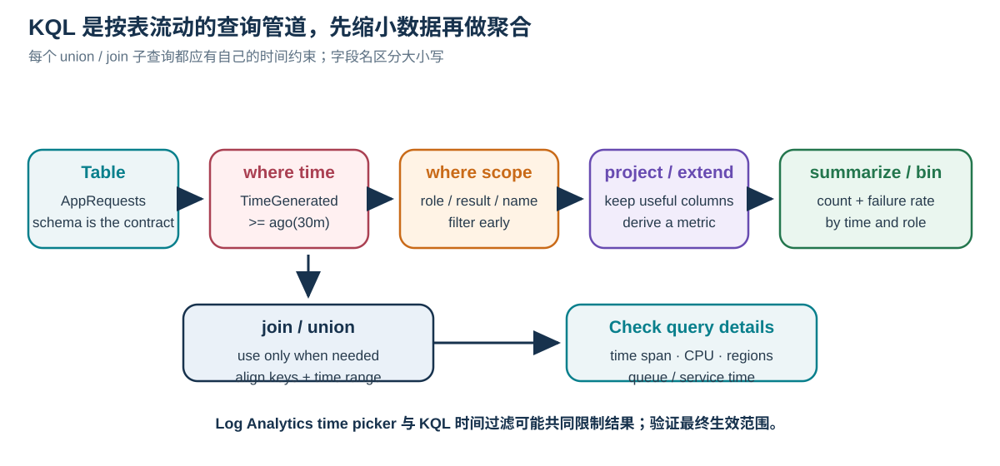
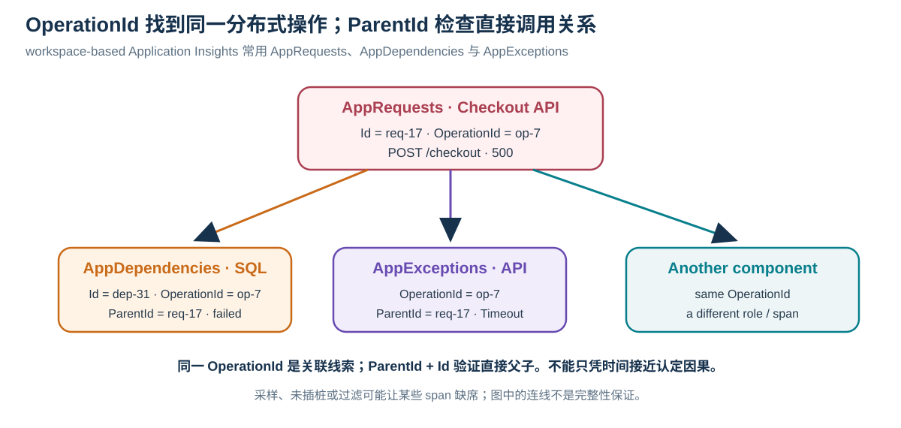
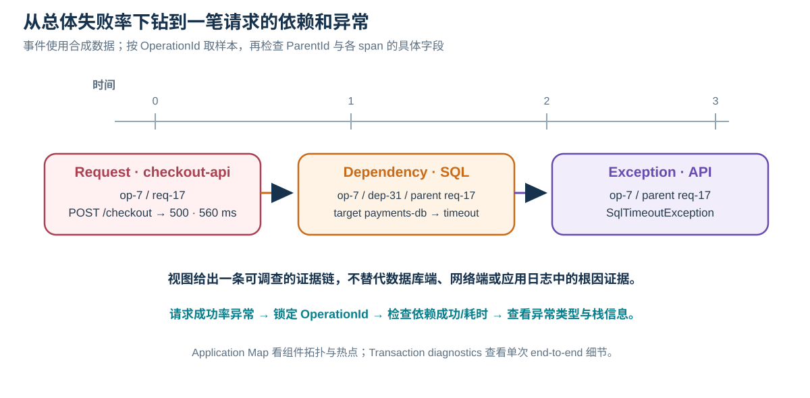
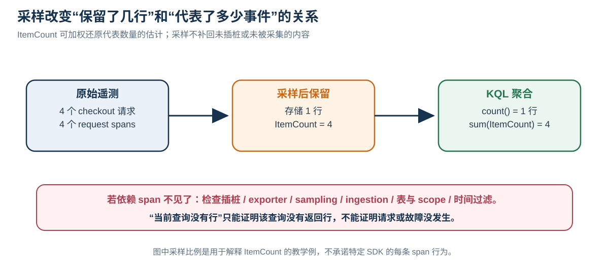

::::: cover
[AZURE CLOUDOPS · ENTERPRISE ENGINEERING]{.kicker}

# 日志里有错误，怎样还原一笔分布式请求？

[Log Analytics、KQL 与 Application Insights]{.subtitle}

::: cover-meta
- **讲次**：15 / 23
- **核心机制**：workspace 表、KQL 管道、分布式关联、采样与请求诊断
- **证据边界**：Microsoft Learn + 合成遥测与离线关联模型
- **适用场景**：请求失败、依赖超时、异常缺失与查询结果为空
:::

::: scenario
checkout API 的失败率升高，但应用日志只显示“请求失败”。值班人员按最近一小时查询发现了一个 SQL 超时异常，却无法证明它属于哪笔请求；同一 operation 还有请求表、依赖表与异常表三种记录。另一个看板显示 20 行请求，而业务系统记录了 80 次调用。前者需要用分布式关联 ID 对齐调用关系，后者可能是采样后保留的记录行数与 ItemCount 权重不同。开始追根因前，先确认数据进入了哪张表、查询覆盖了什么时间和 workspace，再把可见遥测按操作及父子 ID 串起来。
:::

### 本讲目标

读完后，你应能从资源/应用遥测源追踪到 Log Analytics 表；按实际 schema 编写带时间范围、维度筛选和聚合的 KQL；解释 `OperationId` 与 `ParentId` 的关联边界；在采样情况下正确解释 `ItemCount`；区分 Application Map 的组件视图与单次 Transaction diagnostics；并对空结果、孤立 span 和未插桩数据给出有证据边界的结论。

**本讲问题：** 这条错误属于哪笔操作、哪一层依赖；当前缺失的记录是未发生、未收集，还是被查询范围筛掉？

:::::

## 先确认采集路径、工作区和表结构

Log Analytics workspace 保存有明确 schema 的表，控制查询范围、表计划和保留。主机计数器、平台资源日志、应用遥测三条采集路径分别配置。先确认是哪条路少了数据，再选择表及时间窗。[1][2][11–15]

workspace 中的 Azure table 通常有服务定义的 schema；custom table 的 schema 由采集设计确定。不同表计划、保留期和数据来源会影响可查询的数据范围、查询能力、响应时间和费用。先确认当前连接的 workspace、目标资源/应用、表计划和列，再依靠 schema pane 或表参考页检查字段大小写。本文示例面向 workspace-based Application Insights 表 `AppRequests`、`AppDependencies` 与 `AppExceptions`；较早的经典 schema 名称不同，不能不看 schema 就复制表名。[1][3]



日志查询需要对 workspace 具有查询数据权限；Log Analytics Reader 是一个内置角色示例。跨 workspace 查询会扩大数据范围和开销，因此先选最小 scope 与最短有用时间窗。KQL 查询本身也会消耗查询资源。[2][4]

## 配置演练：从 Windows VM 采一条性能计数器

**Azure 配置练习（文档步骤，未执行）。** 目标是验证一台 Windows VM 的 CPU 计数器进入指定 workspace 的 `Perf` 表。选择受支持的 VM、workspace 与管理身份；修改 AMA 扩展、DCR 及关联需要相应写权限，查询 `Perf` 需要该范围的日志读取权限。下例只收集一个计数器，生产配置应按数据成本与隐私要求裁剪。[12–14]

| 对象 | 操作与关键字段 | 独立验证 |
|---|---|---|
| Azure Monitor Agent（AMA） | VM → Extensions + applications 查看 `AzureMonitorWindowsAgent`。配置数据收集时按 VM 类型满足受支持身份和网络前提 | 扩展 Provisioning succeeded 后仍查关联、guest agent 状态或 `Heartbeat` |
| Data Collection Rule（DCR） | Monitor → Data Collection Rules → Create。选择 Windows 平台、Performance counters、自定义 `\Processor(_Total)\% Processor Time`，60 s。Destination 选 Azure Monitor Logs 及目标 workspace | JSON 的 `dataSources.performanceCounters` 应含 `samplingFrequencyInSeconds: 60`，stream 为 `Microsoft-Perf` |
| Data Collection Rule Association（DCRA） | DCR → Resources 增加目标 VM，并核对该 VM 作用域下的 association 指向此 DCR 的 `dataCollectionRuleId` | AMA 有扩展却没关联此规则时，不会获得该计数器配置 |
| Workspace 与流向 | `destinations.logAnalytics` 中的 `workspaceResourceId` 指向目标。`dataFlows` 将 `Microsoft-Perf` 送到该 destination 的逻辑名 | 从目标 workspace 查该 VM 资源 ID 的 `Perf` 行，确认 counter、时间和值 |
| Data Collection Endpoint（DCE） | 本例公用 AMA 路径通常可用默认端点。使用 Azure Monitor Private Link，或数据源明确需要 DCE 时，按文档预置并关联。配置访问端点与 VM 同区域，日志摄取端点与目标 workspace 同区域 | 验证 AMA 的配置访问、摄取 FQDN、AMPLS 关联、私网 DNS 和 HTTPS；配置和数据可能走不同端点 |

~~~{.text title="KQL 文档示例 · NOT_RUN"}
Perf
| where TimeGenerated > ago(30m)
| where _ResourceId =~ "<approved-VM-resource-ID>"
| where ObjectName == "Processor" and CounterName == "% Processor Time"
| project TimeGenerated, Computer, InstanceName, CounterValue
| order by TimeGenerated desc
~~~

**无数据时逐门查。** 同一 VM 的 `Heartbeat` 也缺失，先查扩展、身份、网络和目标 workspace；心跳存在而 `Perf` 缺失，先核对 DCRA、OS 匹配、计数器拼写、stream/dataFlow 和采样间隔。等待配置同步与采集后，再查确切资源 ID 和 UTC 窗口。练习后移除自己的关联，确认采集停止，再考虑删除独享规则或端点；共用摄取对象与保留数据应按管理策略处理。摄取、保留、查询与私网组件可能计费。

**其他两条路。** Storage 的 Blob service 等平台资源，在相应资源 → Diagnostic settings 显式选日志类别与目标 workspace。选择 resource-specific 时按服务文档检查如 `StorageBlobLogs`；选 Azure diagnostics 模式且受支持时查 `AzureDiagnostics`。此配置不靠 VM 的 AMA 或其 DCRA。一个应用则在进程中配置受支持的 OpenTelemetry SDK/Distro 和 Application Insights 连接字符串，从该 Application Insights 资源确认所链接的 workspace。发送有唯一业务标记的请求，再查 `AppRequests` 及相关 trace。不要在配置样例、日志或截图里打印连接字符串。应用有日志而主机计数器没有时，检查 AMA 路径；心跳正常而 `AppRequests` 为空时，检查应用插桩、exporter、目标和采样。[11][12][15]

## KQL：先限定时间与表，再处理细节

KQL 以表名开头，管道符 `|` 把每一步的结果传给下一步。Azure Monitor 的 KQL 区分大小写；表名和列名应按 schema 精确拼写。常用步骤包括 `where` 过滤、`project` 选择列、`extend` 计算字段、`summarize` 分组聚合、`bin()` 建立时间桶、`join` 和 `union` 关联/合并表。[2][5]

先试探小样本和 schema，再逐层加条件与聚合。把 `TimeGenerated` 过滤放在表引用之后，尽可能先用物理列和时间范围排除无关记录，再解析动态 JSON 或执行昂贵的转换。对 `union`、`join` 的每个分支分别限定时间范围；一段查询有了全局时间条件，不代表所有子查询都能安全缩小扫描范围。若有明确时间需求，检查 Portal 时间选择器与查询内时间过滤最后采用的范围。[2][4]

下例按五分钟桶和应用角色看 checkout 请求失败率。`sum(ItemCount)` 估计采样行代表的请求数量；`avg(DurationMs)` 是保留遥测上的平均值，应结合实际采样方法解读。[6][7]

```kusto
let lookback = 30m;
AppRequests
| where TimeGenerated >= ago(lookback)
| where Name contains "/checkout"
| summarize
    RequestCount = sum(ItemCount),
    FailedCount = sumif(ItemCount, Success == false),
    MeanDurationMs = avg(DurationMs)
  by bin(TimeGenerated, 5m), AppRoleName, AppRoleInstance
| extend FailureRatePct = round(100.0 * todouble(FailedCount) / RequestCount, 2)
| order by TimeGenerated desc
```

当查询变慢或被限流时，先查看执行时间、CPU、扫描时间跨度、处理数据年龄、访问的 workspace/region 和排队时间；再判断该收窄的条件、查询范围和表计划。相同 `TimeGenerated` 过滤要出现在每个子查询。查询改写可以减少不必要计算，但不应改变事故定义，例如把查询期限缩短到漏掉事故窗口，或把失败状态过度简化成一个模糊字符串。[4]



## 用 operation 和 parent ID 还原跨服务调用

Application Insights 的 request、dependency 和 exception 记录分别说明服务接到的请求、服务发出的外部调用和捕获到的异常。workspace-based 表把它们放在不同的表里。常用字段包含 `TimeGenerated`、`OperationId`、`ParentId`、`Success`、`DurationMs`、`AppRoleName` 和 `AppRoleInstance`。`AppRequests` 和 `AppDependencies` 有 `Id` 字段；当前 `AppExceptions` 表参考列出了父操作 ID，但没有同名的行 `Id` 字段。`OperationId` 把同一分布式逻辑操作中的遥测联系起来；`ParentId` 与可用的父/子 `Id` 用来检查直接调用关系。相同 operation 里的所有 span 不一定彼此直接相连。[3][8][9]

图中网关的请求可能跨过多个服务角色，然后发起数据库依赖调用。操作 ID 可以收集同一逻辑链路里的 request/dependency/exception；再比对依赖的 `ParentId` 和请求的 `Id`，确认哪次请求直接产生了依赖。只有时间接近而没有关联 ID，不足以把两条记录宣称为同一条因果链。[8][9]



```kusto
let operationId = "<从一条 AppRequests 样本中复制的 OperationId>";
AppRequests
| where TimeGenerated >= ago(1h)
| where OperationId == operationId
| project TimeGenerated, ItemKind = "Request", OperationId, ParentId,
          ItemId = Id, Name, Success, DurationMs
| union kind=outer (
    AppDependencies
    | where TimeGenerated >= ago(1h)
    | where OperationId == operationId
    | project TimeGenerated, ItemKind = "Dependency", OperationId, ParentId,
              ItemId = Id, Name, Success, DurationMs, Target
)
| union kind=outer (
    AppExceptions
    | where TimeGenerated >= ago(1h)
    | where OperationId == operationId
    | project TimeGenerated, ItemKind = "Exception", OperationId, ParentId,
              Name = InnermostType, Message
)
| order by TimeGenerated asc
```

该查询把三表字段投影到统一的时间线结构，便于在同一 OperationId 内按时间查看。检查结果时仍要核对 `ParentId` 链、服务角色、目标依赖、失败码与异常类型。某个异常可以与一个 request 同 operation，但它不一定就是失败的起因。操作故障链需要可测试的假设及服务端/依赖端证据来确认。[3][9]

## 从失败率下钻，而不是直接把拓扑当根因

先用短时间窗和表范围汇总“哪个角色或 endpoint 故障率上升”，然后挑一笔具有代表性的 OperationId 进入事务时间线。查看 requests 与 dependencies 的成功标记、响应码、耗时和 target，再查该操作内的 exceptions 与异常详情。Application Map 把被插桩的组件和依赖关系呈现为系统拓扑，可用于发现热点；Transaction diagnostics 则用于查看单次端到端事务与关联的依赖记录。拓扑边是汇总视图，并不自动解释某一次失败。[8][9]



| 观察到的结果 | 先核对 | 可以得出的结论 | 不能直接推出 |
|---|---|---|---|
| KQL 无行 | workspace/resource scope、时间选择器与 `TimeGenerated`、表名/列名、筛选、数据是否已流入 | 当前查询条件未返回匹配行 | 请求/错误没发生；服务无故障 |
| 有请求，但依赖为空 | 应用自动/手动插桩、支持的库、采样、exporter、依赖表与时间条件 | 当前可见遥测没有依赖记录 | 应用肯定没有访问外部依赖 |
| 同一 OperationId 有多条异常 | 每个异常 ParentId、请求 ID、时间和角色 | 这些行被标记为同一逻辑操作 | 每条异常都导致请求失败 |
| Application Map 显示热点边 | 组件 role、dependency type/target、失败率与代表性事务 | 该拓扑关系值得进一步调查 | 单笔请求的确切根因已经证明 |
| 行数远低于业务请求数 | 采样设置与 ItemCount | 存储行数可能是采样后行数 | `count()` 已是原始请求总数 |

## 采样、ItemCount 与“没有证据”

Application Insights 采样可能让一行遥测代表多个原始遥测项。`ItemCount` 表示这条保留记录代表的项目数；做请求数或事件数统计时，按此字段求和通常比直接 `count()` 更接近总事件数。官方查询例也在请求计数中使用 `sum(ItemCount)`。[6][7]

采样器的设计能保持被采样 trace 的相关性与完整程度，但这不等于所有应用 span 都一定被自动采集，更不等于缺少一条记录便能确定根因。手动插桩遗漏、不支持的依赖、exporter 配置、连接字符串、数据延迟、过滤或查询 scope 都会产生相似的“查不到”。Application Map 也依赖有效的 role name、dependency type 和 target；基数过高可能导致图不完整或难以显示。[8][10]

当前 Microsoft 指引对新项目和首次迁移到 OpenTelemetry 的 .NET、Node.js、Python 推荐 Microsoft OpenTelemetry Distro；Java 使用 Azure Monitor OpenTelemetry Distro。已有 Azure Monitor OpenTelemetry Distro 的系统无需只因名称变化就重复初始化；不要在同一个应用中同时初始化两种 Distro。传入 Application Insights 后，可用一条端到端链路确认 request、dependency 和 exception 是否按预期出现。SDK、自动依赖采集与默认 sampling 会随语言和版本而异，应按部署版本复核。[10][11]



## 离线实验：从样本聚合到请求关联

实验目录：`labs/telemetry-triage/`。合成数据包含 checkout 成功/失败请求、SQL dependency、exception、采样计数和一个缺少父 request 的孤立依赖。Python 模型按 time window 和 role 计算带权请求数，并用 OperationId、ParentId 与本地样本 ID 构造可见事件关系。

```powershell
python -m unittest discover -s textbook/chapters/AZ05-02/labs/telemetry-triage -p "test_*.py" -v
python textbook/chapters/AZ05-02/labs/telemetry-triage/telemetry_model.py
```

`queries/` 下的七条 KQL 模板均为 `NOT_RUN`。先在本地预测时间过滤、加权样本和关联结果，再用 Python 输出对照。模型只解释 fixture 的 `time_minute`、ID 和样本，不连接 workspace 或运行 KQL。

## 练习与参考答案

::: exercise
**练习一。** `AppRequests` 有 10 行，所有行 `ItemCount=8`。仅按存储行数统计会得到多少；用 `sum(ItemCount)` 得到多少？这个结果能否证明 80 条请求都被完整记录了所有依赖 span？
:::

::: solution
存储行数是 10；`sum(ItemCount)` 是 80，表示保留记录代表的请求遥测项数。它不证明所有请求的每个依赖/异常 span 都存在，也不证明没有遗漏其他未采集流量。
:::

::: exercise
**练习二。** 两行 `AppDependencies` 的 OperationId 都是 `op-7`，但 ParentId 分别是 `req-17` 和 `req-18`；你只看到一个父 request 的记录。下一步应该确认什么？
:::

::: solution
按 OperationId 找到同一逻辑操作的候选记录后，核对两个 ParentId 是否分别能匹配当前可见的 request/dependency ID。若 `req-18` 缺席，先检查时间、scope、采样与 instrumentation；当前窗口只有一个可见 request，不足以证明另一个依赖不存在或 req-17 导致了它。
:::

::: exercise
**练习三。** 查询没有返回 AppDependencies。能否判断服务没有访问依赖？用哪几类证据缩小原因？
:::

::: solution
不能。核对 workspace 和表 schema、时间过滤、OperationId、应用的依赖插桩与采集支持情况、exporter/连接配置、sampling 和延迟。把结论写成“当前查询范围内未观察到 dependency 行”，直到取得能验证调用路径的证据。
:::

## 本讲要点

先沿“数据源 → AMA/DCR/DCR association → workspace 表”确认采集，再按时间窗、`ItemCount` 和 operation/parent ID 解释 KQL 结果。诊断设置与应用遥测是不同路径；没有日志可能表示未采集或延迟，七条 KQL 模板仍需在目标 workspace 核对 schema 后再运行。

## 参考资料

::: refs
1. [Tables in Azure Monitor Logs](https://learn.microsoft.com/en-us/azure/azure-monitor/logs/logs-table-overview) — 表类型、schema、表计划和保留。
2. [Get started with log queries](https://learn.microsoft.com/en-us/azure/azure-monitor/logs/get-started-queries) — 表起始查询、大小写、schema、时间范围与查询权限。
3. [AppRequests table reference](https://learn.microsoft.com/en-us/azure/azure-monitor/reference/tables/apprequests), [AppDependencies table reference](https://learn.microsoft.com/en-us/azure/azure-monitor/reference/tables/appdependencies), [AppExceptions table reference](https://learn.microsoft.com/en-us/azure/azure-monitor/reference/tables/appexceptions) — workspace-based Application Insights 列定义。
4. [Optimize log queries in Azure Monitor](https://learn.microsoft.com/en-us/azure/azure-monitor/logs/query-optimization) — 时间跨度、每个子查询过滤、扫描与执行诊断。
5. [summarize operator](https://learn.microsoft.com/en-us/kusto/query/summarize-operator?view=azure-data-explorer) — 分组和聚合语义，KQL operator 适用 Azure Monitor。
6. [Metrics in Application Insights](https://learn.microsoft.com/en-us/azure/azure-monitor/app/metrics-overview) — 采样与 ItemCount 加权统计。
7. [Example queries for AppRequests](https://learn.microsoft.com/en-us/azure/azure-monitor/reference/queries/apprequests) — 请求数量、时序和性能样本 KQL。
8. [Dependency tracking in Application Insights](https://learn.microsoft.com/en-us/azure/azure-monitor/app/dependencies) — 自动/手动依赖采集、事务关联与查询。
9. [Application map](https://learn.microsoft.com/en-us/azure/azure-monitor/app/app-map), [Investigate failures and transactions](https://learn.microsoft.com/en-us/azure/azure-monitor/app/failures-performance-transactions) — 拓扑视图、错误和端到端事务诊断。
10. [OpenTelemetry sampling in Application Insights](https://learn.microsoft.com/en-us/azure/azure-monitor/app/opentelemetry-sampling) — trace sampling、关联与语言默认值。
11. [Enable OpenTelemetry in Application Insights](https://learn.microsoft.com/en-us/azure/azure-monitor/app/opentelemetry-enable) — 当前 SDK/Distro 收集和验证路径。
12. [Azure Monitor Agent overview](https://learn.microsoft.com/en-us/azure/azure-monitor/agents/azure-monitor-agent-overview) 与 [DCR samples](https://learn.microsoft.com/en-us/azure/azure-monitor/data-collection/data-collection-rule-samples) — 主机代理与性能数据流。
13. [Manage DCR associations](https://learn.microsoft.com/en-us/azure/azure-monitor/data-collection/data-collection-rule-associations) — 资源范围及绑定。
14. [Data collection endpoints](https://learn.microsoft.com/en-us/azure/azure-monitor/data-collection/data-collection-endpoint-overview) — 私网、区域和端点用途。
15. [Azure Monitor diagnostic settings](https://learn.microsoft.com/en-us/azure/azure-monitor/essentials/diagnostic-settings) — 平台资源类别、目的地与表模式。
:::
