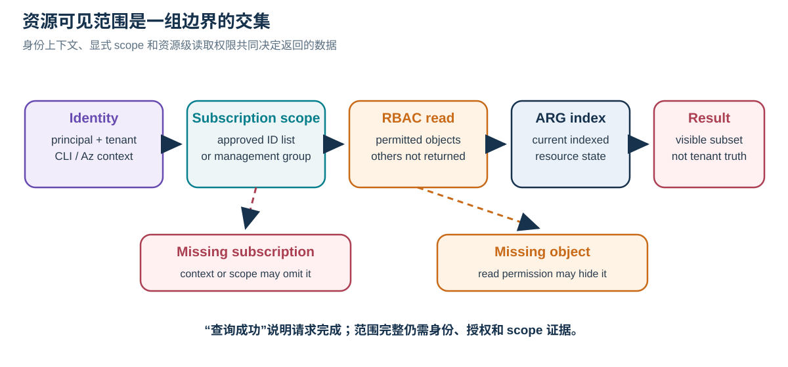
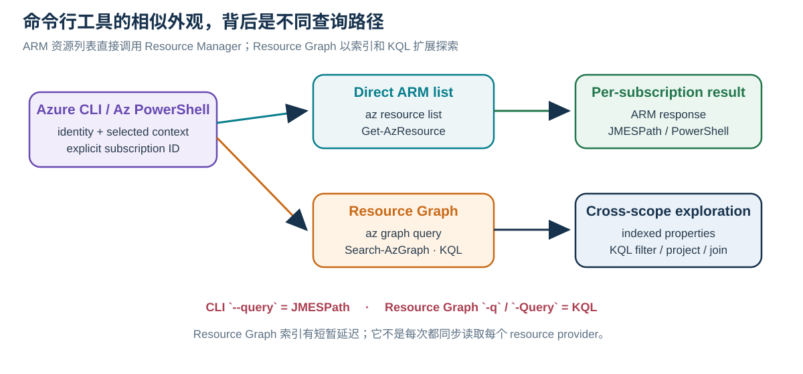
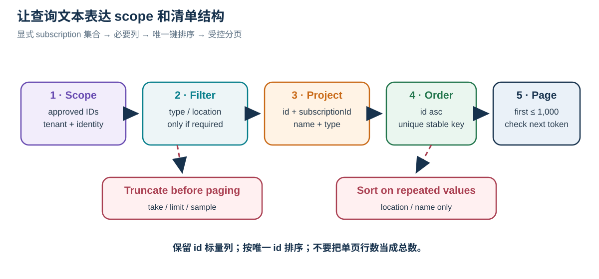
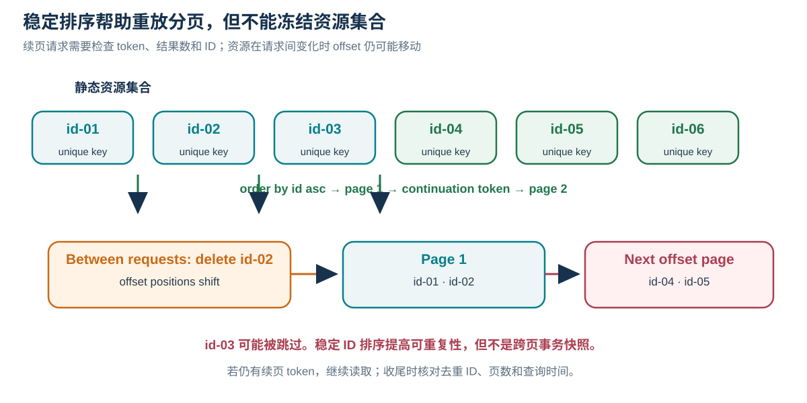
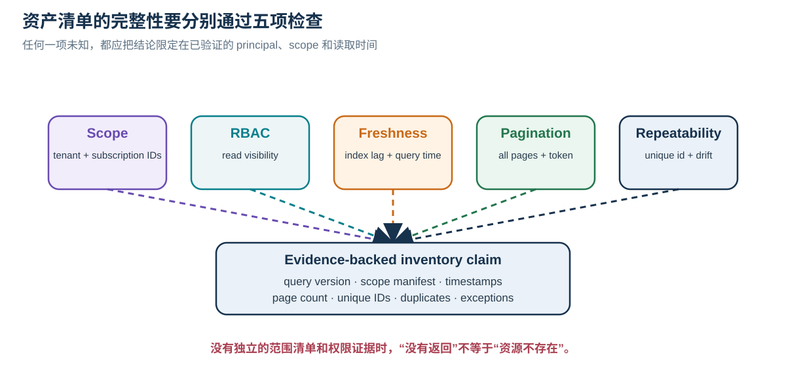

::::: cover
[AZURE CLOUDOPS · ENTERPRISE ENGINEERING]{.kicker}

# 这份资源清单，覆盖了哪些 Azure？

[Azure CLI、PowerShell 与 Resource Graph]{.subtitle}

::: cover-meta
- **讲次**：16 / 23
- **核心机制**：CLI 与 Az PowerShell 上下文、ARM 列表、Resource Graph、稳定分页
- **证据边界**：离线清单模型、Azure 只读盘点
- **适用场景**：资产盘点、CMDB 对账、范围审计、分页结果复核
:::

::: scenario
财务导出的清单有 418 个资源，平台组的 Resource Graph 查询只有 392 行。两边使用了相似的 KQL，但不能因此断言其中一份错误：查询者可能处于不同 tenant 或 subscription 上下文；RBAC 可能只允许读到部分资源；Resource Graph 索引尚未反映最近变更；查询只取了第一页；也可能是在非唯一的 `location` 上排序后，续页出现重复或遗漏。要做一份能复核的资产清单，先定义“哪些订阅、哪个身份、什么查询、何时读取”，再讨论行数。
:::

### 本讲目标

读完后，你应能检查 CLI 与 Az PowerShell 的当前上下文；区分直接 ARM 资源列表与 Resource Graph 索引查询；用显式 subscription scope、字段投影和稳定排序编写资源清单查询；按 Resource Graph 的分页限制取回结果；并把“查询成功”与“范围完整、数据最新、清单可复现”区分开。

**本讲问题：** 怎样说明一份资源清单覆盖了什么、漏掉什么，以及它在哪些条件下可以重复得到？

## 先把范围写出来

资源清单从身份和查询范围开始。Azure CLI 的当前登录和默认 subscription、Az PowerShell 的 context，以及 Resource Graph 命令显式指定的 subscription 或 management group，共同决定一次查询会看到什么。Azure CLI 文档说明，`az account list` 返回当前登录账户可用的订阅；默认订阅会影响部分命令。Az PowerShell context 保存用户、tenant 和 subscription 等认证/目标信息；`Get-AzContext -ListAvailable` 只查看本机保存的 context，并不等价于重新枚举当前用户的所有授权订阅。[1][2]

Resource Graph 默认使用当前授权身份上下文中的订阅范围；调用方可以显式提供 subscription 列表或 management group。若没有足够的 Azure RBAC `read` 权限，相关对象不会返回。会话开始后新获得的订阅，也可能需要刷新身份上下文才出现在 Resource Graph 可用范围中。因此，“查询没有报错”只说明请求在当前上下文执行成功，不能证明 tenant 下的每个 subscription 和每个资源都已被看到。[3][4]



在自动化中，先把允许读取的 subscription ID 写入受审查的清单，逐一验证 tenant 与状态，然后把同一组 ID传给每一个盘点命令。不要只依赖上一条命令遗留的默认 subscription，也不要以 `Get-AzContext -ListAvailable` 的行数推断企业订阅总数。若需要 management group 范围，还要确认层级内订阅数量：Resource Graph management-group scope 会覆盖层级中前 10,000 个 subscription；超出限制或只处理部分 scope 时，需要检查相应响应标志与请求结果。[3][5]

## 选择工具：ARM 列表还是 Resource Graph

Azure CLI 与 Az PowerShell 都可以直接列出 Azure Resource Manager 资源。例如 `az resource list --subscription <id>` 和 `Get-AzResource -SubscriptionId <id>` 适合对某个 subscription 做直接列表或针对特定资源的后续 ARM 操作。这些命令与 Azure CLI 的输出格式、JMESPath 筛选有关。

Azure Resource Graph 面向跨资源、跨 subscription 的高效探索和治理。它保存资源属性索引，支持基于 KQL 的筛选、投影、汇总、排序和有限的跨表关联；它不等于每次都向所有资源 provider 发起即时 GET。ARM 通过变更通知和定期扫描维护索引，但官方资料明确说明索引并非强一致，会有短暂延迟；部分属性也可能因 provider API 版本或更新周期而延后。[4][6]



| 任务 | 合适入口 | 关键语义 | 复核点 |
|---|---|---|---|
| 看当前 CLI 登录/默认订阅 | `az account show`、`az account list` | 登录身份和 CLI 当前选择 | tenant ID、subscription ID、租户目录和启用状态 |
| 看 Az PowerShell 当前目标 | `Get-AzContext` | cmdlet 使用的 tenant/subscription context | 账号、tenant、subscription 是否与清单范围一致 |
| 列出一个 subscription 的 ARM 资源 | `az resource list`、`Get-AzResource` | ARM 资源列表接口 | 每个 subscription 单独执行，记录返回范围与时间 |
| 跨多个 subscription 查询资源索引 | `az graph query`、`Search-AzGraph` | Resource Graph + KQL | 显式 scope、读取权限、索引延迟、续页和限流状态 |

Azure CLI 的 `az graph query -q` 接收 KQL；CLI 的全局 `--query` 参数接收 JMESPath。PowerShell 的 `Search-AzGraph -Query` 接收 Resource Graph KQL，`Get-AzResource` 则是不同的 ARM 资源命令。把这几种同名“query”语义分开，避免先在 Resource Graph 过滤一次、又用错误表达式在 CLI 客户端二次过滤。[7][8]

## 写一条范围清楚的 Resource Graph 清单查询

先投影清单审核所需的基本列，按资源 ID 做稳定排序，再增加类型或标签条件。`id` 在此作为唯一排序键；同名资源或相同 location 并不保证顺序唯一。查询不应在 `order by` 之前被 `take`、`limit` 或 `sample` 截短，否则得到的是一个样本或截断结果，而不是完整分页序列。[5][7]

```kusto
Resources
| project id, name, type, subscriptionId, resourceGroup, location
| order by id asc
```

下面的 CLI 和 PowerShell 片段是获批只读盘点的参考模板。将显式 subscription ID 换成获批值。多订阅盘点时，Resource Graph 可一次接收获批列表，直接 ARM 列表通常逐一指定订阅。项目实际采集走下文的 REST 路径。[7][8]

```powershell
# Reference only — not executed; use only after the separate Stage 3 gates.
$subscriptionId = "<approved-subscription-id>"
$kql = 'Resources | project id, name, type, subscriptionId, resourceGroup, location | order by id asc'

az graph query --subscriptions $subscriptionId --first 1000 --q $kql --output json
Search-AzGraph -Query $kql -Subscription $subscriptionId -First 1000
```

若只需盘点单个 subscription 的 ARM 资源，可用 `az resource list --subscription <id> --output json`，再用其全局 `--query` 做 JMESPath 输出筛选；PowerShell 对应入口是 `Get-AzResource -SubscriptionId <id>`。直接 ARM 列表有助于与 Resource Graph 对照，但两者仍共享相同身份与读取授权，不能作为独立的“全组织实际资产真值”。[8][9]



排查差异时，先将查询范围固定为小而明确的 subscription ID 集合，导出 `id`、`type` 和 `subscriptionId` 等可比较字段。用 Resource Graph 回答跨范围的探索问题，再对关心的订阅用 ARM 资源列表检查差异；差异存在时标注“来源与读取时间”，不要仅靠 name 或 `count()` 做一对一对账。若涉及较大的租户范围，观察限流配额响应；将请求分组到 subscription 或 resource group 通常比并行轰炸查询更合适。[5][10]

### 实测：Graph 扩展不可用时如何保留清单约束

在 Azure for Students 的获批订阅中，Windows CLI 无法安装 Resource Graph 扩展。仓库的清单工具自动改走 `az rest`，在查询请求体中显式传入该订阅和 KQL，并继续核查截断与续页标记。Resource Graph 的这个 `POST` 执行查询；请求不创建或更新资源。[11]

实测返回 **1 页、3 条 Network Watcher 资源**，与同一订阅可见的 ARM 清单对上。报告只保留资源类型和数量。这只能说明本次身份、范围和读取时刻的一致性。若响应声明结果被截断而没有续页 token，工具将这次清单标为不完整。

## 分页：把结果集完整取回来

Resource Graph 单页最多返回 1,000 个对象。CLI 的 `--first`、PowerShell 的 `-First` 可以设定页大小；二者也有 `--skip`/`-Skip` 与 `--skip-token`/`-SkipToken` 续页选项。REST 响应可提供 `$skipToken`；CLI 与 PowerShell 参考文档展示了相应参数。遇到大清单，应确认响应是否仍有下一页，再继续取数，最后把每页合并并按 `id` 检查重复与缺失。[5][7]

稳定分页至少要在查询中按唯一 `id` 排序。按 `location` 或 `name` 排序，在同值记录之间仍没有确定顺序；即使资源完全不变，分页边界也可能重复或漏掉记录。即使用唯一 ID 排序，若第一页和第二页之间创建/删除了资源，基于 `skip` 的 offset 位置仍可能改变。分页本身不是一个跨多次请求的事务快照。[5]

完整分页也有查询形状限制：Resource Graph 查询含 `take`/`limit`/`sample` 时不会返回续页 token；所有投影列都是 `dynamic` 或 `null` 时，也无法提供该 token。保留 `id` 等稳定的标量列，并让分页由请求的 `first`/token 机制控制。响应中的返回行数、总记录数与是否被截断是不同信号，不要把“收到 1,000 行”误认为“拿到了全部”。[5][7]



## “完整、最新、可重复”分别需要证据

| 属性 | 应说明什么 | Resource Graph 的边界 |
|---|---|---|
| **范围完整** | tenant、调用身份、获批 subscription ID 列表、查询的 management group、RBAC 读取范围 | 授权上下文外的资源不会返回；超过管理组层级 10,000 个 subscription 的限制必须单独处理 |
| **数据最新** | 查询时间和近期变更的 ARM 对照结果 | 索引非强一致，变更写入与索引更新间存在延迟 |
| **结果完整** | 页数、续页 token/截断状态、累计唯一资源 ID 与重复数 | 单页最多 1,000 行；截断查询形状可能没有 token |
| **可重复** | KQL 版本、scope 清单、排序键、身份/tenant、读取时间 | 非唯一排序、身份变化、跨页期间资源变化会改变结果 |
| **可解释** | query、过滤条件、工具版本和查询输出/元数据 | CLI JMESPath、Resource Graph KQL、ARM 列表是不同语义 |

盘点记录应保存查询文本或版本、身份别名和 tenant、获批 scope 清单、Resource Graph/CLI 或 Az PowerShell 工具版本、每页 token/页数、开始与结束时间、唯一资源 ID 数及重复数。不要把访问令牌、认证缓存或明文凭据放进清单。若结果用于 CMDB 或审计结论，额外记录任何 management-group subscription 上限、限流、部分 scope、授权缺口和与 ARM 交叉检查的差异。



## 操作演练：Resource Graph 少了一个资源

**未来获批只读，未执行。** 在 Portal → Resource Graph Explorer 的 Scope 固定订阅集合，执行上面的按 ID 排序查询。记录目标只有哪些订阅、每页请求的 `$top` 和服务返回的 `$skipToken`。KQL 保留稳定且非动态类型的键。拿到下一页后用完整 ID 去重，并记录截断提示。若 token 缺失且仍有截断，按分区缩小范围或按官方文档调整查询，根据记录覆盖情况报告结果。

假设 ARM 直接读到新建 VM，但 ARG 清单缺一条。用获批身份对照 `az resource show --ids $ApprovedResourceId` 与同 scope 的查询，先检查读权限、分页和筛选，再等待索引或记录时间差。反例是两边都查不到另一个未授权订阅，不能由此排除资源存在。管理员授权只读即可，不改 Graph/资源配置。完成后按数据要求清理下载的清单；下方模型无需 API、权限或计费。[5][7–11]

## 离线实验：审计合成资源清单

实验目录：`labs/inventory-model/`。合成 fixture 包含三个 subscription 的资源、两条无读取权限的对象，以及一个明确的盘点 scope。模型只保留获批 scope 内且 fixture 标记可读取的资源；按资源 ID 排序分成固定页；再对合并页统计重复、缺少和意外 ID。另一个用例模拟 offset 两页之间删除了一项资源，使后续页漏掉一项，说明稳定排序不能冻结云端集合。

```powershell
python -m unittest discover -s textbook/chapters/AZ05-03/labs/inventory-model -p "test_*.py" -v
python textbook/chapters/AZ05-03/labs/inventory-model/inventory_model.py
```

`queries/` 中的 KQL 文件只作为静态参考模板。Python 实验不实现 KQL、Azure RBAC、ARM API、Resource Graph 索引或令牌认证。fixture 中的 `readable`、资源集合、删除事件与 subscription allowlist 都是合成输入；测试通过只验证本地模型行为，不代表真实 Azure 中可见的资源范围、索引延迟、分页 token 或计费情况。

## 练习与参考答案

::: exercise
**练习一。** CLI 和 Resource Graph 查询都返回成功，但缺少一条最近创建的资源。先检查哪三项？
:::

::: solution
核对显式 subscription ID 列表和当前 tenant/身份；确认该身份对目标资源有 `read` 权限；检查资源创建时间与 Resource Graph 索引延迟，并用直接 ARM 资源列表对照。若结果超过一页，再检查 `resultTruncated`/续页 token 和是否完整取回。查询成功不证明范围或数据完整。
:::

::: exercise
**练习二。** 你按 `location asc` 取第一页 1,000 行，再取第二页 1,000 行。为什么即使资源没变化，也可能有重复或遗漏？
:::

::: solution
相同 location 值的资源之间没有唯一排序顺序，页边界可能不稳定。应投影 `id`，按唯一资源 ID 排序，并保留分页续页 token；跨页期间数据变化时还需记录读取时间并复核差异。
:::

::: exercise
**练习三。** `Get-AzContext -ListAvailable` 显示两个 context；能否据此断言该用户只获准访问两个 subscription？
:::

::: solution
不能。它列的是本地已保存 context。当前账户能看到哪些 subscription 应从订阅枚举和实际授权范围核验；还要确认 tenant、context 是否刷新以及每个资源的 RBAC `read` 可见性。不要把本机缓存条数当成云端授权清单。
:::

## 参考资料

::: refs
1. [List and set Azure subscriptions with Azure CLI](https://learn.microsoft.com/en-us/cli/azure/account) — 当前登录账户可用订阅与默认选择。
2. [Azure contexts and sign-in credentials](https://learn.microsoft.com/en-us/powershell/azure/context-persistence?view=azps-17.0.0) — Azure PowerShell context 的身份、tenant 和 subscription 信息。
3. [Understand the Azure Resource Graph query language](https://learn.microsoft.com/en-us/azure/governance/resource-graph/concepts/query-language) — 查询 scope、显式 subscription/management group 和默认授权范围。
4. [Overview of Azure Resource Graph](https://learn.microsoft.com/en-us/azure/governance/resource-graph/overview) — Resource Graph 的用途、读取权限和索引新鲜度。
5. [Guidance for pagination](https://learn.microsoft.com/en-us/azure/governance/resource-graph/concepts/paging-results) — 页大小、续页 token、排序与分页限制。
6. [Guidance for throttled requests](https://learn.microsoft.com/en-us/azure/governance/resource-graph/concepts/guidance-for-throttled-requests) — 配额标头、scope 限制和请求分组。
7. [Azure CLI `az graph`](https://learn.microsoft.com/en-us/cli/azure/graph?view=azure-cli-latest) — Resource Graph KQL、显式 scope 与分页参数。
8. [Search-AzGraph](https://learn.microsoft.com/en-us/powershell/module/az.resourcegraph/search-azgraph?view=azps-17.0.0) — Az PowerShell Resource Graph 查询及 scope、续页参数。
9. [Azure CLI `az resource`](https://learn.microsoft.com/en-us/cli/azure/resource?view=azure-cli-latest) — ARM 资源列表与 CLI JMESPath 参数。
10. [Troubleshoot common errors for Azure Resource Graph](https://learn.microsoft.com/en-us/azure/governance/resource-graph/troubleshoot/general) — 读取权限与查询结果缺失排查。
11. [Query Azure Resource Graph with REST](https://learn.microsoft.com/en-us/azure/governance/resource-graph/first-query-rest-api) — 在请求体里指定订阅和查询，并读取查询结果。
:::
