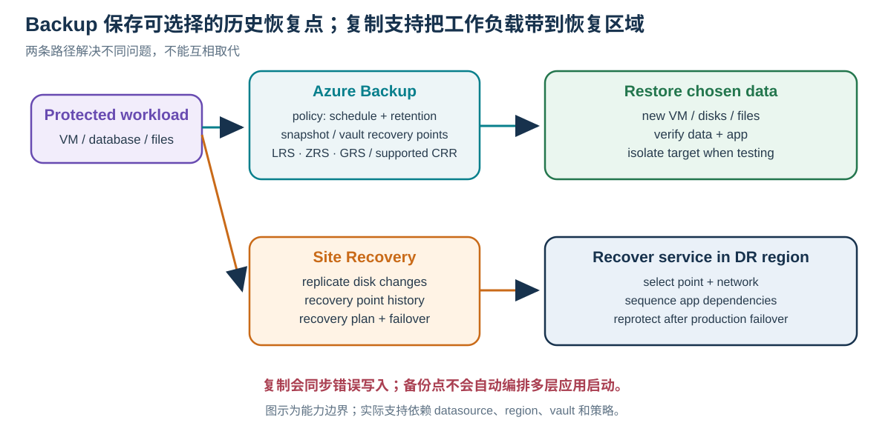
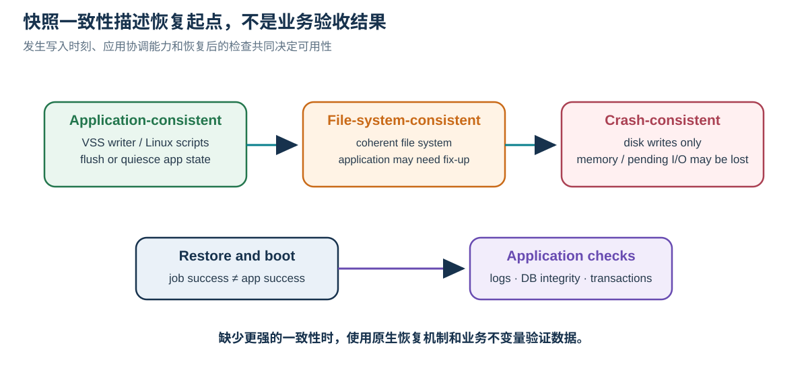
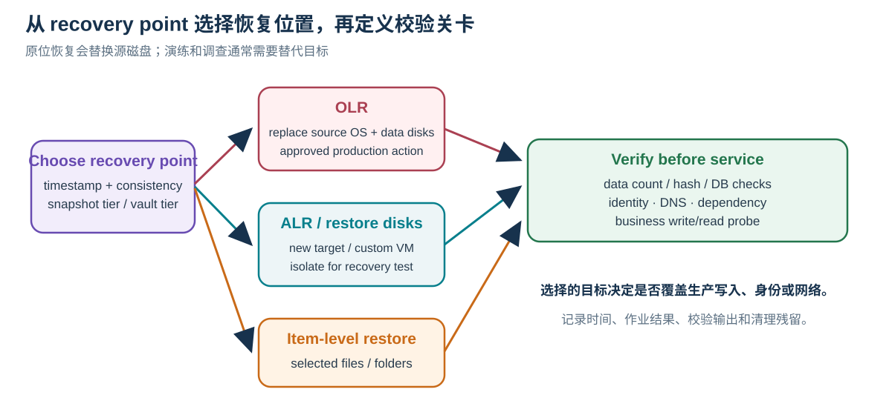
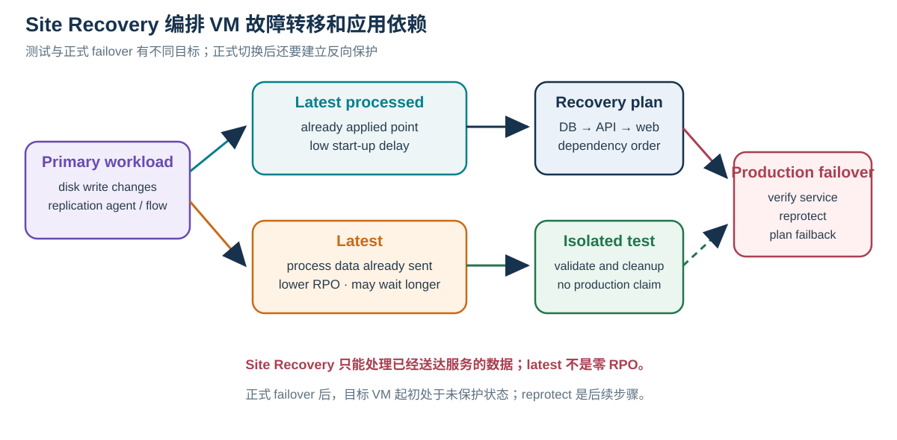
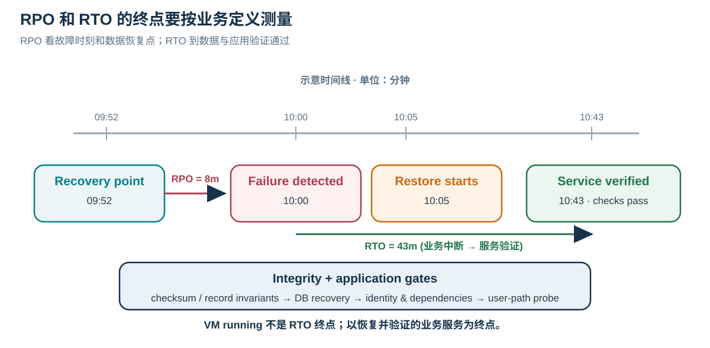

::::: cover
[AZURE CLOUDOPS · ENTERPRISE ENGINEERING]{.kicker}

# 备份任务成功，数据真的恢复了吗？

[Azure Backup、恢复与 Site Recovery]{.subtitle}

::: cover-meta
- **讲次**：17 / 23
- **核心机制**：Backup recovery point、VM 一致性、恢复路径、Site Recovery 故障转移
- **证据边界**：Microsoft Learn + 合成银行账本与离线恢复验收模型
- **适用场景**：误删、数据损坏、区域故障、恢复演练与 RPO/RTO 验收
:::

::: scenario
银行支付数据库在 10:00 被发现逻辑损坏。Azure Backup 显示前一晚任务成功，Site Recovery 也显示复制健康，但当班人员仍不知道选哪个恢复点、恢复到哪里、什么时候能让支付重新服务。昨日备份可能已经超过业务允许的数据丢失窗口；最新复制点可能包含损坏后的写入；VM 能启动也不代表账本一致。恢复必须回答三个不同问题：哪一份数据能还原、恢复操作是否达到目标时间、应用和业务记录是否通过校验。
:::

### 本讲目标

读完后，你应能区分 Azure Backup 的数据保护与 Site Recovery 的复制/故障转移；解释应用一致、文件系统一致和崩溃一致恢复点；根据失效时间、恢复点时间、验证完成时间计算实际 RPO/RTO；选择隔离恢复目标并校验恢复数据；以及说明 Site Recovery 在 test failover、正式 failover、清理、reprotect 和 failback 中的状态变化。

**本讲问题：** 恢复到哪个时间点、哪个目标，经过哪些验证后，才能说业务已经恢复？

## 先区分备份与复制

Azure Backup 把受保护数据写入 Azure 管理的 vault recovery point，并按策略调度备份和保留。对 Azure VM，备份扩展协调快照过程；本地快照层可缩短恢复等待，vault 层保存备份数据以供长期保留和恢复。VM 初始备份是完整备份，之后通常是增量数据。vault 的冗余选择（LRS、ZRS、GRS）影响备份副本的故障域，但不会替应用启动恢复计划。[1][2][3]

Azure Site Recovery 则持续复制受保护 VM 的磁盘变化，并在恢复区域提供复制恢复点。故障转移把复制的 VM 拉起；recovery plan 可以组织 VM 分组、依赖顺序与恢复后的人工/自动步骤。它缩短跨区域业务恢复路径，但复制会同步复制逻辑错误或恶意写入，因此不能代替隔离保留的历史备份。反过来，备份恢复点也不会自动把多层应用按依赖顺序带到另一区域。[7][8]



为支持区域恢复，Backup vault 可按 workload 选择冗余；Recovery Services vault 的存储冗余应在保护工作负载前选定，保护开始后通常不能再切换。对支持的数据源，GRS 与 Cross Region Restore（CRR）可从配对区域恢复；CRR 是针对支持 workload 的能力，不能推断所有数据源、网络策略或所有区域都自动支持。CRR 不等于应用已经在次要区域运行，也不替代恢复演练。[4][5]

## recovery point 有数据，也有一致性等级

恢复点的时间戳表示数据恢复边界；一致性类型说明快照时应用/文件/磁盘处于何种状态。Application-consistent 快照通过 Windows VSS writer 或 Linux 备份脚本协调应用数据。File-system-consistent 快照在文件系统层形成一致点，但应用可能仍需要自己的恢复或修复过程。Crash-consistent 快照只包含当时已写入磁盘的数据；内存中和尚未落盘的 I/O 可能丢失，数据库可能需要 transaction log 回滚或一致性检查。[1]

因此，一致性标签是恢复预期，不是应用功能的证明。若 VSS writer 或 Linux pre/post 脚本失败，或 VM 关机/扩展状态异常，实际恢复点可能退化到较弱的一致性。恢复演练必须从选定 recovery point 启动目标，等待数据层恢复完成，再执行数据库一致性、账本业务规则、对象数量或校验和检查。只看到 VM running、文件可读或快照 job Succeeded，都不足以宣布恢复完成。[1][2]



Backup policy 同时定义 schedule 与 retention。Schedule 影响可用恢复点之间的时间间隔，retention 决定历史数据保留多久；较长保留可帮助回到更早状态，但并不会让近期 RPO 变小。官方 VM Backup Enhanced policy 支持按 4、6、8、12 或 24 小时等频率安排备份；实际 RPO 仍取决于故障发生时最近一个可用 recovery point 的时间、备份状态和恢复范围，而不是仅看策略文本。[6]

## 选择恢复范围和目标

Azure VM Backup 支持从 recovery point 建立新 VM、恢复磁盘或恢复 VM 内的文件/文件夹。Original Location Recovery（OLR）把源 VM 恢复到所选恢复点状态，会替换原 VM 的 OS disk 和 data disks；误选 OLR 可能覆盖当前资源。Alternate-Location Recovery（ALR）把恢复内容放到另一个目标，适合隔离验证、取证或保留当前 VM。Item-Level Restore（ILR）则适用于只需取回文件的场景。Snapshot tier 与 vault tier 的可用性、恢复速度和支持目标不同，也要在演练设计中核对。[3][4]



| 选择 | 适合回答的问题 | 主要风险/验证 |
|---|---|---|
| 新 VM / alternate location | 能否在不覆盖生产 VM 的情况下启动并检查数据？ | 目标网络、名称、身份和依赖配置；隔离副本费用与清理 |
| Restore disks | 是否需要自定义 VM 配置后再挂载磁盘？ | 磁盘顺序、加密/密钥、启动诊断和应用检查 |
| Original Location Recovery | 是否明确批准把源 VM 磁盘还原到旧状态？ | 可能替换 OS 与数据磁盘；确认业务停机、写入保留和恢复时间点 |
| Item-Level Restore | 是否只需恢复特定文件/目录？ | 路径、ACL、文件版本、哈希与应用打开验证 |

备份保存在同一区域或次要区域，也不表示它天然能抵抗账号被攻陷、误删或恶意删除。备份安全配置要检查 vault RBAC、soft delete、不可变策略、冗余类型和恢复管理员流程。某些安全选项不可逆或改变成本/保留行为，应按生产设计与当前服务支持矩阵单独审批；教材的离线演练不会改动任何 vault。[5][9]

## Site Recovery：从复制恢复点到可用服务

故障转移点的选择体现 RPO/RTO 权衡。`Latest processed` 使用 Site Recovery 已处理完的最新恢复点，因此不必先等待待处理数据，通常缩短恢复启动时间。`Latest` 会先处理已经送达 Site Recovery 服务的待处理数据，创建更靠近触发时刻的恢复点，通常可降低数据丢失；处理这些数据会延长启动等待。若故障发生在源区域且数据还没有送达服务，Site Recovery 无法恢复从未复制到目标的数据。因此，“Latest”不是零数据丢失保证。[7][8]

Recovery plan 按 VM 分组并设置启动顺序，让数据库、消息/中间层和前端按依赖关系恢复。测试故障转移建议使用隔离网络，完成连通、身份、DNS、数据和应用验证后执行 Cleanup test failover；cleanup 会删除测试 VM，未保存的数据也会丢失。生产 failover 则是另一个操作门，不能把 test failover 的验证结果说成生产业务已经切换。正式 failover 后，目标 VM 不会自动恢复复制保护；需要按计划 reprotect，之后才可执行 failback。[8][10][11]



每个 recovery plan 都要实测。演练应使用与生产相似但隔离的网络，准备好 DNS、域控制器、证书和应用依赖；记录故障触发时刻、所选恢复点、VM 启动时间、数据库可写时间、外部探针恢复和 cleanup 完成时间。官方资料建议先对应用做 test failover，再运行完整故障转移；恢复计划要根据依赖变化更新并重复演练。[8][10]

## 用实际恢复结果计算 RPO 与 RTO

设 `T_fail` 是业务定义的服务中断/数据损坏起点，`T_point` 是恢复点代表的数据时间，`T_start` 是恢复操作开始的时刻，`T_verified` 是应用和业务数据验证通过、服务可用的时刻：

```text
实际 RPO = T_fail - T_point
实际 RTO = T_verified - T_fail
```

RTO 从业务中断开始计时，不是从工程师开始恢复操作时才计时。记录 `T_start` 可以拆分发现/决策/排队延迟和实际恢复作业时间，但它不会缩短 RTO。若只用 VM 启动时刻代替 `T_verified`，RTO 会忽略数据库恢复、DNS/身份依赖、业务校验和流量切换。损坏被发现的时间也可能晚于真正损坏发生的时间，因此要从最早可信故障时间或数据错误时间计算 RPO，不能自动用“宣布事故”的时刻替换。



合成案例：目标是 RPO ≤ 15 分钟、RTO ≤ 60 分钟。若 Backup 恢复点为 09:52，损坏发生于 10:00，则 RPO 为 8 分钟；若恢复操作 10:05 开始，10:43 才通过账本校验和支付探针，则 RTO 从 10:00 的业务中断起算，为 43 分钟，样本满足目标。若同样的 VM 在 10:20 已启动，但交易记录数不匹配，服务尚未验证；不能把 20 分钟当成 RTO，也不能判定恢复成功。

| 验收面 | 可复核证据 | 失败时的解释 |
|---|---|---|
| 恢复点 | 保护项、point 时间、job 状态、consistency 类型、所用区域/层 | recovery point 可能太旧、未完成或一致性不足 |
| 数据完整 | 文件 SHA-256、记录数、数据库原生一致性/恢复日志检查、关键业务不变量 | VM 启动不代表数据无损；哈希不适用于会合法变化的数据库文件 |
| 服务可用 | 认证、读写事务、依赖、DNS、外部探针与版本 | 仅本机 health check 可能漏掉真实用户路径 |
| 目标安全 | 恢复目标隔离、身份/网络不冲突、生产写路径受控 | 误接生产网络可能触发双主、重复身份或数据覆盖 |
| 关闭与再保护 | Site Recovery test cleanup；正式 failover 后 reprotect/failback 路径 | 测试残留可能占资源；正式目标可能暂未被复制保护 |

恢复证据应包括输入 recovery point 和最终选择理由、发起与完成时间、目标资源位置、job 错误、应用/数据验证输出、目标网络状态、失败和重试、cleanup 或 reprotect 结果，以及恢复后残留资源清单。Snapshot redundancy 或复制健康只描述特定服务路径，不替代最终恢复演练与业务验收。[5][8][9]

## 配置演练：从 Azure VM 备份还原隔离服务

**未来 Azure 练习，当前未执行。** 准备有非敏感校验文件和小型业务数据集的 VM、隔离 VNet 与目标 RG。Recovery Services vault 与源 VM 同区域，核对磁盘、加密、策略支持。分别取得 vault 备份操作权限和目标 RG、VNet 与磁盘所需的恢复权限。[2–6][12]

| Portal 入口 | 操作与字段 | 验收证据 |
|---|---|---|
| Recovery Services vault → Backup | Workload 选 Azure VM；创建或选择 VM backup policy，设 schedule、时区、retention 与所需类型。纳入一台测试 VM | Backup items 中出现目标；Backup now 或等待调度。等首个成功且可用的恢复点 |
| Backup Items → Azure Virtual Machine → Restore VM | 选最早损坏之前的 point，核对 App/File/Crash consistent 类型和储存层。选 Create new virtual machine，指定隔离 RG/VNet 和新名称 | 不接生产写入路径。若恢复目标或 VM 特性不支持，改 Restore disks 再组装。按模式核查 staging storage 及权限 |
| Backup Jobs 与隔离客户端 | 记 point UTC、提交、完成和目标 ID。启动后检查磁盘与依赖，校验样例文件、数据库与业务 | 比对记录数、幂等键和受控读写事务。只有数据和应用都达标，才确认业务恢复 |
| 清理与留存 | 删除专用恢复 VM、磁盘、NIC、临时模板或 staging 对象。检查仍受保护的备份及软删除、不可变性设置 | 目标资源消失时备份仍可能在保留。按各自期限与归属记账 |

~~~{.powershell title="文档示例 · 在隔离恢复 VM 读取试验文件"}
Get-FileHash -Algorithm SHA256 -LiteralPath $RestoredFixturePath
~~~

对照备份前同一文件的摘要。数据库按引擎检查一致性及交易不变量。例中 09:52 point → 10:00 故障 → 10:43 业务验收，RPO 8 分钟、RTO 43 分钟。若 job Completed 但摘要不合，查源 VM、恢复点、盘与一致性，延后接流，再选可验证的恢复点。源 VM 保留现状。

**按工作负载选工具。** 常规 Azure VM 用 Recovery Services vault 的 VM backup。受支持的 Managed Disk 也可由 Backup vault 的 Azure Disk Backup 保护，恢复盘还需做应用验证。Azure SQL Database 由平台备份实现 PITR（AZ04-04）。ASR 是复制和故障转移，隔离 Test failover 后走专用 cleanup。核算受保护实例、留存、恢复算力与存储；停止保护和删除备份是不同操作。

## 离线实验：恢复结果不是一个布尔状态

实验目录：`labs/recovery-model/`。Fixture 提供合成的 Backup 和 Site Recovery 场景：RPO/RTO 合格但哈希不匹配、崩溃一致点需要应用修复、latest 与 latest processed 的时间取舍、未隔离 test failover，以及恢复任务完成但应用探针未通过。模型从时间戳算实际 RPO/RTO，再逐项检查完整性、记录数、应用探针和演练隔离/清理条件。

```powershell
python -m unittest discover -s textbook/chapters/AZ06-01/labs/recovery-model -p "test_*.py" -v
python textbook/chapters/AZ06-01/labs/recovery-model/recovery_model.py
```

这不是 Azure Backup 或 Site Recovery 的仿真实现；它不创建 VM、不运行数据库校验、不验证服务 job、不计算真实快照/复制费用，也不证明任何 RPO/RTO SLA。Fixture 中的时间、checksum、业务探针和 restore mode 都是合成约定。真实恢复需要已获批的资源、隔离范围、成本估算、恢复 runbook、业务负责人验收和清理证据。

## 练习与参考答案

::: exercise
**练习一。** 数据损坏发生于 14:30，备份恢复点为 14:02。恢复 VM 于 15:00 启动，账本校验于 15:18 才通过。计算实际 RPO 和 RTO。若目标是 RPO ≤ 15 分钟、RTO ≤ 60 分钟，是否通过？
:::

::: solution
RPO = 14:30 − 14:02 = 28 分钟，不满足 15 分钟目标。RTO 从业务中断 14:30 起，直到 15:18 校验通过，共 48 分钟，满足 60 分钟目标。VM 在 15:00 启动不作为服务恢复终点；以校验完成时刻为准。即便 RTO 通过，整项恢复仍因 RPO 超标而不通过。
:::

::: exercise
**练习二。** 两个 Site Recovery 选项：最新已处理点为 09:51，latest 选项能在处理已送达的待处理数据后形成 09:58 点。哪个数据丢失窗口较小？哪个可能更快启动？
:::

::: solution
在源故障时刻相同且 09:58 点确实已送达并能处理的前提下，`Latest` 的恢复点更新，RPO 较小；它需要先处理待处理数据，RTO 可能更长。`Latest processed` 可直接使用已处理点，通常更快启动。两者均不会恢复未传到 Site Recovery 的写入，故应根据实际点时间和业务目标选择。
:::

::: exercise
**练习三。** Recovery plan 的 test failover VM 已启动，数据库能登录，但 cleanup 未执行。能否签字确认演练闭环？
:::

::: solution
不能。先在隔离目标完成数据一致性、关键事务、认证和依赖探针，再执行 cleanup 并核实测试 VM/磁盘/网络残留。若是正式 failover，则必须另行确认目标业务验证、reprotect 和 failback 策略；演练环境不代表生产切换已完成。
:::

### 恢复现场验收卡

1. **界定事件：** 记录服务负责人、最早可信损坏/中断时间、受影响数据范围和当前写入状态。
2. **选恢复点：** 保存 recovery point 时间、consistency 类型、job 状态、复制/备份区域与选择理由；计算预计 RPO。
3. **批准目标：** 明确 OLR、ALR、磁盘或文件级恢复；检查是否会覆盖数据、身份、加密密钥、DNS 或网络地址。
4. **计时留证：** 记录恢复开始、VM 启动、数据库可用、应用探针和业务验证通过的时间；以最后一项定义实际 RTO。
5. **校验数据：** 选择适用于该数据的 hash、记录数、数据库原生一致性和关键业务不变量，保留原始验证输出。
6. **验证服务路径：** 从真实调用位置检查认证、DNS、依赖、读写交易和用户路径；区分单机健康与业务可用。
7. **关闭演练：** 清理 test failover 资源并核对残留；正式 failover 则确认 reprotect/failback、责任人、数据同步方向和费用复查。[3][8][10][11]

## 本讲要点

备份恢复、磁盘还原和 Site Recovery failover 是不同工作流，按 workload 选择机制与目标。恢复点还要通过数据完整性、应用探针、RPO/RTO 和隔离/清理检查；作业成功不等于业务已恢复。

## 参考资料

[12] [Azure VM backup support matrix](https://learn.microsoft.com/en-us/azure/backup/backup-support-matrix-iaas) · [Back up an Azure VM](https://learn.microsoft.com/en-us/azure/backup/quick-backup-vm-portal) · [Azure VM restore Portal choices](https://learn.microsoft.com/en-us/azure/backup/backup-azure-arm-restore-vms) · [Azure Disk Backup](https://learn.microsoft.com/en-us/azure/backup/disk-backup-overview)

::: refs
1. [About Azure VM backup](https://learn.microsoft.com/en-us/azure/backup/backup-azure-vms-introduction) — VM 快照一致性与恢复预期。
2. [Azure Backup architecture and components](https://learn.microsoft.com/en-us/azure/backup/backup-architecture) — Backup extension、vault 和存储冗余架构。
3. [About the Azure VM restore process](https://learn.microsoft.com/en-us/azure/backup/about-azure-vm-restore) — Snapshot/vault tier、OLR、ALR 与 ILR。
4. [Azure Backup reliability](https://learn.microsoft.com/en-us/azure/reliability/reliability-backup) — ZRS/GRS/CRR 的区域韧性与约束。
5. [Secure your Azure Backup deployment](https://learn.microsoft.com/en-us/azure/backup/secure-backup) — vault 安全、CRR 和恢复演练设计。
6. [Azure Backup guidance and best practices](https://learn.microsoft.com/en-us/azure/backup/guidance-best-practices) and [Enhanced VM backup policy](https://learn.microsoft.com/en-us/azure/backup/backup-azure-vms-enhanced-policy) — Schedule/retention 及当前频率选项。
7. [Azure-to-Azure disaster recovery architecture](https://learn.microsoft.com/en-us/azure/site-recovery/azure-to-azure-architecture) — 复制与 recovery point policy。
8. [Failover in Azure Site Recovery](https://learn.microsoft.com/en-us/azure/site-recovery/site-recovery-failover) and [common questions](https://learn.microsoft.com/en-us/azure/site-recovery/azure-to-azure-common-questions) — latest/latest processed、恢复计划与 reprotect。
9. [Manage recovery points](https://learn.microsoft.com/en-us/azure/backup/manage-recovery-points) — 增量恢复点、保留和停止保护影响。
10. [Test failover in Azure Site Recovery](https://learn.microsoft.com/en-us/azure/site-recovery/site-recovery-test-failover-to-azure) and [recovery plans](https://learn.microsoft.com/en-us/azure/site-recovery/recovery-plan-overview) — 隔离网络、应用测试和 cleanup。
11. [Run a failover in Azure Site Recovery](https://learn.microsoft.com/en-us/azure/site-recovery/site-recovery-failover) — 验证、提交和后续 reprotect/failback。
:::
