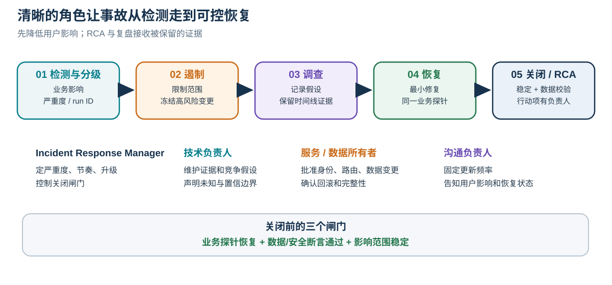
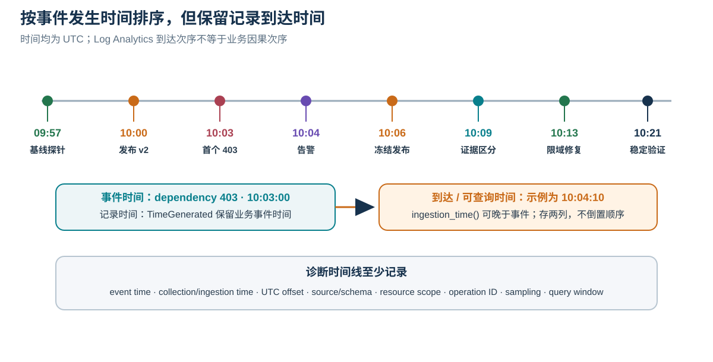
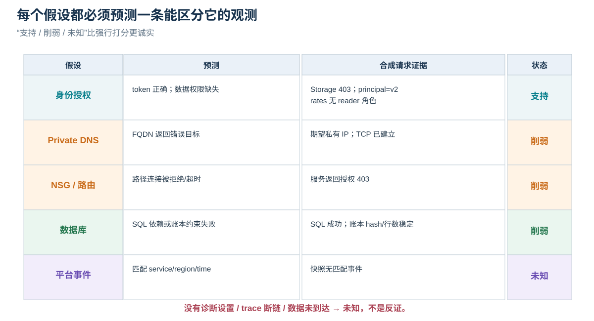
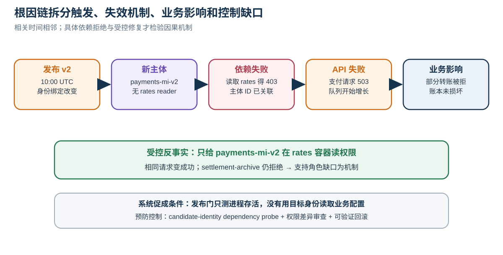
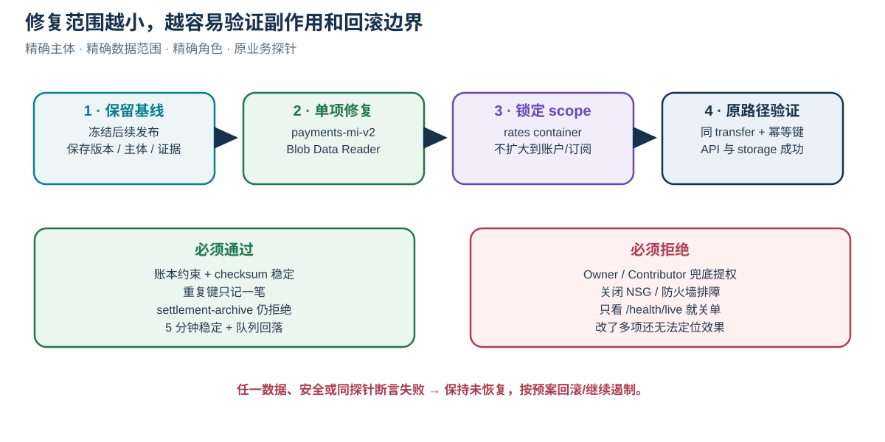

::::: cover
[AZURE CLOUDOPS · ENTERPRISE ENGINEERING]{.kicker}

# 告警触发了，根因真的找到了吗？

[Incident Response、RCA 与银行综合故障]{.subtitle}

::: cover-meta
- **讲次**：18 / 23
- **核心机制**：事件指挥、证据时间线、假设区分、最小修复、同探针复验
- **证据边界**：合成银行案例、Azure 发布闸门实测
- **适用场景**：支付失败、部署回归、身份拒绝、网络异常与事故复盘
:::
:::::

::: scenario
虚构银行的支付 API 在 10:03 UTC 开始返回 503。告警说“transfer error rate high”，数据库仪表板仍为绿色，平台资源健康状态没有红色事件。九分钟前刚发布新版本。团队已经提出五种解释：DNS、NSG、数据库、Azure 平台故障或新版本的身份权限。若同时重启、扩规则、提权和回滚，服务也许会恢复，却无法知道是哪项动作起效，更可能扩大影响。事故响应要先控制损害，再用可区分的证据检验竞争假设，最后对一个有边界的修复执行原探针与业务校验。
:::

### 本讲目标

读完后，你应能建立明确的事故指挥和关闭条件；把告警时间、事件发生时间与数据到达时间分开；使用指标、控制面变更、资源日志和分布式 trace 区分症状与原因；写出支持证据、反证和仍未知的假设；选择可撤销、最小范围的修复；并用同一个业务探针、数据完整性和稳定窗口验证恢复。

**本讲问题：** 哪条因果链能解释症状，哪一项最小变更能在复验后证明它？

## 先控影响，再组织调查

事故开始时先确认影响面和服务目标。事件负责人记录开始时间、受影响的业务路径、用户/区域、严重级别、数据风险和当前缓解措施；技术负责人管理证据与假设；服务所有者审批会改变权限、路由或数据的动作；沟通负责人按固定节奏发布状态。一个人可以兼任多项角色，但“谁批准了哪个变更”必须可追溯。

Azure Well-Architected 的事故管理建议定义角色、升级路径、沟通节奏、检测/遏制/恢复步骤和关闭标准；只在监控恢复到目标、受影响用户不再失败、数据与恢复措施已校验后关闭。RCA 和复盘随后形成可执行改进，不把事故归咎于个人。[1]

遏制是一个独立目标。可以暂停发布、降低受影响功能流量、切到已知健康版本，或隔离一个故障依赖；应先确定动作的影响半径、审批人、回滚条件与是否触及数据。恢复服务的临时绕行不等于修复根因，根因仍未知时不能把“告警变绿”当作 RCA。

## 把证据放到同一条时间线上

支付事故的首条失败请求是 10:03 UTC，告警在 10:04 触发，事故在 10:05 宣告。`TimeGenerated`、客户端事件时间、`_TimeReceived` 和 `ingestion_time()` 回答的不是同一个问题：事件什么时候发生、记录什么时候到达收集端、什么时候可查询。Azure 平台指标、资源日志和 Activity Log 的可见延迟不同，Activity Log 可能需数分钟才可分析；排障时间线应保留事件时间和采集时间，按 UTC 对齐并标明来源。[2][3]

| 证据面 | 典型问题 | 解释边界 |
|---|---|---|
| Azure Monitor Metrics | 失败率、延迟、队列是否偏离基线？ | 适合快速发现趋势；聚合后的指标通常不能指出单次请求的失败原因。 |
| Activity Log / Change Analysis | 故障前发生了哪些 ARM 控制面变更？ | Activity Log 记录管理操作，不等于应用数据面请求日志；记录空缺不能证明没有应用层操作。 |
| Resource Logs | 存储、网络或数据库资源报告了什么操作与状态？ | Resource Logs 默认不收集，需对资源配置诊断设置；未配置或数据未到达时，“没有记录”是未知。 |
| Application Insights traces | 单个请求在哪个依赖、哪个操作 ID 上失败？ | 请求与依赖通过 operation/parent 标识关联；采样、丢失或跨服务未传递上下文会削弱完整性。 |
| Service Health / Resource Health | 有没有匹配区域/服务的 Azure 事件？单项资源报什么状态？ | Service Health 是服务/区域事件，Resource Health 是单资源视图；健康状态不能代替应用探针。 |

先记录原始证据的事件时间、观测时间、资源/环境、查询范围、关联 ID、采样状态和提取人。导出日志前过滤凭据、令牌、个人资料和支付数据；为调查提供短期、最小权限访问。来源不同、粒度不同的数据不能只按“最新一条”排序后得出因果结论。[2][3][4][5]

## 让竞争假设提出可证伪预测

“网络有问题”不是可操作的假设。先把它拆成路径和预测：若 DNS 是原因，名称解析结果应偏离预期；若 NSG/路由阻断，请求不应收到存储服务返回的授权 403；若数据库故障，账本依赖应失败或完整性检查异常；若身份权限是原因，令牌可成功取得但选中主体对目标数据请求被拒绝。

合成银行场景中，trace 显示 `transfer-api` 对 `rates` 配置容器的读取收到 `403 AuthorizationPermissionMismatch`；令牌 audience 是 Storage，主体 ID 与新部署选择的 `payments-mi-v2` 一致。发布差异显示新版本更换了托管身份；已知好的 `payments-mi-v1` 在同一依赖路径工作，新主体在该数据范围没有所需读取角色。DNS 解析到预期私有地址，TCP 握手成功，SQL ledger 依赖通过，账本哈希和行数不变。

这些事实支持“部署把工作负载切到缺少数据面角色的新主体”，并削弱被测路径的 DNS、NSG 和数据库假设。一次 Resource Health 快照没有匹配事件，只能写成“本次快照未观测到匹配平台事件”；不能证明任何区域/服务都没有平台故障。部署与失败时间相邻只是相关性，具体的 403、主体映射和后续受控复验才构成区分性证据。

| 假设 | 最有区分度的观测 | 结果应如何记录 |
|---|---|---|
| Private DNS | FQDN、期望私有 IP、resolver 与 TTL | 解析错误支持 DNS；解析正确只覆盖已测名称、网络与时间。 |
| NSG / 路由 | DNS 结果、有效路径、TCP/应用响应和对应规则 | 收到授权拒绝表明该次请求已到服务端；不证明所有路径都通。 |
| 数据库 | SQL dependency 状态/延迟、连接、账本约束和幂等检查 | 本案 ledger 通过，数据库不是本次失败的必要解释。 |
| 平台事件 | 匹配服务、区域、资源和时间窗口的 Service Health/Resource Health | 找到匹配事件会提高平台假设权重；没找到仍为未证实。 |
| 身份与数据权限 | token audience、主体 object ID、数据面响应码、实际角色及作用域 | 正确 token + 403 + 主体无目标数据权限，定位为授权边界而非认证失败。 |

假设表要允许 `支持`、`削弱`、`未知` 三种状态。避免把“没有日志”自动算成反证：诊断设置可能未启用、摄取可能延迟、查询时间窗可能错误，或应用 trace 没有关联 ID。Azure Monitor 指标、日志和分布式 trace 适合互补分析；它们的覆盖范围仍取决于启用的数据源和 schema。[2][3][4][5]

## 从触发因素写到可复验的根因

根因说明至少分四层：**触发**（版本切换）、**失效机制**（新主体缺少读取 rates 的 Blob 数据权限）、**影响**（支付配置读取返回 403，API 无法授权新交易）、**系统性促成条件**（发布检查只有进程存活探针，没有以目标身份读配置的业务探针）。这避免把根因写成“Azure 坏了”“某工程师忘了权限”或“重启解决了”。

因果证据应覆盖：

1. **先后顺序：** 已知好的部署/探针先通过；身份切换先发生，随后才出现同一依赖路径的拒绝。
2. **特异性：** 失败请求的 trace、依赖目标、返回码和主体标识互相对应；仅凭 5xx 指标无法识别角色缺失。
3. **替代假设：** 对 DNS/TCP、数据库账本和匹配平台事件做过有边界的检查，并注明哪些仍未知。
4. **受控反事实：** 在专用合成实验中，只改变目标主体在 `rates` 数据范围的读取角色，再以相同支付探针复验；其他容器仍然拒绝访问。

这里的角色是 `Storage Blob Data Reader`，范围限定到本案例的 `rates` 容器。微软支持在 Blob 容器范围分配数据角色，并建议使用满足需求的最小作用域；真实角色写入仍需与生产变更审批分开，角色变更也可能需要传播时间。[5]

## 用一个有边界的修复恢复同一业务路径

先冻结后续发布，保留旧版、路由和身份快照。批准后，只对新工作负载主体添加案例所需的只读 Blob 数据角色到 `rates` 容器范围；不向订阅、资源组或整个存储账户授予 Owner、Contributor，也不通过关闭防火墙或扩大 NSG 来“排除问题”。如果变更授权或作用域不可确认，退回已知健康版本是更安全的缓解选择。

复验必须复用恢复前的 `POST /transfers` 探针、同一费率数据路径和已记录的幂等键。要求 API 返回预期状态，Storage dependency 成功，账本只新增一笔预期记录且哈希/约束一致，重复提交不产生第二笔交易；读取 `settlement-archive` 仍被拒绝。最后观察至少五分钟的合成稳定窗口并确认待处理队列回落。若只检查 `/health/live`，它最多证明进程存活，不能代表支付恢复。

从 10:03 UTC 首次失败到 10:21 UTC 完成稳定窗口，合成案例的操作恢复时间为 18 分钟；告警检测延迟为 1 分钟。该时长只描述 fixture 中的事件，不是生产 MTTR、Azure SLA 或真实服务承诺。恢复、修复、RCA 和预防分别记录，避免用一次修复的成功推断所有副作用已消失。

## 因果链演练：从 403 到授权修复

合成案例从 `10:03` 首次失败到 `10:21` 业务验证结束，共 18 分钟，低于 30 分钟目标。Storage 返回 403；对照请求主体、角色变更时间和 container scope 后，发现工作负载使用了新主体，但它没有覆盖目标 Blob 操作的角色。若角色快照晚于失败时间，先按 UTC 对齐事件。再用网络观测与 SQL 遥测排除相似假设；Activity Log 可定位部署或角色变更，应用失败仍需 trace 和 request ID 支持。

**最小修复与复验。** 由 Storage owner 在目标 container scope 为正确主体设置数据角色（AZ03-01），并用原支付探针、幂等性检查和无关容器的拒绝结果复验。调查时以资源 ID、UTC 窗口和 correlation ID 对齐 Activity Log、资源日志与应用 trace。

## 本地事故实验：检验因果和恢复

用 Python 3.11+ 在仓库根目录运行，下列输入只有合成 `fixtures/bank-incident.json`。先预测 scope 修复、探针、数据与 5 分钟稳定窗口的结论，再对照模型输出。若失败，先核对使用的 JSON 和 UTC 时间；复位测试副本即可，无需云清理或费用。

~~~{.powershell title="本地执行 · 现有事故模型"}
python -m unittest discover -s textbook/chapters/AZ06-02/labs/incident-model -p "test_*.py" -v
python textbook/chapters/AZ06-02/labs/incident-model/incident_model.py
~~~

运行结果只覆盖合成证据与本地规则。Azure Activity Log 由平台生成；导出到 workspace 才需要诊断设置。资源日志和应用遥测走各自采集链，并可能延迟（AZ03-03、AZ05-02）。

## 事故复盘练习

1. 若 `rates` 的 Resource Logs 没有返回记录，但 Application Insights trace 有一个 Storage 403，你会把资源日志的缺失标为反证还是未知？还要核实哪些数据源配置和时间范围？
2. `Resource Health = Available` 是否足以关闭“Azure 平台问题”假设？写出一个更准确的结论和一条后续检查。
3. 新版与失败同时出现是否足以证明发布是根因？列出本案例用于区分相关性与机制的两项直接证据。
4. 若容器级角色修复通过同探针，但重复幂等键写出两条支付记录，事故可否关闭？按本讲验收门解释。

**参考答案：** (1) 未知；核对诊断设置、类别/模式、时间窗与关联 ID。(2) 不足；只记录快照未见匹配事件，继续查 Service Health 和业务路径。(3) trace 中的 403、主体映射和缺失角色是直接证据；补精确角色后同一请求成功才是受控复验。(4) 不可关闭；账本重复记录表示业务完整性未恢复。

## 本讲要点

先按 UTC 和 request/correlation ID 建立时间线，再让竞争假设给出可证伪预测。修复应只改变已确认边界，并用同一业务探针、数据完整性和负向权限检查证明恢复；合成案例与云端观测要分开陈述。

## 参考资料

1. [Incident management](https://learn.microsoft.com/en-us/azure/well-architected/design-guides/incident-management) — 角色、响应、关闭和复盘。
2. [Azure Monitor data platform](https://learn.microsoft.com/en-us/azure/azure-monitor/fundamentals/data-platform) and [ingestion time](https://learn.microsoft.com/en-us/azure/azure-monitor/logs/data-ingestion-time) — 证据类型和时间边界。
3. [Activity Log](https://learn.microsoft.com/en-us/azure/azure-monitor/fundamentals/activity-log), [Resource Logs](https://learn.microsoft.com/en-us/azure/azure-monitor/logs/resource-logs) and [diagnostic settings](https://learn.microsoft.com/en-us/azure/azure-monitor/platform/diagnostic-settings) — 控制面记录与日志收集前提。
4. [Application Insights telemetry model](https://learn.microsoft.com/en-us/azure/azure-monitor/app/data-model-request-telemetry), [Service Health](https://learn.microsoft.com/en-us/azure/service-health/service-health-faq) and [Resource Health](https://learn.microsoft.com/en-us/azure/service-health/resource-health-faq) — trace correlation 与健康视图。
5. [Blob data roles](https://learn.microsoft.com/en-us/azure/storage/blobs/assign-azure-role-data-access), [Change Analysis](https://learn.microsoft.com/en-us/azure/azure-monitor/change/change-analysis-enable) and [Azure RBAC](https://learn.microsoft.com/en-us/azure/role-based-access-control/role-assignments) — 最小范围授权与变更调查。
