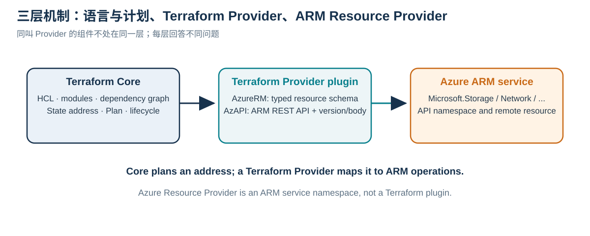
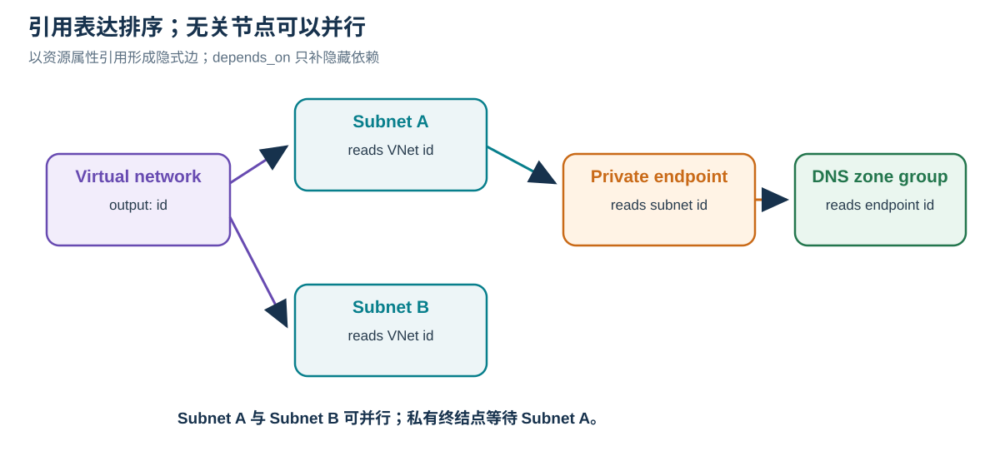
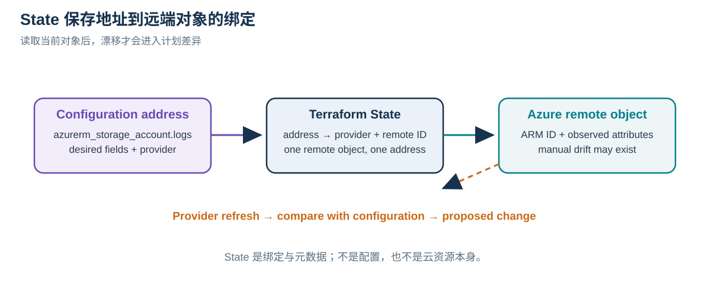
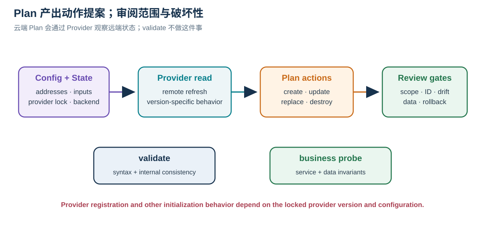

::::: cover
[AZURE CLOUDOPS · ENTERPRISE ENGINEERING]{.kicker}

# Terraform 看见的是配置，还是 Azure 资源？

[Core、Provider、依赖图、State 与 Import]{.subtitle}

::: cover-meta
- **讲次**：19 / 23
- **核心机制**：Provider 边界、依赖图、状态绑定、Plan、生命周期与 Import
- **证据边界**：HashiCorp 与 Azure 官方文档 + 本地 Terraform Core 实验
- **适用场景**：AzureRM/AzAPI 设计、模块复用、变更审查与资源接管
:::
:::::

::: scenario
银行平台把基础设施配置拆成网络、身份、存储和应用模块。一次变更同时出现 AzureRM 资源重建、AzAPI 原始 ARM 请求和已有资源导入。审阅者看到“plan 只有一行替换”，却不知道该资源由哪个 Provider 管理、状态地址指向哪个远端对象，也没看到导入后的配置差异。要安全读懂计划，必须把 Terraform Core、Provider、资源图与 State 当作不同层来推理。
:::

### 本讲目标

读完后，你应能说明 Core 与 Provider 各自负责什么；选择 AzureRM 或 AzAPI 并避免重复管理同一 ARM 对象；通过引用、模块接口和显式依赖解释资源图；说明 State 对地址与远端对象的绑定；识别 Plan 中的创建、原位更新、替换和销毁；并设计可审阅的 Import 流程。

**本讲问题：** 这条配置最终会让哪个 Provider，以什么顺序，把哪个 State 地址收敛到哪个远端对象？

## 先分清 Core、Provider 与 Azure Resource Provider

Terraform 配置语言描述期望状态。Terraform Core 读取配置、输入变量、模块、既有 State 与计划模式，构造依赖图并协调操作。Provider 是独立插件：它声明资源和数据源 schema，并把 Terraform 的读、创建、更新、删除和导入请求转换成目标服务 API 操作。Azure 中还存在另一层 **Azure Resource Provider**，例如 Microsoft.Storage：它是 ARM 侧按资源命名空间提供 API 的服务，不是 Terraform Provider 插件。



AzureRM 提供较高层的、具类型的 Azure 资源 schema；AzAPI 是更薄的 ARM REST 映射层，可选择 API 版本并发送 ARM 请求体。两者可在一个配置中并用：常见稳定资源优先评估 AzureRM；AzureRM 尚未支持或需要精确 API 版本/字段时评估 AzAPI，并把 API 版本、请求体和兼容性责任显式留在代码中。[1][2]

一个 ARM 远端对象应只由一个 Terraform 资源地址负责。不要让 azurerm_storage_account.logs 和 azapi_resource.logs 同时声称拥有同一个 Storage Account：两个地址各有自己的 State 绑定和生命周期，后续 refresh / plan 可能互相覆盖或提出删除、替换。资源类型迁移必须先规划 State 地址/类型迁移与 Provider 支持，再审阅最终 Plan。

::: warn
**Provider 不等于权限隔离或纯本地解释器。** terraform init 会初始化工作目录并下载配置需要的插件与模块；计划阶段可能读取远端对象。Provider 配置在计划/应用阶段还可能带来额外控制面行为；具体注册策略要按锁定版本查证。AzureRM 的资源注册默认随版本演进：5.x 的当前文档把 resource_provider_registrations 默认设为 none；4.x 使用过不同默认策略。锁定版本并显式审查注册设置，不能根据旧教程推断当前行为。[3]
:::

**离线边界示例**（真实 Azure 配置的结构示意；本讲不会初始化这两个云 Provider，也不会连接 Azure）：

```hcl
terraform {
  required_providers {
    azurerm = {
      source  = "hashicorp/azurerm"
      version = "~> 5.0"
    }
    azapi = {
      source  = "Azure/azapi"
      version = "~> 2.0"
    }
  }
}

provider "azurerm" {
  features {}
  # 5.x: 显式要求 Provider 不自动注册 Azure Resource Provider。
  resource_provider_registrations = "none"
}
```

## 固定依赖，再定义可复用模块

每个模块都要声明自己需要的 Provider source 与兼容版本。root module 负责为整套配置选择可共同满足约束的 Provider 版本；.terraform.lock.hcl 记录选中的 Provider 版本和校验和，帮助后续 init 保持一致。lock 文件不锁住所有远程模块版本；远程模块要使用自己的 version 约束，并在升级时审阅源码变化。[4][5]

复用模块应公开输入和输出契约，不应把某个订阅、身份、Provider 配置、环境凭据或目标资源组偷偷写死。Provider configuration 通常集中在 root module。子模块声明 Provider requirement；默认 Provider 可被继承，别名必须由调用模块通过 providers 显式传入。这样审阅者能从 root 清楚看见配置流向哪个订阅或 Provider alias。[6]

```hcl
module "workload" {
  source = "./modules/workload"

  environment = var.environment
  scope       = var.resource_group_id
  providers = {
    azurerm = azurerm.platform
  }
}
```

优先用参数引用表达依赖，仅对隐藏关系加 depends_on。count / for_each 实例有各自地址；资源改名或搬入模块前，先设计 State 地址迁移并审阅 Plan。[7][8]

## 依赖图决定可执行顺序

Core 根据引用构造图。例如子网的 virtual_network_id 引用 VNet 的 ID，会建立 VNet → 子网依赖；子网可与另一个无关子网并行。只有隐藏依赖无法表达时才添加 depends_on。有向循环表示配置要求互相先完成，Terraform 无法排序，必须重构接口或资源边界。[9]



依赖图不是 Azure 服务调用的时间保证。Provider 可能在一个资源操作中进行多个 API 请求；Azure API 也有异步状态、传播延迟和失败重试。Terraform 图能说明配置对象之间的排序约束，不保证业务探针已成功或远端服务已达到业务就绪。

模块是配置复用与接口边界，不是独立的部署事务或权限边界。一个模块可以创建多个 Azure 资源，调用者仍应从 root 的变量、Provider mapping、资源 scope、输出和 Plan 看清最终作用面。-target 可以用于受控修复场景，但常规变更应让完整配置图决定计划，以免漏掉关联差异。[9]

## State 把地址绑定到远端对象

配置表达“期望什么”，State 保存“Terraform 把哪个配置地址关联到哪个 Provider 对象”的绑定及操作元数据。State 让 Core 能比较配置与已知对象、追踪依赖；它不是 Azure 资源本身，也不是配置的替代品。正常计划会刷新 State 中的远端对象以观察当前状态，但刷新结果受 Provider 可读权限、API 与字段映射影响。[10]



State 可能包含敏感值。团队协作时要选有访问控制、加密和锁机制的远程后端；备份和恢复须与锁语义一起设计。并发操作要避免绕过锁。State 中每个远端对象应有一个管理地址；把同一个对象导入两个地址会破坏这个一对一约束。重命名或搬移资源时，应采用有计划的 moved 声明或 State 地址迁移，并审阅迁移前后的 Plan，而不是直接删掉旧块后接受 destroy/create。[10][11]

## Plan 是待审阅的提案

terraform plan 将配置与当前 State / 可见远端状态比较，并提出动作；单独运行 speculative plan 不应用这些动作。terraform validate 检查配置语法和内部一致性，不会验证 Azure API、权限、已有 State、远端数据或资源是否可创建。terraform init -backend=false 可在验证流程中跳过后端初始化，但若配置引用外部 Provider / 模块，仍可能下载它们。[12][13]

计划符号需按生命周期读取：+ 创建、~ 原位更新、-/+ 替换、- 销毁。替换可能由 Provider schema 的 ForceNew 语义或生命周期约束引出。先问：目标 scope 对不对？地址和 Provider 对不对？替换是否必要？明文敏感值有没有泄漏？销毁会影响哪些依赖？是否有锁、备份、变更窗口与回滚计划？



create_before_destroy 可能因同名资源唯一性或配额而失败；prevent_destroy 会阻止配置仍包含该生命周期规则时的 destroy，却不能保护被整体移除的资源块；ignore_changes 可忽略指定属性差异，也会隐藏人工漂移。它们是行为规则，不是审批、防护或备份的替代物。[14]

保存的 Plan 文件可以供流水线的后续 apply 使用，但它不应被当作长期有效的批准：远端状态会变化，保存文件中也可能带有敏感内容。审批要针对精确版本、工作目录、State、Provider 锁文件和计划文件；执行前确认计划仍对应当下变更边界。[12]

## Import 是 State 接管，不是资源创建

把既有 Azure 资源纳入管理时，先写目标 resource 配置和唯一地址，再写 import 块声明 to 地址与 Provider 定义的资源 ID。运行 Plan，确认计划显示 import，且没有非预期更新、替换或删除；Apply 导入后，核对 State 地址和远端 ID，再继续收敛配置。导入不会自动保证 HCL 与现状匹配，偏差可能在下一次 Plan 中变成更新或替换。[15]

```hcl
import {
  to = azurerm_resource_group.shared
  id = "/subscriptions/<subscription-id>/resourceGroups/rg-shared"
}

resource "azurerm_resource_group" "shared" {
  name     = "rg-shared"
  location = "australiaeast"
}
```

同一远端对象只能绑定到一个地址。导入路径、ID 语法和可导入字段由具体 Provider 资源文档定义。AzAPI 资源 ID 还可能含资源类型或 API 版本相关信息。AzureRM/AzAPI 类型转换有 Provider 特定迁移路径。不要假设只改 HCL 类型就会保留现有绑定；按迁移指南或重新导入，并逐项审阅 Plan 是否会重建资源。[15][16][17]

## 本地实验：先验证 Core，再讨论云端

实验目录 labs/terraform-core/ 用 Terraform 内建 terraform_data 表示本地教学契约，并提供一个子模块与 .tftest.hcl 测试。运行 init -backend=false、validate 和 terraform test。该实验没有 azurerm 或 azapi Provider、凭据、远端后端、Azure 地址或 ARM 请求；它只验证 Terraform CLI 对本地 HCL、模块输入/输出、变量检查和计划断言的处理。[18][19]

```powershell
terraform -chdir=textbook/chapters/AZ07-01/labs/terraform-core init -backend=false -input=false
terraform -chdir=textbook/chapters/AZ07-01/labs/terraform-core validate
terraform -chdir=textbook/chapters/AZ07-01/labs/terraform-core test
```

labs/core-model/ 的标准库 Python 模型补充了 Provider 选择、DAG 排序、State 一对一绑定、生命周期动作和导入计划检查。它是显式简化的教学模型，不是 Terraform Core 的另一种实现，不验证 AzureRM/AzAPI schema、Azure API 行为、真实 State、Provider 注册或云端 Plan。

## E3 扩展实验：用真实 Provider schema 做离线 Plan

Stage 2 增加了一个独立 Azure reference root：`textbook/terraform/azure-enterprise-reference/`。它使用可复用的 network、private endpoint、VM、AKS、Key Vault、Storage、Registry 与 monitoring modules，并在 root 组合身份、角色、Recovery Services vault 和 AzAPI policy assignment。它消费明确的既有 resource group，不创建 resource group。

该 root 锁定 AzureRM 5.15.0 与 AzAPI 2.14.0。Provider 配置关闭 CLI、MSI 与 OIDC 登录路径，并将 AzureRM 的自动 resource-provider 注册设为 `none`；AzAPI 使用 `skip_provider_registration = true`。资源类别全部默认关闭。若以后启用资源，Terraform preconditions 还要求准确的订阅/资源组 allowlist、书面授权引用、成本估算、短运行时和剩余预算。AKS 的 node resource group 也必须单独加入 allowlist，因为 AKS 会在其中创建资源。

资源安全字段还需结合服务路径理解：VM 只接受 SSH public key 且没有 public IP；AKS 控制平面使用 private cluster；Storage、Key Vault 与 ACR 使用 private endpoint；Storage 关闭 shared key；Key Vault 启用 RBAC 与 purge protection。Log Analytics 把 Entra authentication 作为本地认证的关闭条件，但互联网 ingestion/query 仍开启，因为本模块没有构建 Private Link Scope。Key Vault 删除后仍可能处于软删除保留期；Recovery Services vault 本身尚无 backup policy 或受保护项目。这些选项不能单凭 `terraform validate` 推导出端到端服务可用，任何 live 设计都须再次核实目标区域、SKU、网络和费用。

E3 的 `terraform test` 明确使用 mock providers，而且每条 `run` 都写 `command = plan`。代表性测试覆盖默认零 Azure 类别、私网 Storage、audit-only (`DoNotEnforce`) Policy、完整企业类别图，以及未授权、未列入 allowlist、超预算负例。执行入口还会从子进程环境移除 `ARM_*`、`AZURE_*` 与 `TF_*` 变量。Registry 下载 provider 是网络访问，但 mock test 不向 Azure 发请求、不注册 provider、不 apply 或 destroy。成功只证明本地 HCL/schema/plan 合同；不证明 API、DNS、RBAC propagation、价格或真实 Azure 行为。[20–23]

```powershell
python textbook/tools/verify_terraform.py
```

该执行入口覆盖全仓 Terraform roots：recursive fmt check、`terraform init -backend=false`、validate 与 mock-provider tests。不要把 mock test 的费用输入样例当成价格资料；它只是验证本地 guard 的合成数值。

::: {.pagebreak}

::: lab
**练习：审阅一个 Terraform 变更**

1. 对照图 19-1，把 azapi_resource、AzureRM 资源类型和 Microsoft.* 命名空间分别放入正确层级。
2. 在模块调用中指出订阅/Provider alias 从何处进入；说明为什么共享模块不应内含自己的 Provider block。
3. 给定 VNet → subnet → private endpoint → DNS zone group 的图，解释哪些关系由 HCL 引用自然产生，哪些边可能需要额外契约。
4. 将一个既有资源从人工管理转为 Terraform 管理，列出 HCL、import Plan、State 地址、漂移和下一步更新检查。
5. 编写 Plan 审查问题：scope、地址、Provider/版本、注册行为、替换/删除、敏感值、状态锁与业务验证。

**交付**：一页变更审阅记录；把每条判断标成 Terraform Core 语义、Provider 行为、Azure ARM 服务行为或业务验收。只接受能指出证据来源的结论。
:::

## 参考资料 {.pagebreak}

1. [Choose between AzureRM and AzAPI](https://learn.microsoft.com/en-us/azure/developer/terraform/azurerm/overview-azapi-provider) — 两类 Provider 的职责和并用场景；Microsoft Learn 页面含 AI 生成说明，和 Azure 官方 Registry 资料交叉核对。
2. [AzAPI Provider overview](https://registry.terraform.io/providers/Azure/azapi/latest/docs) — AzAPI 是 ARM REST 的薄层、API 版本与请求体示例。
3. [AzureRM Provider documentation](https://registry.terraform.io/providers/hashicorp/azurerm/latest/docs/index) — 当前 5.x 注册参数与默认；版本升级须重新查对应 Provider 文档。
4. [Provider requirements](https://developer.hashicorp.com/terraform/language/providers/requirements), [Dependency lock file](https://developer.hashicorp.com/terraform/language/files/dependency-lock) — source、版本约束和锁文件职责。
5. [Module block](https://developer.hashicorp.com/terraform/language/block/module) — 模块来源与版本。
6. [Providers within modules](https://developer.hashicorp.com/terraform/language/modules/develop/providers) — Provider requirements、继承、aliases 和模块 Provider 传递。
7. [Module configuration](https://developer.hashicorp.com/terraform/language/modules/configuration) — 模块输入、输出与复用。
8. [Resource addressing](https://developer.hashicorp.com/terraform/cli/state/resource-addressing) — 模块与实例地址。
9. [Dependency graph](https://developer.hashicorp.com/terraform/internals/graph), [References](https://developer.hashicorp.com/terraform/language/expressions/references) — 图节点、引用和隐式依赖。
10. [State](https://developer.hashicorp.com/terraform/language/state) — 资源绑定和 State 行为。
11. [Backend locking and state locking](https://developer.hashicorp.com/terraform/language/state/locking) — 协作后端锁。
12. [terraform plan](https://developer.hashicorp.com/terraform/cli/commands/plan) — Plan 读取、动作提案与保存计划。
13. [terraform validate](https://developer.hashicorp.com/terraform/cli/commands/validate), [terraform init](https://developer.hashicorp.com/terraform/cli/commands/init) — 验证和初始化边界。
14. [Lifecycle meta-arguments](https://developer.hashicorp.com/terraform/language/meta-arguments/lifecycle) — 创建/删除与漂移规则。
15. [Import blocks](https://developer.hashicorp.com/terraform/language/block/import), [Import one resource](https://developer.hashicorp.com/terraform/language/import/single-resource) — 导入目标、ID、Plan 和 State。
16. [AzureRM 与 AzAPI migration paths](https://learn.microsoft.com/en-us/azure/developer/terraform/how-to-migrate-between-azurerm-and-azapi), [Refactor modules](https://developer.hashicorp.com/terraform/language/modules/develop/refactoring) — Provider 转换、资源类型/schema 和 moved/refactoring 的限制；Microsoft 页面含 AI 生成说明，交叉核对 HashiCorp 资料。
17. [terraform state mv](https://developer.hashicorp.com/terraform/cli/state/mv) — 地址搬迁适用范围与协作警告。

18. [terraform_data](https://developer.hashicorp.com/terraform/language/resources/terraform-data) — Terraform 内建资源生命周期，不直接创建远端基础设施。
19. [Terraform tests](https://developer.hashicorp.com/terraform/language/tests) — plan 命令与 expect_failures 检查。
20. [AzureRM Provider (locked 5.15.0)](https://registry.terraform.io/providers/hashicorp/azurerm/5.15.0/docs) — provider authentication and resource-provider registration settings.
21. [AzAPI Provider (locked 2.14.0)](https://registry.terraform.io/providers/Azure/azapi/2.14.0/docs) — provider authentication and registration behavior.
22. [Terraform provider mocking](https://developer.hashicorp.com/terraform/language/tests/mocking) — mock_provider and synthetic plan values.
23. [Terraform test command](https://developer.hashicorp.com/terraform/cli/commands/test) — run commands and plan-only tests.
