::::: cover
[AZURE CLOUDOPS · ENTERPRISE ENGINEERING]{.kicker}

# 谁持有 Terraform 的状态？

[Azure Storage backend、Blob lease、漂移与恢复]{.subtitle}

::: cover-meta
- **讲次**：20 / 23
- **核心机制**：后端身份、状态 key、租约互斥、漂移审阅与版本恢复
- **证据边界**：HashiCorp 与 Microsoft 文档 + 本地 Terraform 锁和漂移实验
- **工程结果**：一个实际 State 只能有一个明确、受保护的协作边界
:::
:::::

::: scenario
支付平台的两个流水线同时准备改生产网络。一个在 plan，另一个在 apply；它们读写同一份 Terraform State。团队把 State 放进 Azure Blob 后，以为“远程”就意味着权限正确、不会冲突、还能随时回滚。其实这三个结论都要分别证明：身份能否读写 Blob 数据、同一 key 的写入能否互斥、恢复出的 State 是否仍与真实对象和配置一致。
:::

### 本讲目标

读完后，你应能解释 AzureRM backend 如何选择 Blob、如何用租约协调共享 State；区分 Azure 管理面与 Blob 数据面权限；设计 bootstrap、环境 key 和迁移次序；根据正常 plan 与 refresh-only plan 判断如何处理带外变更；并在锁、State 备份与 Blob 版本之间选择安全的恢复路径。

**本讲问题：** 当前操作拿到的是哪份 State、谁能写它、其他写者如何被挡住，以及恢复后怎样证明资源绑定仍然正确？

## State 在哪一层，凭什么访问

Terraform State 把配置地址关联到 Provider 对象，并保存 Core 后续协调需要的元数据。AzureRM backend 将该 State 作为 Blob 放在指定 storage account/container/key 中。后端地址、身份验证和读写 State 的权限属于 backend；创建 Azure 资源的 `azurerm` Provider 是另一条配置与授权路径。二者可以使用同一 Entra 身份，也可以分开，但不能因为 Provider 能管理 Storage Account 就推断 backend 已获 Blob 数据访问权。[1]



AzureRM backend 的 Entra ID 路径推荐把 `Storage Blob Data Contributor` 赋到承载状态的 container；它需要读、写和删除 Blob 数据。普通 ARM `Contributor` 是管理面角色，本身不自动授予 Microsoft Entra Blob 数据访问。如果配置 `lookup_blob_endpoint=true`，backend 才需要另行读取 Storage Account endpoint；能直接给出标准 endpoint 时，不应为方便而扩大管理面权限。[1][2][3]

```hcl
terraform {
  backend "azurerm" {}
}
```

Backend block 在 `terraform init` 阶段初始化，不能引用 Terraform 变量、资源或 data source；因此它无法先创建自己要使用的 Storage Account。把部署 Storage/Container 的 bootstrap 生命周期与使用它保存业务 State 的配置分开。部分 backend 参数可由单独的 `.hcl` 配置文件提供，认证信息用受保护的环境变量或 OIDC 流程传递，避免写进 HCL、`-backend-config` 命令行记录或提交文件。`.terraform/` 目录也可能保存 backend 初始化参数，不应提交版本库。[4][5]

## 锁保护一个 key，不保护所有架构风险

支持 locking 的 backend 会在可能写 State 的操作中自动尝试加锁；获取失败时 Terraform 不继续。AzureRM backend 用 Azure Blob 原生租约支持状态锁定与一致性检查。对同一 Blob key 的并发写者，活动操作持有租约，第二个 writer 要等前者释放或在超时后失败。`-lock-timeout` 决定等待多久；`-lock=false` 会拿掉这层并发保护，不能作为解决报错的常规参数。[1][6]



租约边界是一个 State Blob，而不是一整个 Azure 租户或订阅。不同 key 可以各自运行；这提高并行度，也意味着它们若都声明管理同一个 Azure 资源，锁并不能识别双重管理。必须通过 State/模块边界和代码审查保证一个远端对象只由一个资源地址负责。若某流水线报告锁被占用，先确认持有操作是否仍活跃；`force-unlock` 只用于自己的锁且自动解锁确实失败时，必须使用 Terraform 输出的唯一 lock ID，绝不能抢先解开他人正在使用的租约。[6][7]

## 建立后端、再迁移 State

远程后端存在引导闭环：`terraform init` 需要后端先可访问，但 Terraform 配置又想创建这个后端。稳妥做法是用短生命周期的本地或独立 bootstrap State 创建 Storage Account 与 container；核对防护、身份和数据面访问后，再为 workload 配置 backend 并备份现有本地 State。`terraform init -migrate-state` 会尝试把已有 State 迁到新后端，适合经过审阅的迁移；`-reconfigure` 会丢弃先前 backend 配置而不迁移 State，二者不能混用其含义。[4][8]



每个环境应选定稳定且明确的 key，例如 `platform/dev.tfstate` 与 `platform/prod.tfstate`，并记录该 key 对应的代码根目录、订阅/资源范围、执行身份、恢复责任人和留存策略。Backend key 改名可能让 Terraform 看见空 State，而不是自动“找到旧状态”；迁移前后都要核对旧文件、目标 key、State lineage/serial、资源地址和完整 Plan。Container 范围的 Blob 角色适用于该容器中的数据；若 workload 之间需要更强访问隔离，应评估分 container 或分 account，而不是假设同一个 container 内不同 key 自动有不同 RBAC。[1][3]

## 从漂移走到有意的收敛

Terraform 一次普通 plan 会先刷新可访问对象，再比较 HCL 与刷新后的 State。带外改动可能因此出现在 `Objects have changed outside of Terraform` 摘要中，后续差异表示配置打算怎么处理当前对象。`terraform plan -refresh-only` 单独只提出 State 更新；只有应用这个 refresh-only 计划时才把新的观测值写进 State，它不把远端对象改回配置。若人工改动是事故期间的有意修复，应先审阅并更新 HCL；若改动违反配置意图，则审阅普通 Plan 后再让 Terraform 修正对象。[9]



本讲实验用 HashiCorp `local` Provider 管一个实验目录中的真实文本文件。手工编辑后，锁定的 local v2.9.1 会把原资源报告为已消失，普通 Plan 因而提议重新创建；这不是原位改回一个属性。此 Provider 的 `local_file.id` 按内容 SHA-1 生成，当前实验观测到的行为是 Provider 特定实现。它验证真实的刷新、差异和修复命令链，不等于 AzureRM 对某个资源属性的漂移映射，也不证明 Azure API 权限或一致性。[10]

```hcl
resource "local_file" "marker" {
  filename        = "${path.module}/work/managed-marker.txt"
  content         = var.desired_content
  file_permission = "0600"
}
```

`-detailed-exitcode` 下，0 表示成功且无差异，1 表示错误，2 表示成功但有差异。不要把 refresh-only 与 rollback 混为一谈：refresh-only 会改变 State 的记录，普通 apply 才可能修改对象；“是否接受带外变更”应由服务意图和变更批准决定。复原 IaC 配置也不是通用 undo，数据和不可逆副作用仍需各自恢复方案。[9]

## 版本历史不是 Terraform 的撤销按钮

启用 Blob versioning 后，Blob 写入会保留前一版本；每次 State 写入都可能增加版本和存储费用。软删除与版本管理提供数据保护，但保留期限与生命周期规则要按需要配置；开启 versioning 不能恢复被意外删除的 Storage Account 或 container。对 State Blob 做版本恢复前，先停止 writer 并确认目标 key，取回候选版本到隔离位置，再比较结构、lineage、serial 和资源绑定。[11][12]

Terraform 的 `terraform state pull` 可作为受保护的恢复副本。`terraform state push` 会对不同 lineage 或较高的目标 serial 做保护；`-force` 会绕过这些检查，并可能覆盖较新的 State，因此不应作为普通恢复步骤。State 恢复不是资源恢复：旧 State 可能缺少后来创建的资源绑定，或指向已经替换的对象。恢复后先对账配置、State、实际对象和 Plan，再决定是否需要 import、state 操作或资源修复。[7][13]



对僵持锁也采用证据判断，而非直接执行 `force-unlock`。如果原进程仍在刷新或应用，解除租约会允许第二个写者进入同一状态区；若操作意外终止且 lock 已残留，先调查执行器和后端状态，再用自己的 lock ID 解除。不要在共享状态练习里用人工加锁、sleep 日志或伪造提示替代 Terraform CLI 的真实竞争结果。[6][7]

## 本地实验：先看到真正的 lock refusal

在 `labs/terraform-state/`，Terraform 本地 backend 与 `hashicorp/local` Provider 只管理实验目录中的 State 和文本文件；Registry 下载固定 Provider，不初始化 Azure Provider。完整手动步骤在同目录 `README.md`，自动复验入口如下：

```powershell
terraform init -input=false
python scripts/verify_lab.py
```

Windows Terraform 1.15.5 的实测中，Apply 正持有本地 State 时，第二个 Terraform `plan -lock-timeout=0s` 进程收到 `Error acquiring the state lock`。带外改文件触发 exit code 2 和 local provider 的 `+ create`；refresh-only 移除了 State 绑定而未改文件，普通 Apply 随后恢复声明内容。把 State 文件移开后，`state push` 从备份恢复了 `local_file.marker`，后续 Plan 为 0 差异；最后本地资源已 destroy。这里验证的是 Windows 本地文件锁、local Provider 行为和 Terraform State CLI，不是 Azure Blob lease 或 AzureRM drift 实测。

::: lab
**评审题**：两个独立 key 若同时声明管理同一个 NSG，为什么租约仍挡不住双重管理？如果事故期间的带外修改需要保留，应先改哪份配置，何时选择 refresh-only，最终用什么 Plan 和业务检查证明恢复？哪些结论必须等 Stage 3 才能用 Azure 证据确认？
:::

## 参考资料 {.pagebreak}

1. [AzureRM backend](https://developer.hashicorp.com/terraform/language/backend/azurerm) — Blob backend、租约锁、Entra/OIDC 参数与所需数据面/管理面权限。
2. [Azure built-in roles for Storage](https://learn.microsoft.com/en-us/azure/role-based-access-control/built-in-roles/storage) — Storage Blob Data Contributor 权限范围与 DataActions。
3. [Authorize Blob access with Microsoft Entra ID](https://learn.microsoft.com/en-us/azure/storage/blobs/authorize-access-azure-active-directory) — 数据面授权、容器范围与最小权限。
4. [Backend block configuration](https://developer.hashicorp.com/terraform/language/backend) — backend 参数、部分配置及敏感值边界。
5. [terraform init](https://developer.hashicorp.com/terraform/cli/commands/init) — `-migrate-state` 和 `-reconfigure` 的区别。
6. [State locking](https://developer.hashicorp.com/terraform/language/state/locking) — 自动锁、并发写保护和 force-unlock 风险。
7. [Recover state from backup](https://developer.hashicorp.com/terraform/cli/state/recover), [terraform state push](https://developer.hashicorp.com/terraform/cli/commands/state/push) — lineage、serial 与手工写 State 的保护。
8. [Backend state storage and locking](https://developer.hashicorp.com/terraform/language/state/backends) — backend、State pull/push 和备份。
9. [terraform plan](https://developer.hashicorp.com/terraform/cli/commands/plan) — refresh-only 与 `-detailed-exitcode`。
10. [hashicorp/local `local_file`](https://registry.terraform.io/providers/hashicorp/local/latest/docs/resources/file) — 本地文件资源与文件变更语义。
11. [Blob versioning](https://learn.microsoft.com/en-us/azure/storage/blobs/versioning-overview) — 每次写入生成版本、成本与账户/容器删除限制。
12. [Blob soft delete](https://learn.microsoft.com/en-us/azure/storage/blobs/soft-delete-blob-overview) — 软删除与 versioning 的交互。
13. [Terraform state](https://developer.hashicorp.com/terraform/language/state) — State 文件、备份和本地状态风险。

---
