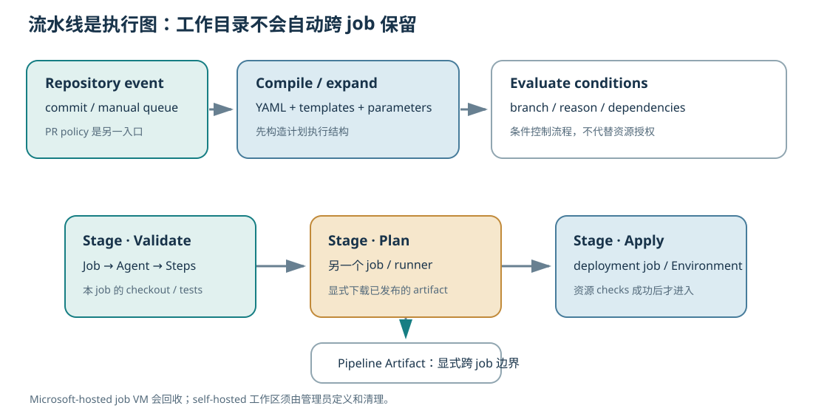
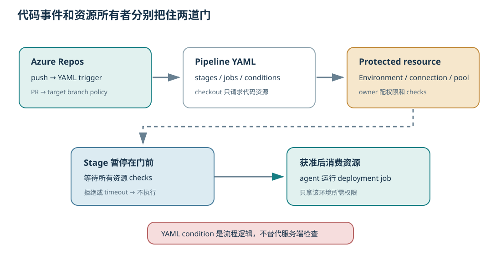
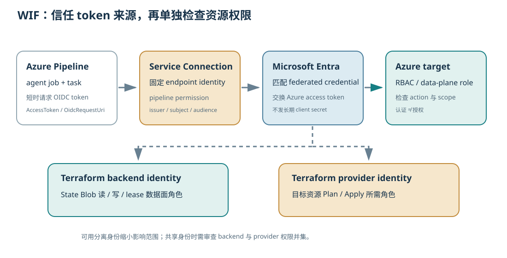
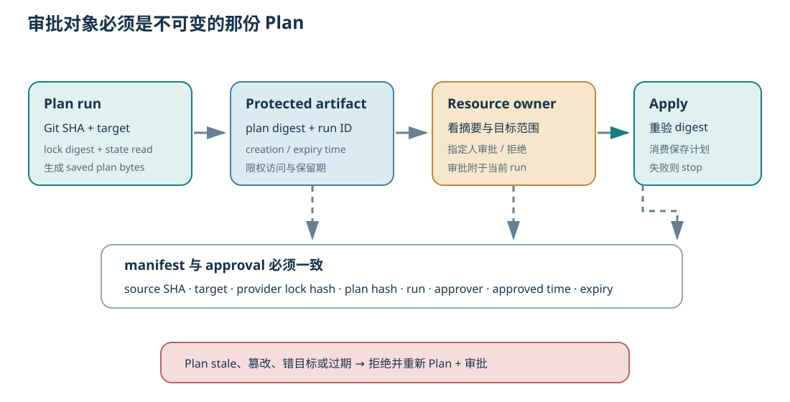

::::: cover
[AZURE CLOUDOPS · ENTERPRISE ENGINEERING]{.kicker}

# 谁可以把计划变成变更？

[Azure Repos、Pipeline stages、WIF、审批和受控 Apply]{.subtitle}

::: cover-meta
- **讲次**：21 / 23
- **核心机制**：代码来源、短期身份、精确 Plan、受保护资源
- **证据边界**：官方文档分析 + 本地 YAML / 计划合同测试
- **工程结果**：应用阶段只能消费同一来源、目标、锁文件和有效审批的计划
:::
:::::

::: scenario
支付平台已把 Terraform State 放到远程存储。开发分支能生成一个看似正常的计划，但真正的风险在下一步：这份计划来自哪个提交、目标是哪一个订阅、provider lock file 是否变化、谁审批、审批是否过期，以及 Apply 是否拿回了被审阅的那份二进制计划？“流水线是绿色”只回答了某些步骤成功，不能单独回答这些授权问题。
:::

### 本讲目标

读完后，你应能沿着 Azure Repos 到 agent、Service Connection、Microsoft Entra 与 Azure RBAC 画出信任链；区分 compile-time template 与运行时表达式；说明 Artifact、Environment、Variable Group 和 Service Connection 各自的保护边界；并定义一份 fail-closed 的 Plan 审批合同。

**本讲问题：** Apply 阶段能否证明自己消费的是已经审阅且仍然有效的那个计划？

## Pipeline 是执行图，资源才是授权边界

Azure Pipeline 通常由 stage、job、step 组成。Stage 划分发布阶段，job 选择 agent 并形成可并行的执行单元，step 执行任务或脚本。Stage 可声明依赖和条件；但条件只影响流程是否继续，本身不会创建一个安全的审批边界。模板在运行前参与 YAML 展开，参数适合表达受限的结构选择，运行时变量则常常直到 job 执行时才有值。不要把编译期的结构约束与运行时字符串拼接混为一谈。[1][2]



Job 在哪里运行由 agent pool 决定。Microsoft-hosted agent 对每个 job 提供新的 VM，job 结束后回收；下一 job 不会自动得到上一台 VM 的文件。Self-hosted agent 的工作目录和缓存行为则取决于池与清理策略。跨 job 或 stage 的计划必须用可追溯的 Pipeline Artifact 传递，不能依赖“下一台机器应该还能看到文件”。[11][12]

Pipeline YAML 说明要请求什么资源，不代表它已获准使用这些资源。Environment、Service Connection、Variable Group、agent pool 和 secure file 都可由资源所有者另设 checks 或 pipeline permissions；Stage 开始前，Azure Pipelines 会先等待所用资源的 checks。若超时或终止失败，stage 不运行。`condition:` 是 YAML 作者控制的流程条件；resource check 则由资源管理员在服务端控制。[8]

## 仓库事件与模板信任

Azure Repos Git 的 PR validation 由目标分支的 **Build validation branch policy** 触发，不由 YAML 中的 `pr:` 触发。YAML `trigger:` 可定义 push CI；组织或项目的“Disable implied YAML CI trigger”设置也会影响省略 trigger 后的默认行为。因此，分支策略、CI trigger 和环境准入分别配置、分别验证。[3][4]



Include template 把步骤或 job 重用进 Pipeline；`extends` template 可以规定允许的 pipeline schema，用来限制调用者能提交哪些步骤。安全收益取决于信任路径：如果调用者也能随意改写“安全模板”，结构仍受同一个代码作者控制。企业可从独立、受保护的模板仓库继承受控流程，并在 Environment 或其他 protected resource 上配置 Required template check。固定模板版本并审核其更新，不要把一次 include 当作策略执行器。[2][8]

同样要限制 Pipeline 自身的 Git 访问。只 checkout 所需仓库；关闭不必要的凭据持久化；缩小 job access token 到当前项目；限制 Pipeline 的 repo 权限。跨项目读仓库时再逐项授予权限。PR 构建不应拿到生产 Service Connection、可读生产 secret 的 Variable Group 或任何 Apply 权限。[3]

## WIF 把哪个身份交给哪段代码

Workload Identity Federation 用短期 OIDC token 代替长期 client secret。Azure Pipelines 的运行向系统 token endpoint 请求 id token；Service Connection 的 issuer、subject 和 audience 必须与 Microsoft Entra federated credential 对上；Entra 成功交换后发出可用于 Azure 的 token；最后 Azure RBAC / 数据面角色仍决定该身份可以做什么。token 解决“是谁”，不自动授予“能做什么”。[5][6]



Terraform AzureRM provider 在 Azure Pipelines 中通过 `System.AccessToken`、`System.OidcRequestUri` 和该 Service Connection ID 完成 OIDC 请求。provider 可从 `ARM_ADO_PIPELINE_SERVICE_CONNECTION_ID` 读取连接 ID；AzureRM backend 使用的环境变量名是 `ARM_OIDC_AZURE_SERVICE_CONNECTION_ID`。当前 HashiCorp 文档说明，AzureCLI 或 AzurePowerShell task 会把 Service Connection ID 提供给任务环境；如果选用其他 task，就要确认它是否支持 WIF 并能提供所需上下文。只看 YAML 中出现“OIDC”不能证明 token 请求成功。[5][7]

Backend 与 AzureRM provider 是两条权限路径。Backend 需要 State Blob 的数据面访问；provider 需要目标资源操作权限。可以用不同身份和连接缩小权限，也可以共享同一身份，但后一种选择扩大了单个凭证被滥用后的影响面。计划身份需要足够读取状态与刷新目标对象；Apply 身份需要实际计划内的写权限。任意 Reader 并不保证 Terraform Plan 总能成功，Provider/Data Source 可能需要额外读取动作。按资源、角色、scope 逐项审查，避免用订阅 Owner 快捷启动。[7][13]

> **版本敏感提醒（研究日：2026-11-27）**：Microsoft Learn 当前说明，新建 WIF Service Connection 默认使用 Microsoft Entra issuer；特定旧连接若使用 Azure DevOps issuer `https://vstoken.dev.azure.com`，将于 **2027-07-01** 退役。该公告仅适用于符合条件的 Azure public cloud 单租户应用或 managed identity；非公有云和多租户应用在公告范围之外。配置或迁移前重新查看当前页面和 Service Connection 标记，不要仅凭旧教程复制 issuer。[6]

Service Connection 在 YAML 中引用具体名称，不能用变量替换。连接需按 Pipeline 单独授权，避免“Grant access permission to all pipelines”。Variable Group 若含秘密，同样应逐 Pipeline 授权；单把 group 名写入 YAML，不构成授权。可将少量非秘密 target metadata 与 secret 分开，或用 Key Vault integration 管理需轮换的 secret；不要把 token、client secret 或计划内容 echo 到日志。[8][9]

## 让 Apply 消费同一份计划

Terraform Plan 是一次读取和计算的结果，不是持续有效的批准。远程 State、Provider API、目标参数或 HCL 在审批等待期间都可能变化。保存 Plan 时需要把源 Git SHA、明确 target scope、provider lock digest、Plan 文件 digest、Pipeline run ID、生成时间和过期时间一起记录。审批应指向这些字段；Apply 下载并核对 Artifact、Plan bytes、当前提交和锁文件。任何一项改变或过期，都重新计划并再次审批。Terraform apply 使用保存的 Plan；如果 State 已被其他操作改变，旧计划会因过时而失败，应退出并重新 plan，不能临时改成无 Plan 的 `apply` 绕过审阅。[10][13]



Plan Artifact 可能暴露配置值或敏感数据。只发布必要文件，限定有权下载的人员与 Pipeline，设定 Project 级 retention，并在过期时清理。不要把 `.tfplan`、State、backend 初始化文件或含秘密的计划 JSON 提交到 Git，也不要将计划日志贴到公开 PR。Apply 必须下载同一次 Pipeline run 的 artifact；跨 run 复用需重新绑定并审核 run、SHA、目标与时间。[10]

本地实验中的 `plan_gate.py` 检查合成 plan bytes 与 lock file 的摘要、来源 SHA、目标、run ID、审批对象和有效期；负例一律失败关闭。它收到的 approval JSON 是测试夹具，程序不能自行证明该对象是某位真实审批人产生的。Stage 2 E5 再增加 `plan_bundle.py`：它用 `terraform show -json` 在内存中读取真实 saved plan，校验计划中的订阅与资源组变量，生成只列资源地址、输出名称和动作的摘要；资源值、output 值和计划 JSON 不写入摘要。二进制 `.tfplan` 仍然敏感，整个 Pipeline Artifact 必须受限访问并设置保留期。[8]

## 审批、Variable Group 与失败路径

将 production Apply 表达为 deployment job 并绑定专用 Environment。由资源 owner 在 Azure DevOps 的 Environment 中设置限定审批组、限制自我审批、超时时间、Branch control、Required template、Artifact evaluation 和 Exclusive lock 等 checks。Checks 也可配置在 Service Connection、Variable Group、repository、agent pool 等资源上；多个资源的 checks 都要通过后，stage 才能运行。它们不是 `approval: true` 这样的 YAML 字段。[8][14]

如果多个 Pipeline 都可能部署同一 state，Environment Exclusive lock 可以控制同一 Environment 的并发 stage；Terraform backend lock 仍负责同一 state key 的状态互斥。二者保护不同对象。Deployment 锁没有消除 Terraform state lease 的必要性；State 锁也不能阻止另一个工具直接更改 Azure 资源。[8][13]

故障要按层分类，拒绝发生时先保留 run ID、stage/job、target 与非敏感错误码：

| 观测 | 先检查 | 修复动作 |
|---|---|---|
| PR 没有 Build Validation | Azure Repos 目标分支 policy、Pipeline 是否启用 | 修 branch policy；YAML `pr:` 不会替代它 |
| WIF 交换被拒绝 | 实际 issuer / subject / audience、连接授权与 federated credential | 修复精确的信任条件，不添加长期 secret |
| Plan 的 Blob 请求被拒绝 | backend 身份的 Storage 数据面权限、State scope 与网络路径 | 授予最小 Blob data role 或修复受控网络访问 |
| Environment 一直等待 | owner 配的审批人、checks 状态、超时和审批快照 | 由 owner 完成或拒绝；超时后不得绕过继续 |
| `saved plan is stale` 或 hash 不符 | State serial、Artifact run、Plan 与 lockfile digest | 停止 Apply；重新 Plan 和审阅同一目标 |
| agent 找不到工具/模板 | agent image、能力、checkout 和外部模板版本 | 固定可复验环境并重新运行验证 |

回退也依赖资源语义。对于可替换配置，恢复 Git 版本后重新 Plan；应用服务可能切回已知版本；数据则按备份恢复路径处理。Terraform 没有跨资源的通用 undo；不能因 Apply 部分成功就盲目 `destroy`。对失败 stage 重试前，检查是否有部分云端结果、State 更新、锁残留和新 Plan 需求。

## 企业交付模板：Plan、Review、Apply

[`enterprise-pipeline.yml`](labs/azure-pipelines/enterprise-pipeline.yml) 是代表性 Stage 2 设计，`enableCloudDelivery` 默认为 `false`。Azure Pipelines 在编译期只把离线 `Validate` 阶段保留在 Pipeline 图中；只有显式改变参数后，才会插入 [`enterprise-delivery.yml`](labs/azure-pipelines/templates/enterprise-delivery.yml) 的 `Plan → PlanReview → Apply` 模板。现有 [`azure-pipelines.yml`](labs/azure-pipelines/azure-pipelines.yml) 仍是独立的离线示例，不引用企业模板，也没有 Azure task。两个文件均未上传、编译或排队运行在 Azure DevOps。完整资源准备清单见该实验的 [README](labs/azure-pipelines/README.md)。

`Plan` 使用 Plan 专用 WIF Service Connection、受限 agent pool、只含目标 metadata 的 Variable Group，以及由 owner 管理的 backend/tfvars Secure Files。YAML 把连接名作为 compile-time 字符串参数；Service Connection 不能通过运行时变量替换。Backend 文件在仓库外，哈希进入 manifest。根模块 [`versions.tf`](../../terraform/azure-enterprise-reference/versions.tf) 的 AzureRM backend 明确要求 Entra/OIDC，禁用 CLI/MSI fallback；Provider 的 `use_workload_identity` 默认 `false`，只有受保护 tfvars 在专门获批的运行中才可开启。Plan 产物绑定当前 SHA、run ID、环境、订阅、资源组、backend 配置摘要、provider lock 摘要、精确 plan 摘要和动作摘要。计划命令的详细日志留在受保护 agent 诊断路径，不输出到 Pipeline 日志。

`PlanReview` 是 deployment job，并关联由 owner 配置检查的 Review Environment。Azure DevOps 会在 job 启动前执行 Environment checks，因此审阅人先在前一 Plan stage 查看 action summary 与同 run artifact；stage 通过后，review job 再下载并校验精确 artifact。该 job 用 `terraform init -backend=false` 加载锁定 Provider schema，再重新计算 plan 与 backend 摘要，不读取 Azure State。`Apply` 再绑定独立的 Apply Environment 与 Apply WIF Service Connection，使用 `download: current` 获取同一 run 产物，重验 backend、lock、源、目标、摘要与计划后调用 E4 `controlled_apply.py`。YAML 本身不直接执行 `terraform apply`。

签名 approval envelope 由外部集成 `cloudops-approval-broker` 在 Apply checks 通过后提供；broker、密钥、受保护 trust store 和 Azure DevOps 审批验证接口尚未实现。它必须核验真实 run/check 与审批人，签名绑定 plan hash、source、scope、run，并对 delete/replacement 另行授权。E4 重放记录写入 Apply agent 的 `CONTROL_ROOT` 持久目录。仅当单一专用 agent 且所有部署共用 Environment Exclusive lock 时，才可沿用本地原子锁；多 agent/外部工具须改用经验证的分布式锁/重放服务。YAML `lockBehavior: sequential` 只选队列方式；owner 仍需在服务端启用 Exclusive lock check。

部署前，资源 owner 应为 Azure Repos 目标分支设置 Build Validation 并保护模板源；生产强制模板迁入独立仓库，以 `extends`/Required template check 固定，同仓库 include 不是防篡改策略；分别创建 Plan/Apply WIF 连接，只授权该 Pipeline；Variable Groups、Secure Files、agent pools、Environments 也只授权必要 Pipeline 并配置 checks。PR 不得取得生产凭据；Plan/Apply 使用不同且最小的 Azure 和 Blob 权限；限制 artifact/log 读者与保留期；两类 agent 固定到同一 Terraform 1.15.5/provider lock 工具链。Plan identity 读取 State 与刷新/数据源所需对象；Apply identity 只获同一 State 访问和计划动作所需写权限。角色按资源操作审查，不预设订阅 Contributor。

## 本地实验：验证 YAML 与审批合同

本讲保留刻意离线的 Azure Pipelines：[azure-pipelines.yml](labs/azure-pipelines/azure-pipelines.yml) 只运行 [offline-checks.yml](labs/azure-pipelines/templates/offline-checks.yml)。它关闭自动触发，只 checkout `self`，不配置 Azure task、Service Connection 或 Apply。PyYAML 做普通 YAML 解析，再由 unittest 检查离线文件和企业模板的静态结构；这不是 Azure Pipelines schema compiler，也没有向 Azure DevOps 上传或排队。

[plan_gate.py](labs/azure-pipelines/scripts/plan_gate.py) 真实地检查临时合成的 Plan bytes 与批准合同；11 个负例验证篡改、错提交、错 scope、锁文件变化、审批错 run、自我审批、过期、时区缺失、超长有效期和未来审批都会被拒绝。新增 [plan_bundle.py](labs/azure-pipelines/scripts/plan_bundle.py) 用合成 Terraform JSON 夹具验证 artifact 创建和回读、source/run/scope/backend/lock/plan 摘要绑定、敏感值省略、output 动作、replacement 分类和 fail-closed 行为。两组离线脚本都不访问 Azure；测试不证明 Azure DevOps approver、WIF、Environment check 或 broker 的身份。当前企业模板是条件关闭的设计，并不证明 server-side resource 已配置。

从仓库根目录运行：

```powershell
python -m pip install -r textbook/chapters/AZ07-03/labs/azure-pipelines/requirements.txt
python -m unittest discover -s textbook/chapters/AZ07-03/labs/azure-pipelines/tests -p "test_*.py" -v
```

不要用 `python -m unittest` 的成功替代 Azure YAML 编译、WIF 验证或 Environment approval 的实测。若未来在 Azure Repos 运行：先配目标分支 Build Validation；在 Project Settings 建专用 Service Connection、Environment 和 agent pool；将连接与含 secrets 的 Variable Group 只授权给指定 Pipeline；再为 Environment 配 checks。配置后分别记录 commit、run URL、check 与 identity evidence。

::: {.think data-title="练习"}
1. PR pipeline 的 YAML 中写了 `pr: main`，但 Azure Repos PR 没有运行。应检查哪个实际开关？
2. Plan 创建后 State 已有另一操作写入。即使审批未过期，为什么旧 Plan 也不能无条件 Apply？
3. 哪些证据来自 YAML/local test，哪些必须来自 Azure DevOps resource owner 或 Azure？
4. 生产 Service Connection 误设成 all pipelines access，且 secrets Variable Group 也开了 Open access。最小修复顺序是什么？
:::

::: answer
1. 检查目标分支的 Build validation policy、其 Pipeline 指向和是否启用；Azure Repos Git 通过 branch policy 验证 PR，而不是 YAML `pr:`。
2. Terraform State 已经发生变化，已保存计划基于旧状态；它可能已 stale。停止，读取最新状态重新生成 Plan，再按新摘要重新审批。
3. YAML/local suite 只能证明提交里的文本能按通用 YAML 解析、合同脚本对测试 fixture 按预期拒绝/接受。Branch policy、服务端 YAML schema 执行、WIF trust、pipeline permission、Environment approval、实际 approver 和 Azure role 必须取自相应服务记录。
4. 先撤销所有 Pipeline 的生产连接授权与 secret group Open access；然后只对准入 Pipeline 授权；再核对 Apply Pipeline 的受保护分支、服务端 Environment checks 和最小 Azure role。审计可能已经运行过的 Pipeline 与 secret/token 使用，并按事件响应流程轮换已暴露的秘密；不要仅删除 YAML 引用。
:::

::: key
一个可审计的部署闭环有四个独立问题：来源是否受保护、身份是否只在目标边界内有效、Artifact 是否仍是受批准的 Plan、资源 owner 是否允许这次 stage。Git SHA、Plan digest、目标、锁文件和时效必须一致；环境检查和 Azure RBAC 另行授权。线上的验证结果不能从离线 YAML 或模型推断。
:::

::: {.refs}
## 官方与实现参考

1. [Stages in Azure Pipelines](https://learn.microsoft.com/en-us/azure/devops/pipelines/process/stages?tabs=yaml&view=azure-devops)
2. [YAML templates for reusable and secure pipelines](https://learn.microsoft.com/en-us/azure/devops/pipelines/process/templates?view=azure-devops)
3. [Build Azure Repos Git repositories](https://learn.microsoft.com/en-us/azure/devops/pipelines/repos/azure-repos-git?view=azure-devops)
4. [Set and manage branch policies](https://learn.microsoft.com/en-us/azure/devops/repos/git/branch-policies?view=azure-devops)
5. [AzureCLI@2 task](https://learn.microsoft.com/en-us/azure/devops/pipelines/tasks/deploy/azure-cli)
6. [Set a Resource Manager workload identity service connection](https://learn.microsoft.com/en-us/azure/devops/pipelines/release/configure-workload-identity?view=azure-devops)
7. [AzureRM provider OIDC guide](https://registry.terraform.io/providers/hashicorp/azurerm/latest/docs/guides/service_principal_oidc) and [AzureRM backend](https://developer.hashicorp.com/terraform/language/backend/azurerm)
8. [Azure Pipelines approvals and checks](https://learn.microsoft.com/en-us/azure/devops/pipelines/process/approvals?view=azure-devops)
9. [Variable groups and Key Vault integration](https://learn.microsoft.com/en-us/azure/devops/pipelines/library/variable-groups?view=azure-devops)
10. [Publish and download Pipeline artifacts](https://learn.microsoft.com/en-us/azure/devops/pipelines/artifacts/pipeline-artifacts?tabs=yaml-task&view=azure-devops) and [retention policies](https://learn.microsoft.com/en-us/azure/devops/pipelines/policies/retention?view=azure-devops)
11. [Microsoft-hosted agents](https://learn.microsoft.com/en-us/azure/devops/pipelines/agents/hosted)
12. [Azure Pipelines YAML schema](https://learn.microsoft.com/en-us/azure/devops/pipelines/yaml-schema?view=vsts)
13. [Terraform state locking](https://developer.hashicorp.com/terraform/language/state/locking) and [Azure built-in Storage roles](https://learn.microsoft.com/en-us/azure/role-based-access-control/built-in-roles/storage)
14. [Azure Pipelines environments](https://learn.microsoft.com/en-us/azure/devops/pipelines/process/environments?view=azure-devops)

:::
