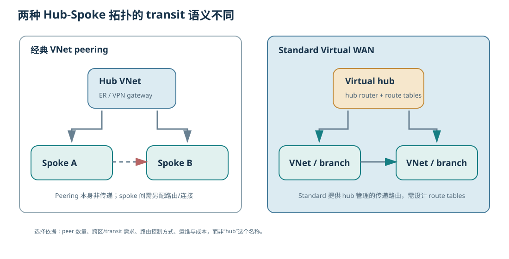
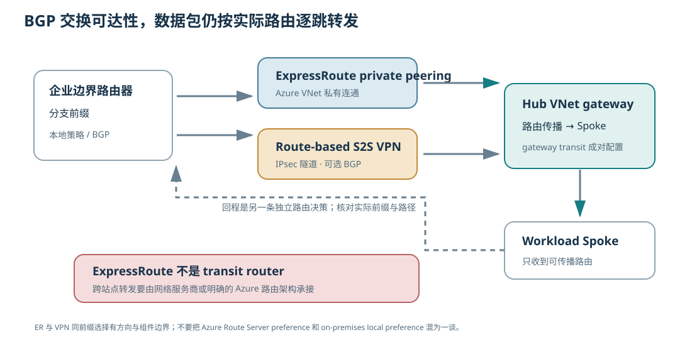
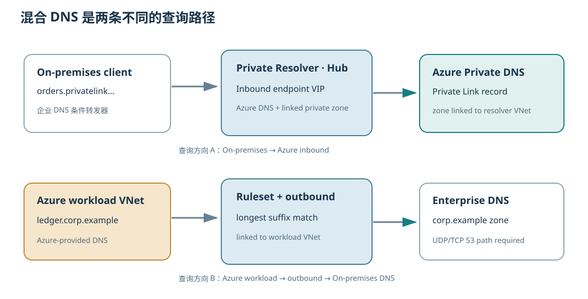
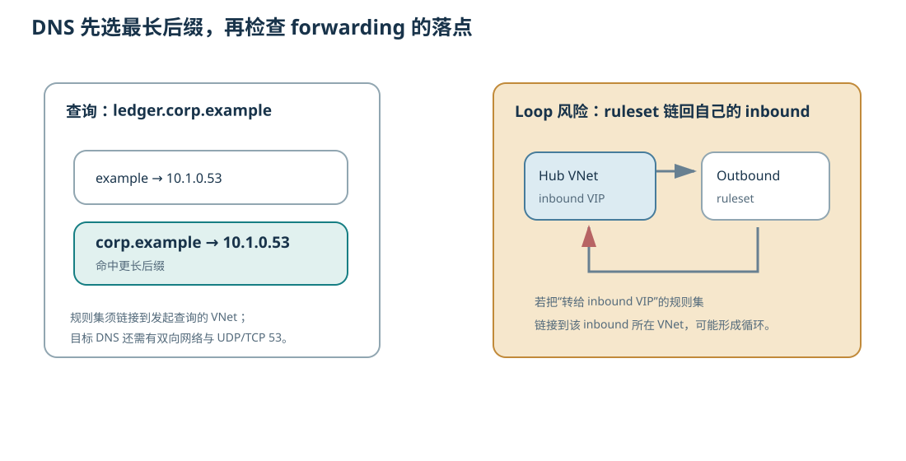
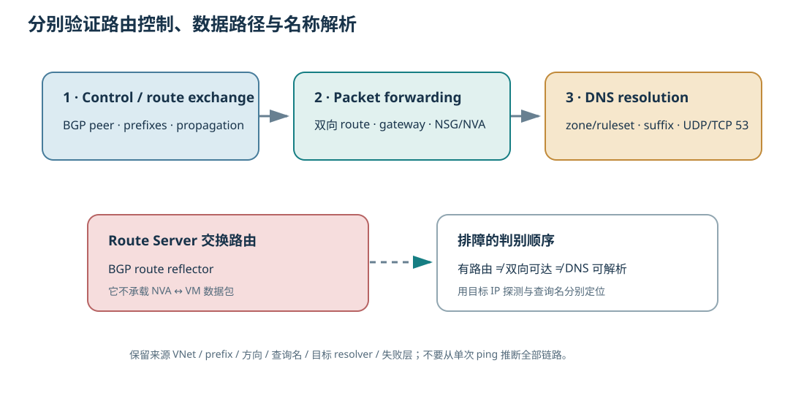

::::: cover
[AZURE CLOUDOPS · ENTERPRISE ENGINEERING]{.kicker}

# 路由已通，应用为何仍找不到数据库？

[Hub-Spoke、VPN、ExpressRoute 与 Enterprise DNS]{.subtitle}

::: cover-meta
- **讲次**：22 / 23
- **核心机制**：VNet peering、gateway transit、BGP、Private Resolver、Virtual WAN
- **证据边界**：Microsoft Learn 官方文档分析 + 本地合成拓扑合同
- **工程结果**：分别审查双向路由、DNS 转发方向、拓扑选择和故障边界
:::
:::::

::: scenario
虚构银行把 `payments` 工作负载放在 Azure spoke，把合作方清算网络留在分支数据中心。ExpressRoute 已建立，spoke NIC 也看到了分支前缀；应用仍报告数据库主机名无法解析。与此同时，分支用户查询 Private Link 名称时偶尔拿到公共地址。网络组只验证了 BGP peer 状态，DNS 组只验证了本地解析器进程，两边都没有沿完整路径追踪同一个请求。
:::

### 本讲目标

读完后，你应能区分经典 VNet peering 与 Virtual WAN 的 transit 语义；逐项核对 hub gateway transit、BGP 路由学习与回程；说明 ExpressRoute private peering、S2S VPN 和 Azure Route Server 分别负责什么；并沿 Private DNS Resolver 的 inbound 与 outbound 路径诊断企业名称解析。

**本讲问题：** 工作负载既有到目标 IP 的双向路由，使用的 DNS 查询会沿哪条独立路径到达正确的权威答案？

## 先选择 transit 模型，再谈“hub”

经典 hub-spoke 通常用 VNet peering 把每个 spoke 接到 hub。Hub 可以容纳 VPN Gateway 或 ExpressRoute Gateway、共享 DNS、防火墙与管理服务；spoke 隔离工作负载。**Peering 是非传递关系**：A 与 hub、B 与 hub 都 peering，不代表 A 能经 hub 到 B。要共享 hub gateway，hub 端 peering 设置 `allowGatewayTransit`，spoke 端相应 peering 设置 `useRemoteGateways`；spoke 已有自己的 gateway 时，不能再使用 remote gateway。若要让 peer 间转发的包通过，还需在相应 peering 上允许 forwarded traffic。这个选项只放行转发流量，本身不创建 UDR 或 NVA。[1]

设计时要明确谁控制转发、如何传播路由及如何隔离。经典 hub-spoke 依靠逐条 peering，适合小规模或自管 UDR/NVA 网络；Standard Virtual WAN 提供 hub 间和分支/VNet transit，但 route table、连接传播与 routing intent 仍须设计。Basic 不具备 Standard 的全部 ExpressRoute 和跨 hub transit 能力。Virtual hub 的路由控制不能照搬 VNet peering 属性。[5]

## BGP 告诉路由器“哪些前缀可达”

BGP peer 通告可达前缀，另一端据此更新路由；VPN Gateway 可在 route-based VPN 上使用 BGP，也可以不用 BGP 而依赖静态网络定义。多条连接或多个站点的 gateway 可以传播从一个 peer 学来的路由，但**路由传播不等于转发设备、策略和返回路径都已配置**。[2]

ExpressRoute 与 VPN 解决不同连接条件。ExpressRoute private peering 把 Azure VNet 私有地址路由连接到企业网络，BGP session 有主、备链路；微软要求同一 peering 的两条 BGP session 都建立以满足对应 SLA。S2S VPN 则通过 IPsec 隧道连接站点，适合加密隧道或备用路径；BGP 可动态通告变化的前缀。ExpressRoute 不是任意站点之间的 transit router，跨站点转发要由服务商或明确设计的 Azure 路由组件承接。[3]

路由排障要沿两个方向列出实际前缀与下一跳。先看 BGP peer 是否 Established，再确认**期望前缀确已通告、接收且没有被过滤**；接着检查 hub gateway 是否传播到 spoke、该 subnet 是否停用了传播、两端 route table 是否有可匹配目的地址的路由。最后逐跳验证返回路径、NVA 转发、NSG 与应用端口。已建立 session 只说明邻居控制关系存在，不能说明某条业务路由被接收，也不能证明数据包完成往返。[1][2]

### ER 与 VPN 并存时，先问“哪一端在选路”

把 Site-to-Site VPN 配成 ExpressRoute private peering 的备用路径时，微软文档指出：对于相同目的前缀，ExpressRoute 是主要路径；企业网络侧应对从 ExpressRoute 学到的路由设置更高 local preference，避免请求和响应分别走 ER、VPN 而形成非对称路径。这是企业边界路由器上的 BGP 属性策略。最长前缀仍先影响匹配：VPN 学到更具体的前缀时，不应假定同长度的 ER 路径规则会覆盖它。[3]

Azure Route Server 是另一个决策点。它在 Azure VNet 内充当 managed BGP route reflector，使 NVA 与 Azure 软件定义网络动态交换路由；与 VPN/ExpressRoute 网关组合时可启用 route exchange。Route Server 的 hub routing preference（ExpressRoute、VPN 或 ASPath）影响它对相同前缀选择的路径；该设置不能替代 on-premises router 上的 local preference。Route Server 传播路由，不承载 NVA 与 VM 之间的数据包，也不会自动把任意 spoke 间流量变成可达。[4]

## DNS 与 IP 路由是两个平面

Private Resolver 的 **inbound endpoint** 给企业 DNS 一个 Azure 内的目标 IP。企业解析器可把 Azure Private DNS 后缀配置为 conditional forwarder，查询经 VPN/ExpressRoute 网络到 inbound endpoint，再由 Azure DNS 在与该 resolver VNet 关联的 private zone 中查记录。若 zone 没有链接到 inbound endpoint 所在 VNet，查询路径即使到达 endpoint，也没有该链接可供解析。[6][7]

反向方向从 Azure workload 开始。采用 Azure-provided DNS 的 VNet 查询不匹配的 private zone 后，会检查所链接 DNS forwarding ruleset；匹配规则后，Private Resolver 的 **outbound endpoint** 把查询转交给企业 DNS。规则集必须链接到发起查询的 VNet；链接不要求该 VNet 与 resolver VNet 做 peering。若 workload VNet 配置的是自定义 DNS，客户端首先把查询交给列出的 DNS IP，不能简单假定 Azure-provided DNS 的规则集路径会处理它。[7]

查询名会由最具体的后缀规则匹配。例如 `ledger.corp.example` 同时匹配 `example` 与 `corp.example`，后者胜出；没有 suffix match 时不发生该规则集的转发。每个端点需要专用 delegated subnet，入站 VIP 还要有从查询来源到该 VNet 的网络路径。DNS 使用 UDP，也可能需要 TCP 53；只验证路由前缀而不核对端口、NSG/NVA 和企业 DNS listener，不能推出查询会得到响应。[7]

::: warn
避免 DNS forwarding loop：如果某规则把查询转给 Private Resolver 的 inbound endpoint，就不要把这个含该规则的 ruleset 链接到 inbound endpoint 所在的 Hub VNet。Hub 内规则集再次匹配同一查询时可能回到自身，形成循环。[7]
:::

## 什么时候选择 Virtual WAN

Virtual WAN 把 VNet、分支、VPN、ExpressRoute 与远程用户连接到 virtual hub；Standard Virtual WAN 的 hubs 互联，并提供由 hub router 管理的 transit 和 route tables。它适合跨多区域、很多分支、需要 partner SD-WAN 集成或希望集中化 hub 路由的场景。经典 hub-spoke 则可让网络团队自行管理 peering、UDR 与 NVA 路径，适合规模较小、边界清楚或已有自管路由体系的网络。[5]

设计审查应明确谁控制转发、如何传播路由及如何隔离流量。小型或自管 UDR/NVA 网络适合经典 hub-spoke；Standard Virtual WAN 提供跨 hub、分支与 VNet transit，但 route table、连接传播和 routing intent 仍需设计。Basic 不含 Standard 的全部 ExpressRoute 与跨 hub 能力。Virtual hub 的控制方式不同于逐条 VNet peering。[5]

## 本地实验：让三个平面分别失败

附带的 [hybrid-connectivity lab](labs/hybrid-connectivity/README.md) 读取完全合成的 JSON，检查四类合同：hub/spoke 的成对 gateway-transit 属性；BGP 与传播前提；spoke→分支及分支→spoke 两向的最长前缀匹配；以及 DNS inbound/outbound 的 zone link、ruleset link、最长后缀、转发目标与 UDP/TCP 53。合同把路由故障和 DNS 故障分别报告，避免由“IP 看起来可达”推断 DNS 已成功。

运行基线后复制 JSON，每次只注入一个故障：移除 transit flag、关闭 BGP、删去回程路由、取消 ruleset link、阻断 TCP 53，或制造转发循环。合同应分别报告路由与 DNS 故障，按最长前缀/后缀选择目标，并拒绝猜测等长冲突。本地检查不会连接 Azure、解析 ARM、发送 DNS 封包或模拟 BGP 收敛；通过只证明输入满足这些教学合同。

未来 Azure 只读实操的前置权限、命令、预期证据、故障分类、恢复边界与费用门槛见 [live-lab runbook](labs/hybrid-connectivity/FUTURE-LIVE-READONLY.md)。本阶段没有连接 Azure。

真实只读排障时，先固定一笔失败请求的源 VNet/subnet、源 IP、目标 IP、查询名与时间。路由侧查看 peer 状态、通告/接收的目标前缀、gateway transit 和两向 effective routes；DNS 侧同时确认客户端配置的 resolver、条件转发或 ruleset link、命中 suffix、目标 endpoint、Private DNS zone link 与 53 端口路径。不要用 `ping` 代替 DNS，也不要用一次成功的 DNS 响应证明业务 TCP 路径已通。

## 故障定位表

| 症状 | 先区分 | 下一项证据 |
|---|---|---|
| Peer Established，但 spoke 到分支无路由 | 控制会话与前缀传播不是一件事 | 目标前缀是否被通告/接收；gateway transit 与 subnet propagation |
| 去程正常、响应超时 | 两个源上下文的回程路由是否对称 | 分支到 spoke 的前缀、下一跳、NVA 状态 |
| Spoke 到 hub 通、spoke 彼此不通 | Peering 是否被错误当作 transit | 是否有 direct peering、UDR/NVA 或 Virtual WAN 路由 |
| 分支按 IP 可达，Private Link 名称解析错 | inbound DNS path 与 private zone association | 条件转发后是否到 inbound VIP；zone 是否链接到 resolver VNet |
| Azure 按 IP 可达，企业名查询超时 | outbound ruleset 与 DNS transport | 来源 VNet 的 ruleset link、最长 suffix、目标 IP 与 UDP/TCP 53 |
| 只有部分域名失败 | suffix 与 zone 的边界或更具体规则 | 实际 query name、最长命中后缀、权威区和 DNS 响应码 |

## 思考题

1. Hub 和两个 spoke 都显示 `Connected`，为什么 spoke A 仍不能访问 spoke B？列出经典 peering 与 Standard Virtual WAN 下各自要找的路由机制。
2. On-premises 与 Azure 都能看见 `172.22.10.0/24`，但 TCP 建连间歇失败。哪些回程路径、前缀长度或有状态设备差异可能解释它？哪种证据能区分？
3. `orders.privatelink.database.windows.net` 能解析，`ledger.corp.example` 超时。沿两条 DNS 路径分别找出查询起点、endpoint、zone/ruleset 归属、suffix 和网络端口。
4. 何时值得从经典 hub-spoke 转向 Virtual WAN？请用站点规模、路由控制权、隔离需求、WAN 服务和运维成本提出可检验的决策条件。

## 参考资料

1. Microsoft Learn, [Hub-and-spoke network topology](https://learn.microsoft.com/en-us/azure/networking/design-guide/hub-spoke), [VNet peering](https://learn.microsoft.com/en-us/azure/virtual-network/virtual-network-manage-peering) and [VPN gateway transit](https://learn.microsoft.com/en-us/azure/vpn-gateway/vpn-gateway-peering-gateway-transit).
2. Microsoft Learn, [BGP with VPN Gateway](https://learn.microsoft.com/en-us/azure/vpn-gateway/vpn-gateway-bgp-overview) and [Configure BGP](https://learn.microsoft.com/en-us/azure/vpn-gateway/configure-bgp).
3. Microsoft Learn, [ExpressRoute routing](https://learn.microsoft.com/en-us/azure/expressroute/expressroute-routing), [circuit peerings](https://learn.microsoft.com/en-us/azure/expressroute/expressroute-circuit-peerings), [VPN Gateway](https://learn.microsoft.com/en-us/azure/vpn-gateway/vpn-gateway-about-vpngateways) and [ER/VPN coexistence](https://learn.microsoft.com/en-us/azure/expressroute/expressroute-howto-coexist-resource-manager).
4. Microsoft Learn, [Azure Route Server overview](https://learn.microsoft.com/en-us/azure/route-server/overview), [ER/VPN route exchange](https://learn.microsoft.com/en-us/azure/route-server/expressroute-vpn-support), [routing preference](https://learn.microsoft.com/en-us/azure/route-server/hub-routing-preference) and [FAQ](https://learn.microsoft.com/en-us/azure/route-server/route-server-faq).
5. Microsoft Learn, [Virtual WAN overview](https://learn.microsoft.com/en-us/azure/virtual-wan/virtual-wan-about) and [virtual hub routing](https://learn.microsoft.com/en-us/azure/virtual-wan/about-virtual-hub-routing)；Azure Architecture Center, [Virtual WAN hub-spoke topology](https://learn.microsoft.com/en-us/azure/architecture/networking/architecture/hub-spoke-virtual-wan-architecture).
6. Microsoft Learn, [Private Resolver overview](https://learn.microsoft.com/en-us/azure/dns/dns-private-resolver-overview) and [endpoints/rulesets](https://learn.microsoft.com/en-us/azure/dns/private-resolver-endpoints-rulesets).
7. Azure Architecture Center, [Private Resolver architecture](https://learn.microsoft.com/en-us/azure/architecture/networking/architecture/azure-dns-private-resolver) and [hybrid DNS infrastructure](https://learn.microsoft.com/en-us/azure/architecture/hybrid/hybrid-dns-infra).

**资料复核日期：2026-11-27（Pacific/Auckland）。** 服务限制、SKU、区域可用性与价格需在具体设计或部署时复核。
