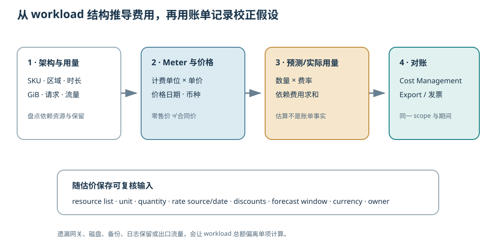
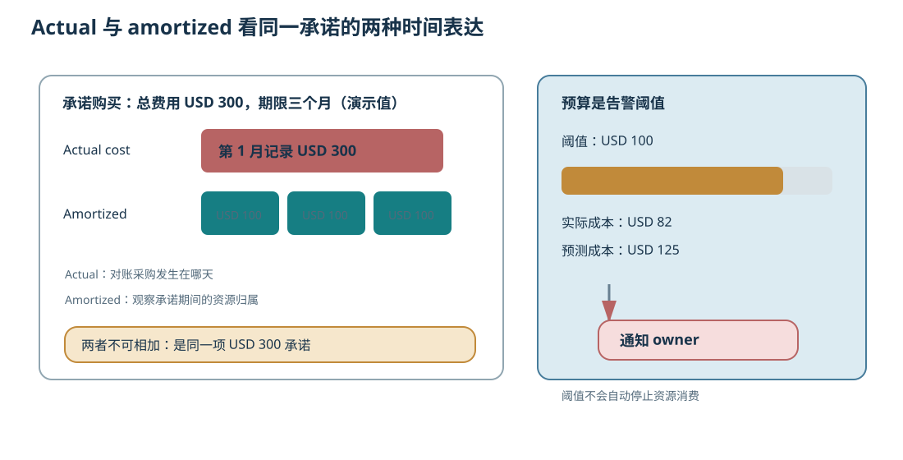
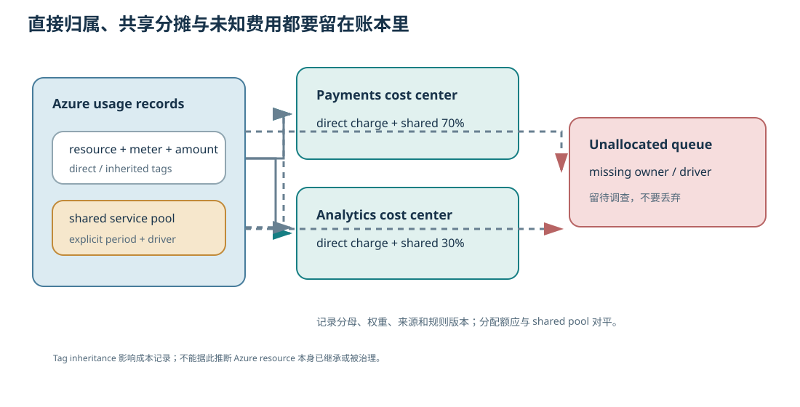
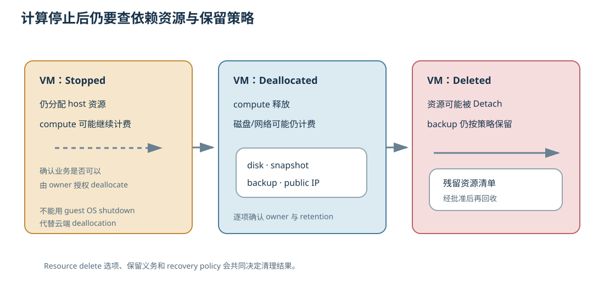
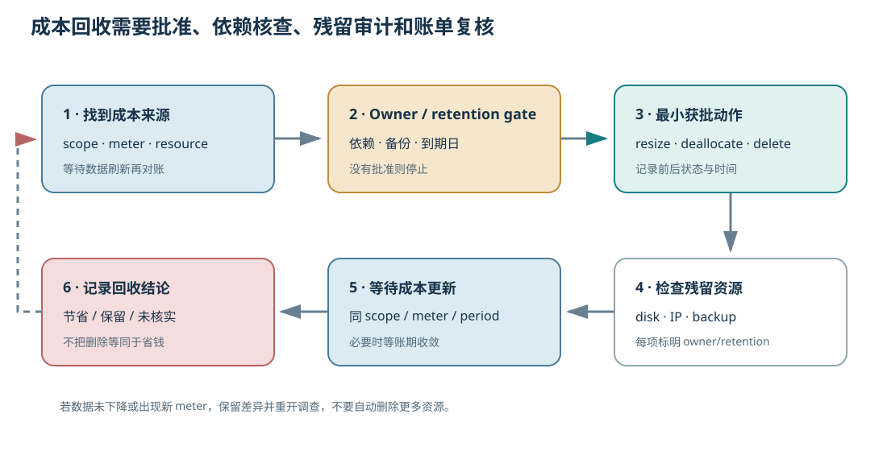

::::: cover
[AZURE CLOUDOPS · ENTERPRISE ENGINEERING]{.kicker}

# 预算没超，账单为何还在涨？

[Azure FinOps、闲置资源与成本回收]{.subtitle}

::: cover-meta
- **讲次**：23 / 23
- **核心机制**：meter 计费、成本可见性、分摊、承诺折扣、保留与清理
- **证据边界**：Microsoft Learn 官方文档分析 + 本地合成成本账本
- **工程结果**：形成可追溯、保留业务数据且能核实残留的回收流程
:::
:::::

::: scenario
虚构银行的云账单比月度估算多出 18%。开发 VM 昨天标成 stopped，预留实例利用率却只有 62%；应用团队说测试资源已删除，平台团队仍在支付磁盘、备份和静态公网 IP 的费用。资源组预算没有触发，成本报表里还有未归属的共享网络费用。财务先需要知道差额来自哪个 meter、资源和日期；工程团队再决定哪些资源可以释放，哪些数据必须保留。
:::

### 本讲目标

读完后，你应能预测 SKU、区域、计费单位和预计用量变化对估价的影响；用 Pricing Calculator 与 Cost Management 的视图配置一个可复核的成本检查；解释 actual cost、amortized cost 与最终账单各回答什么问题；诊断未归属费用和承诺未充分利用；比较 Reservations 与 Savings Plans 的适用条件；并在保留策略、所有者批准和残留清单约束下制定成本回收步骤。

**本讲问题：** 哪些记录证明我们花了钱、哪些记录解释费用归谁，以及哪些云资源可以安全释放？

## 从一个计费单位开始估算

云价格不是“每月一个固定数字”。服务会按不同 meter 计价：运行时长、容量、交易数、查询数、数据保留、网络传输或特定 SKU。一个 workload 的总成本由它的依赖资源和用量假设共同决定。



对每个组件记录服务、区域、SKU/层级、操作系统、计价单位、预计数量、单价来源、折扣或承诺条件、币种和假设日期。然后按计费单位计算：

```text
预估费用 = Σ（预计计费数量 × 该 meter 的单价） + 已知固定费用
```

例如，演示账本假设某计算 meter 使用 120 小时，示例单价为每小时 USD 0.20；它的计算部分为 USD 24。若应用还消耗磁盘容量、备份保留、日志摄取和出站流量，须分别用各自单位估算后相加。此处的数量和单价都是课堂假设，不是 Azure 报价。

Azure Pricing Calculator 根据区域、大小、操作系统、层级等选择零售单价，再乘以输入的用量；登录后也可以显示与特定 billing account 相关的协商价格。Retail Prices API 返回的 retail rate 可用于程序化比较，但不能代替客户合同价格或实际 Cost Management 记录。[1][2]

### 估价之前先补齐依赖

| 资源类别 | 常见成本维度 | 估算时需要验证 |
|---|---|---|
| Compute | SKU、运行时长、计费方式、系统映像 | VM 处于什么状态，是否使用 Spot 或承诺折扣 |
| Storage | 容量、冗余/层级、操作、保留期 | 磁盘、快照、备份和日志分别保留多久 |
| Network | 出站数据、网关、地址、端点或互联 | 流量方向、跨区域/跨网络路径、持续运行的网关 |
| Data & observability | 数据库层级、请求、摄取量、保留和查询 | 流量、索引、采样、备份与恢复副本 |
| Shared platform | 共享服务容量与实际消耗 | 费用先记在哪个 scope，怎样分给使用团队 |

服务、区域、币种和合同价格会变化。应保存价格查询日期和关键参数；定期估价是预算输入，不能证明后来用了多少资源。

## 账单可见性：actual、amortized 与 budget

Cost Management 的 cost analysis 可以按 scope、时间、service、resource、meter、resource group 或 tag 检视成本。Cost query API 是按指定 scope 和 dataset 查询用量数据；对于大型未聚合数据，Microsoft 建议使用 Cost Management exports。EA/MCA 的数据通常在 8–24 小时内出现，按量付费订阅可能需要最多 72 小时；当前月份仍可能延迟或重新计价。因此，刚删除资源后报表未下降，不足以证明删除失败或费用归零。[3][4]

预留实例或 Savings Plan 会让两个视图回答不同问题：**actual cost** 依照账单记录购买费用；**amortized cost** 把承诺费用分摊到有效期并按受益资源展示。财务对账应查看 actual cost；团队 showback/chargeback 和承诺利用率分析通常还要查看 amortized cost。二者是同一承诺在不同视图下的表达，**不能相加**。[5]



预算可以按 subscription、resource group 或符合权限的 billing scope 设金额和 actual/forecast 阈值。达到阈值时它发送告警，通常每天评估成本数据；预算本身不改变资源，也不会停止消费。即使接入 Action Group 自动化，停止动作也来自另行配置的自动化逻辑、权限和条件，并需单独验证。延迟数据意味着告警不是硬限额；生产系统要用审批、部署策略、runtime 限制和本地成本闸门降低超支风险。[3]

::: warn
不要把四个数字混成一个“本月费用”：估算、Cost Management actual cost、amortized 归属和发票/付款状态各自回答不同问题。对账时同时记录时间范围、scope、币种、数据新鲜度和是否含信用额；毛额与信用额要分别留存。
:::

## 让每笔费用有明确归属

直接成本优先归到拥有资源的团队、产品、环境和成本中心。标签是便于检索和报告的键值对，不是授权边界。并非每种资源或用量记录都支持标签，资源组标签也不一定默认进入成本记录；Cost Management 的 tag inheritance 可将支持的上层标签继承到 usage records，但它并不会修改资源本身。标签可能等数据刷新后才显示；不要将秘密、个人信息或敏感业务值写进标签。[6][7]

共享网络、平台监控或内部构建代理的费用不能凭空消失。先把来源保留为一个 shared pool，再用双方认可的分摊驱动因素计算份额，例如出口字节、处理请求数、计算时长或许可席位；保存时间范围、分母、来源数据和分配规则。没有可信驱动因素的部分放入 `unallocated` 队列，交给成本所有者调查，不能为了让团队报表好看而静默丢弃。



成本分配规则是否可用取决于 billing scope 和协议类型；Microsoft 文档指出 Azure RBAC subscription/resource-group scopes 并不支持该 billing feature。团队可以先在自己的账本做可复算的 showback，但应区分这种内部计算与 Microsoft Cost Management 中实际保存的 allocation rule。[8]

## 承诺折扣先看利用率

先删除或缩小已确认浪费，再决定是否购买折扣。**Reservation** 通常承诺一到三年内某类服务或配置，适合长期、稳定且规格/区域符合 benefit 的工作负载；**Savings Plan** 承诺每小时固定金额，可在计划适用范围内覆盖多种合格服务/区域，适合更动态的用量。二者都要以连续使用为前提；Savings Plan 每小时未用的承诺不会结转。reservation 常在充分使用时能获得更高折扣，但配置和范围更受约束。[9][10]

示意：若某 Savings Plan 每小时承诺 USD 1.00，而该小时内合格用量只吸收 USD 0.70 的计划价值，剩余 USD 0.30 不能移到下一小时。这个示例帮助理解利用率，不代表任何 Azure SKU 的承诺折扣。购买之前按小时回放完整业务周期，核对资格、scope、实际使用、现有承诺、计划期限和客户报价；不要根据一周内的峰值推断全年稳定负载。

| 要回答的问题 | Reservation | Savings Plan |
|---|---|---|
| 承诺基础 | 特定产品属性，依服务而定 | 合格用量的每小时金额 |
| 比较适用场景 | 规格、区域或产品长期稳定 | 负载变化或跨多个合格服务/区域 |
| 主要浪费风险 | 购买范围不匹配或长期未利用 | 每小时承诺未使用并过期 |
| 先收集的证据 | 需求周期、SKU/区域、利用率与现有权益 | 每小时支出曲线、合格服务与权益范围 |

**资料时效提示：** Microsoft 目前公布，自 2027-02-01 起，部分与 Savings Plans 对应的服务 reservation 将适用新的 exchange 政策。购买或交换前须复核当时的资格、取消/退款条款及可交换范围；不可把目前合同能力外推到未来订单。[11]

## 停机、删除与数据保留

VM `Stopped` 与 `Deallocated` 不是同一个费用状态。guest OS 关机后若 VM 仍保留 host allocation，计算资源可能继续计费；deallocated 释放计算资源，但相关磁盘和网络资源仍可产生费用。删除 VM 时，`Detach` 选项会留下磁盘等资源；备份策略也可能在 VM 删除后继续保留恢复点并收费。判断成本回收不能只看 VM 清单。[12][13]



成本回收要先核对保留义务。审计日志、法定留存、业务恢复点和调查证据都可能有明确保留期；能否删数据需要相应的业务/安全所有者决定。磁盘、快照、备份、公网地址、监控 workspace、Private Endpoint、网关、共享网络和储存账户都要分别核查 owner、依赖、保留状态和计费来源。Azure Advisor 建议只是筛选线索：低 CPU 的资源可能承载季节性流量、故障转移容量或尚未开始的测试；它不替代服务负责人审批。[14]

### 回收闭环

1. 固定费用差额的 scope、日期、币种、meter 与 resource；等待 Cost Management 数据刷新，必要时与发票/导出核对。
2. 将费用映射到资源、依赖、业务 owner、标签和保留策略；未知费用进入待调查清单。
3. 由 owner 选择继续保留、缩小规格、schedule/deallocate、改配置或删除；在执行前保存审查证据和批准范围。
4. 执行获批动作后检查依赖资源、备份与残留资源清单。对保留项记录 owner、原因、到期/复核日期和费用承担人。
5. 等下一次 Cost Management 刷新和计费周期闭合，再比较相同 meter/scope/time window。只有资源清理和费用变化都核实后，才记录成本回收结果。



::: fault
**症状：** VM 显示已删除，资源组本月仍有费用。\
**区分：** 是删除指令失败，还是 detached disk、public IP、backup recovery point 或延迟上报的 meter？\
**下一项证据：** 对比删除时间、残留资源、deleteOption、备份策略、资源 ID、meter 和 Cost Management 数据更新时间。\
**最小处置：** 保留要求先由 owner 确认；只清理有明确批准的残留项，再于刷新后复查同一时间和 scope。
:::

## 本地实验：成本账本不丢数，也不误删

附带的 [cost-recovery lab](labs/cost-recovery/README.md) 读取纯合成账本，分别汇总 actual/amortized、gross charges/credits、标签归属、共享池分配、按小时的未用承诺、预算阈值和资源保留决策。修订 fixture 后，逐项模拟 `Stopped`、`Deallocated`、detached disk、未归属 shared cost、跨视图混加和超预算等情形。结果只证明测试输入符合明确的教学合同，不模拟 Azure 的定价引擎、账单、Tag inheritance、reservation matching 或资源删除行为。

Windows 命令、样例输出、断言边界和复现实验见 lab README。以后如要观察获批订阅的 Cost Management、Advisor 和资源残留清单，需先通过 Stage 3 L0 的 scope、成本和只读授权门；命令、权限、预期证据、停止条件和后续对账流程见 [future read-only runbook](labs/cost-recovery/FUTURE-LIVE-READONLY.md)。本章验收期间没有查询 Azure。

### 演算：把账本对到成本中心

从实验根目录运行 `python textbook/chapters/FIN-01/labs/cost-recovery/finops_contract.py`。该命令读取仓库中的 `synthetic-ledger.json`，调用实际文件里的 `analyze()` 和 `summarize()` 合同；它不读取云账单。Windows 与 WSL 的命令和完整输出均记录在实验 README。

基线输出节选：

```json
{
  "ledger": {
    "view": "actual",
    "gross_charges": "180.50",
    "credits": "12.00",
    "net_cost": "168.50",
    "allocated_gross": "171.00",
    "unallocated_gross": "9.50"
  },
  "budget": {
    "control": "alert_only",
    "consumption_stopped": false
  }
}
```

Payments 的 USD 101.00 = 直接费用 USD 80.00 + 共享网络 USD 30.00 × 70%；Analytics 分到 USD 9.00。未归属的 USD 9.50 仍是 detached disk USD 5.00 与未知 meter USD 4.50，必须继续调查。USD 12.00 credit 单独记录，不与毛额混写。账本净额 USD 168.50 超过示例预算 USD 160.00，程序只报告阈值已越过；不会停止消费。将所选视图改成 amortized 后，未用承诺也保留在 unallocated，而不是从数字里消失。

## 复习题

1. 一项本月费用高于 Pricing Calculator 的估算。列出至少五类可能造成差异的输入或视图，并说明应从哪项证据区分它们。
2. Actual cost 显示一次性 reservation 购买额，Amortized cost 显示多月资源归属。财务、产品团队各应选择哪个视图？为什么不得相加？
3. 两支团队共同使用网关和监控平台。设计一个透明的分摊规则，并说明分母、未归属费用和标签缺失如何处理。
4. 某 Savings Plan 平时每小时只使用承诺的 65%，周三晚间达到 110%。判断高峰是否能补偿低谷，并列出采购前要补查的证据。
5. 一台 VM 已 deallocated 并且 VM resource 删除，但仍收到磁盘和备份账单。逐步说明如何核实、审批、保留或回收，并如何确认费用真的下降。

### 参考答案要点

1. 先对齐 scope、日期、币种、实际用量和 meter，再检查区域/SKU/OS、运行时长、数据量与流量、依赖资源、合同价、折扣/承诺、Credit 和 Cost Management 数据延迟。估算与发票不是同一证据。
2. Actual cost 服务于按发票发生时间核对付款；amortized cost 服务于把承诺费用分配给使用资源的期间。两种视图重新表达同一承诺；求和会重复计算。
3. 例如按带宽出口字节或成功请求量分配，而不是均分。保存查询范围、总量和每队权重；直接费用和共享费用分开；无法解释的 meter 继续列为 unallocated，标签继承也要核对协议与数据支持。
4. 每小时未使用的计划承诺不会滚到周三；单个高峰不能抵消多个低谷。查看按小时历史、季节性、计划资格/范围、折后有效费率、reserved benefit、承诺期限和合同价，再与按需价格比较。
5. 先按资源 ID 和 meter 对账，列举磁盘/快照/恢复点等依赖；请数据 owner 确认保留和恢复需求。只对经批准的资源执行最小清理；记下残留清单和时间，等待 cost data refresh 和后续账期后在同一 scope/time window 核实。

## 本讲小结

成本回收先要把价格假设、计费记录、费用归属与业务保留需求分开核对。预算告警和 Advisor 建议只提供信号；direct/shared/unallocated 分配必须能复算；Reservations 与 Savings Plans 需要按实际负载周期检查利用率。停机、deallocation 和删除只改变部分资源状态，回收完成仍需检查残留资源，并在成本数据刷新后以相同 scope、meter 和时间窗口复核结果。

## 参考资料

1. Microsoft Learn, [Azure Pricing Calculator](https://learn.microsoft.com/en-us/azure/cost-management-billing/costs/pricing-calculator).
2. Microsoft Learn, [Azure Retail Prices API](https://learn.microsoft.com/en-us/rest/api/cost-management/retail-prices/azure-retail-prices).
3. Microsoft Learn, [Create and manage budgets](https://learn.microsoft.com/en-us/azure/cost-management-billing/costs/tutorial-acm-create-budgets).
4. Microsoft Learn, [Cost and usage data updates](https://learn.microsoft.com/en-us/azure/cost-management-billing/costs/understand-cost-mgt-data), [Cost Management exports](https://learn.microsoft.com/en-us/azure/cost-management-billing/costs/ingest-azure-usage-at-scale) and [Cost Query REST API](https://learn.microsoft.com/en-us/rest/api/cost-management/query/usage).
5. Microsoft Learn, [View amortized costs](https://learn.microsoft.com/en-us/azure/cost-management-billing/reservations/view-amortized-costs).
6. Microsoft Learn, [Cost data and tags](https://learn.microsoft.com/en-us/azure/cost-management-billing/costs/understand-cost-mgt-data).
7. Microsoft Learn, [Tag inheritance](https://learn.microsoft.com/en-us/azure/cost-management-billing/costs/enable-tag-inheritance).
8. Microsoft Learn, [Cost allocation](https://learn.microsoft.com/en-us/azure/cost-management-billing/costs/allocate-costs) and [Cost Management scopes](https://learn.microsoft.com/en-us/azure/cost-management-billing/costs/understand-work-scopes).
9. Microsoft Learn, [Choose a reservation or savings plan](https://learn.microsoft.com/en-us/azure/cost-management-billing/savings-plan/decide-between-savings-plan-reservation).
10. Microsoft Learn, [Reservations and savings plans FAQ](https://learn.microsoft.com/en-us/azure/cost-management-billing/reservations-savings-plan-faq) and [manage reservation use](https://learn.microsoft.com/en-us/azure/cost-management-billing/reservations/manage-reserved-vm-instance).
11. Microsoft Learn, [Reservation exchanges and refunds](https://learn.microsoft.com/en-us/azure/cost-management-billing/reservations/exchange-and-refund-azure-reservations).
12. Microsoft Learn, [VM states and billing](https://learn.microsoft.com/en-us/azure/virtual-machines/states-billing).
13. Microsoft Learn, [Delete VMs and attached resources](https://learn.microsoft.com/en-us/azure/virtual-machines/delete).
14. Microsoft Learn, [Azure Advisor cost recommendations](https://learn.microsoft.com/en-us/azure/advisor/advisor-reference-cost-recommendations).

**资料复核日期：2026-11-27（Pacific/Auckland）。** 价格、价格 API、协议资格、预算与成本数据更新、SKU 和 reservation exchange 条款应在具体决策时重新核对。
